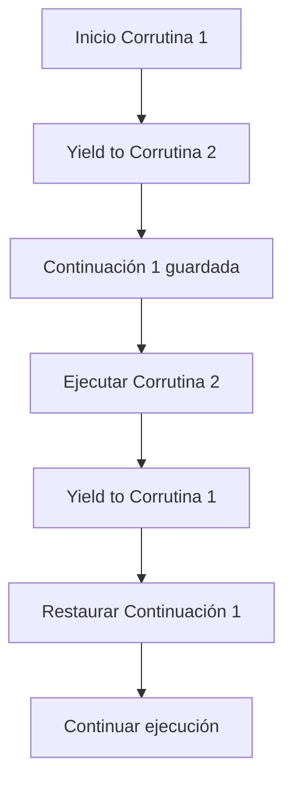
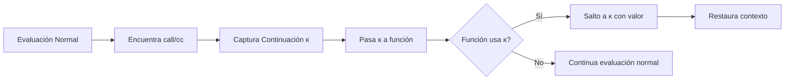

# Lenguajes de Programación - Paradigma imperativo

## 4.6 Continuaciones.

---

Las continuaciones son una poderosa abstracción de control que representan el "resto del cálculo" en un punto dado de la ejecución. Proporcionan un mecanismo general para manejar el flujo de control, excepciones, concurrencia y más.

### Conceptos Fundamentales

#### Definición Formal

Una continuación es una función que representa el contexto de evaluación restante:

$$K: Value \rightarrow Answer$$

Donde:

- $Value$ es el valor que recibirá la continuación
- $Answer$ es el resultado final del cálculo

#### Semántica con Continuaciones

Extendemos la semántica operacional para incluir continuaciones:

$$\langle e, \rho, \kappa \rangle$$

donde:

- $e$: expresión a evaluar
- $\rho$: ambiente
- $\kappa$: continuación actual

### Tipos de Continuaciones

#### Continuación de un Paso (One-Shot)

Representa un único contexto de evaluación.

#### Continuación de Múltiples Pasos (Multi-Shot)

Puede ser invocada múltiples veces.

#### Continuación Delimitada

Opera dentro de un contexto acotado.

### Semántica Formal con Continuaciones

#### Reglas de Evaluación

**Evaluación de constantes**:

$$
\frac{}{\langle n, \rho, \kappa \rangle \rightarrow \kappa(n)}
$$

**Evaluación de variables**:

$$
\frac{}{\langle x, \rho, \kappa \rangle \rightarrow \kappa(\rho(x))}
$$

**Aplicación de función**:

$$
\frac{\langle e_1, \rho, \kappa_1 \rangle \rightarrow v_1 \quad \langle e_2, \rho, \kappa_2 \rangle \rightarrow v_2}{\langle e_1 e_2, \rho, \kappa \rangle \rightarrow \kappa(v_1 v_2)}
$$

donde $\kappa_1$ y $\kappa_2$ son continuaciones intermedias.

### Implementación de Continuaciones

#### Representación de Continuaciones

```python
from typing import Callable, Any

class Continuation:
    def __init__(self, func: Callable[[Any], Any]):
        self.func = func

    def __call__(self, value: Any) -> Any:
        return self.func(value)

# Continuación identidad
identity_cont = Continuation(lambda x: x)

# Continuación que suma 1
add_one_cont = Continuation(lambda x: x + 1)
```

#### Máquina Abstracta con Continuaciones

```python
class ContinuationMachine:
    def __init__(self):
        self.current_cont = identity_cont

    def evaluate(self, expr, env, cont=None):
        if cont is None:
            cont = self.current_cont

        if isinstance(expr, int):
            return cont(expr)

        elif isinstance(expr, str):  # variable
            return cont(env[expr])

        elif expr[0] == 'add':
            _, left, right = expr
            # Evaluar left, luego right, luego sumar
            def left_cont(left_val):
                def right_cont(right_val):
                    return cont(left_val + right_val)
                return self.evaluate(right, env, right_cont)
            return self.evaluate(left, env, left_cont)

        elif expr[0] == 'call/cc':
            # call-with-current-continuation
            _, func_expr = expr
            def capture_cont(current_cont):
                def call_cc_cont(func_val):
                    # Func debe tomar una continuación y un valor
                    return func_val(current_cont, current_cont)
                return self.evaluate(func_expr, env, call_cc_cont)
            return capture_cont(cont)
```

### Aplicaciones de las Continuaciones

#### Manejo de Excepciones

```python
def try_catch(try_block, catch_handler):
    def with_cont(success_cont, exception_cont):
        try:
            result = try_block(success_cont)
            return success_cont(result)
        except Exception as e:
            return catch_handler(e, exception_cont)
    return with_cont

# Ejemplo de uso
def divide(a, b, cont):
    if b == 0:
        raise ValueError("División por cero")
    return cont(a / b)

def handle_error(error, cont):
    print(f"Error: {error}")
    return cont(0)  # Valor por defecto

# Usando continuaciones para manejo de errores
result = try_catch(lambda cont: divide(10, 0, cont), handle_error)(print)
```

#### Corrutinas y Concurrencia



### call/cc (call-with-current-continuation)

#### Definición

`call/cc` captura la continuación actual y la pasa a una función.

$$call/cc = \lambda f. f(\kappa)$$

#### Implementación de call/cc

```scheme
; Ejemplo en Scheme
(let ((x (call/cc (lambda (k) k))))
  (x (lambda (ignore) "hola")))
```

```python
# Implementación en Python-like
def call_with_current_continuation(func):
    """
    call/cc captura la continuación actual
    y la pasa a la función func
    """
    def captured_cont(value):
        # Esta es la continuación capturada
        nonlocal current_continuation
        current_continuation = captured_cont
        return value

    return func(captured_cont)
```

### Semántica CPS (Continuation-Passing Style)

#### Transformación a CPS

La transformación CPS convierte todo el código a forma de paso de continuaciones.

**Transformación para expresiones simples**:

$$CPS(n) = \lambda k. k(n)$$

$$CPS(x) = \lambda k. k(x)$$

**Transformación para aplicación**:

$$CPS(e_1 e_2) = \lambda k. CPS(e_1)(\lambda f. CPS(e_2)(\lambda a. f a k))$$

#### Ejemplo de Transformación

```python
# Código original
def factorial(n):
    if n == 0:
        return 1
    else:
        return n * factorial(n - 1)

# Transformado a CPS
def factorial_cps(n, cont):
    if n == 0:
        return cont(1)
    else:
        return factorial_cps(n - 1, lambda result: cont(n * result))

# Uso
factorial_cps(5, lambda result: print(result))  # 120
```

### Ejercicios Propuestos

#### Ejercicio 1: Implementación de call/cc

Implemente `call/cc` en Python usando excepciones para simular continuaciones:

```python
class ContinuationException(Exception):
    def __init__(self, cont, value):
        self.cont = cont
        self.value = value

def call_cc(func):
    def captured_cont(value):
        raise ContinuationException(captured_cont, value)
    try:
        return func(captured_cont)
    except ContinuationException as e:
        return e.cont(e.value)
```

#### Ejercicio 2: Transformación CPS

Transforme las siguientes expresiones a CPS:

1. `x + y * z`
2. `if p then a else b`
3. `f(g(x), h(y))`

#### Ejercicio 3: Manejador de Excepciones con Continuaciones

Implemente un sistema de manejo de excepciones usando continuaciones:

```python
class ExceptionHandler:
    def __init__(self):
        self.handlers = {}

    def try_block(self, block, cont):
        # Implementar usando continuaciones
        pass

    def catch(self, exception_type, handler):
        # Registrar manejador
        pass
```

### Diagrama de Flujo de Continuaciones



### Aplicaciones Avanzadas

#### Generadores y Corrutinas

```python
def generator(cont):
    yield 1
    # La continuación captura el punto de yield
    result = yield 2
    yield result + 3

# Los generadores son una forma de continuaciones delimitadas
gen = generator()
print(next(gen))  # 1
print(next(gen))  # 2
print(gen.send(10))  # 13
```

#### Backtracking con Continuaciones

```python
def backtracking_solver(choices, constraint):
    def solve(remaining, solution, success_cont, failure_cont):
        if not remaining:
            if constraint(solution):
                return success_cont(solution)
            else:
                return failure_cont()

        choice, *rest = remaining
        for value in choices:
            new_solution = solution + [value]
            # Si falla, continuamos con el siguiente valor
            try:
                return solve(rest, new_solution, success_cont, failure_cont)
            except:
                continue
        return failure_cont()

    return solve
```

### Referencias Bibliográficas

#### Bibliografía Básica

1. Mitchell, J. (2003). _Concepts in Programming Languages_. Cambridge University Press. (Capítulo 8: Control in Programming Languages)
2. Pierce, B.C. (2002). _Types and Programming Languages_. MIT Press. (Capítulo: Continuations)

#### Bibliografía Complementaria

3. Friedman, D.P., Wand, M. (2008). _Essentials of Programming Languages_. 3rd edition. MIT Press. (Capítulo: Continuations)
4. Reynolds, J.C. (1993). _The Discoveries of Continuations_. LISP and Symbolic Computation

### Evaluación del Tema

1. ¿Cómo difieren las continuaciones de las excepciones en el manejo de flujo de control?
2. Explique la diferencia entre continuaciones one-shot y multi-shot
3. ¿Qué ventajas ofrece la transformación CPS para la compilación?
4. ¿Cómo implementaría threads cooperativos usando continuaciones?

### Conclusión

Las continuaciones proporcionan una abstracción poderosa y uniforme para el control de flujo. Permiten implementar características avanzadas como excepciones, backtracking, corrutinas y más. Aunque pueden ser complejas de entender inicialmente, ofrecen una perspectiva unificada sobre la evaluación de programas.
