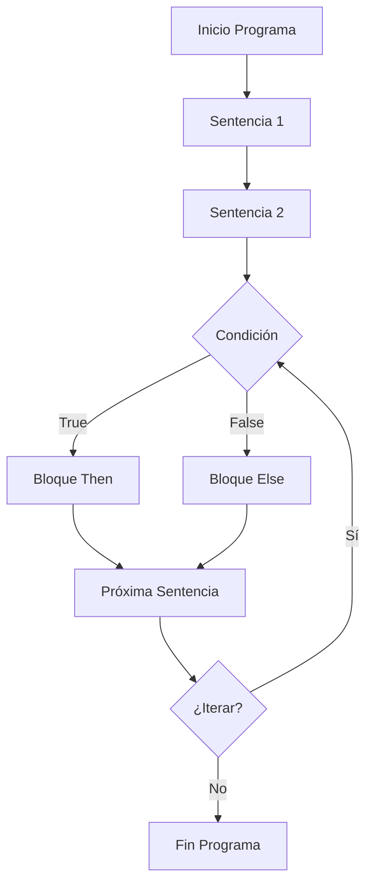
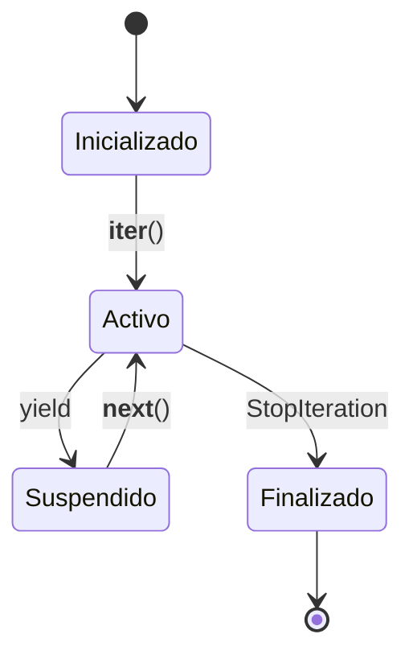

# Lenguajes de Programación - Paradigma imperativo

## 4.7 Estructuras de control simples; iteradores.

---

Las estructuras de control son fundamentales en el paradigma imperativo, permitiendo dirigir el flujo de ejecución de un programa. Los iteradores proporcionan un mecanismo para recorrer colecciones de datos de manera abstracta y controlada.

### Estructuras de Control Simples

#### Definición Formal

Una estructura de control es un constructo sintáctico que determina el orden de ejecución de las sentencias. Formalmente, podemos representar el flujo de control como:

$$P = S_1; S_2; \ldots; S_n$$
donde $;$ denota secuenciación.

#### Secuenciación

La ejecución secuencial se define mediante la regla:

$$
\frac{\langle S_1, s \rangle \rightarrow s' \quad \langle S_2, s' \rangle \rightarrow s''}{\langle S_1; S_2, s \rangle \rightarrow s''}
$$

#### Estructuras Condicionales

##### If-Then-Else

**Semántica formal**:

$$
\frac{\langle e, s \rangle \Downarrow true \quad \langle S_1, s \rangle \rightarrow s'}{\langle \texttt{if } e \texttt{ then } S_1 \texttt{ else } S_2, s \rangle \rightarrow s'}
$$

$$
\frac{\langle e, s \rangle \Downarrow false \quad \langle S_2, s \rangle \rightarrow s'}{\langle \texttt{if } e \texttt{ then } S_1 \texttt{ else } S_2, s \rangle \rightarrow s'}
$$

**Implementación**:

```python
# Estructura if-then-else básica
x = 10
if x > 5:
    resultado = "mayor"
else:
    resultado = "menor"
```

##### Switch-Case

```python
# Estructura switch mediante if-elif-else
dia = 3
if dia == 1:
    nombre = "Lunes"
elif dia == 2:
    nombre = "Martes"
elif dia == 3:
    nombre = "Miércoles"
else:
    nombre = "Otro día"
```

#### Estructuras Iterativas

##### While Loop

**Semántica formal**:

$$
\frac{\langle e, s \rangle \Downarrow true \quad \langle S, s \rangle \rightarrow s' \quad \langle \texttt{while } e \texttt{ do } S, s' \rangle \rightarrow s''}{\langle \texttt{while } e \texttt{ do } S, s \rangle \rightarrow s''}
$$

$$
\frac{\langle e, s \rangle \Downarrow false}{\langle \texttt{while } e \texttt{ do } S, s \rangle \rightarrow s}
$$

**Implementación**:

```python
# Ejemplo while
contador = 0
while contador < 5:
    print(contador)
    contador += 1
```

##### For Loop

```python
# For loop tradicional
for i in range(5):
    print(i)

# For each loop
frutas = ["manzana", "banana", "cereza"]
for fruta in frutas:
    print(fruta)
```

### Iteradores

#### Definición Formal

Un iterador es una estructura que implementa la interfaz:

$$Iterator = (hasNext: () \rightarrow Boolean, next: () \rightarrow T)$$

#### Protocolo de Iteración

**Semántica de iteración**:

$$
\frac{\langle it.hasNext(), s \rangle \Downarrow true \quad \langle body, s[x \mapsto it.next()] \rangle \rightarrow s' \quad \langle \texttt{for } x \texttt{ in } it, s' \rangle \rightarrow s''}{\langle \texttt{for } x \texttt{ in } it, s \rangle \rightarrow s''}
$$

$$
\frac{\langle it.hasNext(), s \rangle \Downarrow false}{\langle \texttt{for } x \texttt{ in } it, s \rangle \rightarrow s}
$$

#### Implementación de Iteradores

```python
class MiIterador:
    def __init__(self, datos):
        self.datos = datos
        self.indice = 0

    def __iter__(self):
        return self

    def __next__(self):
        if self.indice >= len(self.datos):
            raise StopIteration
        resultado = self.datos[self.indice]
        self.indice += 1
        return resultado

# Uso del iterador
iterador = MiIterador([1, 2, 3, 4, 5])
for elemento in iterador:
    print(elemento)
```

### Diagrama de Flujo de Control



### Semántica Operacional Extendida

#### Reglas para Estructuras Compuestas

**Secuencia de sentencias**:

$$
\frac{\langle S_1, s \rangle \rightarrow s_1 \quad \langle S_2, s_1 \rangle \rightarrow s_2 \quad \cdots \quad \langle S_n, s_{n-1} \rangle \rightarrow s_n}{\langle S_1; S_2; \ldots; S_n, s \rangle \rightarrow s_n}
$$

**Bloque de código**:

$$
\frac{\langle S^*, s \rangle \rightarrow s'}{\langle \{ S^* \}, s \rangle \rightarrow s'}
$$

### Generadores e Iteradores Lazy

#### Generadores en Python

```python
def generador_numeros(n):
    """Generador que produce números del 0 a n-1"""
    i = 0
    while i < n:
        yield i  # Pausa la ejecución y devuelve el valor
        i += 1

# Uso del generador
for numero in generador_numeros(5):
    print(numero)
```

#### Semántica de Yield

La sentencia `yield` transforma una función en un generador, creando una máquina de estados:

$$
\langle yield\ e, s, \kappa \rangle \rightarrow \kappa(v, \langle rest, s' \rangle)
$$

donde $\langle rest, s' \rangle$ representa el estado suspendido.

### Ejemplos Avanzados

#### Iterador con Estado Complejo

```python
class IteradorFibonacci:
    def __init__(self, maximo):
        self.maximo = maximo
        self.a, self.b = 0, 1
        self.contador = 0

    def __iter__(self):
        return self

    def __next__(self):
        if self.contador >= self.maximo:
            raise StopIteration
        if self.contador == 0:
            resultado = self.a
        else:
            resultado = self.a
            self.a, self.b = self.b, self.a + self.b
        self.contador += 1
        return resultado

# Uso
for num in IteradorFibonacci(10):
    print(num)
```

#### Estructuras de Control Anidadas

```python
# Ejemplo complejo con estructuras anidadas
for i in range(3):
    print(f"Outer loop: {i}")
    j = 0
    while j < 2:
        if i % 2 == 0:
            print(f"  Even: {i}, {j}")
        else:
            print(f"  Odd: {i}, {j}")
        j += 1
```

### Ejercicios Propuestos

#### Ejercicio 1: Implementación de Máquina de Control

Implemente una máquina abstracta que ejecute estructuras de control:

```python
class ControlFlowMachine:
    def __init__(self):
        self.state = {}

    def execute_if(self, condition, then_block, else_block):
        # Implementar semántica de if-then-else
        pass

    def execute_while(self, condition, body):
        # Implementar semántica de while
        pass

    def execute_for(self, iterator, variable, body):
        # Implementar semántica de for
        pass
```

#### Ejercicio 2: Análisis Semántico

Analice el siguiente código y trace su ejecución:

```python
x = 0
y = 5
while x < y:
    if x % 2 == 0:
        print(f"{x} es par")
    else:
        print(f"{x} es impar")
    x += 1
```

#### Ejercicio 3: Implementación de Iteradores

Implemente un iterador que:

1. Recorra una matriz en espiral
2. Genere números primos lazy
3. Implemente el patrón Iterator para un árbol binario

### Optimizaciones de Control Flow

#### Loop Unrolling

```python
# Original
for i in range(4):
    procesar(i)

# Desenrollado
procesar(0)
procesar(1)
procesar(2)
procesar(3)
```

#### Branch Prediction

Análisis estático de condiciones para optimizar saltos.

### Referencias Bibliográficas

#### Bibliografía Básica

1. Mitchell, J. (2003). _Concepts in Programming Languages_. Cambridge University Press. (Capítulo 3: Control Structures)
2. Pierce, B.C. (2002). _Types and Programming Languages_. MIT Press. (Capítulo: Operational Semantics)

#### Bibliografía Complementaria

3. Scott, M.L. (2009). _Programming Language Pragmatics_. (Capítulo 6: Control Flow)
4. Friedman, D.P., Wand, M. (2008). _Essentials of Programming Languages_. (Capítulo 5: Control)

### Evaluación del Tema

1. ¿Cómo difieren las semánticas de `while` y `for` en términos de poder expresivo?
2. ¿Qué ventajas ofrecen los iteradores sobre el acceso directo a arrays?
3. Compare el mecanismo de `yield` con las continuaciones
4. ¿Cómo se implementarían excepciones usando estructuras de control?

### Diagrama de Estados de Iterador



### Conclusión

Las estructuras de control simples y los iteradores son componentes esenciales del paradigma imperativo. Proporcionan los mecanismos básicos para dirigir el flujo de ejecución y manipular colecciones de datos. Su comprensión semántica es fundamental para el diseño e implementación de lenguajes de programación.
