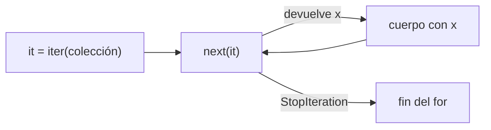

# Lenguajes de Programación - Paradigma imperativo

## 4.7 Estructuras de control simples; iteradores.

---

Las **estructuras de control** deciden qué instrucción se ejecuta después. En los primeros lenguajes había solo saltos condicionales e incondicionales, `goto`; la **programación estructurada**, a partir de la carta de Dijkstra de 1968 y del teorema de Böhm y Jacopini de 1966, mostró que bastan tres formas, la **secuencia**, la **selección** y la **iteración**, para expresar cualquier algoritmo, con programas más fáciles de leer y de verificar. Este tema da la semántica de esas estructuras, sus variantes en los lenguajes actuales y los **iteradores**, que separan el recorrido de una colección del uso de sus elementos.

### Semántica

Con la semántica operacional de paso pequeño y el estado $\sigma$ del tema 4.3:

$$ \begin{aligned} \langle s_1; s_2, \sigma \rangle &\to \langle s_1'; s_2, \sigma' \rangle \quad \text{si } \langle s_1, \sigma \rangle \to \langle s_1', \sigma' \rangle \\ \langle \mathsf{if}\ b\ \mathsf{then}\ s_1\ \mathsf{else}\ s_2, \sigma \rangle &\to \langle s_1, \sigma \rangle \quad \text{si } [\![ b ]\!]\sigma = \mathsf{V} \\ \langle \mathsf{if}\ b\ \mathsf{then}\ s_1\ \mathsf{else}\ s_2, \sigma \rangle &\to \langle s_2, \sigma \rangle \quad \text{si } [\![ b ]\!]\sigma = \mathsf{F} \\ \langle \mathsf{while}\ b\ \mathsf{do}\ s, \sigma \rangle &\to \langle \mathsf{if}\ b\ \mathsf{then}\ (s; \mathsf{while}\ b\ \mathsf{do}\ s)\ \mathsf{else}\ \mathsf{skip}, \sigma \rangle \end{aligned} $$

La regla del `while` lo define por **despliegue**: un ciclo es un condicional que, si la guarda vale, ejecuta el cuerpo y vuelve a ser el mismo ciclo. En la semántica denotacional, el significado del ciclo es el menor punto fijo de esa ecuación, y un ciclo que no termina denota la función indefinida en ese estado. Para razonar sobre un ciclo se usa un **invariante**, como en la regla de Hoare del tema 2.3, y para probar que termina, una **función de cota** entera, no negativa, que disminuye en cada vuelta.

### Selección e iteración en los lenguajes

- **Condicionales:** `if`, con `else if` encadenados, y la selección múltiple `switch` o `case`, que se compila con una **tabla de saltos** cuando los casos son enteros cercanos, en tiempo constante. En C, los casos "caen" al siguiente si falta `break`, una fuente de errores clásica; Python 3.10 agregó `match`, que compara contra **patrones** estructurales, como en los lenguajes funcionales.
- **Ciclos con guarda:** `while`, que evalúa la guarda antes del cuerpo y puede ejecutarlo cero veces, y `do … while` o `repeat … until`, que la evalúa después y lo ejecuta al menos una vez.
- **Ciclos con contador:** el `for` de Pascal o Fortran fija el número de vueltas al entrar y prohíbe modificar la variable de control; el `for` de C es un `while` con inicialización e incremento, sin esas garantías.
- **Salidas:** `break` sale del ciclo, `continue` pasa a la siguiente vuelta, y algunos lenguajes, como Java y Rust, permiten etiquetar los ciclos para salir de varios niveles. Son saltos restringidos, que conservan la estructura: siempre van al final de una construcción que los contiene.
- **Evaluación en cortocircuito:** en `a and b`, si `a` es falso, `b` no se evalúa. Es una estructura de control dentro de las expresiones, que permite `p is not None and p.v > 0`.

### Iteradores

Un **iterador** produce los elementos de una colección uno a la vez, sin exponer su representación. En Python, un objeto es **iterable** si `__iter__` devuelve un iterador, y un iterador implementa `__next__`, que devuelve el siguiente elemento o lanza `StopIteration`. El `for` es azúcar sintáctica:

```python
it = iter(coleccion)
while True:
    try:
        x = next(it)
    except StopIteration:
        break
    cuerpo(x)
```

Hay dos formas de escribir iteradores:

- **Externos**, como clase: el estado del recorrido vive en atributos y quien usa el iterador controla cuándo pide el siguiente. Es el patrón *Iterator* de Gamma y otros, y el de Java con `hasNext` y `next`.
- **Generadores**, como función con `yield`: el estado vive en las variables locales de la función, que se **suspende** en cada `yield` y se reanuda en el siguiente `next`. Es una continuación de un solo uso (tema 4.6), introducida por CLU en 1975 e incorporada a Python, C#, JavaScript y Kotlin.

Un iterador puede ser **perezoso** e infinito: produce el siguiente elemento solo cuando se pide, como los flujos del tema 3.2, y se combina con `islice`, `takewhile` y similares. Los **iteradores internos** invierten el control: la colección recibe una función y la aplica a cada elemento, como `forEach`, y la salida temprana requiere excepciones o continuaciones.



### Implementación en Python

El programa implementa la máquina de control del ejercicio 1, con `while` y `for` definidos como en las reglas y un límite de pasos que detecta ciclos largos, y la usa para trazar el programa del ejercicio 2. Para el ejercicio 3 implementa el recorrido en espiral como generador y lo comprueba en 25 formas de matriz, una criba de Eratóstenes incremental que produce primos sin cota, y un árbol binario de búsqueda con un iterador inorden externo, con una pila explícita, y uno preorden como generador.

```python
import heapq
from itertools import islice

# ---------- Ejercicio 1: máquina de control sobre un estado explícito ----------
class ControlFlowMachine:
    """Los bloques y condiciones son funciones del estado; la máquina cuenta pasos para detectar ciclos largos."""
    def __init__(self, limite=10_000): self.state, self.pasos, self.limite, self.salida = {}, 0, limite, []
    def _paso(self):
        self.pasos += 1
        if self.pasos > self.limite: raise RuntimeError(f"más de {self.limite} pasos: ¿ciclo infinito?")
    def execute_if(self, condition, then_block, else_block=None):
        self._paso()
        if condition(self.state): then_block(self)
        elif else_block: else_block(self)
    def execute_while(self, condition, body):
        # while c do s  ≡  if c then (s; while c do s)  — desplegado en un ciclo, no en recursión
        while True:
            self._paso()
            if not condition(self.state): return
            body(self)
    def execute_for(self, iterator, variable, body):
        it = iter(iterator)                       # for x in it  ≡  it := iter(e); while hay siguiente: x := next(it); s
        while True:
            self._paso()
            try: self.state[variable] = next(it)
            except StopIteration: return
            body(self)
    def asigna(self, var, f): self._paso(); self.state[var] = f(self.state)
    def imprime(self, f): self.salida.append(f(self.state))

# ---------- Ejercicio 2: la traza del programa ----------
m = ControlFlowMachine(); m.state.update(x=0, y=5)
traza = []
def cuerpo(mq):
    traza.append(dict(mq.state))
    mq.execute_if(lambda s: s["x"] % 2 == 0, lambda q: q.imprime(lambda s: f"{s['x']} es par"),
                  lambda q: q.imprime(lambda s: f"{s['x']} es impar"))
    mq.asigna("x", lambda s: s["x"] + 1)
m.execute_while(lambda s: s["x"] < s["y"], cuerpo)
print("ejercicio 2: salida", m.salida)
print("   estado al entrar a cada vuelta:", [(t["x"], t["y"]) for t in traza], "| final", m.state, "| vueltas", len(traza),
      "| evaluaciones de la guarda", len(traza) + 1)
m2 = ControlFlowMachine(); m2.state["total"] = 0
m2.execute_for(range(1, 6), "i", lambda q: q.asigna("total", lambda s: s["total"] + s["i"] ** 2))
print("   for i in 1..5: total += i² ->", m2.state["total"], "| i queda en", m2.state["i"])
m3 = ControlFlowMachine(limite=100); m3.state["x"] = 0
try: m3.execute_while(lambda s: s["x"] >= 0, lambda q: q.asigna("x", lambda s: s["x"] + 1))
except RuntimeError as e: print("   while x >= 0: x += 1 ->", e)

# ---------- Ejercicio 3.1: recorrido en espiral ----------
def espiral(mat):
    if not mat: return
    arriba, abajo, izq, der = 0, len(mat) - 1, 0, len(mat[0]) - 1
    while arriba <= abajo and izq <= der:
        for j in range(izq, der + 1): yield mat[arriba][j]
        for i in range(arriba + 1, abajo + 1): yield mat[i][der]
        if arriba < abajo:
            for j in range(der - 1, izq - 1, -1): yield mat[abajo][j]
        if izq < der:
            for i in range(abajo - 1, arriba, -1): yield mat[i][izq]
        arriba, abajo, izq, der = arriba + 1, abajo - 1, izq + 1, der - 1
M = [[1, 2, 3, 4], [5, 6, 7, 8], [9, 10, 11, 12]]
print("ejercicio 3.1: espiral 3x4:", list(espiral(M)), "| 1x3:", list(espiral([[1, 2, 3]])), "| 3x1:", list(espiral([[1], [2], [3]])))
for n in range(1, 6):
    for c in range(1, 6):
        A = [[i * c + j for j in range(c)] for i in range(n)]
        assert sorted(espiral(A)) == list(range(n * c))       # cada elemento exactamente una vez
print("   comprobado en las 25 formas de 1x1 a 5x5: cada elemento aparece una sola vez")

# ---------- Ejercicio 3.2: primos perezosos, criba incremental ----------
def primos():
    """Criba de Eratóstenes sin cota: para cada compuesto pendiente guarda el siguiente múltiplo de su primo."""
    yield 2
    pendientes = []                               # montículo de (siguiente múltiplo impar, 2p)
    n = 3
    while True:
        if not pendientes or pendientes[0][0] > n:
            yield n; heapq.heappush(pendientes, (n * n, 2 * n))   # el primer múltiplo que importa es p²
        else:
            while pendientes[0][0] == n:
                m_, paso = heapq.heappop(pendientes); heapq.heappush(pendientes, (m_ + paso, paso))
        n += 2
print("ejercicio 3.2: primeros 15 primos:", list(islice(primos(), 15)))
gen = primos(); print("   el primo 1000 es", next(islice(gen, 999, None)), "| y el siguiente", next(gen), "(el generador conserva su estado)")

# ---------- Ejercicio 3.3: patrón Iterator para un árbol binario ----------
class Nodo:
    def __init__(self, v, izq=None, der=None): self.v, self.izq, self.der = v, izq, der
class IteradorInorden:
    """Pila explícita: memoria O(altura) y cada __next__ cuesta O(1) amortizado."""
    def __init__(self, raiz): self.pila = []; self._baja(raiz)
    def _baja(self, n):
        while n: self.pila.append(n); n = n.izq
    def __iter__(self): return self
    def __next__(self):
        if not self.pila: raise StopIteration
        n = self.pila.pop(); self._baja(n.der); return n.v
class ArbolBinario:
    def __init__(self): self.raiz = None
    def inserta(self, v):
        if not self.raiz: self.raiz = Nodo(v); return
        n = self.raiz
        while True:
            lado = "izq" if v < n.v else "der"
            if getattr(n, lado) is None: setattr(n, lado, Nodo(v)); return
            n = getattr(n, lado)
    def __iter__(self): return IteradorInorden(self.raiz)
    def preorden(self):                           # con un generador, la pila la maneja Python
        pila = [self.raiz] if self.raiz else []
        while pila:
            n = pila.pop(); yield n.v
            if n.der: pila.append(n.der)
            if n.izq: pila.append(n.izq)
t = ArbolBinario()
for v in (50, 30, 70, 20, 40, 60, 80, 35, 45): t.inserta(v)
print("ejercicio 3.3: inorden", list(t), "| preorden", list(t.preorden()))
it = iter(t); a, b = next(it), next(it)
print("   dos iteradores independientes:", a, b, "y otro nuevo empieza en", next(iter(t)))
it, maxima = iter(t), 0
for _ in range(9): maxima = max(maxima, len(it.pila)); next(it)
print("   altura del árbol 4, máximo de nodos en la pila:", maxima)
cadena = Nodo(0); n = cadena
for v in range(1, 3000): n.izq = Nodo(v); n = n.izq      # una rama izquierda de 3000 nodos, más que el límite de recursión
print("   árbol degenerado de 3000 nodos: el iterador con pila explícita recorre", sum(1 for _ in IteradorInorden(cadena)),
      "nodos; un recorrido recursivo excedería el límite de", __import__("sys").getrecursionlimit())
```

Salida:

```text
ejercicio 2: salida ['0 es par', '1 es impar', '2 es par', '3 es impar', '4 es par']
   estado al entrar a cada vuelta: [(0, 5), (1, 5), (2, 5), (3, 5), (4, 5)] | final {'x': 5, 'y': 5} | vueltas 5 | evaluaciones de la guarda 6
   for i in 1..5: total += i² -> 55 | i queda en 5
   while x >= 0: x += 1 -> más de 100 pasos: ¿ciclo infinito?
ejercicio 3.1: espiral 3x4: [1, 2, 3, 4, 8, 12, 11, 10, 9, 5, 6, 7] | 1x3: [1, 2, 3] | 3x1: [1, 2, 3]
   comprobado en las 25 formas de 1x1 a 5x5: cada elemento aparece una sola vez
ejercicio 3.2: primeros 15 primos: [2, 3, 5, 7, 11, 13, 17, 19, 23, 29, 31, 37, 41, 43, 47]
   el primo 1000 es 7919 | y el siguiente 7927 (el generador conserva su estado)
ejercicio 3.3: inorden [20, 30, 35, 40, 45, 50, 60, 70, 80] | preorden [50, 30, 20, 40, 35, 45, 70, 60, 80]
   dos iteradores independientes: 20 30 y otro nuevo empieza en 20
   altura del árbol 4, máximo de nodos en la pila: 3
   árbol degenerado de 3000 nodos: el iterador con pila explícita recorre 3000 nodos; un recorrido recursivo excedería el límite de 1000
```

### Ejercicios Propuestos

1. **Máquina de control.** Implementa una máquina abstracta que ejecute estructuras de control:

    ```python
    class ControlFlowMachine:
        def __init__(self):
            self.state = {}
        def execute_if(self, condition, then_block, else_block):
            pass
        def execute_while(self, condition, body):
            pass
        def execute_for(self, iterator, variable, body):
            pass
    ```

2. **Traza.** Traza la ejecución de

    ```python
    x = 0
    y = 5
    while x < y:
        if x % 2 == 0:
            print(f"{x} es par")
        else:
            print(f"{x} es impar")
        x += 1
    ```

3. **Iteradores.** Implementa iteradores que recorran una matriz en espiral, generen números primos de forma perezosa y recorran un árbol binario con el patrón *Iterator*.

### Soluciones

**Ejercicio 1.** Es la clase del programa. Las condiciones y los bloques son funciones del estado, y cada construcción sigue su regla: `execute_while` evalúa la guarda, y si vale ejecuta el cuerpo y repite, que es el despliegue de la regla escrito como ciclo para no consumir la pila de Python; `execute_for` obtiene un iterador, asigna cada elemento a la variable y termina con `StopIteration`, exactamente la traducción del `for` de la sección de iteradores. Como en Python, la variable de control conserva el último valor al terminar, `i` queda en 5; en Pascal su valor queda indefinido, y en C++ o Java, declarada en el `for`, deja de existir. El contador de pasos convierte un ciclo infinito en un error, una protección que un intérprete real no puede ofrecer en general, porque decidir si un ciclo termina es indecidible.

**Ejercicio 2.** El estado inicial es $[x \mapsto 0, y \mapsto 5].$ La guarda $x \lt y$ vale al entrar con $x = 0, 1, 2, 3, 4;$ en cada vuelta, el condicional elige la rama por la paridad de $x$ y después $x$ aumenta en 1. La salida es

```text
0 es par
1 es impar
2 es par
3 es impar
4 es par
```

Con $x = 5$ la guarda es falsa y el ciclo termina en $[x \mapsto 5, y \mapsto 5]:$ cinco vueltas y seis evaluaciones de la guarda. La terminación se prueba con la función de cota $y - x,$ que vale 5 al entrar, es un entero no negativo mientras la guarda vale y disminuye en 1 en cada vuelta. El invariante $0 \le x \le y$ junto con la negación de la guarda da $x = y$ al salir.

**Ejercicio 3.**

1. **Espiral.** El generador mantiene cuatro bordes, `arriba`, `abajo`, `izq` y `der`, recorre la fila superior, la columna derecha, la fila inferior al revés y la columna izquierda hacia arriba, y encoge los bordes. Las dos condiciones `arriba < abajo` e `izq < der` evitan repetir elementos cuando queda una sola fila o columna, el error habitual de esta función; el programa lo comprueba en todas las matrices de $1 \times 1$ a $5 \times 5.$
2. **Primos perezosos.** La criba de Eratóstenes clásica necesita una cota. La versión incremental guarda, para cada primo $p$ encontrado, su siguiente múltiplo impar pendiente en un montículo, empezando en $p^2,$ porque los múltiplos menores ya tienen un factor primo menor. Un impar $n$ es primo si no es el mínimo del montículo; si lo es, se avanzan los múltiplos que coinciden con $n.$ Cada primo cuesta $O(\log k)$ por operación del montículo, con $k$ los primos guardados, y el generador conserva su estado entre llamadas: el primo 1000 es 7919, y el siguiente, 7927.
3. **Árbol binario.** El iterador inorden externo guarda en una pila el camino de nodos pendientes: al crearse baja por la izquierda desde la raíz, y cada `__next__` saca un nodo, baja por la izquierda desde su hijo derecho y devuelve el valor. La memoria es $O(h),$ con $h$ la altura, y cada nodo entra y sale de la pila una vez, así que recorrer el árbol completo cuesta $O(n)$ y cada `__next__` cuesta $O(1)$ amortizado. Un recorrido recursivo es más corto de escribir, pero en un árbol degenerado de 3000 nodos excede el límite de recursión de Python; la pila explícita no tiene ese problema. Cada llamada a `iter` crea un iterador nuevo, de modo que dos recorridos simultáneos son independientes.

### Referencias

1. Dijkstra, E. W., Go To statement considered harmful. _Communications of the ACM_ 11(3), 1968.
2. Böhm, C., and Jacopini, G., Flow diagrams, Turing machines and languages with only two formation rules. _Communications of the ACM_ 9(5), 1966.
3. Liskov, B., Snyder, A., Atkinson, R., and Schaffert, C., Abstraction mechanisms in CLU. _Communications of the ACM_ 20(8), 1977.
4. Gamma, E., Helm, R., Johnson, R., and Vlissides, J., _Design Patterns_. Addison-Wesley, 1994.
5. O'Neill, M. E., The genuine sieve of Eratosthenes. _Journal of Functional Programming_ 19(1), 2009.
