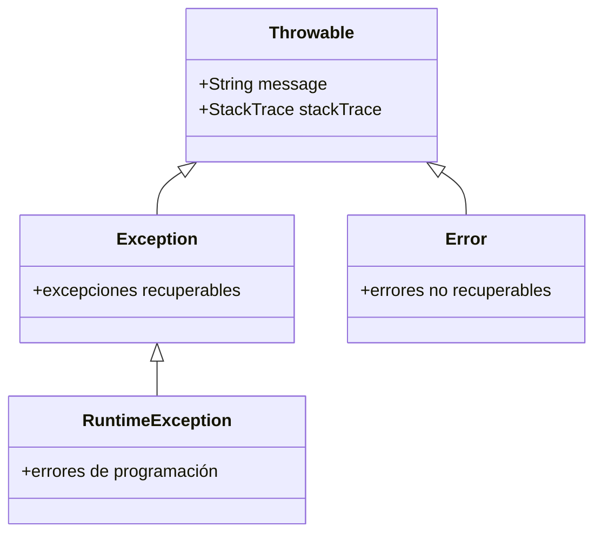
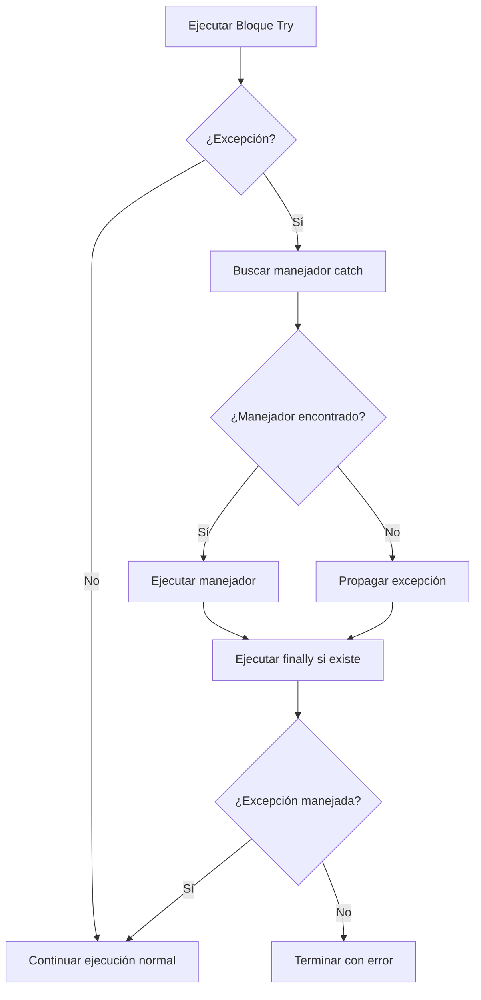

# Lenguajes de Programación - Paradigma imperativo

## 4.8 Manejo de excepciones.

---

El manejo de excepciones es un mecanismo de control de flujo que permite gestionar errores y situaciones excepcionales de manera estructurada, separando la lógica normal del código de manejo de errores.

### Conceptos Fundamentales

#### Definición Formal

Una excepción es una interrupción del flujo normal de ejecución que requiere manejo especial. Formalmente:

$$\text{Exception} = (\text{type}, \text{message}, \text{stack trace})$$

El manejo de excepciones sigue la semántica:

$$ \langle try\ B\ catch\ H, s \rangle \rightarrow \begin{cases} \langle B, s \rangle \rightarrow s' & \text{si no hay excepción} \\\ \langle H(e), s \rangle \rightarrow s' & \text{si } B \text{ lanza } e \end{cases} $$

### Mecanismos Básicos de Excepciones

#### Try-Catch-Finally

**Estructura básica**:
```python
try:
    # Código que puede lanzar excepción
    resultado = operacion_riesgosa()
except TipoExcepcion as e:
    # Manejo de excepción específica
    print(f"Error: {e}")
except OtroTipoExcepcion as e:
    # Manejo de otro tipo
    print(f"Otro error: {e}")
finally:
    # Código que siempre se ejecuta
    print("Limpieza")
```

#### Semántica Operacional

**Regla para try-catch**:

$$ \frac{\langle B, s \rangle \rightarrow s'}{\langle \texttt{try } B \texttt{ catch } H, s \rangle \rightarrow s'} $$

$$ \frac{\langle B, s \rangle \rightarrow \texttt{raise } e \quad \langle H(e), s \rangle \rightarrow s'}{\langle \texttt{try } B \texttt{ catch } H, s \rangle \rightarrow s'} $$

**Regla para finally**:

$$ \frac{\langle B, s \rangle \rightarrow s' \quad \langle F, s' \rangle \rightarrow s''}{\langle \texttt{try } B \texttt{ finally } F, s \rangle \rightarrow s''} $$

$$ \frac{\langle B, s \rangle \rightarrow \texttt{raise } e \quad \langle F, s \rangle \rightarrow s'}{\langle \texttt{try } B \texttt{ finally } F, s \rangle \rightarrow \texttt{raise } e \text{ con } s'} $$

### Tipos de Excepciones

#### Excepciones Verificadas vs No Verificadas

**Excepciones verificadas** (Java):
- Deben ser declaradas o manejadas
- ```java
  public void readFile() throws IOException {
      // código que puede lanzar IOException
  }
  ```

**Excepciones no verificadas** (Python, C++):
- No requieren declaración
- ```python
  def read_file():
      # puede lanzar FileNotFoundError sin declarar
      with open("file.txt") as f:
          return f.read()
  ```

#### Jerarquía de Excepciones



### Implementación de Mecanismos de Excepción

#### Máquina Abstracta con Manejo de Excepciones

```python
class ExceptionMachine:
    def __init__(self):
        self.environment = {}
        self.call_stack = []
        self.exception_handlers = []

    def execute_try(self, try_block, catch_blocks, finally_block=None):
        # Guardar el punto actual en la pila
        current_context = {
            'env': self.environment.copy(),
            'handlers': self.exception_handlers.copy()
        }
        self.call_stack.append(current_context)

        try:
            # Ejecutar el bloque try
            result = self.execute_block(try_block)
            if finally_block:
                self.execute_block(finally_block)
            return result

        except Exception as e:
            # Buscar manejador apropiado
            for exception_type, handler in catch_blocks:
                if isinstance(e, exception_type):
                    self.environment['exception'] = e
                    result = self.execute_block(handler)
                    if finally_block:
                        self.execute_block(finally_block)
                    return result

            # Si no se encuentra manejador, propagar
            if finally_block:
                self.execute_block(finally_block)
            raise e

        finally:
            # Restaurar contexto
            if self.call_stack:
                self.call_stack.pop()

    def throw(self, exception):
        """Lanza una excepción"""
        if self.exception_handlers:
            # Transferir control al manejador
            handler = self.exception_handlers[-1]
            raise exception
        else:
            # Terminar ejecución si no hay manejadores
            raise exception
```

### Semántica Formal Extendida

#### Sistema de Transición de Estados

Extendemos la semántica con contextos de excepción:

$$ \langle S, s, h \rangle \rightarrow \langle s', h' \rangle \mid \texttt{raise } e $$

donde $h$ representa la pila de manejadores.

#### Reglas de Transición

**Throw statement**:

$$ \frac{}{\langle \texttt{throw } e, s, h \rangle \rightarrow \texttt{raise } e} $$

**Try-catch**:

$$ \frac{\langle B, s, h' \rangle \rightarrow \langle s', h'' \rangle}{\langle \texttt{try } B \texttt{ catch } H, s, h \rangle \rightarrow \langle s', h \rangle} $$

$$ \frac{\langle B, s, h' \rangle \rightarrow \texttt{raise } e \quad \langle H(e), s, h \rangle \rightarrow \langle s', h'' \rangle}{\langle \texttt{try } B \texttt{ catch } H, s, h \rangle \rightarrow \langle s', h \rangle} $$

### Patrones de Manejo de Excepciones

#### Resource Acquisition Is Initialization (RAII)

```cpp
// Ejemplo en C++
class FileHandler {
public:
    FileHandler(const std::string& filename) {
        file = fopen(filename.c_str(), "r");
        if (!file) throw std::runtime_error("Cannot open file");
    }

    ~FileHandler() {
        if (file) fclose(file);
    }

private:
    FILE* file;
};

// Uso - limpieza automática incluso con excepciones
void process_file() {
    FileHandler f("data.txt");
    // operaciones que pueden lanzar excepciones
}
```

#### Exception Safety Guarantees

1. **No-throw guarantee**: Operación nunca lanza excepciones
2. **Strong exception safety**: Operación atomica - éxito completo o estado sin cambios
3. **Basic exception safety**: No fugas de recursos, pero estado puede modificarse

### Ejemplos en Diferentes Lenguajes

#### Java: Excepciones Verificadas

```java
public class FileProcessor {
    public void processFile(String filename) throws IOException {
        try (BufferedReader br = new BufferedReader(new FileReader(filename))) {
            String line;
            while ((line = br.readLine()) != null) {
                processLine(line);
            }
        } catch (FileNotFoundException e) {
            throw new IOException("File not found", e);
        }
    }

    private void processLine(String line) {
        if (line == null) {
            throw new IllegalArgumentException("Line cannot be null");
        }
        // procesamiento
    }
}
```

#### Python: Excepciones como Control de Flujo

```python
def find_index(data, target):
    try:
        return data.index(target)
    except ValueError:
        return -1

# Uso de excepciones para control de flujo
def parse_number(s):
    try:
        return int(s)
    except ValueError:
        try:
            return float(s)
        except ValueError:
            raise ValueError(f"Cannot convert '{s}' to number")
```

### Ejercicios Propuestos

#### Ejercicio 1: Implementación de Try-Catch

Implemente un sistema de manejo de excepciones básico:

```python
class ExceptionSystem:
    def __init__(self):
        self.handler_stack = []

    def try_block(self, try_func, catch_handlers, finally_func=None):
        # Implementar semántica de try-catch-finally
        pass

    def throw(self, exception):
        # Implementar lanzamiento de excepción
        pass
```

#### Ejercicio 2: Análisis de Exception Safety

Analice la seguridad de excepciones del siguiente código:

```python
class DatabaseTransaction:
    def __init__(self, db_connection):
        self.db = db_connection
        self.changes = []

    def execute(self, operations):
        try:
            for op in operations:
                result = self.db.execute(op)
                self.changes.append((op, result))
            self.db.commit()
        except Exception as e:
            self.rollback()
            raise e

    def rollback(self):
        for op, result in reversed(self.changes):
            self.db.rollback_operation(op, result)
        self.changes = []
```

#### Ejercicio 3: Diseño de Jerarquía de Excepciones

Diseñe una jerarquía de excepciones para un sistema de archivos:

```python
class FileSystemError(Exception):
    pass

class FileNotFoundError(FileSystemError):
    pass

class PermissionError(FileSystemError):
    pass

class DiskFullError(FileSystemError):
    pass
```

### Diagrama de Flujo de Manejo de Excepciones



### Técnicas Avanzadas

#### Exception Chaining

```python
def process_data(data):
    try:
        return complex_operation(data)
    except CalculationError as e:
        # Preservar excepción original
        raise ProcessingError("Failed to process data") from e
```

#### Custom Exception Classes

```python
class ValidationError(Exception):
    def __init__(self, message, field_name, value):
        super().__init__(message)
        self.field_name = field_name
        self.value = value
        self.timestamp = datetime.now()

    def __str__(self):
        return f"{super().__str__()} (field: {self.field_name}, value: {self.value})"
```

### Referencias Bibliográficas

#### Bibliografía Básica
1. Mitchell, J. (2003). *Concepts in Programming Languages*. Cambridge University Press. (Capítulo 8: Exception Handling)
2. Stroustrup, B. (2013). *The C++ Programming Language*. (Capítulo 13: Exceptions)

#### Bibliografía Complementaria
3. Arnold, K., et al. (2005). *The Java Programming Language*. (Capítulo 8: Exceptions)
4. Goodrich, M.T., et al. (2013). *Data Structures and Algorithms in Python*. (Capítulo 2: Exception Handling)

### Evaluación del Tema

1. ¿Cuáles son las ventajas y desventajas de las excepciones verificadas vs no verificadas?
2. ¿Cómo garantiza RAII la seguridad de excepciones?
3. Explique la diferencia entre `throw`, `throws` y `throw from` en diferentes lenguajes
4. ¿Cuándo es apropiado usar excepciones para control de flujo normal?

### Conclusión

El manejo de excepciones es un mecanismo crucial para construir software robusto y mantenible. Proporciona una separación clara entre la lógica normal del programa y el manejo de errores, permitiendo un control estructurado de situaciones excepcionales. La comprensión de sus semánticas y patrones de uso es esencial para el desarrollo de software confiable.
