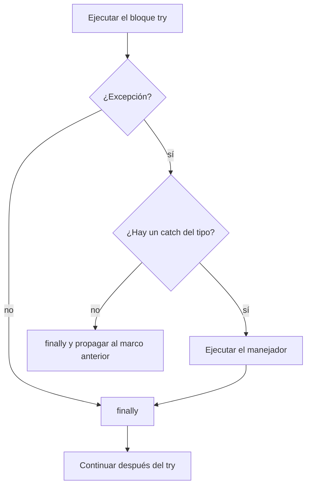

# Lenguajes de Programación - Paradigma imperativo

## 4.8 Manejo de excepciones.

---

Una **excepción** es un evento que impide que una operación termine normalmente: un archivo que no existe, una división entre cero, una conexión perdida. Sin un mecanismo para ellas, cada función debe devolver un código de error y cada llamada debe revisarlo, y el código normal queda mezclado con el de los errores. El **manejo de excepciones** separa ambos: una operación **lanza** la excepción, y el control salta al **manejador** más cercano dispuesto a atenderla, que puede estar varias llamadas más arriba. Este tema da la semántica del mecanismo, sus variantes, la noción de **seguridad ante excepciones** y el diseño de jerarquías de excepciones.

### Semántica

Una ejecución termina **normalmente**, con un valor, o **abruptamente**, con una excepción. Las reglas de una semántica de paso grande con esos dos resultados son:

$$ \begin{aligned} &\frac{\langle s, \sigma \rangle \Downarrow \langle v, \sigma' \rangle}{\langle \mathsf{try}\ s\ \mathsf{catch}\ (E\ x)\ h, \sigma \rangle \Downarrow \langle v, \sigma' \rangle} \qquad \frac{\langle s, \sigma \rangle \Downarrow \langle \mathsf{exc}\ e, \sigma' \rangle \quad e \in E \quad \langle h, \sigma'[x \mapsto e] \rangle \Downarrow r}{\langle \mathsf{try}\ s\ \mathsf{catch}\ (E\ x)\ h, \sigma \rangle \Downarrow r} \\ &\frac{\langle s, \sigma \rangle \Downarrow \langle \mathsf{exc}\ e, \sigma' \rangle \quad e \notin E}{\langle \mathsf{try}\ s\ \mathsf{catch}\ (E\ x)\ h, \sigma \rangle \Downarrow \langle \mathsf{exc}\ e, \sigma' \rangle} \qquad \frac{\langle s_1, \sigma \rangle \Downarrow \langle \mathsf{exc}\ e, \sigma' \rangle}{\langle s_1; s_2, \sigma \rangle \Downarrow \langle \mathsf{exc}\ e, \sigma' \rangle} \end{aligned} $$

La última regla es la **propagación**: una excepción en $s_1$ salta $s_2$ y todo lo que sigue, hasta encontrar un `try` cuyo tipo $E$ la incluya. Los cambios al almacén hechos antes de la excepción **permanecen**: el mecanismo transfiere el control, pero no deshace efectos. Para `finally`, con $r$ el resultado del bloque protegido y $r_f$ el del `finally`, el resultado es $r$ si $r_f$ es normal y $r_f$ si es abrupto: un `return` o una excepción en el `finally` **sustituye** al resultado del bloque, y la excepción original se pierde. En la semántica con continuaciones del tema 4.6, lanzar es invocar la continuación del manejador más cercano, descartando la del punto del error.

### Implementación

En tiempo de ejecución hay una pila de manejadores paralela a la pila de llamadas. Lanzar una excepción la **desenrolla**: se sacan marcos, ejecutando los `finally` de cada uno, hasta llegar al primer marco con un manejador cuyo tipo coincida, y si no hay ninguno, el programa termina con un mensaje. Las implementaciones modernas, como las de C++ y Java, usan **tablas de excepciones** generadas por el compilador, que asocian rangos de código con manejadores, de modo que entrar a un `try` no cuesta nada y el costo se paga solo al lanzar; por eso las excepciones deben reservarse para situaciones excepcionales, no usarse como control de flujo habitual.

### Variantes

- **Terminación o reanudación:** casi todos los lenguajes usan el modelo de **terminación**, en el que el bloque que lanzó se abandona. En el de **reanudación**, como las condiciones de Common Lisp, el manejador puede pedir que la operación continúe, por ejemplo con un valor de reemplazo.
- **Excepciones verificadas:** en Java, un método debe declarar con `throws` las excepciones verificadas que puede lanzar, y el compilador comprueba que quien lo llama las atrape o las declare. Las de `RuntimeException` no se verifican. Ningún lenguaje posterior importante copió el modelo, que obliga a cadenas de declaraciones.
- **Errores como valores:** Rust, Go y los lenguajes funcionales devuelven un valor `Result` u `Option`, o un par valor y error, que el tipo obliga a revisar; el operador `?` de Rust propaga el error con una sola marca. Es el manejo explícito, sin saltos ocultos.
- **Liberación de recursos:** además de `finally`, Python tiene `with`, C# `using`, Java `try` con recursos, y C++ y Rust liberan en los destructores, que se ejecutan al desenrollar la pila (RAII).
- **Encadenamiento:** una excepción lanzada al manejar otra conserva la original, en Python en `__context__`, o en `__cause__` con `raise … from`, y en Java en `getCause`.

### Seguridad ante excepciones

Un código es **seguro ante excepciones** si una excepción no deja el sistema en un estado inválido. Abrahams distingue tres garantías, de más débil a más fuerte:

- **Básica:** se conservan los invariantes y no se fugan recursos, aunque el estado pueda haber cambiado.
- **Fuerte:** la operación es **atómica**, o tiene éxito completo o el estado queda como estaba, igual que una transacción.
- **Sin excepciones:** la operación nunca lanza. Las operaciones de liberación y de reversión deben ofrecerla, porque se ejecutan durante la propagación de otra excepción.



### Implementación en Python

El programa implementa el sistema del ejercicio 1 con una pila de manejadores explícita: `throw` busca el marco con un manejador del tipo y desenrolla hasta él ejecutando los `finally` de los marcos intermedios; muestra también las dos trampas de `finally` en Python. Para el ejercicio 2 ejecuta la transacción del enunciado contra una base de datos simulada que puede fallar, exhibe sus defectos y los compara con una versión corregida. Para el ejercicio 3 muestra el problema de nombres de la jerarquía propuesta y construye una que lo evita.

```python
import builtins, errno

# ---------- Ejercicio 1: try/catch/finally con una pila de manejadores explícita ----------
class ExceptionSystem:
    """throw busca en la pila, de la cima hacia abajo, el primer marco con un manejador del tipo; desenrolla los marcos
    intermedios ejecutando sus finally. Python solo se usa para transportar el salto (como un longjmp)."""
    class _Salto(BaseException):
        def __init__(self, marco, exc): self.marco, self.exc = marco, exc
    def __init__(self): self.handler_stack, self.bitacora = [], []
    def try_block(self, try_func, catch_handlers, finally_func=None):
        marco = {"handlers": catch_handlers, "nivel": len(self.handler_stack)}
        self.handler_stack.append(marco)
        try:
            try:
                resultado = try_func()
            except ExceptionSystem._Salto as s:
                if s.marco is not marco: raise            # va a un marco más abajo: seguir desenrollando
                self.handler_stack.pop(); marco = None    # el manejador corre fuera del try: si lanza, va al de afuera
                tipo = next(t for t in type(s.exc).__mro__ if t in catch_handlers)
                self.bitacora.append(f"atrapa {type(s.exc).__name__} en nivel {len(self.handler_stack)} con el caso {tipo.__name__}")
                resultado = catch_handlers[tipo](s.exc)
            return resultado
        finally:
            if marco is not None: self.handler_stack.pop()
            if finally_func: self.bitacora.append("finally"); finally_func()
    def throw(self, exc):
        for marco in reversed(self.handler_stack):
            if any(isinstance(exc, t) for t in marco["handlers"]): raise ExceptionSystem._Salto(marco, exc)
        raise exc                                           # sin manejador: llega al nivel superior
es = ExceptionSystem()
r = es.try_block(lambda: es.try_block(lambda: es.throw(ValueError("dato inválido")), {KeyError: lambda e: "clave"},
                                      lambda: None),
                 {ValueError: lambda e: f"recuperado de {e}"}, lambda: None)
print("ejercicio 1:", r, "| bitácora:", es.bitacora, "| pila al final:", len(es.handler_stack))
es.bitacora.clear()
r = es.try_block(lambda: es.try_block(lambda: es.throw(ZeroDivisionError("x/0")),
                                      {ArithmeticError: lambda e: es.throw(RuntimeError(f"relanzada: {e}"))}),
                 {RuntimeError: lambda e: str(e)})
print("   el manejador relanza otra excepción:", r, "|", es.bitacora)
try: es.try_block(lambda: es.throw(TypeError("sin manejador")), {KeyError: lambda e: 0}, lambda: print("   finally corre aunque nadie atrape"))
except TypeError as e: print("   llega al nivel superior:", e, "| pila:", len(es.handler_stack))
def f_return_en_finally():                                 # semántica de Python que conviene conocer
    try: return "del try"
    finally: return "del finally"                          # noqa: el return del finally sustituye al del try
def f_excepcion_en_finally():
    try: raise ValueError("original")
    finally: raise KeyError("del finally")                 # sustituye a la original, que queda en __context__
print("   return en finally:", f_return_en_finally(), end=" | ")
try: f_excepcion_en_finally()
except KeyError as e: print("excepción en finally:", repr(e), "y la original queda en __context__:", repr(e.__context__))

# ---------- Ejercicio 2: seguridad de excepciones de DatabaseTransaction ----------
class BD:
    def __init__(self, falla_en=None, falla_rollback=False): self.datos, self.falla_en, self.falla_rollback, self.commits = {}, falla_en, falla_rollback, 0
    def execute(self, op):
        k, v = op
        if k == self.falla_en: raise ValueError(f"error al escribir {k}")
        anterior = self.datos.get(k); self.datos[k] = v; return anterior
    def rollback_operation(self, op, anterior):
        if self.falla_rollback: raise ConnectionError("se perdió la conexión durante el rollback")
        k, _ = op
        if anterior is None: self.datos.pop(k, None)
        else: self.datos[k] = anterior
    def commit(self): self.commits += 1
class DatabaseTransaction:                                 # la versión del enunciado
    def __init__(self, db): self.db, self.changes = db, []
    def execute(self, operations):
        try:
            for op in operations:
                result = self.db.execute(op); self.changes.append((op, result))
            self.db.commit()
        except Exception as e:
            self.rollback(); raise e
    def rollback(self):
        for op, result in reversed(self.changes): self.db.rollback_operation(op, result)
        self.changes = []
db = BD(falla_en="c"); tx = DatabaseTransaction(db)
try: tx.execute([("a", 1), ("b", 2), ("c", 3)])
except ValueError as e: print("ejercicio 2: falla normal ->", e, "| datos tras el rollback:", db.datos)
db = BD(); tx = DatabaseTransaction(db)
tx.execute([("a", 1)]); print("   tras un commit exitoso, changes no se vació:", tx.changes)
db.falla_en = "z"
try: tx.execute([("b", 2), ("z", 0)])
except ValueError: print("   la segunda transacción falla y su rollback deshace también 'a', ya confirmada:", db.datos)
db = BD(falla_en="c", falla_rollback=True); tx = DatabaseTransaction(db)
try: tx.execute([("a", 1), ("b", 2), ("c", 3)])
except Exception as e: print("   si el rollback falla, se lanza", type(e).__name__, "y la causa original queda solo en __context__:", repr(e.__context__))

class TransaccionSegura:
    """Garantía fuerte: o se aplican todas las operaciones o ninguna; nunca se pierde la excepción original."""
    def __init__(self, db): self.db = db
    def execute(self, operations):
        cambios = []                                       # local a cada llamada: no hay estado entre transacciones
        try:
            for op in operations: cambios.append((op, self.db.execute(op)))
            self.db.commit()
        except BaseException as e:                         # también KeyboardInterrupt: no se deja a medias
            errores = []
            for op, anterior in reversed(cambios):
                try: self.db.rollback_operation(op, anterior)
                except Exception as er: errores.append(er)   # se sigue deshaciendo lo demás
            if errores: e.add_note(f"además, {len(errores)} operaciones no se pudieron deshacer: {errores[0]}")
            raise                                          # relanza la original con su traza intacta
for falla_rb in (False, True):
    db = BD(falla_en="c", falla_rollback=falla_rb); tx = TransaccionSegura(db)
    try: tx.execute([("a", 1), ("b", 2), ("c", 3)])
    except ValueError as e: print(f"   segura, rollback {'con' if falla_rb else 'sin'} falla: se propaga", repr(e), "| notas:", getattr(e, "__notes__", []))
db = BD(); tx = TransaccionSegura(db); tx.execute([("a", 1)]); db.falla_en = "z"
try: tx.execute([("b", 2), ("z", 0)])
except ValueError: print("   segura, segunda transacción fallida: 'a' se conserva:", db.datos)

# ---------- Ejercicio 3: jerarquía de excepciones para un sistema de archivos ----------
class FileNotFoundError(Exception): pass                   # el nombre del enunciado...
print("ejercicio 3: con la jerarquía del enunciado, FileNotFoundError ya no es el de Python:", FileNotFoundError is not builtins.FileNotFoundError)
try:
    try: open("/no/existe")
    except FileNotFoundError: print("   atrapada")
except builtins.FileNotFoundError: print("   open() lanza el FileNotFoundError de Python, y el except del módulo ya no lo atrapa")
del FileNotFoundError                                      # se recupera el nombre de Python

class FileSystemError(OSError):
    """Raíz de la jerarquía. Hereda de OSError, como los errores del sistema operativo, y guarda la ruta."""
    def __init__(self, ruta, mensaje=None):
        super().__init__(self.codigo, mensaje or self.__doc__.strip(), ruta)
class ArchivoNoEncontrado(FileSystemError, FileNotFoundError):
    "no existe el archivo"; codigo = errno.ENOENT
class PermisoDenegado(FileSystemError, PermissionError):
    "permiso denegado"; codigo = errno.EACCES
class DiscoLleno(FileSystemError):
    "no queda espacio en el disco"; codigo = errno.ENOSPC
class CuotaExcedida(DiscoLleno):
    "se excedió la cuota del usuario"; codigo = errno.EDQUOT
for exc in (ArchivoNoEncontrado("/datos/a.txt"), PermisoDenegado("/etc/shadow"), CuotaExcedida("/home/u/big.bin")):
    capas = [c.__name__ for c in type(exc).__mro__ if c not in (object, BaseException)]
    print(f"   {type(exc).__name__}: {exc} | errno {exc.errno} ({errno.errorcode[exc.errno]}) | ruta {exc.filename}")
    print(f"      la atrapan: {', '.join(capas)}")
def lee(ruta):
    try: raise ArchivoNoEncontrado(ruta)
    except FileNotFoundError as e: return f"un except FileNotFoundError de Python la atrapa: {e.filename}"
print("  ", lee("/datos/b.txt"))
try: raise DiscoLleno("/var/log/app.log") from builtins.OSError(errno.ENOSPC, "escritura fallida")
except FileSystemError as e: print("   encadenada con from: causa =", repr(e.__cause__))
```

Salida:

```text
ejercicio 1: recuperado de dato inválido | bitácora: ['finally', 'atrapa ValueError en nivel 0 con el caso ValueError', 'finally'] | pila al final: 0
   el manejador relanza otra excepción: relanzada: x/0 | ['atrapa ZeroDivisionError en nivel 1 con el caso ArithmeticError', 'atrapa RuntimeError en nivel 0 con el caso RuntimeError']
   finally corre aunque nadie atrape
   llega al nivel superior: sin manejador | pila: 0
   return en finally: del finally | excepción en finally: KeyError('del finally') y la original queda en __context__: ValueError('original')
ejercicio 2: falla normal -> error al escribir c | datos tras el rollback: {}
   tras un commit exitoso, changes no se vació: [(('a', 1), None)]
   la segunda transacción falla y su rollback deshace también 'a', ya confirmada: {}
   si el rollback falla, se lanza ConnectionError y la causa original queda solo en __context__: ValueError('error al escribir c')
   segura, rollback sin falla: se propaga ValueError('error al escribir c') | notas: []
   segura, rollback con falla: se propaga ValueError('error al escribir c') | notas: ['además, 2 operaciones no se pudieron deshacer: se perdió la conexión durante el rollback']
   segura, segunda transacción fallida: 'a' se conserva: {'a': 1}
ejercicio 3: con la jerarquía del enunciado, FileNotFoundError ya no es el de Python: True
   open() lanza el FileNotFoundError de Python, y el except del módulo ya no lo atrapa
   ArchivoNoEncontrado: [Errno 2] no existe el archivo: '/datos/a.txt' | errno 2 (ENOENT) | ruta /datos/a.txt
      la atrapan: ArchivoNoEncontrado, FileSystemError, FileNotFoundError, OSError, Exception
   PermisoDenegado: [Errno 13] permiso denegado: '/etc/shadow' | errno 13 (EACCES) | ruta /etc/shadow
      la atrapan: PermisoDenegado, FileSystemError, PermissionError, OSError, Exception
   CuotaExcedida: [Errno 122] se excedió la cuota del usuario: '/home/u/big.bin' | errno 122 (EDQUOT) | ruta /home/u/big.bin
      la atrapan: CuotaExcedida, DiscoLleno, FileSystemError, OSError, Exception
   un except FileNotFoundError de Python la atrapa: /datos/b.txt
   encadenada con from: causa = OSError(28, 'escritura fallida')
```

### Ejercicios Propuestos

1. **try/catch.** Implementa un sistema básico de manejo de excepciones:

    ```python
    class ExceptionSystem:
        def __init__(self):
            self.handler_stack = []
        def try_block(self, try_func, catch_handlers, finally_func=None):
            pass
        def throw(self, exception):
            pass
    ```

2. **Seguridad.** Analiza la seguridad ante excepciones de

    ```python
    class DatabaseTransaction:
        def __init__(self, db_connection):
            self.db = db_connection
            self.changes = []

        def execute(self, operations):
            try:
                for op in operations:
                    result = self.db.execute(op)
                    self.changes.append((op, result))
                self.db.commit()
            except Exception as e:
                self.rollback()
                raise e

        def rollback(self):
            for op, result in reversed(self.changes):
                self.db.rollback_operation(op, result)
            self.changes = []
    ```

3. **Jerarquía.** Diseña una jerarquía de excepciones para un sistema de archivos, a partir de:

    ```python
    class FileSystemError(Exception):
        pass

    class FileNotFoundError(FileSystemError):
        pass

    class PermissionError(FileSystemError):
        pass

    class DiskFullError(FileSystemError):
        pass
    ```

### Soluciones

**Ejercicio 1.** Es la clase del programa. `try_block` apila un marco con sus manejadores y ejecuta el bloque. `throw` recorre la pila de la cima hacia abajo, encuentra el primer marco con un manejador cuyo tipo incluya la excepción, y transfiere el control a ese marco; el transporte usa una excepción interna de Python, que hace el papel de `longjmp` en C. Cada marco intermedio que el salto atraviesa ejecuta su `finally` al salir, y por eso, en la primera prueba, la bitácora muestra el `finally` interior **antes** de que el exterior atrape el `ValueError`. Dos detalles de diseño:

- el manejador se ejecuta **después** de sacar su marco de la pila, para que una excepción lanzada dentro del manejador vaya al `try` exterior y no al mismo, como en la segunda prueba;
- el tipo se compara con la jerarquía, recorriendo el MRO, de modo que un caso `ArithmeticError` atrapa `ZeroDivisionError`.

El programa muestra además las trampas del `finally`: un `return` en él descarta el del bloque, y una excepción en él sustituye a la original, que solo sobrevive en `__context__`.

**Ejercicio 2.** El código funciona en el caso simple, una operación que falla se deshace, pero tiene cuatro defectos:

1. **`changes` no se vacía tras el `commit`.** Si una segunda transacción con el mismo objeto falla, el rollback deshace **también** las operaciones de la primera, que ya estaban confirmadas. Es el defecto más grave, y el programa lo muestra: tras confirmar `a` y fallar la segunda transacción, `a` desaparece. La lista debe ser local a cada llamada a `execute`, o vaciarse al confirmar.
2. **Un rollback que falla pierde la excepción original.** Si `rollback_operation` lanza, por ejemplo por una conexión perdida, esa excepción sustituye a la que causó el rollback, que solo queda en `__context__`, y el resto de las operaciones no se deshacen. La reversión debe ofrecer la garantía sin excepciones, o al menos atrapar cada falla, seguir con las demás y adjuntarlas a la excepción original.
3. **`except Exception` no atrapa `KeyboardInterrupt` ni `SystemExit`**, que heredan de `BaseException`: un Ctrl-C durante las operaciones deja la transacción a medias. Hay que atrapar `BaseException`, o usar `finally` con una bandera de éxito.
4. **`raise e` en lugar de `raise`.** En Python 3 ambos conservan la traza, pero `raise e` agrega la línea del `raise` y oscurece el origen; `raise` sin argumento es la forma idiomática de relanzar.

Con las cuatro correcciones, la versión segura del programa ofrece la **garantía fuerte**: o todas las operaciones quedan confirmadas, o el estado es el anterior, y la excepción que llega a quien llamó es la original, con una nota si algo no se pudo deshacer. Si el `commit` mismo falla después de aplicar parte de los cambios en el servidor, ninguna lógica del cliente basta: la atomicidad debe darla la base de datos, con su propio `ROLLBACK`.

**Ejercicio 3.** La jerarquía del enunciado tiene un defecto: `FileNotFoundError` y `PermissionError` ya son excepciones predefinidas de Python, y al declararlas se **ocultan** en el módulo. Un `except FileNotFoundError` del módulo ya no atrapa el error que lanza `open`, como muestra el programa, y el código de fuera que atrapa la de Python no atrapa la del módulo. La jerarquía corregida:

- la raíz `FileSystemError` hereda de `OSError`, la base de los errores del sistema operativo, y guarda la ruta y el código `errno`;
- `ArchivoNoEncontrado` hereda de `FileSystemError` y **también** de `FileNotFoundError`, y `PermisoDenegado` de `PermissionError`, con herencia múltiple, de modo que cualquier código existente que atrapa las de Python las sigue atrapando;
- `DiscoLleno` tiene una subclase `CuotaExcedida`: quien atiende la falta de espacio en general atrapa ambas, y quien necesita distinguir la cuota atrapa la específica;
- cada clase fija su código `errno`, y su cadena de documentación sirve de mensaje.

Los principios: una raíz propia, para que un solo `except` atrape todo lo del módulo; subclases solo donde alguien vaya a **atraparlas por separado**; datos en atributos, no solo en el mensaje, y encadenar con `raise … from` la excepción de bajo nivel que causó la del módulo.

### Referencias

1. Goodenough, J. B., Exception handling: issues and a proposed notation. _Communications of the ACM_ 18(12), 1975.
2. Abrahams, D., Exception-safety in generic components. _Generic Programming_, Springer, 2000.
3. Scott, M. L., _Programming Language Pragmatics_. Morgan Kaufmann, 2015. Capítulo 9.
4. Van Rossum, G., et al., _The Python Language Reference_, sección 8.4, The try statement. Python Software Foundation, 2024.
5. Stroustrup, B., _The C++ Programming Language_. Addison-Wesley, 2013. Capítulo 13.
