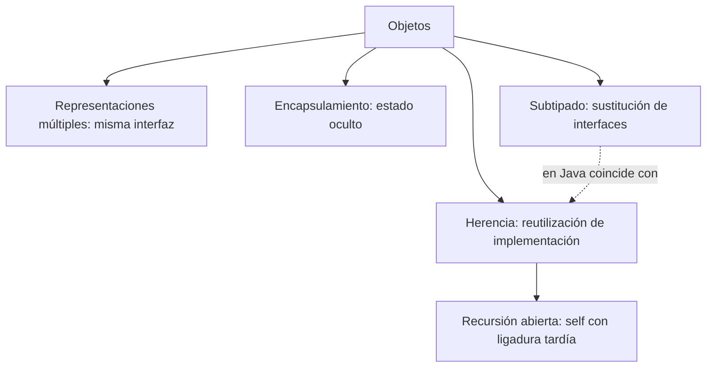

# Lenguajes de Programación - Paradigma orientado a objetos

## 5.1 Fundamentos: representaciones múltiples, encapsulamiento, subtipado, herencia, recursion abierta.

---

La programación orientada a objetos organiza un programa en **objetos**: entidades que agrupan un estado y las operaciones sobre él, y que se comunican enviándose mensajes. Simula 67 la introdujo para simulación, Smalltalk la convirtió en un paradigma completo en los años setenta, y C++, Java, C# y Python la llevaron a la práctica general. Pierce identifica cinco ideas que la caracterizan: **representaciones múltiples**, **encapsulamiento**, **subtipado**, **herencia** y **recursión abierta**. Este tema las define, las distingue entre sí, pues a menudo se confunden, y las ilustra con ejemplos ejecutables.

### Representaciones múltiples

Un objeto se usa solo a través de sus **operaciones**, no de su representación. Por eso, dos objetos con la misma interfaz pueden tener representaciones distintas y usarse indistintamente. Un número complejo puede guardarse en forma cartesiana, $x + yi,$ o polar, $r e^{i\theta};$ si ambos responden a `re`, `im` y `modulo`, el código que los usa no necesita saber cuál es cuál, y una operación como la suma puede combinar un complejo de cada tipo, accediendo al otro solo por su interfaz. Cada representación puede además implementar de forma eficiente lo que le resulta fácil: el módulo de un complejo polar es $r,$ sin calcular nada.

Esta es la diferencia de fondo con los **tipos abstractos de datos** (TAD) de los módulos de ML o los paquetes de Ada. Un TAD oculta su representación, pero tiene **una sola**, y sus operaciones pueden acceder a la representación de **todos** sus argumentos, lo que facilita operaciones binarias eficientes como la unión de conjuntos. Un objeto solo conoce su propia representación. Cook resume la diferencia: los TAD facilitan agregar operaciones; los objetos, agregar representaciones.

### Encapsulamiento

El **encapsulamiento** restringe el acceso al estado de un objeto a sus propias operaciones. Permite mantener **invariantes**, propiedades que el estado cumple siempre, como que un contador nunca sea negativo, y cambiar la representación sin afectar a quien usa el objeto. Los lenguajes lo implementan de formas distintas:

- Java y C++ declaran los miembros `private`, `protected` o `public`, y el compilador rechaza los accesos no permitidos, con la granularidad de la **clase**: un objeto puede leer los campos privados de otro objeto de su misma clase.
- Smalltalk hace todos los campos privados al **objeto**.
- Python solo tiene convenciones: un nombre con `_` indica uso interno, y uno con `__` se transforma en `_Clase__nombre` para evitar choques en las subclases, pero sigue siendo accesible.
- Las **cerraduras** dan encapsulamiento real en cualquier lenguaje funcional: el estado es una variable capturada que nadie más puede nombrar. Es la codificación de objetos de los lenguajes funcionales.

### Subtipado

$S$ es un **subtipo** de $T,$ escrito $S \lt: T,$ si un valor de $S$ puede usarse en cualquier contexto que espere un $T.$ La regla de **subsunción** lo formaliza:

$$\frac{\Gamma \vdash e : S \qquad S \lt: T}{\Gamma \vdash e : T}.$$

Para objetos, el subtipado **en anchura** dice que un objeto con más métodos es subtipo de uno con menos, y el subtipado **en profundidad**, que los tipos de los métodos pueden refinarse: un método de $S$ puede aceptar argumentos más generales, **contravarianza**, y devolver resultados más específicos, **covarianza**. El subtipado puede ser **nominal**, declarado explícitamente con `extends` o `implements`, como en Java, o **estructural**, determinado por la forma de los tipos, como en TypeScript, Go o los `Protocol` de Python.

El tipado garantiza que los métodos existan con tipos compatibles, pero no que se comporten bien. El **principio de sustitución de Liskov** pide además compatibilidad de comportamiento: un subtipo no debe exigir precondiciones más fuertes, ni dar postcondiciones más débiles, ni romper los invariantes del supertipo (tema 5.2).

### Herencia

La **herencia** es un mecanismo para **reutilizar código**: una subclase obtiene los campos y métodos de su superclase, agrega otros y puede **redefinir** algunos. Es distinta del subtipado: el subtipado es una relación entre **interfaces**, la herencia es una relación entre **implementaciones**. En Java y C++ coinciden porque una subclase es automáticamente subtipo, pero:

- puede haber subtipado sin herencia, con interfaces o tipos estructurales;
- puede haber herencia sin subtipado, como la herencia `private` de C++, que reutiliza la implementación sin exponer la interfaz.

La herencia **múltiple** permite heredar de varias clases, con el problema del **diamante** cuando dos superclases heredan de una misma; Python lo resuelve con un orden de resolución de métodos, el MRO calculado con la linealización C3, y Java la limita a las interfaces. Una regla de diseño frecuente es **preferir la composición a la herencia**: un objeto que contiene a otro y le delega trabajo no depende de los detalles internos de su implementación.

### Recursión abierta

Dentro de un método, `self` o `this` denota al objeto que recibió el mensaje, y una llamada `self.m()` se resuelve **en tiempo de ejecución** con la clase real del objeto, no con la clase donde está escrito el método. Por eso, si una subclase redefine `m`, los métodos heredados que llaman a `self.m()` usan la versión nueva. Esta **ligadura tardía de `self`** es la recursión abierta: los métodos de una clase son mutuamente recursivos a través de `self`, pero la recursión está "abierta" a ser extendida. Formalmente, una clase es una función de `self` en un registro de métodos, y el objeto es su punto fijo, $o = \mathsf{fix}(\lambda \mathit{self}.\, \{ m_1 = \dots, m_2 = \dots \}),$ que se toma **después** de combinar la clase con sus subclases.

La recursión abierta hace posibles patrones como el **método plantilla**, en el que la superclase define el esqueleto de un algoritmo y las subclases los pasos. Su riesgo es el problema de la **clase base frágil**: un cambio interno en la superclase, como hacer que un método llame a otro, puede romper subclases que redefinen alguno de los dos.



### Implementación en Python

El programa implementa complejos cartesianos y polares que se suman entre sí. Para el ejercicio 1 define la jerarquía de empleados con un contrato explícito de su método y lo comprueba en cada subclase, incluida una que lo viola. Para el ejercicio 2 implementa el contador con dos niveles de encapsulamiento, por convenciones de Python y por cerraduras. Para el ejercicio 3 implementa las expresiones con un `describir` heredado que usa `evaluar` por recursión abierta, y lo contrasta con una versión de recursión cerrada.

```python
import math
from abc import ABC, abstractmethod

# ---------- Representaciones múltiples: dos implementaciones de la misma interfaz que interoperan ----------
class Complejo(ABC):
    @abstractmethod
    def re(self): ...
    @abstractmethod
    def im(self): ...
    def modulo(self): return math.hypot(self.re(), self.im())
    def mas(self, otro): return Cartesiano(self.re() + otro.re(), self.im() + otro.im())   # solo usa la interfaz del otro
class Cartesiano(Complejo):
    def __init__(self, x, y): self._x, self._y = x, y
    def re(self): return self._x
    def im(self): return self._y
class Polar(Complejo):
    def __init__(self, r, t): self._r, self._t = r, t
    def re(self): return self._r * math.cos(self._t)
    def im(self): return self._r * math.sin(self._t)
    def modulo(self): return self._r                      # cada representación puede optimizar lo que le es fácil
z = Cartesiano(3, 4).mas(Polar(2, math.pi / 2))
print(f"representaciones: (3 + 4i) + 2∠90° = {z.re():.0f} + {z.im():.0f}i, módulo {z.modulo():.4f} | |2∠90°| = {Polar(2, math.pi / 2).modulo()}")

# ---------- Ejercicio 1: empleados y el principio de sustitución ----------
class Empleado(ABC):
    """Contrato de pago_mensual: devuelve un número >= 0 y no modifica al empleado."""
    def __init__(self, nombre): self.nombre = nombre
    @abstractmethod
    def pago_mensual(self): ...
    def recibo(self): return f"{self.nombre}: {self.pago_mensual():,.2f}"   # usa el método de la subclase
class TiempoCompleto(Empleado):
    def __init__(self, nombre, salario_anual):
        if salario_anual < 0: raise ValueError("salario negativo")
        super().__init__(nombre); self.salario_anual = salario_anual
    def pago_mensual(self): return self.salario_anual / 12
class PorHoras(Empleado):
    def __init__(self, nombre, tarifa, horas):
        if tarifa < 0 or horas < 0: raise ValueError("tarifa u horas negativas")
        super().__init__(nombre); self.tarifa, self.horas = tarifa, horas
    def pago_mensual(self):
        extra = max(0, self.horas - 160)                 # horas extra al 150 %
        return self.tarifa * (self.horas - extra) + 1.5 * self.tarifa * extra
class Becario(Empleado):                                 # una subclase que VIOLA el contrato
    def __init__(self, nombre): super().__init__(nombre); self.meses = 0
    def pago_mensual(self): self.meses += 1; return -100.0 if self.meses > 1 else 0.0
def nomina(empleados): return sum(e.pago_mensual() for e in empleados)   # escrita solo contra Empleado
def cumple_contrato(e):
    antes = dict(vars(e)); p1 = e.pago_mensual(); p2 = e.pago_mensual()
    return p1 >= 0 and p1 == p2 and vars(e) == antes
plantilla = [TiempoCompleto("Ana", 360_000), PorHoras("Luis", 150, 170), PorHoras("Eva", 150, 100)]
print("ejercicio 1:", " | ".join(e.recibo() for e in plantilla), f"| nómina {nomina(plantilla):,.2f}")
print("   contrato:", {type(e).__name__: cumple_contrato(e) for e in plantilla + [Becario("Leo")]})

# ---------- Ejercicio 2: encapsulamiento ----------
class Contador:
    __slots__ = ("_Contador__valor",)                    # sin __dict__: no se agregan atributos por error
    def __init__(self, inicial=0):
        if inicial < 0: raise ValueError("el contador no puede ser negativo")
        self.__valor = inicial                           # el nombre se transforma en _Contador__valor
    @property
    def valor(self): return self.__valor                 # solo lectura
    def incrementa(self, n=1):
        if n < 0: raise ValueError("usa decrementa")
        self.__valor += n; return self
    def decrementa(self, n=1):
        if n < 0: raise ValueError("usa incrementa")
        if self.__valor - n < 0: raise ValueError(f"decrementar {n} dejaría el contador en {self.__valor - n}")
        self.__valor -= n; return self
c = Contador().incrementa(5).decrementa(2)
print("ejercicio 2: valor", c.valor, end=" | ")
for intento in (lambda: setattr(c, "valor", 99), lambda: c.decrementa(10), lambda: setattr(c, "otro", 1)):
    try: intento()
    except (AttributeError, ValueError) as e: print(type(e).__name__, end=" | ")
c._Contador__valor = -7                                   # la transformación de nombres no es protección real
print("pero c._Contador__valor = -7 sí funciona:", c.valor)
def contador_cerrado(inicial=0):                          # encapsulamiento real: el estado vive en una cerradura
    valor = inicial
    def incrementa(): nonlocal valor; valor += 1; return valor
    def decrementa():
        nonlocal valor
        if valor == 0: raise ValueError("ya está en 0")
        valor -= 1; return valor
    return {"incrementa": incrementa, "decrementa": decrementa, "valor": lambda: valor}
k = contador_cerrado(); k["incrementa"](); k["incrementa"](); k["decrementa"]()
print("   con cerraduras: valor", k["valor"](), "| el objeto solo expone", sorted(k), "y la variable no se puede modificar desde fuera")

# ---------- Ejercicio 3: recursión abierta ----------
class Expresion(ABC):
    @abstractmethod
    def evaluar(self): ...
    @abstractmethod
    def texto(self): ...
    def describir(self): return f"{self.texto()} = {self.evaluar()}"   # self.evaluar se resuelve en tiempo de ejecución
class Num(Expresion):
    def __init__(self, v): self.v = v
    def evaluar(self): return self.v
    def texto(self): return str(self.v)
class Binaria(Expresion):
    simbolo = "?"
    def __init__(self, a, b): self.a, self.b = a, b
    def evaluar(self): return self.opera(self.a.evaluar(), self.b.evaluar())
    def texto(self): return f"({self.a.texto()} {self.simbolo} {self.b.texto()})"
class Suma(Binaria):
    simbolo = "+"
    def opera(self, x, y): return x + y
class Resta(Binaria):
    simbolo = "-"
    def opera(self, x, y): return x - y
class Mult(Binaria):
    simbolo = "*"
    def opera(self, x, y): return x * y
e = Resta(Mult(Num(3), Suma(Num(4), Num(5))), Num(7))
print("ejercicio 3:", e.describir())
class NumModular(Num):                                    # una subclase redefine evaluar, y describir la usa sin cambios
    def evaluar(self): return self.v % 5
class SumaTrazada(Suma):
    pasos = []
    def opera(self, x, y): SumaTrazada.pasos.append((x, y)); return super().opera(x, y)
print("   recursión abierta: Num(12).describir() =", Num(12).describir(), "| NumModular(12).describir() =", NumModular(12).describir())
print("  ", SumaTrazada(Num(1), SumaTrazada(Num(2), Num(3))).describir(), "con las sumas", SumaTrazada.pasos)
class ExpresionCerrada:                                   # recursión cerrada: describir llama a la función, no al método
    def __init__(self, v): self.v = v
    def evaluar(self): return self.v
    def describir(self): return f"{self.v} = {ExpresionCerrada.evaluar(self)}"
class CerradaModular(ExpresionCerrada):
    def evaluar(self): return self.v % 5
print("   recursión cerrada: CerradaModular(12).describir() =", CerradaModular(12).describir(), "(ignora la redefinición)")
```

Salida:

```text
representaciones: (3 + 4i) + 2∠90° = 3 + 6i, módulo 6.7082 | |2∠90°| = 2
ejercicio 1: Ana: 30,000.00 | Luis: 26,250.00 | Eva: 15,000.00 | nómina 71,250.00
   contrato: {'TiempoCompleto': True, 'PorHoras': True, 'Becario': False}
ejercicio 2: valor 3 | AttributeError | ValueError | AttributeError | pero c._Contador__valor = -7 sí funciona: -7
   con cerraduras: valor 1 | el objeto solo expone ['decrementa', 'incrementa', 'valor'] y la variable no se puede modificar desde fuera
ejercicio 3: ((3 * (4 + 5)) - 7) = 20
   recursión abierta: Num(12).describir() = 12 = 12 | NumModular(12).describir() = 12 = 2
   (1 + (2 + 3)) = 6 con las sumas [(2, 3), (1, 5)]
   recursión cerrada: CerradaModular(12).describir() = 12 = 12 (ignora la redefinición)
```

### Ejercicios Propuestos

1. **Jerarquía.** Diseña una jerarquía de clases para los empleados de una empresa, con una clase base `Empleado` y subclases `EmpleadoTiempoCompleto` y `EmpleadoPorHoras`, que respete el principio de sustitución de Liskov.

2. **Encapsulamiento.** Crea una clase `Contador` que encapsule un valor numérico, permita incrementarlo y decrementarlo, no permita el acceso directo al valor interno y rechace los valores negativos.

3. **Recursión abierta.** Implementa una clase `ExpresionMatematica` con un método abstracto `evaluar()`, un método `describir()` que use `evaluar()`, y subclases para la suma, la resta y la multiplicación.

### Soluciones

**Ejercicio 1.** La clase base declara `pago_mensual` como abstracto y fija su **contrato**: devuelve un número no negativo y no modifica al empleado. `recibo` y `nomina` están escritas solo contra `Empleado` y funcionan con cualquier subclase. `TiempoCompleto` paga la doceava parte del salario anual; `PorHoras` paga la tarifa por hora, con las horas que pasan de 160 al 150 %. Luis, con 170 horas a 150, recibe $160 \cdot 150 + 10 \cdot 225 = 26\,250.$ Ambas validan sus datos en el constructor, de modo que no puede existir un empleado que viole el contrato. Para mostrar qué significa violarlo, `Becario` devuelve un pago negativo a partir de la segunda llamada, y modifica su estado al calcularlo: el tipo es correcto, Python lo acepta como `Empleado`, pero una nómina que lo incluya da resultados absurdos y que dependen de cuántas veces se consulte. La comprobación del programa lo detecta. El principio de Liskov es exactamente eso: un subtipo debe cumplir el contrato del supertipo, no solo tener sus métodos.

**Ejercicio 2.** El contador guarda el valor en un atributo `__valor`, lo expone solo para lectura con una propiedad y valida en `incrementa` y `decrementa`, que rechazan cantidades negativas y cualquier decremento que deje el valor bajo cero. Con `__slots__` tampoco se pueden agregar atributos por error. Así se mantiene el invariante $\mathit{valor} \ge 0$ para todo código que use la interfaz. Pero en Python no es una protección real: el atributo se llama en realidad `_Contador__valor`, y asignarlo directamente rompe el invariante, como muestra el programa. Para un encapsulamiento que el lenguaje garantice, la versión con **cerraduras** guarda el valor en una variable local de la función constructora; el objeto resultante solo expone tres funciones, y no hay forma de nombrar la variable desde fuera. Es la idea de los objetos como cerraduras de Scheme, y la misma que usan los campos privados `#x` de JavaScript.

**Ejercicio 3.** `Expresion` declara `evaluar` y `texto` como abstractos y define `describir` en términos de ambos; `Binaria` factoriza lo común a las tres operaciones, y cada subclase solo da su símbolo y `opera`, un método plantilla. Para $((3 \cdot (4 + 5)) - 7)$ el resultado es 20. La recursión abierta se ve al extender: `NumModular` redefine solo `evaluar`, y el `describir` heredado, escrito antes de que la subclase existiera, usa la versión nueva y da $12 = 2;$ `SumaTrazada` redefine `opera` para registrar cada suma, y el `evaluar` heredado de `Binaria` la usa. En la versión de **recursión cerrada**, `describir` llama a `ExpresionCerrada.evaluar(self)`, la función de la clase base, y la redefinición de la subclase se ignora: así se comportan los métodos no virtuales de C++, y es la razón de que en C++ haya que declarar `virtual` los métodos que se quieren abiertos.

### Referencias

1. Pierce, B. C., _Types and Programming Languages_. MIT Press, 2002. Capítulos 15 a 18.
2. Cook, W. R., On understanding data abstraction, revisited. _OOPSLA_, 2009.
3. Liskov, B., and Wing, J. M., A behavioral notion of subtyping. _ACM Transactions on Programming Languages and Systems_ 16(6), 1994.
4. Abadi, M., and Cardelli, L., _A Theory of Objects_. Springer, 1996.
5. Gamma, E., Helm, R., Johnson, R., and Vlissides, J., _Design Patterns_. Addison-Wesley, 1994.
