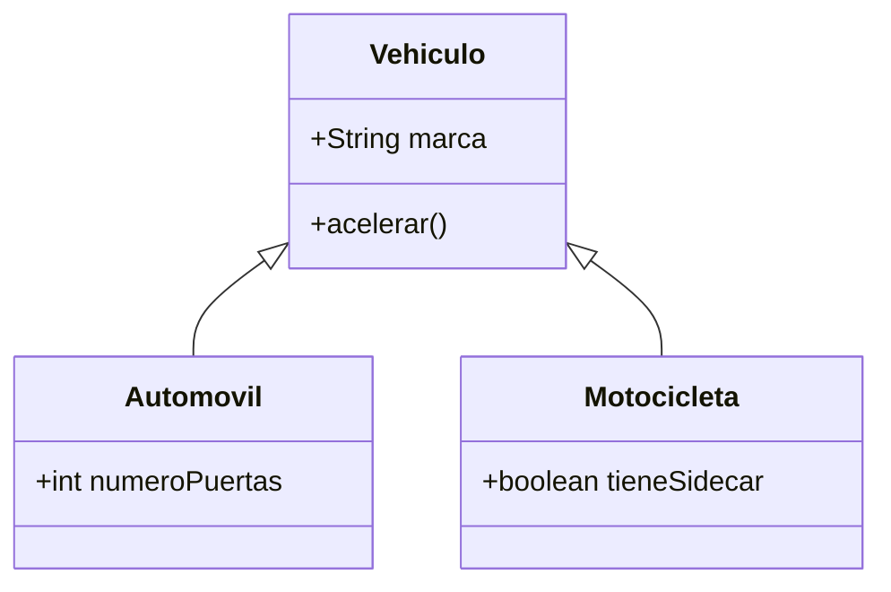
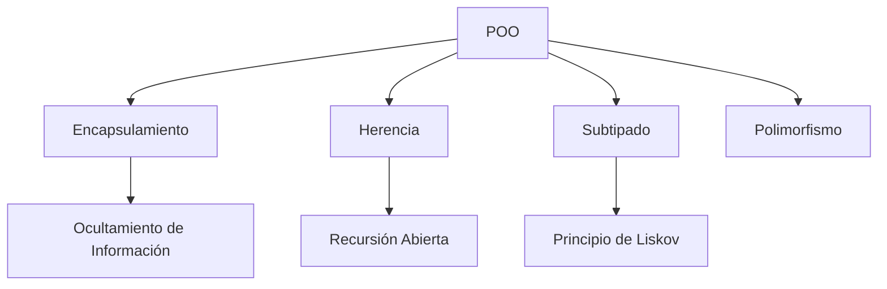

# Lenguajes de Programación - Paradigma orientado a objetos

## 5.1 Fundamentos: representaciones múltiples, encapsulamiento, subtipado, herencia, recursion abierta.

---

#### Representaciones Múltiples

El principio de representaciones múltiples se refiere a la capacidad de representar un mismo concepto o entidad de diferentes formas, permitiendo que diferentes implementaciones coexistan bajo una interfaz común.

**Definición**: Capacidad de implementar una misma interfaz o abstracción mediante múltiples representaciones concretas, donde cada implementación puede variar en su estructura interna pero mantiene el mismo comportamiento externo.

**Ejemplo conceptual**:

```java
// Interfaz común
interface Figura {
    double calcularArea();
}

// Diferentes representaciones
class Circulo implements Figura {
    private double radio;
    public double calcularArea() {
        return Math.PI * radio * radio;
    }
}

class Cuadrado implements Figura {
    private double lado;
    public double calcularArea() {
        return lado * lado;
    }
}
```

#### Encapsulamiento

El encapsulamiento es el mecanismo que restringe el acceso directo a los componentes de un objeto, protegiendo la integridad de los datos y ocultando los detalles de implementación.

**Definición**: Principio que agrupa datos y métodos que operan sobre esos datos en una unidad (objeto), y restringe el acceso a los componentes internos.

**Fórmula del principio de ocultamiento de información**:

$$ E = \lbrace d, m | d \in datos, m \in \text{métodos}, acceso(m,d) \leq restringido \rbrace $$

**Ejemplo**:

```java
public class CuentaBancaria {
    private double saldo; // Datos encapsulados

    // Métodos públicos para acceder a los datos
    public void depositar(double monto) {
        if (monto > 0) saldo += monto;
    }

    public double getSaldo() {
        return saldo;
    }
}
```

#### Subtipado

El subtipado define una relación de compatibilidad entre tipos, donde un subtipo puede ser usado en cualquier contexto donde se espera un supertipo.

**Definición**: Relación entre tipos donde si $S$ es subtipo de $T$, entonces cualquier expresión de tipo $S$ puede ser usada donde se espera una expresión de tipo $T$.

**Principio de sustitución de Liskov**:

$$\forall x:T. \forall y:S. (S \leq T) \Rightarrow P(x) \Rightarrow P(y)$$

**Ejemplo**:

```java
class Animal {
    void hacerSonido() {
        System.out.println("Sonido genérico");
    }
}

class Perro extends Animal {
    @Override
    void hacerSonido() {
        System.out.println("Guau guau");
    }
}

// Perro es subtipo de Animal
Animal miAnimal = new Perro(); // Subtipado válido
```

#### Herencia

La herencia permite crear nuevas clases basadas en clases existentes, reutilizando y extendiendo su comportamiento.

**Definición**: Mecanismo mediante el cual una clase (subclase) adquiere las propiedades y métodos de otra clase (superclase).

**Jerarquía de herencia**:



**Ejemplo**:

```java
class Vehiculo {
    protected String marca;

    public void acelerar() {
        System.out.println("Acelerando...");
    }
}

class Automovil extends Vehiculo {
    private int numeroPuertas;

    public void abrirPuertas() {
        System.out.println("Abriendo " + numeroPuertas + " puertas");
    }
}
```

#### Recursión Abierta

La recursión abierta se refiere a la capacidad de los métodos de un objeto de llamar a otros métodos del mismo objeto, incluso si estos son sobrescritos en subclases.

**Definición**: Mecanismo donde un método puede invocar a otro método del mismo objeto mediante una referencia que permite el enlace dinámico.

**Ejemplo**:

```java
class Figura {
    public double area() {
        return 0;
    }

    public void describir() {
        System.out.println("Área: " + area()); // Recursión abierta
    }
}

class Circulo extends Figura {
    private double radio;

    @Override
    public double area() {
        return Math.PI * radio * radio;
    }
}

// Cuando describir() se llama en Circulo, usa area() sobrescrito
```

### Ejercicios Propuestos

#### Ejercicio 1: Diseño de Jerarquía de Clases

Diseña una jerarquía de clases para representar empleados de una empresa. Debe incluir:

- Clase base Empleado con atributos comunes
- Subclases para EmpleadoTiempoCompleto y EmpleadoPorHoras
- Implementa el principio de sustitución de Liskov

#### Ejercicio 2: Encapsulamiento

Crea una clase `Contador` que:

- Encapsule un valor numérico
- Permita incrementar y decrementar el valor
- No permita acceso directo al valor interno
- Incluya validaciones para valores negativos

#### Ejercicio 3: Recursión Abierta

Implementa una clase `ExpresionMatematica` con:

- Método abstracto `evaluar()`
- Método `describir()` que use `evaluar()` (recursión abierta)
- Subclases para suma, resta y multiplicación

### Diagrama de Relaciones entre Conceptos



### Referencias Bibliográficas

#### Bibliografía Básica

1. Mitchell, J. (2003). _Concepts in Programming Languages_. Cambridge University Press. (Capítulo 9: Object-Oriented Programming)
2. Pierce, B.C. (2002). _Types and Programming Languages_. MIT Press. (Capítulo 18: Imperative Objects)

#### Bibliografía Complementaria

3. Harper, R. (2010). _Practical Foundations for Programming Languages_. http://www.cs.cmu.edu/~rwh/plbook/book.pdf
4. Friedman, D.P. & Wand, M. (2008). _Essentials of Programming Languages_. 3rd edition. MIT Press.
5. Krishnamurthi, S. (2007). _Programming Languages: Application and Interpretation_. http://www.cs.brown.edu/~sk/Publications/Books/ProgLangs/

### Caso de Estudio Integrador

**Sistema de Formas Geométricas**:

```java
interface Forma {
    double calcularArea();
    double calcularPerimetro();
    default void mostrarInfo() {
        System.out.println("Área: " + calcularArea());
        System.out.println("Perímetro: " + calcularPerimetro());
    }
}

abstract class FormaBase implements Forma {
    protected String color;

    public FormaBase(String color) {
        this.color = color;
    }

    public String getColor() {
        return color;
    }
}

class Circulo extends FormaBase {
    private double radio;

    public Circulo(String color, double radio) {
        super(color);
        this.radio = radio;
    }

    @Override
    public double calcularArea() {
        return Math.PI * radio * radio;
    }

    @Override
    public double calcularPerimetro() {
        return 2 * Math.PI * radio;
    }
}
```

Este caso demuestra: encapsulamiento, herencia, subtipado, y recursión abierta mediante el método `mostrarInfo()`.

### Evaluación de Conceptos

1. **Verdadero o Falso**: El encapsulamiento permite acceso directo a todos los atributos de una clase.
2. **Explica** la diferencia entre herencia y subtipado con un ejemplo.
3. **Implementa** una clase que demuestre recursión abierta.
4. **Diseña** un sistema que utilice representaciones múltiples para diferentes algoritmos de ordenamiento.

Esta guía proporciona una base sólida para comprender los fundamentos del paradigma orientado a objetos, integrando conceptos teóricos con ejemplos prácticos y referencias académicas.
