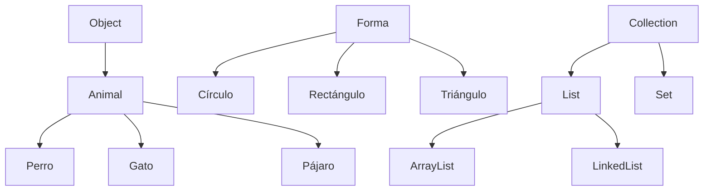
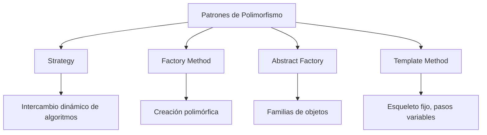

# Lenguajes de Programación - Paradigma orientado a objetos

## 5.2 Polimorfismo de subtipos.

---

### Definición Fundamental

El polimorfismo de subtipos es un mecanismo que permite tratar objetos de diferentes tipos de manera uniforme a través de una interfaz común, aprovechando las relaciones de herencia y subtipado.

**Definición formal**: Dados dos tipos $S$ y $T$, si $S \leq T$ (S es subtipo de T), entonces cualquier expresión de tipo $S$ puede ser usada en contextos donde se espera una expresión de tipo $T$.

### Principio de Sustitución de Liskov

Formalizado por Barbara Liskov en 1987, establece que:

> Si $S$ es un subtipo de $T$, entonces los objetos de tipo $S$ pueden sustituir a los objetos de tipo $T$ sin alterar las propiedades deseables del programa.

**Formalización**:

$$\forall \phi: Propiedad, \forall x:T, \forall y:S. (S \leq T) \Rightarrow (\phi(x) \Rightarrow \phi(y))$$

### Mecanismos del Polimorfismo de Subtipos

#### Enlace Dinámico (Dynamic Binding)

```java
class Animal {
    public void hacerSonido() {
        System.out.println("Sonido genérico");
    }
}

class Perro extends Animal {
    @Override
    public void hacerSonido() {
        System.out.println("Guau guau");
    }
}

class Gato extends Animal {
    @Override
    public void hacerSonido() {
        System.out.println("Miau miau");
    }
}

// Uso polimórfico
Animal[] animales = {new Perro(), new Gato(), new Animal()};
for (Animal animal : animales) {
    animal.hacerSonido(); // Enlace dinámico
}
```

#### Interfaces y Clases Abstractas

```java
interface Forma {
    double calcularArea();
    double calcularPerimetro();
}

abstract class FormaGeometrica implements Forma {
    protected String color;

    public FormaGeometrica(String color) {
        this.color = color;
    }

    public String getColor() {
        return color;
    }
}

class Circulo extends FormaGeometrica {
    private double radio;

    public Circulo(String color, double radio) {
        super(color);
        this.radio = radio;
    }

    @Override
    public double calcularArea() {
        return Math.PI * radio * radio;
    }

    @Override
    public double calcularPerimetro() {
        return 2 * Math.PI * radio;
    }
}
```

### Sistema de Tipos y Subtipado

**Regla de subtipado para métodos**:
Un método $m$ en tipo $S$ con firma $U → V$ es subtipo de un método $m$ en tipo $T$ con firma $X → Y$ si:

$$X \leq U \quad \text{y} \quad V \leq Y$$

**Notación formal**:

$$(U → V) \leq (X → Y) \iff (X \leq U) \land (V \leq Y)$$

### Diagrama de Relaciones de Subtipado



### Ejemplo Avanzado: Sistema de Pagos

```java
interface MetodoPago {
    boolean procesarPago(double monto);
    String obtenerTipo();
}

class TarjetaCredito implements MetodoPago {
    private String numero;
    private String fechaExpiracion;

    @Override
    public boolean procesarPago(double monto) {
        System.out.println("Procesando pago con tarjeta de crédito: $" + monto);
        return true;
    }

    @Override
    public String obtenerTipo() {
        return "Tarjeta de Crédito";
    }
}

class PayPal implements MetodoPago {
    private String email;

    @Override
    public boolean procesarPago(double monto) {
        System.out.println("Procesando pago con PayPal: $" + monto);
        return true;
    }

    @Override
    public String obtenerTipo() {
        return "PayPal";
    }
}

class SistemaPagos {
    public void procesarTransaccion(MetodoPago metodo, double monto) {
        System.out.println("Usando: " + metodo.obtenerTipo());
        metodo.procesarPago(monto);
    }
}
```

### Ventajas del Polimorfismo de Subtipos

1. **Extensibilidad**: Nuevos subtipos pueden añadirse sin modificar código existente
2. **Reutilización**: Código que opera sobre supertipos funciona con todos los subtipos
3. **Mantenibilidad**: Cambios localizados en implementaciones específicas
4. **Flexibilidad**: Intercambio dinámico de implementaciones

### Consideraciones de Diseño

#### Diseño por Contrato

```java
/**
 * @pre monto > 0
 * @post return == true si pago exitoso
 * @post return == false si pago fallido
 */
boolean procesarPago(double monto);
```

#### Covarianza y Contravarianza

**Covarianza en tipos de retorno**:

$$S \leq T \Rightarrow F[S] \leq F[T]$$

**Contravarianza en parámetros**:

$$S \leq T \Rightarrow F[T] \leq F[S]$$

### Ejercicios Propuestos

#### Ejercicio 1: Sistema de Notificaciones

Diseña un sistema de notificaciones con:

- Interfaz `Notificacion` con método `enviar()`
- Subtipos: `EmailNotificacion`, `SMSNotificacion`, `PushNotificacion`
- Clase `SistemaNotificaciones` que use polimorfismo

#### Ejercicio 2: Análisis de Subtipado

Dado el siguiente código, identifica violaciones al principio de Liskov:

```java
class Rectangulo {
    protected int ancho, alto;

    public void setAncho(int ancho) { this.ancho = ancho; }
    public void setAlto(int alto) { this.alto = alto; }
}

class Cuadrado extends Rectangulo {
    @Override
    public void setAncho(int ancho) {
        super.setAncho(ancho);
        super.setAlto(ancho);
    }

    @Override
    public void setAlto(int alto) {
        super.setAncho(alto);
        super.setAlto(alto);
    }
}
```

#### Ejercicio 3: Implementación Polimórfica

Crea una jerarquía para representar operaciones matemáticas:

- Interfaz `Operacion` con método `aplicar(double a, double b)`
- Implementa `Suma`, `Resta`, `Multiplicacion`, `Division`
- Clase `Calculadora` que use cualquier operación

### Patrones de Diseño Relacionados



### Referencias Bibliográficas

#### Bibliografía Básica

1. **Mitchell, J. (2003)**. _Concepts in Programming Languages_. Cambridge University Press.
   - Capítulo 10: Object-Oriented Programming Concepts
   - Sección 10.4: Subtyping and Inheritance

2. **Pierce, B.C. (2002)**. _Types and Programming Languages_. MIT Press.
   - Capítulo 15: Subtyping
   - Capítulo 18: Imperative Objects

#### Bibliografía Complementaria

3. **Liskov, B. (1987)**. _Data Abstraction and Hierarchy_. OOPSLA 1987
4. **Harper, R. (2010)**. _Practical Foundations for Programming Languages_.
   - Capítulo 24: Subtyping and Inheritance
5. **Krishnamurthi, S. (2007)**. _Programming Languages: Application and Interpretation_.
   - Capítulo 32: Objects: Interpretation and Types

### Caso de Estudio: Sistema de Figuras Geométricas

```java
interface Figura {
    double area();
    double perimetro();
    Punto centro();
}

class Circulo implements Figura {
    private Punto centro;
    private double radio;

    public Circulo(Punto centro, double radio) {
        this.centro = centro;
        this.radio = radio;
    }

    @Override
    public double area() { return Math.PI * radio * radio; }

    @Override
    public double perimetro() { return 2 * Math.PI * radio; }

    @Override
    public Punto centro() { return centro; }
}

class Rectangulo implements Figura {
    private Punto esquinaSupIzq;
    private double ancho, alto;

    @Override
    public double area() { return ancho * alto; }

    @Override
    public double perimetro() { return 2 * (ancho + alto); }

    @Override
    public Punto centro() {
        return new Punto(
            esquinaSupIzq.x() + ancho/2,
            esquinaSupIzq.y() + alto/2
        );
    }
}

class CalculadoraGeometrica {
    public static double areaTotal(List<Figura> figuras) {
        return figuras.stream()
                     .mapToDouble(Figura::area)
                     .sum();
    }
}
```

### Evaluación de Conceptos

1. **Explica** la diferencia entre polimorfismo paramétrico y de subtipos
2. **Demuestra** con código cómo el polimorfismo de subtipos permite extensibilidad
3. **Identifica** posibles problemas de violación del principio de Liskov
4. **Diseña** un sistema que use polimorfismo para manejar diferentes formatos de archivos

Esta guía proporciona una comprensión profunda del polimorfismo de subtipos, integrando fundamentos teóricos con ejemplos prácticos y referencias académicas esenciales.
