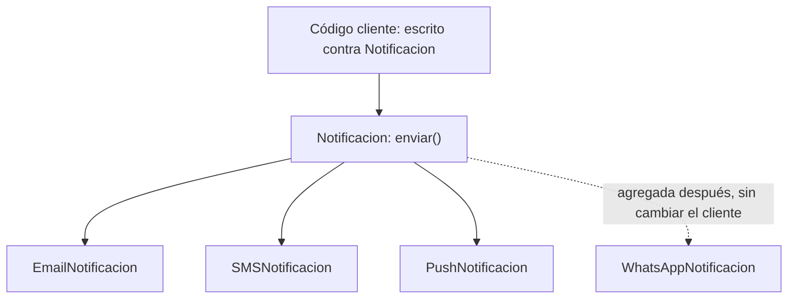

# Lenguajes de Programación - Paradigma orientado a objetos

## 5.2 Polimorfismo de subtipos.

---

Un código es **polimórfico** si funciona con valores de varios tipos. Strachey y, después, Cardelli y Wegner distinguen varias formas: el polimorfismo **paramétrico**, en el que una función como `longitud : List[a] → int` trata todos los tipos de la misma manera (tema 3.7); el **ad hoc**, de la sobrecarga, en el que cada tipo tiene su propia implementación con el mismo nombre, y el **de subtipos**, o de inclusión, en el que un código escrito para un tipo $T$ acepta también cualquier subtipo de $T.$ Este último es el característico de la orientación a objetos. Este tema da sus reglas, las de varianza, el principio de sustitución de Liskov, que fija qué debe cumplir un subtipo, y los patrones de diseño que lo aprovechan.

### Subsunción y despacho

El polimorfismo de subtipos combina dos mecanismos. La **subsunción**, del tema 5.1, permite que un valor de tipo $S$ se use donde se espera un $T$ si $S \lt: T:$ una lista de `Notificacion` puede contener correos, mensajes de texto y notificaciones móviles. El **despacho dinámico**, del tema 5.4, hace que cada llamada `n.enviar()` ejecute el método de la clase real del objeto, no el del tipo declarado. El resultado es que un código escrito una vez contra la interfaz funciona con subtipos que aún no existían cuando se escribió, que es el **principio abierto-cerrado** de Meyer: abierto a la extensión, cerrado a la modificación.

La relación de subtipos es un **preorden**: reflexiva, $T \lt: T,$ y transitiva, si $S \lt: U$ y $U \lt: T$ entonces $S \lt: T.$ En Java su máximo es `Object`, y en un sistema con tipo inferior, como `Nothing` en Scala o `never` en TypeScript, este es subtipo de todos.

### Varianza

¿Cuándo un tipo construido a partir de otros es subtipo de otro? Para las funciones, la regla es

$$\frac{T_1 \lt: S_1 \qquad S_2 \lt: T_2}{S_1 \to S_2 \;\lt:\; T_1 \to T_2}.$$

El tipo del resultado varía en el **mismo** sentido, **covarianza**: una función que devuelve un `Perro` sirve donde se pide una que devuelva un `Animal`. El del argumento varía en sentido **contrario**, **contravarianza**: una función que acepta cualquier `Animal` sirve donde se pide una que acepte un `Perro`, pero no al revés, porque podría recibir un `Gato`. Para los métodos redefinidos, Java permite resultados covariantes desde la versión 5, pero no argumentos contravariantes: un método con un parámetro de tipo distinto es una **sobrecarga**, no una redefinición.

Para los contenedores mutables, la única regla segura es la **invarianza**: `List[Perro]` no es subtipo de `List[Animal]`, porque en una `List[Animal]` se puede insertar un `Gato`. Los arreglos de Java son covariantes, una decisión de 1995 anterior a los genéricos, y el error se detecta en tiempo de ejecución con `ArrayStoreException`; las listas genéricas son invariantes, y la varianza se pide en el punto de uso con comodines: `List<? extends Animal>` solo para leer, y `List<? super Perro>` solo para escribir. Scala, Kotlin y C# la declaran en la definición, con `+T` y `-T` o con `out T` e `in T`.

### El principio de sustitución de Liskov

Liskov y Wing (1994) definen el subtipado **de comportamiento**: $S$ es subtipo de $T$ si toda propiedad demostrable de los objetos de $T$ vale también para los de $S.$ En términos de contratos, para cada método redefinido:

- las **precondiciones** no pueden reforzarse: el subtipo debe aceptar todo lo que aceptaba el supertipo;
- las **postcondiciones** no pueden debilitarse: debe garantizar al menos lo mismo;
- los **invariantes** del supertipo deben conservarse;
- la **regla de la historia**: el subtipo no puede permitir cambios de estado que el supertipo prohíbe, por ejemplo, una subclase mutable de una clase inmutable.

Son las mismas condiciones de la varianza, aplicadas al comportamiento en lugar de a los tipos. El compilador comprueba la parte de tipos; la de comportamiento es responsabilidad del diseño, y se verifica con pruebas que se ejecutan contra todos los subtipos, o con contratos como los de Eiffel.

### Patrones de diseño

Varios patrones clásicos son aplicaciones directas del polimorfismo de subtipos:

- **Estrategia:** un algoritmo intercambiable se representa como un objeto con una interfaz común, como las operaciones de una calculadora.
- **Método plantilla:** la superclase fija el esqueleto y las subclases dan los pasos, por recursión abierta.
- **Método fábrica y fábrica abstracta:** la creación de objetos se delega a un método que las subclases redefinen, de modo que el código cliente no nombra las clases concretas.
- **Compuesto:** un objeto y una colección de objetos comparten interfaz, como una expresión y sus subexpresiones.



### Implementación en Python

El programa implementa el sistema de notificaciones del ejercicio 1, con validación propia de cada canal y un canal agregado después sin modificar el sistema. Para el ejercicio 2 ejecuta sobre un rectángulo y un cuadrado una prueba que solo usa lo que promete `Rectangulo`, y muestra una corrección con valores inmutables. Para el ejercicio 3 implementa la calculadora con operaciones intercambiables. Al final muestra por qué las listas mutables no pueden ser covariantes.

```python
from abc import ABC, abstractmethod
from dataclasses import dataclass

# ---------- Ejercicio 1: notificaciones ----------
class Notificacion(ABC):
    def __init__(self, destino, mensaje): self.destino, self.mensaje = destino, mensaje
    @abstractmethod
    def enviar(self) -> str: ...
    def valida(self) -> bool: return bool(self.mensaje)
class EmailNotificacion(Notificacion):
    def __init__(self, destino, mensaje, asunto): super().__init__(destino, mensaje); self.asunto = asunto
    def valida(self): return super().valida() and "@" in self.destino
    def enviar(self): return f"email a {self.destino} [{self.asunto}]: {self.mensaje}"
class SMSNotificacion(Notificacion):
    LIMITE = 160
    def valida(self): return super().valida() and self.destino.lstrip("+").isdigit()
    def enviar(self):
        partes = -(-len(self.mensaje) // self.LIMITE)       # un SMS largo se divide en segmentos
        return f"SMS a {self.destino} en {partes} segmento(s): {self.mensaje[:20]}…"
class PushNotificacion(Notificacion):
    def enviar(self): return f"push al dispositivo {self.destino}: {self.mensaje}"
class SistemaNotificaciones:
    """Depende solo de Notificacion: agregar un canal nuevo no cambia esta clase (abierto-cerrado)."""
    def __init__(self): self.cola, self.bitacora = [], []
    def agrega(self, n: Notificacion): self.cola.append(n); return self
    def despacha(self):
        for n in self.cola:                                 # despacho dinámico: cada n.enviar es el de su clase
            self.bitacora.append(n.enviar() if n.valida() else f"rechazada: {type(n).__name__} a {n.destino!r}")
        self.cola.clear(); return self.bitacora
s = SistemaNotificaciones()
s.agrega(EmailNotificacion("ana@ejemplo.mx", "Tu pedido salió", "Envío")).agrega(SMSNotificacion("+525512345678", "x" * 200))
s.agrega(PushNotificacion("tel-42", "Hay una actualización")).agrega(EmailNotificacion("sin-arroba", "hola", "?"))
class WhatsAppNotificacion(Notificacion):                   # un canal nuevo, sin tocar SistemaNotificaciones
    def enviar(self): return f"WhatsApp a {self.destino}: {self.mensaje}"
s.agrega(WhatsAppNotificacion("+5215500000000", "Listo"))
print("ejercicio 1:"); [print("   ", linea) for linea in s.despacha()]

# ---------- Ejercicio 2: Rectángulo y Cuadrado ----------
class Rectangulo:
    def __init__(self, ancho, alto): self.ancho, self.alto = ancho, alto
    def set_ancho(self, a): self.ancho = a
    def set_alto(self, h): self.alto = h
    def area(self): return self.ancho * self.alto
class Cuadrado(Rectangulo):
    def __init__(self, lado): super().__init__(lado, lado)
    def set_ancho(self, a): self.ancho = self.alto = a
    def set_alto(self, h): self.ancho = self.alto = h
def prueba_cliente(r: Rectangulo):
    """Lo que un cliente de Rectangulo tiene derecho a suponer: set_alto no cambia el ancho."""
    r.set_ancho(5); r.set_alto(4)
    return r.area()
print("ejercicio 2: el cliente espera área 20 | Rectangulo:", prueba_cliente(Rectangulo(1, 1)), "| Cuadrado:", prueba_cliente(Cuadrado(1)))
# corrección: valores inmutables; "cambiar" el ancho produce una figura nueva, y Cuadrado ya no promete set_ancho
@dataclass(frozen=True)
class Figura:
    def area(self): raise NotImplementedError
@dataclass(frozen=True)
class Rect(Figura):
    ancho: float; alto: float
    def area(self): return self.ancho * self.alto
    def con_ancho(self, a): return Rect(a, self.alto)
@dataclass(frozen=True)
class Cuad(Figura):
    lado: float
    def area(self): return self.lado ** 2
    def como_rect(self): return Rect(self.lado, self.lado)
figs = [Rect(5, 4), Cuad(3), Cuad(3).como_rect().con_ancho(10)]
print("   corregido con valores inmutables:", [(type(f).__name__, f.area()) for f in figs], "| suma de áreas", sum(f.area() for f in figs))

# ---------- Ejercicio 3: operaciones y calculadora ----------
class Operacion(ABC):
    simbolo = "?"
    @abstractmethod
    def aplicar(self, a: float, b: float) -> float: ...
class Suma(Operacion):
    simbolo = "+"
    def aplicar(self, a, b): return a + b
class Resta(Operacion):
    simbolo = "-"
    def aplicar(self, a, b): return a - b
class Multiplicacion(Operacion):
    simbolo = "*"
    def aplicar(self, a, b): return a * b
class Division(Operacion):
    simbolo = "/"
    def aplicar(self, a, b):
        if b == 0: raise ZeroDivisionError("división entre cero")
        return a / b
class Potencia(Operacion):                                   # extensión sin modificar la calculadora
    simbolo = "^"
    def aplicar(self, a, b): return a ** b
class Calculadora:
    def __init__(self, *ops: Operacion): self.ops = {o.simbolo: o for o in ops}
    def calcula(self, a, simbolo, b):
        if simbolo not in self.ops: raise ValueError(f"operación desconocida {simbolo!r}")
        return self.ops[simbolo].aplicar(a, b)
    def evalua(self, tokens):                                  # de izquierda a derecha, sin precedencia
        acc = float(tokens[0])
        for i in range(1, len(tokens), 2): acc = self.calcula(acc, tokens[i], float(tokens[i + 1]))
        return acc
calc = Calculadora(Suma(), Resta(), Multiplicacion(), Division(), Potencia())
print("ejercicio 3:", {s: calc.calcula(12, s, 3) for s in "+-*/^"}, "| 2 + 3 * 4 ^ 2 =", calc.evalua("2 + 3 * 4 ^ 2".split()))
for args in ((1, "/", 0), (1, "%", 2)):
    try: calc.calcula(*args)
    except (ZeroDivisionError, ValueError) as e: print(f"   {args}: {type(e).__name__}: {e}")

# ---------- Varianza: por qué las listas mutables son invariantes ----------
class Animal: pass
class Perro(Animal): pass
class Gato(Animal): pass
perros: list = [Perro()]
animales = perros                                            # si list[Perro] <: list[Animal] fuera válido...
animales.append(Gato())                                      # ...esto sería legal
print("varianza: tras tratar list[Perro] como list[Animal], la lista de perros contiene", [type(x).__name__ for x in perros])
```

Salida:

```text
ejercicio 1:
    email a ana@ejemplo.mx [Envío]: Tu pedido salió
    SMS a +525512345678 en 2 segmento(s): xxxxxxxxxxxxxxxxxxxx…
    push al dispositivo tel-42: Hay una actualización
    rechazada: EmailNotificacion a 'sin-arroba'
    WhatsApp a +5215500000000: Listo
ejercicio 2: el cliente espera área 20 | Rectangulo: 20 | Cuadrado: 16
   corregido con valores inmutables: [('Rect', 20), ('Cuad', 9), ('Rect', 30)] | suma de áreas 59
ejercicio 3: {'+': 15, '-': 9, '*': 36, '/': 4.0, '^': 1728} | 2 + 3 * 4 ^ 2 = 400.0
   (1, '/', 0): ZeroDivisionError: división entre cero
   (1, '%', 2): ValueError: operación desconocida '%'
varianza: tras tratar list[Perro] como list[Animal], la lista de perros contiene ['Perro', 'Gato']
```

En Java, la misma situación con arreglos compila y falla al ejecutar, y con listas genéricas no compila:

```java
Animal[] animales = new Perro[1];
animales[0] = new Gato();   // java.lang.ArrayStoreException: Gato

List<Animal> xs = new ArrayList<Perro>();
// error: incompatible types: ArrayList<Perro> cannot be converted to List<Animal>
```

### Ejercicios Propuestos

1. **Notificaciones.** Diseña un sistema con una interfaz `Notificacion` con el método `enviar()`, los subtipos `EmailNotificacion`, `SMSNotificacion` y `PushNotificacion`, y una clase `SistemaNotificaciones` que use polimorfismo.

2. **Subtipado.** Identifica las violaciones al principio de Liskov en:

    ```java
    class Rectangulo {
        protected int ancho, alto;

        public void setAncho(int ancho) { this.ancho = ancho; }
        public void setAlto(int alto) { this.alto = alto; }
    }

    class Cuadrado extends Rectangulo {
        @Override
        public void setAncho(int ancho) {
            super.setAncho(ancho);
            super.setAlto(ancho);
        }

        @Override
        public void setAlto(int alto) {
            super.setAncho(alto);
            super.setAlto(alto);
        }
    }
    ```

3. **Operaciones.** Crea una interfaz `Operacion` con el método `aplicar(double a, double b)`, las implementaciones `Suma`, `Resta`, `Multiplicacion` y `Division`, y una clase `Calculadora` que use cualquier operación.

### Soluciones

**Ejercicio 1.** `Notificacion` es una clase abstracta con `enviar` abstracto y una validación común, que cada subclase refuerza con sus propias reglas: el correo exige una arroba y el SMS un número; el SMS divide además los mensajes largos en segmentos de 160 caracteres. `SistemaNotificaciones` solo conoce la interfaz: guarda una cola de `Notificacion` y en `despacha` llama a `valida` y `enviar` en cada una, y el despacho dinámico elige el método de cada clase. La prueba del diseño es agregar `WhatsAppNotificacion` **después**, sin tocar el sistema, y que funcione. Que `valida` sea más estricta en las subclases parece reforzar una precondición, pero no lo es: `valida` no es una precondición de `enviar`, sino una consulta cuya respuesta es parte del contrato, y el sistema la consulta antes de enviar.

**Ejercicio 2.** El código **compila** y `Cuadrado` es subtipo de `Rectangulo` para el sistema de tipos, pero viola el principio de Liskov. La postcondición implícita de `setAlto(h)` en `Rectangulo` es que el alto pasa a ser $h$ **y el ancho no cambia**; `Cuadrado` la debilita, porque cambia también el ancho. Un cliente que hace `setAncho(5); setAlto(4)` y espera un área de 20 obtiene 16 con un cuadrado, como muestra el programa. La relación "un cuadrado **es un** rectángulo" vale para las figuras matemáticas, que no cambian, pero no para objetos con métodos que modifican el ancho y el alto por separado. Hay tres correcciones:

1. **Valores inmutables:** sin modificadores, un cuadrado sí cumple todo lo que promete un rectángulo; "cambiar el ancho" devuelve una figura nueva, y un cuadrado con otro ancho es un rectángulo. Es la que implementa el programa.
2. **Sin herencia entre ellos:** `Rectangulo` y `Cuadrado` son hermanos bajo una interfaz `Figura` con `area()`, y cada uno tiene los modificadores que tienen sentido para él.
3. **Debilitar el contrato del supertipo**, documentando que `setAlto` puede cambiar el ancho. Es correcto, pero inútil: ningún cliente puede razonar sobre un `Rectangulo`.

**Ejercicio 3.** Es el patrón **estrategia**: cada operación es un objeto con `aplicar` y un símbolo, y la calculadora guarda un diccionario de símbolo a operación. `Division` rechaza el divisor cero con una excepción en lugar de devolver infinito o `NaN`, una decisión que forma parte de su contrato y debe documentarse en la interfaz para que no sea un refuerzo sorpresivo de la precondición. Agregar `Potencia` no requiere modificar la calculadora. El evaluador de cadenas aplica las operaciones de izquierda a derecha sin precedencia, $((2 + 3) \cdot 4)^2 = 400;$ respetar la precedencia requiere un analizador sintáctico, que es otro problema.

### Referencias

1. Liskov, B., and Wing, J. M., A behavioral notion of subtyping. _ACM Transactions on Programming Languages and Systems_ 16(6), 1994.
2. Cardelli, L., and Wegner, P., On understanding types, data abstraction, and polymorphism. _ACM Computing Surveys_ 17(4), 1985.
3. Pierce, B. C., _Types and Programming Languages_. MIT Press, 2002. Capítulo 15.
4. Meyer, B., _Object-Oriented Software Construction_. Prentice Hall, 1997. Capítulos 11 y 16.
5. Bloch, J., _Effective Java_. Addison-Wesley, 2018. Capítulo 5.
