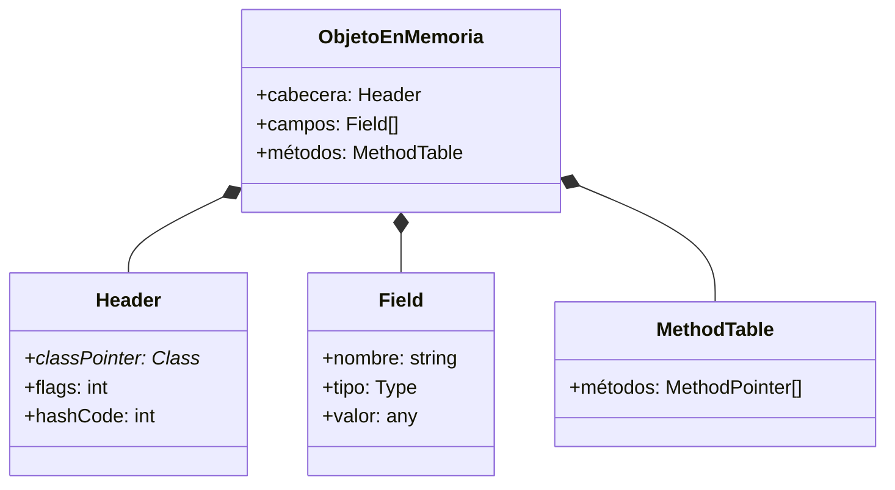
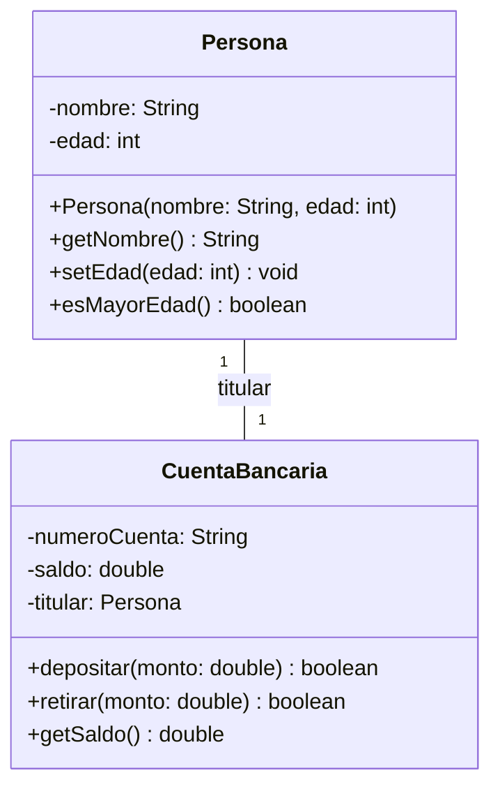
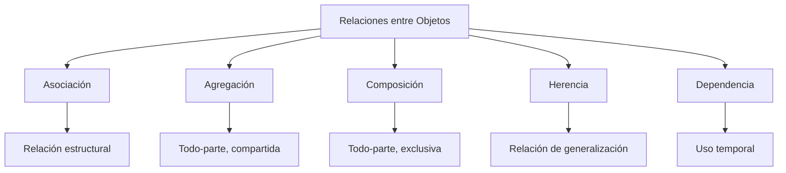
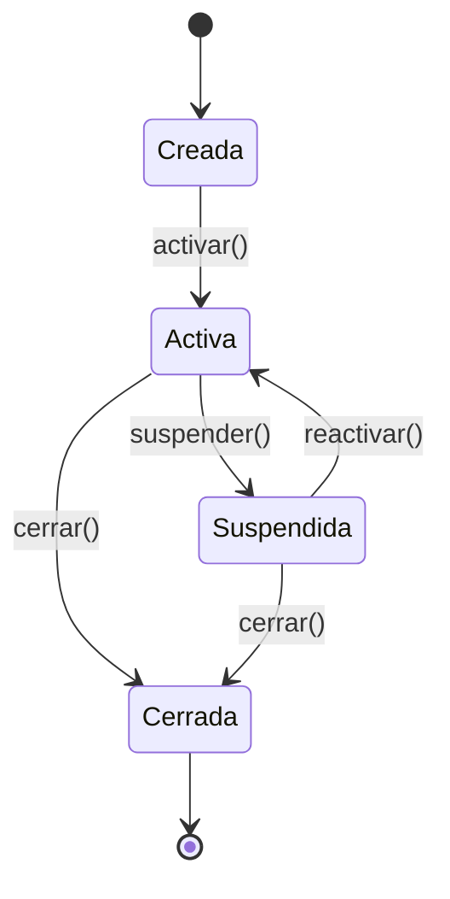
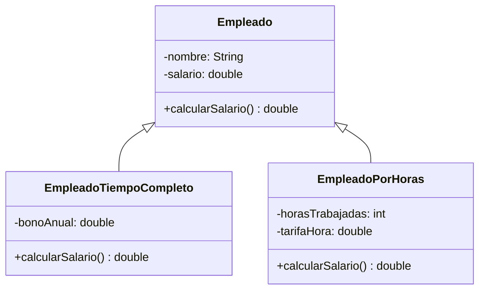

# Lenguajes de Programación - Paradigma orientado a objetos

## 5.3 Modelado y representación de objetos.

---

### Definición Fundamental

El modelado de objetos es el proceso de abstraer entidades del mundo real o conceptual en representaciones software mediante clases y objetos, capturando tanto su estructura como su comportamiento.

**Definición formal**: Un objeto es una entidad que encapsula estado (datos) y comportamiento (métodos), representado como:

$$O = (S, M)$$

donde $S$ es el estado y $M$ es el conjunto de métodos.

### Representación Interna de Objetos

#### Estructura en Memoria



### Modelado de Clases y Objetos

#### Diagrama UML de Clases



### Representación Matemática

#### Clase como Tupla de Funciones

Una clase puede representarse como:

$$C = (F, M, I)$$

donde:

- $F$: Conjunto de campos (atributos)
- $M$: Conjunto de métodos
- $I$: Implementación de métodos

#### Objeto como Instancia

Un objeto $o$ de clase $C$:

$$o = (v_1, v_2, ..., v_n)$$

donde $v_i$ son valores de los campos $f_i \in F$

### Encapsulación y Ocultamiento de Información

**Principio de encapsulación**:

$$\forall f \in F, \exists m \in M \mid acceso(f) = controlado(m)$$

**Ejemplo de implementación**:

```java
public class CuentaBancaria {
    private String numeroCuenta;
    private double saldo;
    private Persona titular;

    // Constructor
    public CuentaBancaria(String numeroCuenta, Persona titular) {
        this.numeroCuenta = numeroCuenta;
        this.saldo = 0.0;
        this.titular = titular;
    }

    // Métodos de acceso controlado
    public boolean depositar(double monto) {
        if (monto > 0) {
            saldo += monto;
            return true;
        }
        return false;
    }

    public boolean retirar(double monto) {
        if (monto > 0 && saldo >= monto) {
            saldo -= monto;
            return true;
        }
        return false;
    }

    public double getSaldo() {
        return saldo;
    }
}
```

### Relaciones entre Objetos

#### Tipos de Relaciones



### Modelado de Comportamiento

#### Diagrama de Estados



#### Implementación de Estados

```java
public interface EstadoCuenta {
    void depositar(Cuenta cuenta, double monto);
    void retirar(Cuenta cuenta, double monto);
    void suspender(Cuenta cuenta);
    void reactivar(Cuenta cuenta);
}

public class EstadoActiva implements EstadoCuenta {
    public void depositar(Cuenta cuenta, double monto) {
        cuenta.saldo += monto;
    }

    public void retirar(Cuenta cuenta, double monto) {
        if (cuenta.saldo >= monto) {
            cuenta.saldo -= monto;
        }
    }

    public void suspender(Cuenta cuenta) {
        cuenta.setEstado(new EstadoSuspendida());
    }

    public void reactivar(Cuenta cuenta) {
        // Ya está activa
    }
}
```

### Representación de Herencia

#### Jerarquía de Herencia



### Modelado de Interfaces

```java
public interface Notificable {
    void enviarNotificacion(String mensaje);
    boolean puedeRecibirNotificaciones();
}

public interface Auditable {
    void registrarAuditoria(String accion);
    List<String> obtenerHistorialAuditoria();
}

public class CuentaPremium implements Notificable, Auditable {
    private List<String> historialAuditoria = new ArrayList<>();

    @Override
    public void enviarNotificacion(String mensaje) {
        System.out.println("Notificación premium: " + mensaje);
    }

    @Override
    public boolean puedeRecibirNotificaciones() {
        return true;
    }

    @Override
    public void registrarAuditoria(String accion) {
        historialAuditoria.add(accion + " - " + new Date());
    }

    @Override
    public List<String> obtenerHistorialAuditoria() {
        return Collections.unmodifiableList(historialAuditoria);
    }
}
```

### Patrones de Modelado

#### Pattern Object Model

```java
public abstract class PatternObject {
    protected Map<String, Object> properties = new HashMap<>();

    public void setProperty(String key, Object value) {
        properties.put(key, value);
    }

    public Object getProperty(String key) {
        return properties.get(key);
    }

    public abstract void validate();
}

public class User extends PatternObject {
    public User() {
        setProperty("username", "");
        setProperty("email", "");
        setProperty("active", false);
    }

    @Override
    public void validate() {
        if (((String)getProperty("username")).isEmpty()) {
            throw new ValidationException("Username required");
        }
    }
}
```

### Ejercicios Propuestos

#### Ejercicio 1: Modelado de Sistema Educativo

Diseña un sistema para representar:

- Clases: `Estudiante`, `Profesor`, `Curso`, `Matricula`
- Relaciones: herencia, asociación, composición
- Comportamiento: calificaciones, horarios, matrículas

#### Ejercicio 2: Representación de Objetos JSON

Implementa un sistema que convierta objetos a JSON:

```java
interface JSONSerializable {
    String toJSON();
}

class Persona implements JSONSerializable {
    private String nombre;
    private int edad;

    // Implementar toJSON()
}
```

#### Ejercicio 3: Sistema de Inventarios

Modela un sistema de inventario con:

- Productos con diferentes categorías
- Gestión de stock
- Relaciones de herencia y composición
- Estados de productos (disponible, agotado, reservado)

### Métricas de Modelado

**Cohesión de clase**:

$$ \text{Cohesión}(C) = \frac{|M_{relacionados}|}{|M|} $$

**Acoplamiento entre clases**:

$$ Acoplamiento(C_1, C_2) = |\{m \in M_1 \mid depende(m, C_2)\}| $$

### Referencias Bibliográficas

#### Bibliografía Básica

1. **Mitchell, J. (2003)**. _Concepts in Programming Languages_. Cambridge University Press.
   - Capítulo 9: Data Abstraction and Object Orientation
   - Sección 9.3: Objects and Encapsulation

2. **Pierce, B.C. (2002)**. _Types and Programming Languages_. MIT Press.
   - Capítulo 18: Imperative Objects
   - Sección 18.4: Self

#### Bibliografía Complementaria

3. **Rumbaugh, J., et al. (1991)**. _Object-Oriented Modeling and Design_
4. **Booch, G. (1994)**. _Object-Oriented Analysis and Design with Applications_
5. **Krishnamurthi, S. (2007)**. _Programming Languages: Application and Interpretation_
   - Capítulo 32: Objects: Interpretation and Types

### Caso de Estudio: Sistema de Reservas

```java
public class SistemaReservas {
    private Map<String, Recurso> recursos = new HashMap<>();
    private List<Reserva> reservas = new ArrayList<>();

    public interface Recurso {
        String getId();
        boolean estaDisponible(LocalDateTime inicio, LocalDateTime fin);
    }

    public class SalaConferencia implements Recurso {
        private String id;
        private int capacidad;
        private List<Reserva> reservas = new ArrayList<>();

        @Override
        public boolean estaDisponible(LocalDateTime inicio, LocalDateTime fin) {
            return reservas.stream().noneMatch(r -> r.hayConflicto(inicio, fin));
        }
    }

    public class Reserva {
        private Recurso recurso;
        private LocalDateTime inicio;
        private LocalDateTime fin;

        public boolean hayConflicto(LocalDateTime inicio, LocalDateTime fin) {
            return !(this.fin.isBefore(inicio) || this.inicio.isAfter(fin));
        }
    }
}
```

### Evaluación de Conceptos

1. **Explica** la diferencia entre composición y agregación con ejemplos
2. **Modela** un sistema de comercio electrónico con al menos 5 clases
3. **Implementa** el patrón State para manejar estados de pedidos
4. **Diseña** un sistema de modelado que permita extensión dinámica

Esta guía proporciona una comprensión completa del modelado y representación de objetos, integrando fundamentos teóricos con prácticas de diseño y implementación.
