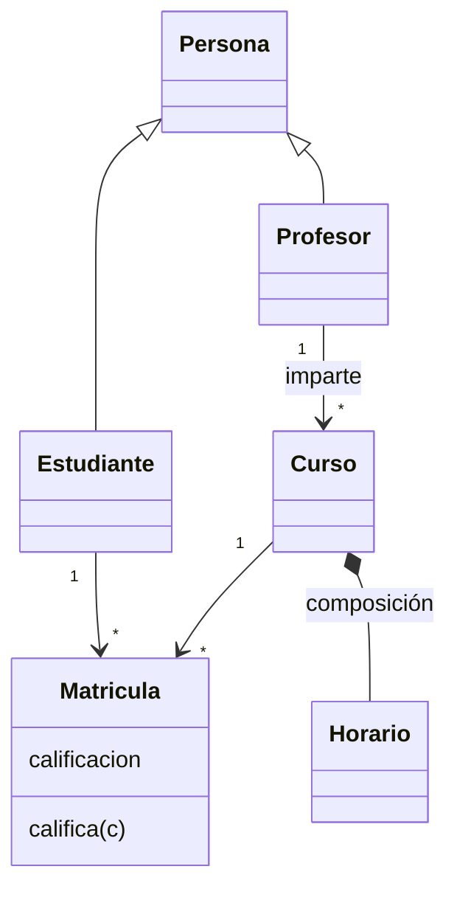

# Lenguajes de Programación - Paradigma orientado a objetos

## 5.3 Modelado y representación de objetos.

---

Programar con objetos requiere dos decisiones de naturaleza distinta. La primera es de **modelado**: qué objetos hay en el dominio del problema, qué responsabilidades tiene cada uno y cómo se relacionan. La segunda es de **representación**: cómo guarda el lenguaje un objeto en memoria y cómo encuentra sus campos y métodos. Este tema trata ambas: la estructura de un objeto en memoria y su modelo matemático, las relaciones entre clases de UML, el modelado del comportamiento con estados, la serialización y las métricas de cohesión y acoplamiento.

### Representación en memoria

Un objeto tiene **identidad**, **estado** y **comportamiento**. En una implementación típica, como la de Java o C++, un objeto es un bloque de memoria con:

- una **cabecera**, con un apuntador a la descripción de su clase, que incluye la tabla de métodos del tema 5.4, y datos para el recolector de basura y la sincronización;
- los **campos**, en posiciones fijas que el compilador conoce, con los de la superclase primero, de modo que el código compilado para la superclase encuentra sus campos en el mismo desplazamiento dentro de un objeto de cualquier subclase.

Los métodos no se guardan en el objeto: se comparten en la clase. La identidad es la dirección, y por eso `==` en Java compara identidad y `equals` compara estado.

En Python y JavaScript, por omisión, los campos viven en un **diccionario** por objeto, lo que permite agregar atributos en tiempo de ejecución a costa de memoria y tiempo de búsqueda. Con `__slots__`, Python usa posiciones fijas, como Java. Los motores de JavaScript, como V8, recuperan esa eficiencia con **clases ocultas**: agrupan los objetos que tienen los mismos campos en el mismo orden y les asignan una disposición fija.

### Modelo matemático

En la codificación de Cook y de Pierce, una clase es una función que recibe el estado y `self` y devuelve un registro de métodos, y un objeto es el punto fijo de la clase aplicada a un estado particular:

$$\mathit{clase} : \mathit{Estado} \to (\mathit{Obj} \to \mathit{Obj}), \qquad o = \mathsf{fix}(\mathit{clase}(s)).$$

Un objeto es así un **registro de cerraduras** que comparten el estado $s.$ La herencia combina registros antes de tomar el punto fijo, lo que da la recursión abierta del tema 5.1. El cálculo de objetos de Abadi y Cardelli toma en cambio los objetos como primitivos, sin clases: un objeto es un registro de métodos con un parámetro `self` explícito, y la herencia se reemplaza por la clonación y la actualización de métodos, como en Self y JavaScript.

### Relaciones entre clases

UML distingue, de más débil a más fuerte:

- **Dependencia:** una clase usa otra temporalmente, por ejemplo como parámetro de un método.
- **Asociación:** los objetos de una clase conocen a los de otra de forma duradera, con una **multiplicidad**: un curso tiene un profesor, un profesor tiene varios cursos. Si la asociación tiene datos propios, como la calificación de un estudiante en un curso, se modela con una **clase de asociación**.
- **Agregación:** una asociación todo-parte en la que las partes existen por separado: un departamento agrupa profesores.
- **Composición:** una agregación en la que el todo **posee** las partes, que se crean y destruyen con él y no se comparten: los horarios de un curso, las líneas de una factura.
- **Generalización:** la herencia, entre una clase y su especialización.

En el código, una asociación es un campo que referencia a otro objeto, y la composición, un campo que guarda un objeto creado por el propio todo, a menudo un **objeto valor**, inmutable y sin identidad propia, que se compara por contenido.



### Modelado del comportamiento

Muchos objetos tienen un ciclo de vida: un producto está disponible, reservado o agotado, y solo ciertas operaciones son válidas en cada estado. Hay dos maneras de representarlo:

- un **campo de estado** que se actualiza en cada transición, con el riesgo de que deje de coincidir con los datos de los que debería depender;
- un estado **derivado**, calculado a partir de los datos cada vez que se consulta, que nunca se desincroniza.

Cuando el comportamiento cambia mucho de un estado a otro, el patrón **estado** representa cada estado como un objeto con los métodos válidos en él, y el objeto principal delega en su estado actual.

### Métricas

La **cohesión** mide qué tanto pertenecen juntos los elementos de una clase; el **acoplamiento**, cuánto depende una clase de otras. El objetivo es **alta cohesión** y **bajo acoplamiento**. La métrica LCOM, de Chidamber y Kemerer (1994), cuenta los pares de métodos que no comparten atributos, $P,$ y los que sí comparten alguno, $Q:$

$$\mathrm{LCOM} = \max(P - Q, 0).$$

Un valor de 0 indica una clase cohesiva; uno alto, una clase con varias responsabilidades que convendría separar. La métrica CBO, del mismo trabajo, cuenta las clases con las que una clase está acoplada. Son indicadores, no reglas: una clase de datos sin métodos que compartan nada puede tener un LCOM alto y estar bien diseñada.

### Implementación en Python

El programa compara el tamaño de un objeto con diccionario y con `__slots__`. Para el ejercicio 1 implementa el sistema educativo del diagrama, con herencia, asociación, una clase de asociación y composición, y validaciones de cupo y de choques de horario. Para el ejercicio 2 implementa un serializador a JSON por reflexión, que escapa las cadenas y detecta ciclos, y lo compara con la concatenación ingenua. Para el ejercicio 3 implementa el inventario con estados derivados del stock. Al final calcula el LCOM de dos clases analizando su código fuente.

```python
import ast, inspect, json, sys, textwrap
from dataclasses import dataclass, field
from enum import Enum

# ---------- Representación interna: con y sin __dict__ ----------
class ConDict:
    def __init__(self): self.x, self.y = 1, 2
class ConSlots:
    __slots__ = ("x", "y")
    def __init__(self): self.x, self.y = 1, 2
a, b = ConDict(), ConSlots()
print("representación: ConDict ocupa", sys.getsizeof(a) + sys.getsizeof(a.__dict__), "bytes (objeto + diccionario);",
      "ConSlots", sys.getsizeof(b), "bytes (campos en posiciones fijas) | ambos guardan un apuntador a su clase:", type(a).__name__, type(b).__name__,
      "| ConSlots.x es un", type(ConSlots.__dict__["x"]).__name__, "que conoce el desplazamiento del campo")

# ---------- Ejercicio 1: sistema educativo ----------
class Persona:
    def __init__(self, nombre): self.nombre = nombre
class Profesor(Persona): pass                                          # herencia
class Estudiante(Persona):
    def __init__(self, nombre): super().__init__(nombre); self.matriculas = []
    def promedio(self):
        cal = [m.calificacion for m in self.matriculas if m.calificacion is not None]
        return round(sum(cal) / len(cal), 2) if cal else None
@dataclass(frozen=True)
class Horario:                                                         # objeto valor, parte de Curso: composición
    dia: str; inicio: int; fin: int
    def choca(self, otro): return self.dia == otro.dia and self.inicio < otro.fin and otro.inicio < self.fin
class Curso:
    def __init__(self, clave, profesor, cupo, *horarios):
        self.clave, self.profesor, self.cupo = clave, profesor, cupo  # asociación con Profesor
        self.horarios, self.matriculas = list(horarios), []
class Matricula:                                                        # clase de asociación entre Estudiante y Curso
    def __init__(self, estudiante, curso): self.estudiante, self.curso, self.calificacion = estudiante, curso, None
    def califica(self, c):
        if not 0 <= c <= 10: raise ValueError("la calificación va de 0 a 10")
        self.calificacion = c
def matricula(est, curso):
    if len(curso.matriculas) >= curso.cupo: raise ValueError(f"{curso.clave} sin cupo")
    for m in est.matriculas:
        if any(h.choca(g) for h in m.curso.horarios for g in curso.horarios):
            raise ValueError(f"{curso.clave} choca con {m.curso.clave}")
    m = Matricula(est, curso); est.matriculas.append(m); curso.matriculas.append(m); return m
prof = Profesor("Turing")
lp = Curso("LP", prof, 2, Horario("lun", 9, 11), Horario("mie", 9, 11))
bd = Curso("BD", prof, 2, Horario("lun", 10, 12))
ia = Curso("IA", prof, 1, Horario("mar", 9, 11))
ana, luis = Estudiante("Ana"), Estudiante("Luis")
matricula(ana, lp).califica(9.5); matricula(ana, ia).califica(8)
for intento in (lambda: matricula(ana, bd), lambda: matricula(luis, ia)):
    try: intento()
    except ValueError as e: print("ejercicio 1: rechazado:", e)
print("   Ana:", [m.curso.clave for m in ana.matriculas], "promedio", ana.promedio(), "| inscritos en LP:", [m.estudiante.nombre for m in lp.matriculas])

# ---------- Ejercicio 2: serialización a JSON ----------
def a_json(obj, _vistos=None):
    """Reflexión sobre los campos públicos; escapa cadenas y detecta ciclos."""
    vistos = _vistos if _vistos is not None else set()
    if obj is None or isinstance(obj, (bool, int, float)): return json.dumps(obj)
    if isinstance(obj, str): return json.dumps(obj, ensure_ascii=False)
    if isinstance(obj, Enum): return a_json(obj.value, vistos)
    if id(obj) in vistos: raise ValueError(f"ciclo en {type(obj).__name__}")
    vistos = vistos | {id(obj)}
    if isinstance(obj, (list, tuple)): return "[" + ", ".join(a_json(x, vistos) for x in obj) + "]"
    campos = obj.items() if isinstance(obj, dict) else ((k, v) for k, v in vars(obj).items() if not k.startswith("_"))
    return "{" + ", ".join(f"{json.dumps(str(k), ensure_ascii=False)}: {a_json(v, vistos)}" for k, v in campos) + "}"
class PersonaJ:
    def __init__(self, nombre, edad, contacto=None): self.nombre, self.edad, self.contacto, self._clave = nombre, edad, contacto, "secreta"
    def to_json_ingenuo(self): return '{"nombre": "' + self.nombre + '", "edad": ' + str(self.edad) + "}"
p = PersonaJ('Ana "la Grande"', 30, {"emails": ["ana@x.mx"], "tel": None})
print("ejercicio 2:", a_json(p))
print("   vuelta atrás con json.loads:", json.loads(a_json(p)) == {"nombre": 'Ana "la Grande"', "edad": 30, "contacto": {"emails": ["ana@x.mx"], "tel": None}})
try: json.loads(p.to_json_ingenuo())
except json.JSONDecodeError as e: print("   la versión por concatenación produce JSON inválido:", p.to_json_ingenuo(), "→", e.msg)
q = PersonaJ("Bo", 3); q.contacto = q
try: a_json(q)
except ValueError as e: print("   referencia circular:", e)

# ---------- Ejercicio 3: inventario con estados ----------
class Estado(Enum):
    DISPONIBLE = "disponible"; RESERVADO = "reservado"; AGOTADO = "agotado"
@dataclass
class Producto:
    sku: str; nombre: str; categoria: str; precio: float
    existencia: int = 0; reservado: int = 0
    @property
    def libre(self): return self.existencia - self.reservado
    @property
    def estado(self):                                                  # derivado del stock: nunca se desincroniza
        if self.existencia == 0: return Estado.AGOTADO
        return Estado.RESERVADO if self.libre == 0 else Estado.DISPONIBLE
@dataclass
class Perecedero(Producto):
    caduca: str = "2026-12-31"
@dataclass
class Inventario:
    productos: dict = field(default_factory=dict)                      # composición: el inventario posee sus productos
    movimientos: list = field(default_factory=list)
    def alta(self, p): self.productos[p.sku] = p
    def entrada(self, sku, n): self.productos[sku].existencia += n; self.movimientos.append(("entrada", sku, n))
    def reserva(self, sku, n):
        p = self.productos[sku]
        if n > p.libre: raise ValueError(f"solo hay {p.libre} libres de {sku}")
        p.reservado += n; self.movimientos.append(("reserva", sku, n))
    def entrega(self, sku, n):
        p = self.productos[sku]
        if n > p.reservado: raise ValueError("se entrega solo lo reservado")
        p.reservado -= n; p.existencia -= n; self.movimientos.append(("entrega", sku, n))
    def valor(self): return sum(p.existencia * p.precio for p in self.productos.values())
    def por_categoria(self):
        r = {}
        for p in self.productos.values(): r[p.categoria] = r.get(p.categoria, 0) + p.existencia
        return r
inv = Inventario()
inv.alta(Producto("T-1", "Teclado", "cómputo", 450.0)); inv.alta(Perecedero("L-1", "Leche", "alimentos", 28.5, caduca="2026-11-20"))
inv.entrada("T-1", 3); inv.entrada("L-1", 10)
estados = [inv.productos["T-1"].estado.value]
inv.reserva("T-1", 3); estados.append(inv.productos["T-1"].estado.value)
try: inv.reserva("T-1", 1)
except ValueError as e: estados.append(f"error: {e}")
inv.entrega("T-1", 3); estados.append(inv.productos["T-1"].estado.value)
print("ejercicio 3: estados del teclado:", " → ".join(estados))
print(f"   valor {inv.valor():.2f} | por categoría {inv.por_categoria()} | movimientos {len(inv.movimientos)} | la leche caduca {inv.productos['L-1'].caduca}")

# ---------- Cohesión: falta de cohesión de métodos (LCOM) a partir del código ----------
def lcom(cls):
    """LCOM de Chidamber y Kemerer: pares de métodos sin atributos en común menos pares con alguno, mínimo 0."""
    usos = {}
    for nombre, f in vars(cls).items():
        if inspect.isfunction(f) and not nombre.startswith("__"):
            arbol = ast.parse(textwrap.dedent(inspect.getsource(f)))
            usos[nombre] = {n.attr for n in ast.walk(arbol) if isinstance(n, ast.Attribute) and isinstance(n.value, ast.Name) and n.value.id == "self"}
    ms = list(usos); P = Q = 0
    for i in range(len(ms)):
        for j in range(i + 1, len(ms)):
            if usos[ms[i]] & usos[ms[j]]: Q += 1
            else: P += 1
    return max(P - Q, 0), usos
class Mezcla:                                                          # dos responsabilidades en una clase
    def __init__(self): self.saldo = 0; self.log = []
    def deposita(self, n): self.saldo += n
    def retira(self, n): self.saldo -= n
    def escribe(self, s): self.log.append(s)
    def vacia(self): self.log.clear()
for c in (Inventario, Mezcla):
    v, usos = lcom(c); print(f"cohesión: LCOM({c.__name__}) = {v}", {m: sorted(a) for m, a in usos.items()})
```

Salida:

```text
representación: ConDict ocupa 344 bytes (objeto + diccionario); ConSlots 48 bytes (campos en posiciones fijas) | ambos guardan un apuntador a su clase: ConDict ConSlots | ConSlots.x es un member_descriptor que conoce el desplazamiento del campo
ejercicio 1: rechazado: BD choca con LP
ejercicio 1: rechazado: IA sin cupo
   Ana: ['LP', 'IA'] promedio 8.75 | inscritos en LP: ['Ana']
ejercicio 2: {"nombre": "Ana \"la Grande\"", "edad": 30, "contacto": {"emails": ["ana@x.mx"], "tel": null}}
   vuelta atrás con json.loads: True
   la versión por concatenación produce JSON inválido: {"nombre": "Ana "la Grande"", "edad": 30} → Expecting ',' delimiter
   referencia circular: ciclo en PersonaJ
ejercicio 3: estados del teclado: disponible → reservado → error: solo hay 0 libres de T-1 → agotado
   valor 285.00 | por categoría {'cómputo': 0, 'alimentos': 10} | movimientos 4 | la leche caduca 2026-11-20
cohesión: LCOM(Inventario) = 0 {'alta': ['productos'], 'entrada': ['movimientos', 'productos'], 'reserva': ['movimientos', 'productos'], 'entrega': ['movimientos', 'productos'], 'valor': ['productos'], 'por_categoria': ['productos']}
cohesión: LCOM(Mezcla) = 2 {'deposita': ['saldo'], 'retira': ['saldo'], 'escribe': ['log'], 'vacia': ['log']}
```

### Ejercicios Propuestos

1. **Sistema educativo.** Diseña un sistema con las clases `Estudiante`, `Profesor`, `Curso` y `Matricula`, con relaciones de herencia, asociación y composición, y con calificaciones, horarios y matrículas.

2. **JSON.** Implementa la conversión de objetos a JSON:

    ```java
    interface JSONSerializable {
        String toJSON();
    }

    class Persona implements JSONSerializable {
        private String nombre;
        private int edad;

        // Implementar toJSON()
    }
    ```

3. **Inventario.** Modela un sistema de inventario con productos de diferentes categorías, gestión del stock, relaciones de herencia y composición, y estados de los productos: disponible, agotado y reservado.

### Soluciones

**Ejercicio 1.** El diagrama de la sección de relaciones es el modelo. `Estudiante` y `Profesor` heredan de `Persona`. `Curso` se **asocia** con un profesor, que existe por su cuenta, y está **compuesto** de sus horarios, objetos valor inmutables que solo existen como parte del curso. La relación entre estudiantes y cursos es de muchos a muchos y tiene un dato propio, la calificación, por lo que se modela con la **clase de asociación** `Matricula`, que ambos lados referencian. Las reglas del dominio están en un solo lugar, la función `matricula`: rechaza la inscripción si el curso no tiene cupo o si alguno de sus horarios se cruza con uno de los cursos ya inscritos; dos intervalos $[a, b)$ y $[c, d)$ del mismo día se cruzan si $a \lt d$ y $c \lt b.$ La calificación se valida en `Matricula.califica`. El promedio de Ana, con 9.5 y 8, es 8.75.

**Ejercicio 2.** La versión ingenua concatena cadenas, `"{\"nombre\": \"" + nombre + ...`, y produce JSON inválido en cuanto el nombre tiene una comilla, una diagonal invertida o un salto de línea; peor, si el nombre lo controla un usuario, puede **inyectar** campos. La solución es escapar cada cadena según la especificación de JSON, RFC 8259, o usar una biblioteca, como `json.dumps` en Python o Jackson en Java. El serializador del programa recorre por **reflexión** los campos públicos del objeto, omite los que empiezan con `_`, para no exponer datos internos, y trata recursivamente listas, diccionarios y objetos anidados. Detecta los **ciclos** con el conjunto de objetos en el camino actual: un objeto que se contiene a sí mismo no tiene representación en JSON. La prueba de corrección es la ida y vuelta: `json.loads` de la salida reproduce los datos. En Java, con la interfaz del enunciado, `toJSON` sería:

```java
public String toJSON() {
    return "{\"nombre\": " + escapa(nombre) + ", \"edad\": " + edad + "}";
}
static String escapa(String s) {
    StringBuilder sb = new StringBuilder("\"");
    for (char c : s.toCharArray()) {
        switch (c) {
            case '"' -> sb.append("\\\"");
            case '\\' -> sb.append("\\\\");
            case '\n' -> sb.append("\\n");
            default -> { if (c < 0x20) sb.append(String.format("\\u%04x", (int) c)); else sb.append(c); }
        }
    }
    return sb.append('"').toString();
}
```

**Ejercicio 3.** `Producto` guarda la existencia y lo reservado; `Perecedero` hereda y agrega la fecha de caducidad, y la categoría es un campo y no una subclase, porque no cambia el comportamiento. El `Inventario` está **compuesto** de sus productos y de un registro de movimientos. El estado **se deriva** del stock: agotado si la existencia es 0, reservado si todo lo existente está reservado, disponible en otro caso. Así es imposible que el estado diga "disponible" sin unidades libres. Las operaciones validan sus precondiciones: no se reserva más de lo libre ni se entrega más de lo reservado. La traza del teclado recorre los tres estados y muestra la reserva rechazada. El registro de movimientos permite reconstruir el inventario y auditarlo, y es el germen del patrón de **fuente de eventos**.

La métrica final confirma el diseño: `Inventario` tiene LCOM 0, porque todos sus métodos comparten `productos`, mientras que una clase que mezcla un saldo y una bitácora tiene LCOM 2, la señal de que son dos clases.

### Referencias

1. Booch, G., Rumbaugh, J., and Jacobson, I., _The Unified Modeling Language User Guide_. Addison-Wesley, 2005.
2. Abadi, M., and Cardelli, L., _A Theory of Objects_. Springer, 1996.
3. Chidamber, S. R., and Kemerer, C. F., A metrics suite for object oriented design. _IEEE Transactions on Software Engineering_ 20(6), 1994.
4. Evans, E., _Domain-Driven Design_. Addison-Wesley, 2003.
5. Bray, T. (ed.), RFC 8259: The JavaScript Object Notation (JSON) Data Interchange Format. IETF, 2017.
