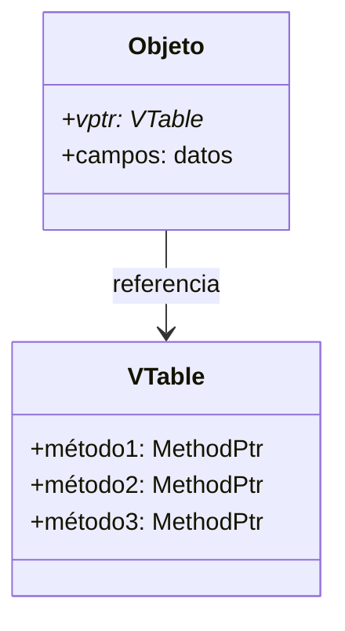

# Lenguajes de Programación - Paradigma orientado a objetos

## 5.4 Despacho dinámico y reemplazo de métodos (overriding).

---

### Definición Fundamental

El **despacho dinámico** es el mecanismo mediante el cual la selección del método a ejecutar se determina en tiempo de ejecución basado en el tipo real del objeto, no en el tipo declarado de la referencia.

**Definición formal**: Dado un objeto $o$ de tipo dinámico $D$ y tipo estático $T$, donde $D \leq T$, el despacho del método $m$ se resuelve como:

$$\text{despacho}(o, m) = \text{lookup}(D, m)$$

### Reemplazo de Métodos (Overriding)

El **overriding** permite que una subclase proporcione una implementación específica de un método que ya está definido en su superclase.

**Regla de overriding**: Para que un método $m'$ en clase $C'$ reemplace a $m$ en clase $C$ donde $C' \leq C$, se debe cumplir:

$$\text{firma}(m') = \text{firma}(m)$$

### Mecanismo de Búsqueda de Métodos

#### Tabla de Métodos Virtuales (VTable)



**Estructura en memoria**:

```c
struct VTable {
    void (*método1)(void*);
    void (*método2)(void*);
    void (*método3)(void*);
};

struct Objeto {
    VTable* vptr;
    // campos de datos...
};
```

### Implementación en Java

```java
class Animal {
    public void hacerSonido() {
        System.out.println("Sonido genérico");
    }

    public void mover() {
        System.out.println("El animal se mueve");
    }
}

class Perro extends Animal {
    @Override
    public void hacerSonido() {
        System.out.println("Guau guau");
    }

    @Override
    public void mover() {
        System.out.println("El perro corre");
    }
}

class Gato extends Animal {
    @Override
    public void hacerSonido() {
        System.out.println("Miau miau");
    }

    // No override de mover() - usa implementación de Animal
}

// Uso del despacho dinámico
public class Main {
    public static void main(String[] args) {
        Animal[] animales = {new Animal(), new Perro(), new Gato()};

        for (Animal animal : animales) {
            animal.hacerSonido(); // Despacho dinámico
            animal.mover();       // Despacho dinámico
        }
    }
}
```

### Modelo Matemático

#### Semántica Operacional

La regla de despacho dinámico puede expresarse como:

$$\frac{o = new C() \quad lookup(C, m) = function(x)e}{o.m() \rightarrow e[o/this]}$$

Donde:

- $lookup(C, m)$ busca el método $m$ en la clase $C$
- $e[o/this]$ substituye $this$ por el objeto $o$

#### Algoritmo de Búsqueda

$$ lookup(C, m) =  \begin{cases}  \text{definición}(m, C) & \text{si } m \text{ está definido en } C \\\ lookup(super(C), m) & \text{en caso contrario} \end{cases} $$

### Diferencias Clave

#### Despacho Dinámico vs. Estático

| Característica | Despacho Dinámico | Despacho Estático  |
| -------------- | ----------------- | ------------------ |
| Resolución     | Tiempo ejecución  | Tiempo compilación |
| Flexibilidad   | Alta              | Baja               |
| Overhead       | Mayor             | Menor              |
| Polimorfismo   | Sí                | No                 |

### Ejemplo Avanzado: Sistema de Formas

```java
abstract class Forma {
    protected String color;

    public Forma(String color) {
        this.color = color;
    }

    // Método abstracto - debe ser override
    public abstract double calcularArea();

    // Método concreto - puede ser override
    public void describir() {
        System.out.println("Forma color: " + color);
    }

    // Método final - no puede ser override
    public final String getColor() {
        return color;
    }
}

class Circulo extends Forma {
    private double radio;

    public Circulo(String color, double radio) {
        super(color);
        this.radio = radio;
    }

    @Override
    public double calcularArea() {
        return Math.PI * radio * radio;
    }

    @Override
    public void describir() {
        System.out.println("Círculo color: " + color + ", radio: " + radio);
    }
}

class Rectangulo extends Forma {
    private double ancho, alto;

    public Rectangulo(String color, double ancho, double alto) {
        super(color);
        this.ancho = ancho;
        this.alto = alto;
    }

    @Override
    public double calcularArea() {
        return ancho * alto;
    }

    // No override de describir() - usa implementación de Forma
}
```

### Patrón Template Method

```java
abstract class ProcesadorDatos {
    // Método template - define el esqueleto del algoritmo
    public final void procesar() {
        abrirConexion();
        transformarDatos(); // Paso variable - despacho dinámico
        cerrarConexion();
    }

    protected void abrirConexion() {
        System.out.println("Abriendo conexión...");
    }

    protected void cerrarConexion() {
        System.out.println("Cerrando conexión...");
    }

    // Método abstracto - debe ser implementado por subclases
    protected abstract void transformarDatos();
}

class ProcesadorXML extends ProcesadorDatos {
    @Override
    protected void transformarDatos() {
        System.out.println("Transformando datos XML...");
    }
}

class ProcesadorJSON extends ProcesadorDatos {
    @Override
    protected void transformarDatos() {
        System.out.println("Transformando datos JSON...");
    }
}
```

### Consideraciones de Diseño

#### Principio de Liskov y Overriding

El overriding debe respetar el principio de sustitución de Liskov:

- Precondiciones no pueden ser más restrictivas
- Postcondiciones no pueden ser más débiles
- No lanzar nuevas excepciones checked

#### Anotaciones y Contratos

```java
class Base {
    /**
     * @pre valor > 0
     * @post return > 0
     */
    public int procesar(int valor) {
        return valor * 2;
    }
}

class Derivada extends Base {
    @Override
    /**
     * @pre valor != 0  // Precondición más débil - OK
     * @post return > 1 // Postcondición más fuerte - OK
     */
    public int procesar(int valor) {
        return Math.abs(valor) * 3;
    }
}
```

### Ejercicios Propuestos

#### Ejercicio 1: Sistema de Notificaciones

Implementa un sistema donde:

- Clase base `Notificacion` con método `enviar()`
- Subclases `EmailNotificacion`, `SMSNotificacion`, `PushNotificacion`
- Demuestra despacho dinámico en una lista heterogénea

#### Ejercicio 2: Análisis de VTable

Dada la jerarquía:

```java
class A { void m1() {} void m2() {} }
class B extends A { void m1() {} void m3() {} }
class C extends B { void m2() {} void m4() {} }
```

Dibuja las VTables para cada clase y muestra el despacho de `C.m2()`

#### Ejercicio 3: Violación de Liskov

Identifica y corrige violaciones del principio de Liskov:

```java
class Rectangulo {
    void setAncho(int w) { ... }
    void setAlto(int h) { ... }
}

class Cuadrado extends Rectangulo {
    @Override
    void setAncho(int w) {
        super.setAncho(w);
        super.setAlto(w);
    }

    @Override
    void setAlto(int h) {
        super.setAncho(h);
        super.setAlto(h);
    }
}
```

### Optimizaciones del Despacho Dinámico

#### Inline Caching

```java
// Antes de la optimización
void llamarMetodo(Animal animal) {
    animal.hacerSonido(); // Búsqueda en VTable
}

// Después de inline caching
void llamarMetodo(Animal animal) {
    if (animal.getClass() == Perro.class) {
        ((Perro)animal).hacerSonido$Perro(); // Llamada directa
    } else {
        animal.hacerSonido(); // Fallback a VTable
    }
}
```

#### Polymorphic Inline Caching

Para múltiples tipos frecuentes:

```java
switch (animal.getClass()) {
    case Perro.class: ((Perro)animal).hacerSonido$Perro(); break;
    case Gato.class: ((Gato)animal).hacerSonido$Gato(); break;
    default: animal.hacerSonido(); break;
}
```

### Referencias Bibliográficas

#### Bibliografía Básica

1. **Mitchell, J. (2003)**. _Concepts in Programming Languages_. Cambridge University Press.
   - Capítulo 10: Object-Oriented Programming Concepts
   - Sección 10.3: Dynamic Dispatch

2. **Pierce, B.C. (2002)**. _Types and Programming Languages_. MIT Press.
   - Capítulo 18: Imperative Objects
   - Sección 18.5: Dynamic Dispatch

#### Bibliografía Complementaria

3. **Krishnamurthi, S. (2007)**. _Programming Languages: Application and Interpretation_
   - Capítulo 32: Objects: Interpretation and Types
4. **Agesen, O. (1995)**. _The Cartesian Product Algorithm_
5. **Chambers, C. (1992)**. _Object-Oriented Multi-Methods in Cecil_

### Caso de Estudio: Sistema de Plugins

```java
interface Plugin {
    String getName();
    void initialize();
    void execute();
    void cleanup();
}

abstract class AbstractPlugin implements Plugin {
    @Override
    public void initialize() {
        System.out.println("Inicializando plugin: " + getName());
    }

    @Override
    public void cleanup() {
        System.out.println("Limpiando plugin: " + getName());
    }

    // execute() debe ser override por subclases
}

class DatabasePlugin extends AbstractPlugin {
    @Override
    public String getName() { return "DatabasePlugin"; }

    @Override
    public void execute() {
        System.out.println("Ejecutando operaciones de base de datos");
    }
}

class NetworkPlugin extends AbstractPlugin {
    @Override
    public String getName() { return "NetworkPlugin"; }

    @Override
    public void execute() {
        System.out.println("Ejecutando operaciones de red");
    }

    @Override
    public void initialize() {
        super.initialize();
        System.out.println("Configurando conexiones de red");
    }
}

class PluginManager {
    private List<Plugin> plugins = new ArrayList<>();

    public void runAll() {
        for (Plugin plugin : plugins) {
            plugin.initialize();  // Despacho dinámico
            plugin.execute();     // Despacho dinámico
            plugin.cleanup();     // Despacho dinámico
        }
    }
}
```

### Evaluación de Conceptos

1. **Explica** cómo funciona la VTable y su overhead de rendimiento
2. **Implementa** un sistema con despacho dinámico múltiple (multimethods)
3. **Analiza** violaciones del principio de Liskov en overriding
4. **Optimiza** código con patrones de despacho frecuente

Esta guía proporciona una comprensión profunda del despacho dinámico y reemplazo de métodos, integrando fundamentos teóricos con implementaciones prácticas y consideraciones de rendimiento.
