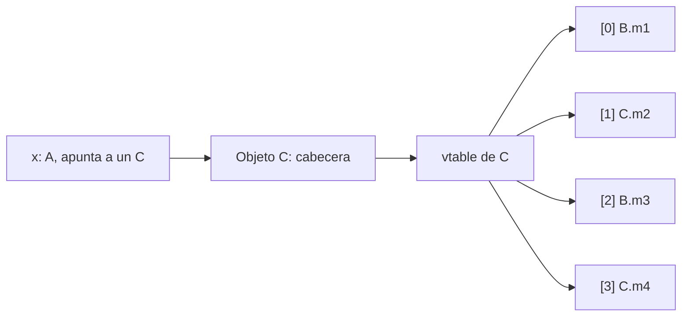

# Lenguajes de Programación - Paradigma orientado a objetos

## 5.4 Despacho dinámico y reemplazo de métodos (overriding).

---

Cuando un programa ejecuta `x.m()`, el lenguaje debe decidir qué código corre. Con **despacho estático**, lo decide el compilador a partir del tipo declarado de `x`; con **despacho dinámico**, se decide en tiempo de ejecución a partir de la clase real del objeto al que `x` apunta. El despacho dinámico es lo que hace útil el **reemplazo de métodos** (*overriding*): una subclase da su propia implementación de un método heredado, y todo el código escrito contra la superclase la usa sin saberlo. Este tema define ambos mecanismos, su implementación con tablas de métodos virtuales y con búsqueda en la cadena de clases, las optimizaciones que los hacen rápidos y su relación con la sobrecarga.

### Reemplazo y sobrecarga

Una subclase **reemplaza** un método si define uno con el mismo nombre y una firma compatible: los mismos parámetros y un tipo de resultado igual o más específico. En Java, la anotación `@Override` pide al compilador que verifique que de verdad se reemplaza algo; sin ella, un error tipográfico en el nombre o en un parámetro crea un método nuevo sin aviso. Dentro del método reemplazado, `super.m()` llama a la versión de la superclase con **despacho estático**, para extenderla en lugar de sustituirla.

La **sobrecarga** es otra cosa: varios métodos con el mismo nombre y parámetros distintos, entre los que el compilador elige con los **tipos estáticos** de los argumentos. Es polimorfismo ad hoc, resuelto al compilar. La diferencia es la fuente de errores clásica:

- el **receptor** se despacha dinámicamente, por su clase real;
- los **argumentos** se resuelven estáticamente, por su tipo declarado.

Java, C++ y C# son por eso de **despacho simple**. Los lenguajes con **multimétodos**, como CLOS, Julia o Dylan, eligen el método por las clases reales de todos los argumentos; en los demás, se obtiene el efecto con el **doble despacho** del patrón visitante. En Java, los métodos `static`, `private` y `final` no se despachan dinámicamente, y en C++ solo los declarados `virtual`.

### Tablas de métodos virtuales

En un lenguaje con tipos estáticos y herencia simple, cada clase tiene una **tabla de métodos virtuales**, o **vtable**: un arreglo de apuntadores a las implementaciones de sus métodos. Cada objeto guarda en su cabecera un apuntador a la tabla de su clase. La tabla de una subclase se construye copiando la de la superclase y luego:

- un método **reemplazado** conserva su índice, con la nueva implementación;
- un método **nuevo** se agrega al final.

Así, un método tiene el **mismo índice** en la tabla de la clase donde se declara y en la de todas sus subclases, y el compilador, que conoce el tipo estático, puede fijar el índice. Una llamada `x.m()` se compila a tres instrucciones: cargar la tabla desde el objeto, cargar la entrada en el índice de `m`, y saltar. El costo es constante, independiente de la profundidad de la jerarquía. Con herencia múltiple, C++ usa varias tablas por objeto y ajusta el apuntador `this` al convertir entre clases base.

### Búsqueda dinámica

Los lenguajes dinámicos, como Smalltalk, Ruby y Python, no conocen el tipo al compilar y no pueden fijar un índice. La semántica es la **búsqueda**: se busca el método en la clase del objeto, y si no está, en su superclase, y así hasta la raíz; en Python, en el orden del MRO. Formalmente, con $\mathit{mbody}(m, C)$ el cuerpo del método $m$ en la clase $C,$ la búsqueda es

$$\mathit{mbody}(m, C) = \begin{cases} \text{el cuerpo de } m \text{ en } C & \text{si } C \text{ define } m, \\ \mathit{mbody}(m, \mathit{super}(C)) & \text{en otro caso.} \end{cases}$$

Es la misma función de la semántica de Featherweight Java del tema 5.5. Una llamada $\mathsf{new}\ C(\bar{v}).m(\bar{u})$ se reduce al cuerpo $\mathit{mbody}(m, C)$ con los parámetros sustituidos por $\bar{u}$ y `this` por el objeto.

### Optimizaciones

La búsqueda en cada llamada sería lenta, y los compiladores la evitan:

- **Caché en línea** (Deutsch y Schiffman, 1984, para Smalltalk): cada sitio de llamada recuerda la última clase de receptor y el método que encontró; si la siguiente llamada tiene un receptor de la misma clase, salta directo. En la práctica, la mayoría de los sitios son **monomórficos**, siempre la misma clase.
- **Caché polimórfica** (Hölzle, Chambers y Ungar, 1991, para Self): guarda unas pocas clases por sitio. Los sitios **megamórficos**, con muchas clases, vuelven a la búsqueda general.
- **Desvirtualización:** si el compilador demuestra que solo hay una implementación posible, porque la clase es `final` o porque el análisis de toda la jerarquía cargada lo muestra, reemplaza la llamada virtual por una directa, y puede **expandirla en línea**. La JVM lo hace de forma especulativa y deshace la optimización si se carga una subclase nueva.



### Implementación en Python

El programa construye las tablas de métodos virtuales de la jerarquía del ejercicio 2, con la regla de copiar y extender, despacha las llamadas como lo haría el código compilado y las compara con la búsqueda por la cadena de superclases. Después simula cachés en línea de uno y de cuatro elementos en sitios monomórficos, polimórficos y megamórficos. Para el ejercicio 1 muestra el despacho dinámico en una lista heterogénea, con un método plantilla, `super` y doble despacho.

```python
import random

# ---------- Ejercicio 2: construcción de vtables con herencia simple ----------
class Clase:
    def __init__(self, nombre, padre, metodos):
        self.nombre, self.padre, self.propios = nombre, padre, metodos
        self.vtable = list(padre.vtable) if padre else []        # se copia la tabla del padre: mismos índices
        self.indice = dict(padre.indice) if padre else {}
        for m in metodos:
            impl = f"{nombre}.{m}"
            if m in self.indice: self.vtable[self.indice[m]] = impl   # redefinición: misma entrada, otra implementación
            else: self.indice[m] = len(self.vtable); self.vtable.append(impl)  # método nuevo: entrada al final
A = Clase("A", None, ["m1", "m2"])
B = Clase("B", A, ["m1", "m3"])
C = Clase("C", B, ["m2", "m4"])
print("ejercicio 2: vtables (índice: implementación)")
for k in (A, B, C): print(f"   {k.nombre}: " + ", ".join(f"[{i}] {k.vtable[i]}" for i in range(len(k.vtable))))
class Objeto:
    def __init__(self, clase): self.clase = clase
def invoca_virtual(obj, metodo, tipo_estatico):
    i = tipo_estatico.indice[metodo]                               # el compilador fija el índice con el tipo estático
    return f"índice {i} fijado con el tipo {tipo_estatico.nombre}, se carga vtable de {obj.clase.nombre} → {obj.clase.vtable[i]}"
print("   C.m2() con x: A = new C():", invoca_virtual(Objeto(C), "m2", A))
print("   C.m1() con x: A = new C():", invoca_virtual(Objeto(C), "m1", A))
print("   C.m3() con y: B = new C():", invoca_virtual(Objeto(C), "m3", B))
assert all(C.vtable[A.indice[m]].endswith(m) for m in A.indice)  # las entradas de A tienen el mismo índice en C

# --- búsqueda dinámica, como en Smalltalk o Python: se sube por la cadena de superclases ---
def busca(clase, metodo):
    pasos = 0
    while clase:
        if metodo in clase.propios: return f"{clase.nombre}.{metodo}", pasos
        clase, pasos = clase.padre, pasos + 1
    raise AttributeError(metodo)
print("   búsqueda por la cadena: m3 en C →", busca(C, "m3"), "| m2 en C →", busca(C, "m2"), "| m1 en C →", busca(C, "m1"))

# ---------- Cachés en línea: monomórfica y polimórfica ----------
def simula(sitio, cache_tam, receptores):
    cache, aciertos, busquedas = [], 0, 0
    for clase in receptores:
        hit = next((impl for (k, impl) in cache if k is clase), None)
        if hit: aciertos += 1
        else:
            busquedas += 1; impl, _ = busca(clase, sitio)
            cache.append((clase, impl))
            if len(cache) > cache_tam: cache.pop(0)                # el más viejo sale
    return aciertos / len(receptores)
rng = random.Random(7)
mono = [C] * 1000
poli = [rng.choice((A, B, C)) for _ in range(1000)]
clases_extra = [Clase(f"K{i}", A, ["m1"]) for i in range(12)]
mega = [rng.choice(clases_extra) for _ in range(1000)]
print("cachés en línea: tasa de aciertos de un sitio de llamada a m1")
for nombre, flujo in (("monomórfico (siempre C)", mono), ("polimórfico (A, B o C)", poli), ("megamórfico (12 clases)", mega)):
    print(f"   {nombre:26} caché de 1: {simula('m1', 1, flujo):.3f} | caché de 4: {simula('m1', 4, flujo):.3f}")

# ---------- Ejercicio 1: despacho dinámico en Python, y despacho por varios argumentos ----------
class Notificacion:
    def enviar(self): return f"{self.canal()}: {self.cuerpo()}"   # plantilla: ambos métodos se despachan dinámicamente
    def canal(self): return "genérico"
    def cuerpo(self): return "aviso"
class Email(Notificacion):
    def canal(self): return "email"
class EmailUrgente(Email):
    def cuerpo(self): return "URGENTE: " + super().cuerpo()       # super: despacho estático a la clase padre
class SMS(Notificacion):
    def canal(self): return "sms"
    def enviar(self): return super().enviar()[:12] + "…"          # redefine y extiende
lista = [Notificacion(), Email(), EmailUrgente(), SMS()]
print("ejercicio 1:", [n.enviar() for n in lista])
print("   MRO de EmailUrgente:", [k.__name__ for k in EmailUrgente.__mro__])
# Python despacha solo por el receptor; despachar por el tipo de dos objetos (doble despacho) requiere el patrón visitante
class Forma:
    def choca(self, otra): return otra.choca_con(self)               # primer despacho: self; segundo: otra
class Circulo(Forma):
    def choca_con(self, otra): return f"{type(otra).__name__}-Circulo"
class Caja(Forma):
    def choca_con(self, otra): return f"{type(otra).__name__}-Caja"
print("   doble despacho:", [a.choca(b) for a in (Circulo(), Caja()) for b in (Circulo(), Caja())])
```

Salida:

```text
ejercicio 2: vtables (índice: implementación)
   A: [0] A.m1, [1] A.m2
   B: [0] B.m1, [1] A.m2, [2] B.m3
   C: [0] B.m1, [1] C.m2, [2] B.m3, [3] C.m4
   C.m2() con x: A = new C(): índice 1 fijado con el tipo A, se carga vtable de C → C.m2
   C.m1() con x: A = new C(): índice 0 fijado con el tipo A, se carga vtable de C → B.m1
   C.m3() con y: B = new C(): índice 2 fijado con el tipo B, se carga vtable de C → B.m3
   búsqueda por la cadena: m3 en C → ('B.m3', 1) | m2 en C → ('C.m2', 0) | m1 en C → ('B.m1', 1)
cachés en línea: tasa de aciertos de un sitio de llamada a m1
   monomórfico (siempre C)    caché de 1: 0.999 | caché de 4: 0.999
   polimórfico (A, B o C)     caché de 1: 0.332 | caché de 4: 0.997
   megamórfico (12 clases)    caché de 1: 0.079 | caché de 4: 0.347
ejercicio 1: ['genérico: aviso', 'email: aviso', 'email: URGENTE: aviso', 'sms: aviso…']
   MRO de EmailUrgente: ['EmailUrgente', 'Email', 'Notificacion', 'object']
   doble despacho: ['Circulo-Circulo', 'Circulo-Caja', 'Caja-Circulo', 'Caja-Caja']
```

El mismo comportamiento en Java, con la sobrecarga y los métodos estáticos como contraste:

```java
class A { String m1() { return "A.m1"; } String m2() { return "A.m2"; }
          String f(A o) { return "A.f(A)"; } static String s() { return "A.s"; } }
class B extends A { @Override String m1() { return "B.m1"; } String m3() { return "B.m3"; }
          String f(B o) { return "B.f(B)"; } static String s() { return "B.s"; } }
class C extends B { @Override String m2() { return "C.m2"; } String m4() { return "C.m4"; } }

A x = new C();
B y = new C();
x.m1();   // B.m1
x.m2();   // C.m2
x.f(y);   // A.f(A): con el tipo estático A de x, el único candidato es f(A)
y.f(y);   // B.f(B)
y.f(x);   // A.f(A): el argumento x tiene tipo estático A
x.s();    // A.s: los métodos estáticos se eligen por el tipo estático
```

### Ejercicios Propuestos

1. **Despacho en una lista.** Implementa una clase base `Notificacion` con el método `enviar()` y subclases `EmailNotificacion`, `SMSNotificacion` y `PushNotificacion`, y demuestra el despacho dinámico en una lista heterogénea.

2. **vtables.** Para la jerarquía

    ```java
    class A { void m1() {} void m2() {} }
    class B extends A { void m1() {} void m3() {} }
    class C extends B { void m2() {} void m4() {} }
    ```

    dibuja las vtables de cada clase y muestra el despacho de `m2()` sobre un objeto de clase `C`.

3. **Liskov.** Identifica y corrige las violaciones del principio de Liskov en:

    ```java
    class Rectangulo {
        void setAncho(int w) { ... }
        void setAlto(int h) { ... }
    }

    class Cuadrado extends Rectangulo {
        @Override
        void setAncho(int w) {
            super.setAncho(w);
            super.setAlto(w);
        }

        @Override
        void setAlto(int h) {
            super.setAncho(h);
            super.setAlto(h);
        }
    }
    ```

### Soluciones

**Ejercicio 1.** El sistema de notificaciones completo está en el tema 5.2; aquí el programa se concentra en el mecanismo. `Notificacion.enviar` es un método plantilla que llama a `canal` y `cuerpo`, y ambas llamadas se despachan con la clase real del objeto: `Email` reemplaza solo `canal`, `EmailUrgente` hereda ese `canal` y reemplaza `cuerpo` extendiendo la versión heredada con `super`, y `SMS` reemplaza el propio `enviar`, también con `super`. Al recorrer la lista, una misma línea de código, `n.enviar()`, ejecuta cuatro combinaciones distintas. El MRO de `EmailUrgente` es el orden de búsqueda. Despachar por el tipo de **dos** objetos, como en una colisión entre formas, requiere doble despacho: `a.choca(b)` despacha por `a` y llama a `b.choca_con(a)`, que despacha por `b`.

**Ejercicio 2.** Aplicando la regla de copiar y extender:

| Índice | A      | B      | C      |
| ------ | ------ | ------ | ------ |
| 0      | `A.m1` | `B.m1` | `B.m1` |
| 1      | `A.m2` | `A.m2` | `C.m2` |
| 2      |        | `B.m3` | `B.m3` |
| 3      |        |        | `C.m4` |

`B` reemplaza `m1` en el índice 0, hereda `m2` en el 1 y agrega `m3` en el 2; `C` hereda `m1` de `B`, reemplaza `m2` en el 1, hereda `m3` y agrega `m4` en el 3. Para `A x = new C(); x.m2();`, el compilador busca `m2` en el tipo estático `A`, obtiene el índice 1 y emite: cargar la tabla desde el objeto, que es la de `C` porque el objeto es un `C`; cargar la entrada 1, que es `C.m2`, y saltar. El resultado es `C.m2`, y el índice habría sido el mismo con `B` o `C` como tipo estático, porque `m2` tiene el índice 1 en las tres tablas. La búsqueda dinámica da el mismo resultado subiendo por la cadena: `m2` está en `C` en 0 pasos, `m1` y `m3` en `B` en un paso. Las cachés en línea muestran por qué los lenguajes dinámicos pueden ser rápidos: un sitio monomórfico acierta casi siempre con una caché de una entrada, uno con tres clases necesita una caché polimórfica, y uno con doce clases falla con ambas.

**Ejercicio 3.** El análisis completo está en el ejercicio 2 del tema 5.2: el código es correcto para el sistema de tipos, pero `Cuadrado.setAlto` debilita la postcondición de `Rectangulo.setAlto`, que deja el ancho intacto, y un cliente que hace `setAncho(5); setAlto(4)` obtiene un área de 16 en lugar de 20. El problema de fondo es que el **reemplazo** permite cambiar el comportamiento sin que el compilador lo note: `@Override` verifica la firma, no el contrato. En Java moderno, la corrección más limpia es eliminar la mutabilidad y la herencia entre ambos, con registros que implementan una interfaz sellada:

```java
sealed interface Figura permits Rectangulo, Cuadrado { int area(); }
record Rectangulo(int ancho, int alto) implements Figura {
    public int area() { return ancho * alto; }
    Rectangulo conAncho(int w) { return new Rectangulo(w, alto); }
}
record Cuadrado(int lado) implements Figura {
    public int area() { return lado * lado; }
    Rectangulo comoRectangulo() { return new Rectangulo(lado, lado); }
}
```

Los registros son inmutables, y no hay ningún método cuyo contrato un subtipo pueda romper.

### Referencias

1. Stroustrup, B., _The Design and Evolution of C++_. Addison-Wesley, 1994. Capítulo 12.
2. Deutsch, L. P., and Schiffman, A. M., Efficient implementation of the Smalltalk-80 system. _POPL_, 1984.
3. Hölzle, U., Chambers, C., and Ungar, D., Optimizing dynamically-typed object-oriented languages with polymorphic inline caches. _ECOOP_, 1991.
4. Gosling, J., et al., _The Java Language Specification_, Java SE 21. Oracle, 2023. Secciones 8.4.8 y 15.12.
5. Scott, M. L., _Programming Language Pragmatics_. Morgan Kaufmann, 2015. Capítulo 10.
