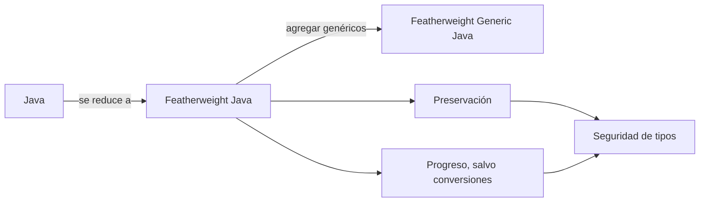

# Lenguajes de Programación - Paradigma orientado a objetos

## 5.5 Formalismos: Java Peso Pluma (Featherweight Java), SOOL.

---

Para demostrar que el sistema de tipos de un lenguaje es **seguro**, es decir, que un programa bien tipado no llega a un error de tipos al ejecutarse, se necesita una definición formal del lenguaje. Un lenguaje real como Java es demasiado grande para eso, y se estudia un **cálculo núcleo**: un lenguaje mínimo que conserva las características que interesan y descarta el resto. Para los objetos hay dos tradiciones: los cálculos **basados en clases**, como Featherweight Java, que modelan lenguajes como Java, y los **basados en objetos**, como el cálculo de Abadi y Cardelli. Este tema presenta Featherweight Java con su sintaxis, tipos y semántica, sus teoremas de seguridad, y SOOL, un lenguaje núcleo de enseñanza.

### Featherweight Java

Featherweight Java (FJ), de Igarashi, Pierce y Wadler (1999), es Java reducido a clases, herencia, campos, métodos, creación de objetos y conversiones de tipo. No tiene asignación, interfaces, sobrecarga, `super` en las expresiones, valores primitivos, excepciones ni concurrencia. Todo programa FJ es un programa Java válido con el mismo significado. Es un lenguaje **funcional**: un objeto no cambia después de creado, y "modificar" un campo es crear un objeto nuevo. Su tamaño permite demostrar la seguridad de tipos en unas páginas, y extenderlo con genéricos dio Featherweight Generic Java, el modelo de los genéricos de Java 5.

**Sintaxis.** Una barra superior, $\bar{C},$ denota una secuencia $C_1, \dots, C_n.$

$$ \begin{aligned} L &::= \mathsf{class}\ C\ \mathsf{extends}\ C\ \{ \bar{C}\ \bar{f};\ K\ \bar{M} \} \\ K &::= C(\bar{C}\ \bar{f})\ \{ \mathsf{super}(\bar{f});\ \mathsf{this}.\bar{f} = \bar{f}; \} \\ M &::= C\ m(\bar{C}\ \bar{x})\ \{ \mathsf{return}\ e; \} \\ e &::= x \mid e.f \mid e.m(\bar{e}) \mid \mathsf{new}\ C(\bar{e}) \mid (C)\,e \\ v &::= \mathsf{new}\ C(\bar{v}) \end{aligned} $$

Un programa es una **tabla de clases** $CT,$ que asocia cada nombre de clase con su declaración, y una expresión. El constructor $K$ está totalmente determinado por los campos: recibe un valor para cada campo, los de la superclase primero. `this` es una variable más, y los valores son objetos cuyos argumentos son valores.

**Funciones auxiliares.** Se definen por recursión sobre la tabla de clases:

- $\mathit{fields}(C),$ los campos de $C$ con sus tipos, los heredados primero; $\mathit{fields}(\mathsf{Object}) = \bullet.$
- $\mathit{mtype}(m, C) = \bar{B} \to B,$ el tipo del método $m$ en $C,$ buscado en $C$ y, si no está, en su superclase.
- $\mathit{mbody}(m, C) = (\bar{x}, e),$ los parámetros y el cuerpo, con la misma búsqueda. Es el despacho dinámico del tema 5.4.

**Subtipos.** La relación $C \lt: D$ es la clausura reflexiva y transitiva de la declaración `extends`:

$$\frac{}{C \lt: C} \qquad \frac{C \lt: D \quad D \lt: E}{C \lt: E} \qquad \frac{CT(C) = \mathsf{class}\ C\ \mathsf{extends}\ D\ \{\dots\}}{C \lt: D}.$$

Es **nominal**: dos clases con los mismos campos y métodos no son subtipos si no lo declaran.

**Tipos.** Con un contexto $\Gamma$ que asigna clases a variables, las reglas principales son:

$$ \begin{aligned} &\frac{x : C \in \Gamma}{\Gamma \vdash x : C}\ \text{(T-Var)} \qquad \frac{\Gamma \vdash e_0 : C_0 \quad \mathit{fields}(C_0) = \bar{C}\ \bar{f}}{\Gamma \vdash e_0.f_i : C_i}\ \text{(T-Field)} \\ &\frac{\Gamma \vdash e_0 : C_0 \quad \mathit{mtype}(m, C_0) = \bar{D} \to C \quad \Gamma \vdash \bar{e} : \bar{C} \quad \bar{C} \lt: \bar{D}}{\Gamma \vdash e_0.m(\bar{e}) : C}\ \text{(T-Invk)} \qquad \frac{\mathit{fields}(C) = \bar{D}\ \bar{f} \quad \Gamma \vdash \bar{e} : \bar{C} \quad \bar{C} \lt: \bar{D}}{\Gamma \vdash \mathsf{new}\ C(\bar{e}) : C}\ \text{(T-New)} \end{aligned} $$

Para las conversiones hay tres reglas: hacia arriba, si $D \lt: C;$ hacia abajo, si $C \lt: D$ y $C \ne D;$ y la conversión **estúpida**, si $C$ y $D$ no están relacionadas, que emite una advertencia. La tercera no la necesita ningún programa razonable, pero hace falta para la prueba: $(A)(\mathsf{Object})\,\mathsf{new}\ B()$ está bien tipada si $A$ y $B$ no están relacionadas, y se reduce a $(A)\,\mathsf{new}\ B(),$ que sin esa regla no tendría tipo.

**Métodos bien formados.** Un método $C_0\ m(\bar{C}\ \bar{x})\ \{ \mathsf{return}\ e_0; \}$ en la clase $C,$ que extiende a $D,$ está bien formado si su cuerpo tiene un tipo $E_0 \lt: C_0$ en el contexto $\bar{x} : \bar{C},\ \mathsf{this} : C,$ y si cumple la regla de **reemplazo**: si $\mathit{mtype}(m, D) = \bar{D} \to D_0,$ entonces $\bar{C} = \bar{D}$ y $C_0 = D_0.$ FJ exige firmas **idénticas**; Java permite además un resultado covariante.

**Reducción.** Con contextos de evaluación que reducen de izquierda a derecha:

$$ \begin{aligned} &\frac{\mathit{fields}(C) = \bar{C}\ \bar{f}}{(\mathsf{new}\ C(\bar{v})).f_i \to v_i}\ \text{(R-Field)} \qquad \frac{\mathit{mbody}(m, C) = (\bar{x}, e_0)}{(\mathsf{new}\ C(\bar{v})).m(\bar{u}) \to [\bar{x} \mapsto \bar{u},\ \mathsf{this} \mapsto \mathsf{new}\ C(\bar{v})]\, e_0}\ \text{(R-Invk)} \\ &\frac{C \lt: D}{(D)\,(\mathsf{new}\ C(\bar{v})) \to \mathsf{new}\ C(\bar{v})}\ \text{(R-Cast)} \end{aligned} $$

R-Invk es el despacho dinámico: el cuerpo se busca con la clase **real** $C$ del objeto, y `this` se sustituye por el objeto mismo, lo que da la recursión abierta. Una conversión cuyo objeto no es de un subtipo no tiene regla: la expresión queda **atorada**, que es la `ClassCastException` de Java.

### Seguridad de tipos

**Teorema (preservación).** Si $\Gamma \vdash e : C$ y $e \to e',$ entonces $\Gamma \vdash e' : C'$ para algún $C' \lt: C.$

El tipo puede **disminuir**: en `new Pair(new A(), new B()).setfst(new B()).fst`, la expresión tiene tipo `Object`, el del campo, y su valor `new B()` tiene tipo `B`. La prueba es por inducción sobre la derivación de $e \to e',$ y el caso central, R-Invk, usa un lema de sustitución: sustituir variables por expresiones de subtipos de sus tipos produce una expresión de un subtipo del tipo original.

**Teorema (progreso).** Si $\vdash e : C,$ entonces $e$ es un valor, o $e \to e'$ para algún $e',$ o $e$ contiene, en posición de evaluación, una conversión $(D)\,\mathsf{new}\ C'(\bar{v})$ con $C' \not\lt: D.$

La tercera alternativa es la diferencia con los lenguajes sin conversiones: FJ garantiza que nunca se accede a un campo inexistente ni se llama a un método inexistente, pero no que una conversión hacia abajo tenga éxito. Un programa **sin conversiones hacia abajo** no se atora nunca.

FJ **no garantiza la terminación**: un método puede llamarse a sí mismo, y `new Loop().loop()`, con `Loop loop() { return this.loop(); }`, está bien tipado y se reduce a sí mismo para siempre. FJ es Turing completo, y la seguridad de tipos dice que un programa bien tipado no falla, no que termine.

### SOOL

SOOL (*Simple Object-Oriented Language*) es el lenguaje que Bruce usa en _Foundations of Object-Oriented Languages_ (2002) para estudiar los sistemas de tipos de objetos. Es más cercano a un lenguaje real que FJ en algunos aspectos, como las variables de instancia mutables y los tipos de objeto separados de las clases, y está pensado para analizar problemas como los **métodos binarios** y el tipo `MyType`, el tipo de `self`, que FJ no puede expresar. Su sintaxis de clases y métodos es parecida a la de FJ, pero sin constructores explícitos ni conversiones, y con `this` como palabra reservada.

| Característica             | FJ                                | SOOL                                  |
| -------------------------- | --------------------------------- | ------------------------------------- |
| Estado                     | Inmutable                         | Variables de instancia mutables       |
| Subtipos                   | Nominales, por `extends`          | Tipos de objeto separados de clases   |
| Constructores              | Uno, determinado por los campos   | Implícitos                            |
| Conversiones               | Sí, con las tres reglas           | No                                    |
| Propósito                  | Probar la seguridad de Java       | Estudiar tipos de objetos y `MyType`  |



### Implementación en Python

El programa implementa FJ completo: las funciones auxiliares, el verificador de tipos con la regla de reemplazo y las tres reglas de conversión, y la reducción de paso pequeño con sustitución. Para el ejemplo de `Point` lo extiende con enteros y suma, que FJ no tiene. Resuelve los ejercicios 2 a 4 y muestra en ejemplos concretos la preservación con un tipo que disminuye, una conversión atorada, el origen de las conversiones estúpidas y un programa bien tipado que no termina.

```python
# Featherweight Java (Igarashi, Pierce y Wadler), con la extensión de enteros y suma para el ejemplo de Point.
# Expresiones: ("var", x) | ("field", e, f) | ("call", e, m, [e]) | ("new", C, [e]) | ("cast", C, e) | ("int", n) | ("add", e, e)
class ErrorTipo(Exception): pass

def muestra(e):
    t = e[0]
    if t == "var": return e[1]
    if t == "int": return str(e[1])
    if t == "field": return f"{muestra(e[1])}.{e[2]}"
    if t == "call": return f"{muestra(e[1])}.{e[2]}({', '.join(map(muestra, e[3]))})"
    if t == "new": return f"new {e[1]}({', '.join(map(muestra, e[2]))})"
    if t == "cast": return f"({e[1]}) {muestra(e[2])}"
    if t == "add": return f"{muestra(e[1])} + {muestra(e[2])}"

class FJ:
    def __init__(self, clases):
        """clases: {C: (D, [(tipo, campo)], {m: (tipo_res, [(tipo, x)], cuerpo)})}; Object está implícita."""
        self.CT = clases
    # --- funciones auxiliares de la definición ---
    def superclase(self, C): return self.CT[C][0]
    def subtipo(self, S, T):                                  # reflexiva, transitiva, y C <: D si C extends D
        if S == T or T == "Object": return True
        if S in ("Object", "int") or S not in self.CT: return False
        return self.subtipo(self.superclase(S), T)
    def fields(self, C):
        if C == "Object": return []
        D, campos, _ = self.CT[C]
        return self.fields(D) + campos
    def mtype(self, m, C):
        if C == "Object": return None
        D, _, metodos = self.CT[C]
        if m in metodos: res, params, _ = metodos[m]; return [t for t, _ in params], res
        return self.mtype(m, D)
    def mbody(self, m, C):
        if C == "Object": raise ErrorTipo(f"no existe el método {m}")
        D, _, metodos = self.CT[C]
        if m in metodos: _, params, cuerpo = metodos[m]; return [x for _, x in params], cuerpo
        return self.mbody(m, D)
    # --- tipado de expresiones ---
    def tipo(self, gamma, e, avisos=None):
        t = e[0]
        if t == "var":
            if e[1] not in gamma: raise ErrorTipo(f"variable libre {e[1]}")
            return gamma[e[1]]                                                    # T-Var
        if t == "int": return "int"
        if t == "add":
            if self.tipo(gamma, e[1], avisos) == "int" == self.tipo(gamma, e[2], avisos): return "int"
            raise ErrorTipo("+ requiere enteros")
        if t == "field":                                                         # T-Field
            C0 = self.tipo(gamma, e[1], avisos)
            for Ci, fi in self.fields(C0):
                if fi == e[2]: return Ci
            raise ErrorTipo(f"{C0} no tiene el campo {e[2]}")
        if t == "call":                                                          # T-Invk
            C0 = self.tipo(gamma, e[1], avisos); mt = self.mtype(e[2], C0)
            if mt is None: raise ErrorTipo(f"{C0} no tiene el método {e[2]}")
            Ds, C = mt; Cs = [self.tipo(gamma, a, avisos) for a in e[3]]
            if len(Cs) != len(Ds) or not all(self.subtipo(c, d) for c, d in zip(Cs, Ds)):
                raise ErrorTipo(f"argumentos {Cs} no son subtipos de {Ds} en {e[2]}")
            return C
        if t == "new":                                                           # T-New
            Ds = [d for d, _ in self.fields(e[1])]; Cs = [self.tipo(gamma, a, avisos) for a in e[2]]
            if len(Cs) != len(Ds) or not all(self.subtipo(c, d) for c, d in zip(Cs, Ds)):
                raise ErrorTipo(f"new {e[1]}: argumentos {Cs} frente a campos {Ds}")
            return e[1]
        if t == "cast":                                                          # T-UCast, T-DCast, T-SCast
            D, C = self.tipo(gamma, e[2], avisos), e[1]
            if self.subtipo(D, C): return C
            if self.subtipo(C, D): return C
            if avisos is not None: avisos.append(f"conversión estúpida ({C}) sobre un {D}")
            return C
    # --- buena formación de métodos y clases ---
    def verifica(self):
        for C, (D, campos, metodos) in self.CT.items():
            for m, (C0, params, cuerpo) in metodos.items():
                gamma = {x: T for T, x in params}; gamma["this"] = C
                E0 = self.tipo(gamma, cuerpo)
                if not self.subtipo(E0, C0): raise ErrorTipo(f"{C}.{m}: el cuerpo tiene tipo {E0}, no subtipo de {C0}")
                heredado = self.mtype(m, D)                                       # regla override
                if heredado and heredado != ([T for T, _ in params], C0):
                    raise ErrorTipo(f"{C}.{m}: tipo {[T for T, _ in params]} → {C0} distinto del heredado "
                                    f"{heredado[0]} → {heredado[1]} de {D}")
        return "ok"
    # --- reducción de paso pequeño, con contextos de evaluación de izquierda a derecha ---
    def es_valor(self, e): return e[0] == "int" or (e[0] == "new" and all(self.es_valor(a) for a in e[2]))
    def paso(self, e):
        t = e[0]
        if t == "field":
            if not self.es_valor(e[1]): return ("field", self.paso(e[1]), e[2])                       # RC-Field
            nombres = [f for _, f in self.fields(e[1][1])]
            return e[1][2][nombres.index(e[2])]                                                     # R-Field
        if t == "call":
            if not self.es_valor(e[1]): return ("call", self.paso(e[1]), e[2], e[3])                # RC-Invk-Recv
            for i, a in enumerate(e[3]):
                if not self.es_valor(a): return ("call", e[1], e[2], e[3][:i] + [self.paso(a)] + e[3][i + 1:])  # RC-Invk-Arg
            xs, cuerpo = self.mbody(e[2], e[1][1])
            return sustituye(cuerpo, dict(zip(xs, e[3])) | {"this": e[1]})                           # R-Invk
        if t == "new":
            for i, a in enumerate(e[2]):
                if not self.es_valor(a): return ("new", e[1], e[2][:i] + [self.paso(a)] + e[2][i + 1:])  # RC-New-Arg
        if t == "cast":
            if not self.es_valor(e[2]): return ("cast", e[1], self.paso(e[2]))                      # RC-Cast
            if self.subtipo(e[2][1], e[1]): return e[2]                                             # R-Cast
            raise ErrorTipo(f"atorado: ({e[1]}) {muestra(e[2])}, porque {e[2][1]} no es subtipo de {e[1]}")
        if t == "add":
            if not self.es_valor(e[1]): return ("add", self.paso(e[1]), e[2])
            if not self.es_valor(e[2]): return ("add", e[1], self.paso(e[2]))
            return ("int", e[1][1] + e[2][1])
        raise ErrorTipo("sin regla aplicable")
    def evalua(self, e, limite=50, traza=True):
        pasos = [muestra(e)]
        for _ in range(limite):
            if self.es_valor(e): return e, pasos
            e = self.paso(e); pasos.append(muestra(e))
        raise RuntimeError(f"más de {limite} pasos; últimos: {pasos[-1]}")

def sustituye(e, s):
    t = e[0]
    if t == "var": return s.get(e[1], e)
    if t == "int": return e
    if t == "field": return ("field", sustituye(e[1], s), e[2])
    if t == "call": return ("call", sustituye(e[1], s), e[2], [sustituye(a, s) for a in e[3]])
    if t == "new": return ("new", e[1], [sustituye(a, s) for a in e[2]])
    if t == "cast": return ("cast", e[1], sustituye(e[2], s))
    if t == "add": return ("add", sustituye(e[1], s), sustituye(e[2], s))

V = lambda x: ("var", x); F = lambda e, f: ("field", e, f); N = lambda C, *a: ("new", C, list(a))
I = lambda n: ("int", n); M = lambda e, m, *a: ("call", e, m, list(a))

# ---------- Ejercicio 3: new Point(1, 2).move(3, 4) ----------
puntos = FJ({"Point": ("Object", [("int", "x"), ("int", "y")],
                       {"move": ("Point", [("int", "dx"), ("int", "dy")],
                                 N("Point", ("add", F(V("this"), "x"), V("dx")), ("add", F(V("this"), "y"), V("dy"))))})})
e3 = M(N("Point", I(1), I(2)), "move", I(3), I(4))
print("ejercicio 3: tabla de clases", puntos.verifica(), "| tipo de la expresión:", puntos.tipo({}, e3))
v, pasos = puntos.evalua(e3)
for i, p in enumerate(pasos): print(f"   {'  ' if i == 0 else '→ '}{p}")

# ---------- Ejercicio 2: el programa del enunciado no está bien tipado ----------
ej2 = FJ({"A": ("Object", [], {"m": ("B", [], N("B"))}),
          "B": ("A", [], {"m": ("A", [], N("A"))})})
try: ej2.verifica()
except ErrorTipo as e: print("ejercicio 2: rechazado:", e)
ej2b = FJ({"A": ("Object", [], {"m": ("B", [], N("B"))}),
           "B": ("A", [], {"m": ("B", [], N("B"))})})
e2 = M(N("B"), "m")
print("   corregido (B.m devuelve B):", ej2b.verifica(), "| new B().m() :", ej2b.tipo({}, e2), "| se reduce a", ej2b.evalua(e2)[1][-1])

# ---------- Ejercicio 4: SOOL a FJ ----------
animales = FJ({"Animal": ("Object", [], {"speak": ("Animal", [], V("this"))}),
               "Dog": ("Animal", [], {"speak": ("Animal", [], V("this"))})})
e4 = M(N("Dog"), "speak")
print("ejercicio 4:", animales.verifica(), "| tipo", animales.tipo({}, e4), "|", " → ".join(animales.evalua(e4)[1]),
      "| el valor tiene clase Dog <: Animal:", animales.subtipo("Dog", "Animal"))

# ---------- Propiedades: preservación con subtipos, conversiones y no terminación ----------
par = FJ({"A": ("Object", [], {}), "B": ("Object", [], {}),
          "Pair": ("Object", [("Object", "fst"), ("Object", "snd")],
                   {"setfst": ("Pair", [("Object", "n")], N("Pair", V("n"), F(V("this"), "snd")))}),
          "Loop": ("Object", [], {"loop": ("Loop", [], M(V("this"), "loop"))})})
par.verifica()
ep = F(M(N("Pair", N("A"), N("B")), "setfst", N("B")), "fst")
print("propiedades: tipo de", muestra(ep), "=", par.tipo({}, ep), "| valor", par.evalua(ep)[1][-1],
      "de tipo", par.tipo({}, par.evalua(ep)[0]), "<: Object (preservación con subtipo)")
ec = ("cast", "A", F(N("Pair", N("B"), N("B")), "fst"))
print("   (A) new Pair(new B(), new B()).fst tiene tipo", par.tipo({}, ec), end=" ")
try: par.evalua(ec)
except ErrorTipo as e: print("pero", e)
eo = ("cast", "A", ("cast", "Object", N("B"))); a0 = []; t0 = par.tipo({}, eo, a0); e1 = par.paso(eo); a1 = []; par.tipo({}, e1, a1)
print(f"   {muestra(eo)} : {t0} sin avisos {a0} → {muestra(e1)}, que solo se tipa con la regla de {a1[0]}")
try: par.evalua(M(N("Loop"), "loop"), limite=20)
except RuntimeError as e: print("   new Loop().loop() está bien tipado y no termina:", e)
```

Salida:

```text
ejercicio 3: tabla de clases ok | tipo de la expresión: Point
     new Point(1, 2).move(3, 4)
   → new Point(new Point(1, 2).x + 3, new Point(1, 2).y + 4)
   → new Point(1 + 3, new Point(1, 2).y + 4)
   → new Point(4, new Point(1, 2).y + 4)
   → new Point(4, 2 + 4)
   → new Point(4, 6)
ejercicio 2: rechazado: B.m: tipo [] → A distinto del heredado [] → B de A
   corregido (B.m devuelve B): ok | new B().m() : B | se reduce a new B()
ejercicio 4: ok | tipo Animal | new Dog().speak() → new Dog() | el valor tiene clase Dog <: Animal: True
propiedades: tipo de new Pair(new A(), new B()).setfst(new B()).fst = Object | valor new B() de tipo B <: Object (preservación con subtipo)
   (A) new Pair(new B(), new B()).fst tiene tipo A pero atorado: (A) new B(), porque B no es subtipo de A
   (A) (Object) new B() : A sin avisos [] → (A) new B(), que solo se tipa con la regla de conversión estúpida (A) sobre un B
   new Loop().loop() está bien tipado y no termina: más de 20 pasos; últimos: new Loop().loop()
```

### Ejercicios Propuestos

1. **Extensión de FJ.** Extiende FJ con campos públicos y privados, constructores con parámetros arbitrarios y sobrecarga de métodos.

2. **Tipos.** Deriva el tipo de `new B().m()` para:

    ```java
    class A extends Object {
        A() { super(); }
        B m() { return new B(); }
    }

    class B extends A {
        B() { super(); }
        A m() { return new A(); }
    }
    ```

3. **Reducción.** Deriva la reducción completa de `new Point(1, 2).move(3, 4)`, con

    ```java
    class Point extends Object {
        int x; int y;
        Point(int x, int y) { super(); this.x = x; this.y = y; }
        Point move(int dx, int dy) { return new Point(this.x + dx, this.y + dy); }
    }
    ```

4. **De SOOL a FJ.** Traduce a FJ:

    ```text
    class Animal {
        Animal speak() { return this; }
    }

    class Dog extends Animal {
        Animal speak() { return this; }
    }

    new Dog().speak()
    ```

### Soluciones

**Ejercicio 1.** Cada extensión cambia una parte distinta de la definición:

- **Campos privados:** se marca cada campo con su visibilidad en $\mathit{fields},$ y T-Field se divide en dos casos: un campo público se accede desde cualquier lugar, y uno privado de la clase $C$ solo dentro de los métodos de $C,$ lo que obliga a llevar en el juicio de tipos la clase actual, $\Gamma; C \vdash e : T.$ La reducción no cambia: la visibilidad es una restricción estática.
- **Constructores con parámetros arbitrarios:** el constructor deja de estar determinado por los campos. `new C(ē)` se tipa con los parámetros del constructor, y su reducción deja de producir directamente un valor: primero ejecuta el cuerpo del constructor, que debe calcular el valor de cada campo y llamar al de la superclase. Se puede reducir a FJ con un método de fábrica que calcula los campos y llama al constructor canónico.
- **Sobrecarga:** $\mathit{mtype}(m, C)$ deja de ser una función y pasa a ser un conjunto de firmas. T-Invk elige la **más específica** entre las aplicables a los tipos estáticos de los argumentos, y la elección se anota en la expresión, $e.m^{\bar{D} \to C}(\bar{e}),$ para que R-Invk busque con $\mathit{mbody}$ un método de **esa** firma. Así se separa la resolución estática de la sobrecarga del despacho dinámico por el receptor, como en Java. La regla de reemplazo se aplica por firma, y aparece un error nuevo: una llamada ambigua cuando ninguna firma es más específica que las demás.

**Ejercicio 2.** El programa **no está bien tipado**, y por eso `new B().m()` no tiene tipo. La clase `A` es correcta. En `B`, el método `m` tiene tipo $\bullet \to A,$ y el heredado de `A` es $\mathit{mtype}(m, A) = \bullet \to B.$ La regla de reemplazo exige tipos idénticos y la clase `B` es rechazada; el verificador del programa da exactamente ese error. Java, que permite resultados covariantes, también lo rechaza, porque `A` no es subtipo de `B`:

```text
Ej2.java:2: error: m() in B cannot override m() in A
  return type A is not compatible with B
```

La razón es la seguridad: un código que llama `x.m()` con `x : A` espera un `B` según el tipo de `A.m`, y si `x` fuera un `B` recibiría un `A`, que puede no tener los métodos de `B`. Con la corrección `B m() { return new B(); }`, la derivación es

$$\dfrac{\dfrac{\mathit{fields}(B) = \bullet}{\vdash \mathsf{new}\ B() : B}\ \text{(T-New)} \qquad \mathit{mtype}(m, B) = \bullet \to B}{\vdash \mathsf{new}\ B().m() : B}\ \text{(T-Invk)}$$

y la expresión se reduce en un paso por R-Invk, con $\mathit{mbody}(m, B) = (\bullet, \mathsf{new}\ B()),$ a $\mathsf{new}\ B().$

**Ejercicio 3.** FJ no tiene `int` ni `+`; el ejercicio requiere extenderlo con los enteros como valores, el tipo `int`, que no es subtipo de `Object`, y una regla $n_1 + n_2 \to n$ con $n$ la suma. Con $\mathit{mbody}(\mathit{move}, \mathit{Point}) = ((dx, dy),\ \mathsf{new}\ \mathit{Point}(\mathsf{this}.x + dx, \mathsf{this}.y + dy)):$

1. Por R-Invk, se sustituyen $dx \mapsto 3,$ $dy \mapsto 4$ y $\mathsf{this} \mapsto \mathsf{new}\ \mathit{Point}(1, 2),$ y queda `new Point(new Point(1, 2).x + 3, new Point(1, 2).y + 4)`.
2. El primer argumento que no es valor es el primero; por R-Field en su contexto, `new Point(1, 2).x` se reduce a 1.
3. Por la regla de la suma, $1 + 3 \to 4.$
4. Por R-Field en el segundo argumento, `new Point(1, 2).y` se reduce a 2.
5. Por la suma, $2 + 4 \to 6,$ y el resultado es el valor `new Point(4, 6)`.

Son cinco pasos, los que imprime el programa. `this` se sustituye por el objeto **completo**, que se copia en ambos accesos; en una implementación real es un apuntador.

**Ejercicio 4.** La traducción agrega lo que FJ exige: `extends Object` explícito y el constructor canónico, sin campos.

```java
class Animal extends Object {
    Animal() { super(); }
    Animal speak() { return this; }
}

class Dog extends Animal {
    Dog() { super(); }
    Animal speak() { return this; }
}

new Dog().speak()
```

La regla de reemplazo se cumple, porque `Dog.speak` tiene la misma firma que `Animal.speak`. La expresión tiene tipo `Animal` por T-Invk, y se reduce en un paso: $\mathit{mbody}(\mathit{speak}, \mathit{Dog}) = (\bullet, \mathsf{this}),$ y sustituyendo `this` queda `new Dog()`, de tipo `Dog` $\lt:$ `Animal`, como predice la preservación. El tipo estático `Animal` pierde la información de que el resultado es un `Dog`; recuperarla requiere una conversión, o el tipo `MyType` que estudia SOOL, con el que `speak` devolvería "el tipo del receptor".

### Referencias

1. Igarashi, A., Pierce, B. C., and Wadler, P., Featherweight Java: a minimal core calculus for Java and GJ. _ACM Transactions on Programming Languages and Systems_ 23(3), 2001.
2. Pierce, B. C., _Types and Programming Languages_. MIT Press, 2002. Capítulo 19.
3. Bruce, K. B., _Foundations of Object-Oriented Languages: Types and Semantics_. MIT Press, 2002.
4. Abadi, M., and Cardelli, L., _A Theory of Objects_. Springer, 1996.
5. Wright, A. K., and Felleisen, M., A syntactic approach to type soundness. _Information and Computation_ 115(1), 1994.
