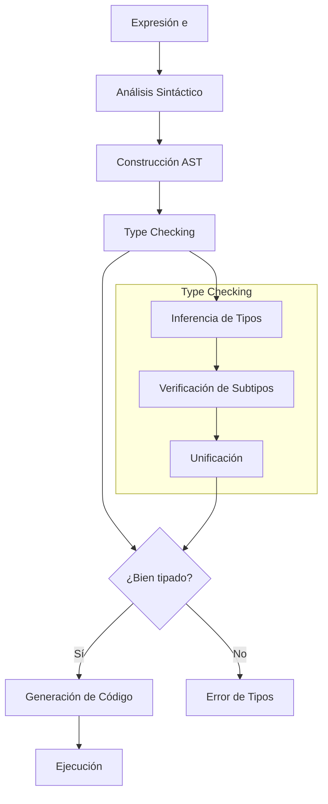

# Lenguajes de Programación - Paradigma orientado a objetos

## 5.5 Formalismos: Java Peso Pluma (Featherweight Java), SOOL.

---

### Introducción a los Lenguajes Formales de Objetos

Los formalismos como **Featherweight Java (FJ)** y **SOOL** (Simple Object-Oriented Language) son lenguajes núcleo (core calculi) diseñados para estudiar formalmente las propiedades de los lenguajes orientados a objetos.

### Featherweight Java (FJ)

#### Definición y Propósito

**Featherweight Java** es un núcleo minimalista de Java diseñado por Atsushi Igarashi, Benjamin Pierce y Philip Wadler para el estudio formal de tipos y herencia en POO.

**Objetivo principal**: Proporcionar un modelo formal suficientemente simple para pruebas formales pero suficientemente expresivo para capturar las características esenciales de Java.

#### Sintaxis de FJ

La sintaxis de FJ se define formalmente como:

$$ \begin{aligned} &\text{Class} & C &::= \text{class } C \text{ extends } C \{ \overline{C} \ \overline{f}; \overline{M} \} \\\ &\text{Method} & M &::= C \ m(\overline{C} \ \overline{x}) \{ \text{return } e; \} \\\ &\text{Expression} & e &::= x \mid e.f \mid e.m(\overline{e}) \mid \text{new } C(\overline{e}) \mid (C)e \\\ &\text{Variable} & x &::= \text{identificador} \\\ &\text{Field} & f &::= \text{identificador} \\\ &\text{Method name} & m &::= \text{identificador} \\\ \end{aligned} $$

#### Sistema de Tipos de FJ

**Regla de subtipado**:

$$S \leq T \iff S = T \lor \exists U. S \leq U \land U \leq T$$

**Regla de typing**:

$$\Gamma \vdash e : C$$

**Judgment de método bien tipado**:

$$CT(C) = \text{class } C \text{ extends } D \{...\} \quad \overline{C} \ \overline{f}; \overline{M}$$

$$\forall M \in \overline{M}. \text{OK in } C$$

#### Semántica Operacional de FJ

**Reducción (small-step semantics)**:

$$\frac{fields(C) = \overline{D} \ \overline{f}}{(\text{new } C(\overline{e})).f_i \rightarrow e_i}$$

$$\frac{mbody(m, C) = (\overline{x}, e_0)}{(\text{new } C(\overline{e})).m(\overline{d}) \rightarrow [\overline{d}/\overline{x}, \text{new } C(\overline{e})/\text{this}]e_0}$$

#### Ejemplo en FJ

```java
// Programa FJ equivalente
class A extends Object {
    A() { super(); }
}

class B extends A {
    B() { super(); }
}

class Point extends Object {
    int x; int y;
    Point(int x, int y) {
        super(); this.x = x; this.y = y;
    }
    Point move(int dx, int dy) {
        return new Point(this.x + dx, this.y + dy);
    }
}

// Expresión
new Point(1, 2).move(3, 4)
```

### SOOL (Simple Object-Oriented Language)

#### Definición y Características

**SOOL** es un lenguaje formal más simple que FJ, diseñado para enseñar los conceptos fundamentales de POO sin la complejidad de Java.

**Características principales**:

- Herencia simple
- Encapsulación básica
- Polimorfismo de subtipos
- Sin interfaces ni sobrecarga

#### Sintaxis de SOOL

$$ \begin{aligned} &\text{Program} & P &::= \overline{CD} \ e \\\ &\text{Class Def} & CD &::= \text{class } C \text{ extends } C \{ \overline{FD} \ \overline{MD} \} \\\ &\text{Field Def} & FD &::= C \ f; \\\ &\text{Method Def} & MD &::= C \ m(\overline{C} \ \overline{x}) \{ \text{return } e; \} \\\ &\text{Expression} & e &::= x \mid e.f \mid e.m(\overline{e}) \mid \text{new } C(\overline{e}) \mid \text{this} \\\ \end{aligned} $$

#### Sistema de Tipos de SOOL

**Environment de typing**:

$$\Gamma ::= \emptyset \mid \Gamma, x:C$$

**Judgments de typing**:

$$\Gamma \vdash e : C$$

**Reglas de typing**:

$$ \frac{\Gamma(x) = C}{\Gamma \vdash x : C} \quad \text{(T-Var)} $$

$$ \frac{\Gamma \vdash e_0 : C_0 \quad fields(C_0) = \overline{C} \ \overline{f} \quad f_i \in \overline{f}} {\Gamma \vdash e_0.f_i : C_i} \quad \text{(T-Field)} $$

$$ \frac{\Gamma \vdash e_0 : C_0 \quad mtype(m, C_0) = \overline{C} \rightarrow C \quad \Gamma \vdash \overline{e} : \overline{D} \quad \overline{D} \leq \overline{C}} {\Gamma \vdash e_0.m(\overline{e}) : C} \quad \text{(T-Invoke)} $$

### Semántica Formal

#### Relación de Reducción

**Contextos de evaluación**:

$$E ::= [·] \mid E.f \mid E.m(\overline{e}) \mid v.m(\overline{v}, E, \overline{e}) \mid \text{new } C(\overline{v}, E, \overline{e})$$

**Reglas de reducción**:

$$ \frac{fields(C) = \overline{D} \ \overline{f}} {E[\text{(new } C(\overline{v})).f_i] \rightarrow E[v_i]} \quad \text{(R-Field)} $$

$$ \frac{mbody(m, C) = (\overline{x}, e_0)} {E[\text{(new } C(\overline{v})).m(\overline{u})] \rightarrow E[[\overline{u}/\overline{x}, \text{new } C(\overline{v})/\text{this}]e_0]} \quad \text{(R-Invoke)} $$

### Ejemplo Completo: Sistema de Formas en FJ

```java
class Object extends Object {
    Object() { super(); }
}

class Shape extends Object {
    Shape() { super(); }
    Shape move(int dx, int dy) {
        return new Shape();
    }
}

class Circle extends Shape {
    int x; int y; int r;
    Circle(int x, int y, int r) {
        super(); this.x = x; this.y = y; this.r = r;
    }
    Shape move(int dx, int dy) {
        return new Circle(this.x + dx, this.y + dy, this.r);
    }
}

class Rectangle extends Shape {
    int x; int y; int w; int h;
    Rectangle(int x, int y, int w, int h) {
        super(); this.x = x; this.y = y; this.w = w; this.h = h;
    }
    Shape move(int dx, int dy) {
        return new Rectangle(this.x + dx, this.y + dy, this.w, this.h);
    }
}

// Programa principal
new Circle(0, 0, 5).move(10, 10)
```

### Ejercicios Propuestos

#### Ejercicio 1: Extensión de FJ

Extiende FJ con:

- Campos públicos y privados
- Constructores parametrizados
- Sobrecarga de métodos

#### Ejercicio 2: Sistema de Tipos

Demuestra el typing para:

```java
class A extends Object {
    A() { super(); }
    B m() { return new B(); }
}

class B extends A {
    B() { super(); }
    A m() { return new A(); }
}

new B().m()
```

#### Ejercicio 3: Semántica Operacional

Deriva la reducción completa para:

```java
new Point(1, 2).move(3, 4)
```

#### Ejercicio 4: SOOL a FJ

Traduce el siguiente programa SOOL a FJ:

```
class Animal {
    Animal speak() { return this; }
}

class Dog extends Animal {
    Animal speak() { return this; }
}

new Dog().speak()
```

### Propiedades Formales

#### Teorema de Preservación (Subject Reduction)

Si $\Gamma \vdash e : C$ y $e \rightarrow e'$, entonces $\Gamma \vdash e' : C'$ para algún $C' \leq C$.

#### Teorema de Progresión

Si $\emptyset \vdash e : C$, entonces $e$ es un valor o $\exists e'$ tal que $e \rightarrow e'$.

#### Normalización

Todo programa bien tipado en FJ termina (no tiene infinite reductions).

### Herramientas y Implementaciones

#### Implementación de FJ en Haskell

```haskell
data Class = Class {
    className :: String,
    superClass :: String,
    fields :: [Field],
    methods :: [Method]
}

data Expr = Var String
          | FieldAccess Expr String
          | MethodInvoke Expr String [Expr]
          | New String [Expr]
          | Cast String Expr

type Environment = Map String Type

typeCheck :: Environment -> Expr -> Either String Type
typeCheck env (Var x) = lookup x env
typeCheck env (FieldAccess e f) = do
    t <- typeCheck env e
    lookupField t f
-- ... implementación completa
```

### Referencias Bibliográficas

#### Bibliografía Básica

1. **Igarashi, A., Pierce, B. C., & Wadler, P. (2001)**. _Featherweight Java: A Minimal Core Calculus for Java and GJ_. ACM TOPLAS
2. **Pierce, B. C. (2002)**. _Types and Programming Languages_. MIT Press.
   - Capítulo 18: Imperative Objects
   - Capítulo 19: Case Study: Featherweight Java

#### Bibliografía Complementaria

3. **Abadi, M., & Cardelli, L. (1996)**. _A Theory of Objects_
4. **Fisher, K., & Mitchell, J. C. (1998)**. _A Delegation-based Object Calculus with Subtyping_
5. **Krishnamurthi, S. (2007)**. _Programming Languages: Application and Interpretation_
   - Capítulo 32: Objects: Interpretation and Types

### Aplicaciones Prácticas

#### Uso en Diseño de Lenguajes

FJ se utiliza para:

- Verificar seguridad de tipos en extensiones de Java
- Estudiar formalmente generics (GJ)
- Analizar propiedades de herencia múltiple

#### Uso en Educación

SOOL se emplea para:

- Enseñar conceptos básicos de POO
- Introducir sistemas de tipos formales
- Demostrar teoremas de seguridad

### Diagrama de Flujo de Type Checking



### Evaluación de Conceptos

1. **Demuestra** la preservación para la regla de invocación de métodos
2. **Extiende** FJ con interfaces y demuestra preservación
3. **Implementa** un type checker para SOOL
4. **Compara** el formalismo de FJ con el de Cardelli's Object Calculus

Esta guía proporciona una comprensión profunda de los formalismos FJ y SOOL, integrando fundamentos teóricos con aplicaciones prácticas y ejercicios para fortalecer el aprendizaje de los conceptos formales de la programación orientada a objetos.
