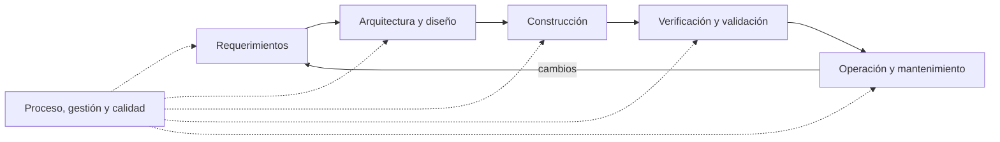

# Ingeniería de Software - Introducción a la ingeniería de software

## 1.1 Objetivos y campo de acción de la ingeniería de software.

---

La **ingeniería de software** es la disciplina que se ocupa de producir software de forma sistemática: con un proceso definido, con calidad medible y dentro de un costo y un plazo. El término se popularizó en la conferencia de la OTAN de 1968 en Garmisch, convocada por lo que entonces se llamó la **crisis del software**: proyectos que se entregaban tarde, costaban mucho más de lo presupuestado, no hacían lo que se pedía o no se terminaban nunca. Este tema define la disciplina, sus objetivos y cómo se miden, y el alcance de su campo de acción.

### Definición

El estándar IEEE 610.12 la define como "la aplicación de un enfoque sistemático, disciplinado y cuantificable al desarrollo, la operación y el mantenimiento del software". Sommerville la describe como la disciplina de ingeniería que se ocupa de **todos** los aspectos de la producción de software, desde la especificación inicial hasta el mantenimiento del sistema en uso. Tres ideas distinguen a la ingeniería de software de la simple programación:

- **Escala:** un programa lo escribe una persona para sí misma; un sistema lo construyen equipos, lo usan otras personas y se mantiene durante años. Brooks lo resume: un producto de software de sistemas cuesta unas nueve veces más que el programa que hace lo mismo.
- **Proceso:** el trabajo se organiza en actividades, como especificar, diseñar, construir, validar y evolucionar, con productos intermedios revisables.
- **Compromisos:** no hay una solución óptima, sino un equilibrio entre calidad, costo, plazo y alcance, decidido con información y no por intuición.

### Objetivos

El objetivo general es entregar software que satisfaga a sus usuarios con un costo y un plazo aceptables. Se desglosa en atributos de **calidad del producto**, que el estándar ISO/IEC 25010 de 2011 organiza en ocho características: adecuación funcional, eficiencia de desempeño, compatibilidad, usabilidad, **fiabilidad**, seguridad, **mantenibilidad** y portabilidad; la revisión de 2023 agrega una novena, la protección ante daños (*safety*), y renombra algunas. Y en objetivos de **proyecto**: cumplir el alcance, el presupuesto y el calendario.

Que la ingeniería sea **cuantificable** significa que estos objetivos se expresan con métricas. Las principales:

- **Fiabilidad:** la probabilidad de que el sistema opere sin fallos durante un tiempo $t$ en condiciones dadas. Con una tasa de fallos constante $\lambda,$ el modelo exponencial da $R(t) = e^{-\lambda t},$ y el tiempo medio entre fallos es $\mathrm{MTBF} = 1/\lambda.$
- **Disponibilidad:** la fracción del tiempo en que el sistema está en servicio. Con $\mathrm{MTTR}$ el tiempo medio de reparación, $A = \mathrm{MTBF} / (\mathrm{MTBF} + \mathrm{MTTR}).$ Es la cifra de los acuerdos de servicio: 99.9 % permite unas 8.8 horas de caída al año.
- **Tamaño:** las **líneas de código** (LOC) miden el producto, pero dependen del lenguaje y del estilo; los **puntos de función** de Albrecht miden la funcionalidad desde el punto de vista del usuario, a partir de entradas, salidas, consultas, archivos internos e interfaces externas, y no dependen del lenguaje.
- **Productividad:** tamaño entregado por unidad de esfuerzo, en puntos de función por **persona-mes**. El esfuerzo se mide en personas por tiempo, no en tiempo.
- **Complejidad ciclomática** (McCabe, 1976): para un grafo de flujo de control con $E$ aristas, $N$ nodos y $P$ componentes conexos, $V(G) = E - N + 2P.$ Equivale al número de decisiones más uno, y es el número de caminos linealmente independientes, la base de la prueba de caminos del tema 6. Valores por encima de 10 suelen indicar un módulo que conviene dividir.

Fiabilidad y disponibilidad se confunden con frecuencia, y no son lo mismo: un sistema que falla cada hora pero se recupera en un segundo tiene una disponibilidad altísima y una fiabilidad pésima.

### Campo de acción

El cuerpo de conocimientos de la disciplina, la guía SWEBOK de la IEEE, en su versión 4 de 2024, organiza el campo en áreas que este curso recorre:

- **Requerimientos:** obtener, analizar, especificar y validar lo que el sistema debe hacer (tema 4).
- **Arquitectura y diseño:** decidir la estructura del sistema y de sus componentes (temas 2 y 5).
- **Construcción:** programar, integrar y gestionar la configuración.
- **Pruebas, verificación y validación:** comprobar que el sistema cumple su especificación y satisface a sus usuarios (tema 6).
- **Operación y mantenimiento:** el mantenimiento **correctivo** repara defectos, el **adaptativo** ajusta el sistema a un entorno que cambia, el **perfectivo** mejora o agrega funciones, y el **preventivo** mejora la estructura para facilitar los cambios futuros (tema 7). Es la mayor parte del costo total de un sistema a lo largo de su vida.
- **Procesos, gestión y calidad:** los modelos de proceso del tema 3, la planeación y el control de proyectos, la gestión de riesgos y el aseguramiento de la calidad.
- **Práctica profesional:** ética, como el código ACM/IEEE de 1999, y responsabilidad legal.



### Implementación en Python

El programa resuelve el ejercicio 1 con el modelo exponencial: estima la tasa de fallos, calcula el MTBF, la fiabilidad para varios horizontes y la disponibilidad, y comprueba el modelo con una simulación. Para el ejercicio 2 aplica la fórmula del grafo y calcula también la complejidad de una función real contando sus decisiones con el árbol de sintaxis de Python. Al final calcula la productividad del ejemplo de la introducción.

```python
import ast, math, random

# ---------- Ejercicio 1: fiabilidad, MTBF y disponibilidad ----------
horas, fallos, mttr = 720, 5, 2.0                    # MTTR: tiempo medio de reparación supuesto, en horas
lam = fallos / horas                                 # tasa de fallos (estimador de máxima verosimilitud)
mtbf = 1 / lam
def R(t): return math.exp(-lam * t)                  # modelo exponencial: tasa de fallos constante
disp = mtbf / (mtbf + mttr)
print(f"ejercicio 1: λ = {lam:.5f} fallos/h | MTBF = {mtbf:.0f} h | disponibilidad con MTTR {mttr:.0f} h = {disp:.4%}")
for t in (1, 8, 24, 168, 720): print(f"   R({t:>3} h) = P(sin fallos durante {t} h) = {R(t):.4f}")
print(f"   tiempo con R(t) = 0.99: {-math.log(0.99) / lam:.2f} h | mediana de vida: {math.log(2) * mtbf:.1f} h")
original = (horas - fallos * 2) / horas
print(f"   la fórmula original da {original:.4%}: es la disponibilidad aproximada, no la fiabilidad")
rng = random.Random(42)                             # comprobación por simulación: 100 000 periodos de 24 h
sim = sum(rng.expovariate(lam) > 24 for _ in range(100_000)) / 100_000
print(f"   simulación: fracción de periodos de 24 h sin fallo = {sim:.4f} (teórico {R(24):.4f})")

# ---------- Ejercicio 2: complejidad ciclomática ----------
def mccabe_grafo(E, N, P): return E - N + 2 * P
print("ejercicio 2: V(G) = 20 − 15 + 2·1 =", mccabe_grafo(20, 15, 1))
fuente = '''
def clasifica_transferencia(monto, saldo, es_frecuente, intentos):
    if intentos >= 3:
        return "bloqueada"
    if monto <= 0 or monto > saldo:
        return "rechazada"
    for limite in (10_000, 50_000):
        if monto > limite and not es_frecuente:
            return "requiere verificación"
    while monto > 100_000:
        monto -= 1
    return "aprobada"
'''
class Decisiones(ast.NodeVisitor):
    def __init__(self): self.n = 0
    def visit_If(self, n): self.n += 1; self.generic_visit(n)
    def visit_For(self, n): self.n += 1; self.generic_visit(n)
    def visit_While(self, n): self.n += 1; self.generic_visit(n)
    def visit_BoolOp(self, n): self.n += len(n.values) - 1; self.generic_visit(n)   # cada and/or es otra decisión
v = Decisiones(); v.visit(ast.parse(fuente))
print(f"   función de ejemplo: {v.n} decisiones → V(G) = {v.n + 1} caminos independientes, es decir, al menos {v.n + 1} casos de prueba para cubrirlos")
exec(fuente)
casos = [(1, 10, False, 3), (0, 10, False, 0), (20, 10, False, 0), (20_000, 99_999, False, 0), (60_000, 99_999, True, 0),
         (500, 1_000, False, 0), (100_001, 200_000, True, 0), (20_000, 99_999, True, 0)]
print("   casos:", [clasifica_transferencia(*c) for c in casos])

# ---------- Productividad ----------
pf, meses, personas, loc = 30, 3, 1, 1500
print(f"productividad: {pf / (meses * personas):.0f} PF por persona-mes | {loc / pf:.0f} LOC por PF |",
      f"con 3 personas serían {pf / (meses * 3):.2f} PF por persona-mes")
```

Salida:

```text
ejercicio 1: λ = 0.00694 fallos/h | MTBF = 144 h | disponibilidad con MTTR 2 h = 98.6301%
   R(  1 h) = P(sin fallos durante 1 h) = 0.9931
   R(  8 h) = P(sin fallos durante 8 h) = 0.9460
   R( 24 h) = P(sin fallos durante 24 h) = 0.8465
   R(168 h) = P(sin fallos durante 168 h) = 0.3114
   R(720 h) = P(sin fallos durante 720 h) = 0.0067
   tiempo con R(t) = 0.99: 1.45 h | mediana de vida: 99.8 h
   la fórmula original da 98.6111%: es la disponibilidad aproximada, no la fiabilidad
   simulación: fracción de periodos de 24 h sin fallo = 0.8447 (teórico 0.8465)
ejercicio 2: V(G) = 20 − 15 + 2·1 = 7
   función de ejemplo: 7 decisiones → V(G) = 8 caminos independientes, es decir, al menos 8 casos de prueba para cubrirlos
   casos: ['bloqueada', 'rechazada', 'rechazada', 'requiere verificación', 'aprobada', 'aprobada', 'aprobada', 'aprobada']
productividad: 10 PF por persona-mes | 50 LOC por PF | con 3 personas serían 3.33 PF por persona-mes
```

### Ejercicios Propuestos

1. **Fiabilidad.** Un sistema opera durante 720 horas con 5 fallos. Calcula su fiabilidad.

2. **Complejidad.** Un grafo de control tiene 15 nodos, 20 aristas y 1 componente. Calcula su complejidad ciclomática.

3. **Caso práctico.** Identifica los objetivos de ingeniería de software en el desarrollo de una aplicación móvil bancaria.

4. **Comparación.** Compara las ventajas y desventajas del modelo en cascada y del desarrollo ágil para un proyecto de 6 meses.

### Soluciones

**Ejercicio 1.** El enunciado no basta para dar "la fiabilidad" como un solo número, porque la fiabilidad depende del horizonte de tiempo. Con el modelo exponencial, la tasa de fallos estimada es $\lambda = 5/720 \approx 0.00694$ fallos por hora, y el MTBF es de 144 horas. La fiabilidad para un horizonte $t$ es $R(t) = e^{-t/144}:$ 0.9931 para una hora, 0.8465 para un día y apenas 0.3114 para una semana. Es decir, la probabilidad de pasar un día completo sin fallos es de 85 %, y para garantizar 99 % el horizonte se reduce a 1.45 horas. La simulación de 100 000 días confirma el valor de un día, 0.8447 frente a 0.8465.

La fórmula $(\text{tiempo sin fallos}/\text{tiempo total}) \times 100,$ con 2 horas de reparación por fallo, da 98.61 %, pero eso es la **disponibilidad**, no la fiabilidad; con la fórmula $\mathrm{MTBF}/(\mathrm{MTBF} + \mathrm{MTTR})$ se obtiene 98.63 %, casi lo mismo. El modelo exponencial supone que la tasa de fallos es constante; en software suele **disminuir** con el tiempo, conforme se corrigen defectos, y los modelos de crecimiento de la fiabilidad, como el de Musa o el de Goel y Okumoto, describen esa evolución.

**Ejercicio 2.** $V(G) = 20 - 15 + 2 \cdot 1 = 7.$ El grafo tiene siete caminos linealmente independientes, y una prueba de caminos básicos necesita siete casos. Para no depender de dibujar el grafo, se cuenta directamente en el código: cada `if`, `for`, `while` y cada operador `and` u `or` es una decisión, y $V(G)$ es el número de decisiones más uno. La función de ejemplo del programa tiene siete decisiones y por tanto $V(G) = 8,$ y los ocho casos de la salida recorren sus ramas.

**Ejercicio 3.** En una aplicación bancaria, los objetivos de calidad se priorizan así, con una métrica para cada uno:

- **Seguridad:** autenticación de dos factores, cifrado en tránsito y en reposo, y protección ante el robo del dispositivo. Se mide con pruebas de penetración y con el cumplimiento de normas como PCI DSS.
- **Fiabilidad e integridad:** una transferencia se aplica completa o no se aplica, nunca a medias. Se mide con la tasa de transacciones inconsistentes, que debe ser cero.
- **Disponibilidad:** típicamente 99.9 % o más, con ventanas de mantenimiento anunciadas.
- **Usabilidad y accesibilidad:** las operaciones frecuentes en pocos pasos, y cumplimiento de las pautas WCAG.
- **Eficiencia:** tiempos de respuesta, por ejemplo menos de 2 segundos para el 95 % de las consultas de saldo.
- **Mantenibilidad y portabilidad:** cambios regulatorios frecuentes y versiones para varios sistemas operativos.

Y los objetivos de proyecto: cumplir los plazos regulatorios y el presupuesto. El conflicto típico es entre seguridad y usabilidad, por ejemplo con cada paso de verificación adicional, y se resuelve con base en el riesgo de cada operación.

**Ejercicio 4.**

| Aspecto                    | Cascada                                        | Ágil                                              |
| -------------------------- | ---------------------------------------------- | ------------------------------------------------- |
| Requerimientos             | Fijados al inicio                              | Evolucionan; se priorizan en cada iteración       |
| Entregas                   | Una, al final                                  | Incrementos funcionales cada 2 a 4 semanas        |
| Retroalimentación          | Tardía, en la prueba de aceptación             | Continua, en cada revisión                        |
| Costo de un cambio tardío  | Alto: rehacer documentos y diseño              | Menor: se absorbe en la siguiente iteración       |
| Planeación y contratos     | Precio y alcance fijos, más fáciles de pactar  | Alcance variable, exige confianza con el cliente  |
| Documentación              | Extensa, adecuada para auditorías              | La necesaria, a veces insuficiente                |

Para un proyecto de 6 meses, cascada conviene si los requerimientos son estables y conocidos, por ejemplo un sistema regulado con especificación fija, o si el contrato exige un alcance cerrado. Ágil conviene si hay incertidumbre en los requerimientos o el cliente puede participar en cada revisión: en 6 meses caben unas 12 iteraciones de dos semanas, y en la mitad del proyecto ya existe software en uso. Para la mayoría de los proyectos de ese tamaño, la incertidumbre de los requerimientos es el riesgo dominante, y por eso ágil suele ser la opción preferida.

### Referencias

1. Sommerville, I., _Software Engineering_. Pearson, 2016. Capítulos 1 y 2.
2. Pressman, R. S., and Maxim, B. R., _Software Engineering: A Practitioner's Approach_. McGraw-Hill, 2020.
3. Washizaki, H. (ed.), _Guide to the Software Engineering Body of Knowledge (SWEBOK)_, versión 4.0. IEEE Computer Society, 2024.
4. Brooks, F. P., _The Mythical Man-Month_. Addison-Wesley, 1995.
5. McCabe, T. J., A complexity measure. _IEEE Transactions on Software Engineering_ 2(4), 1976.
6. ISO/IEC 25010:2023, _Systems and software Quality Requirements and Evaluation (SQuaRE): Product quality model_.
