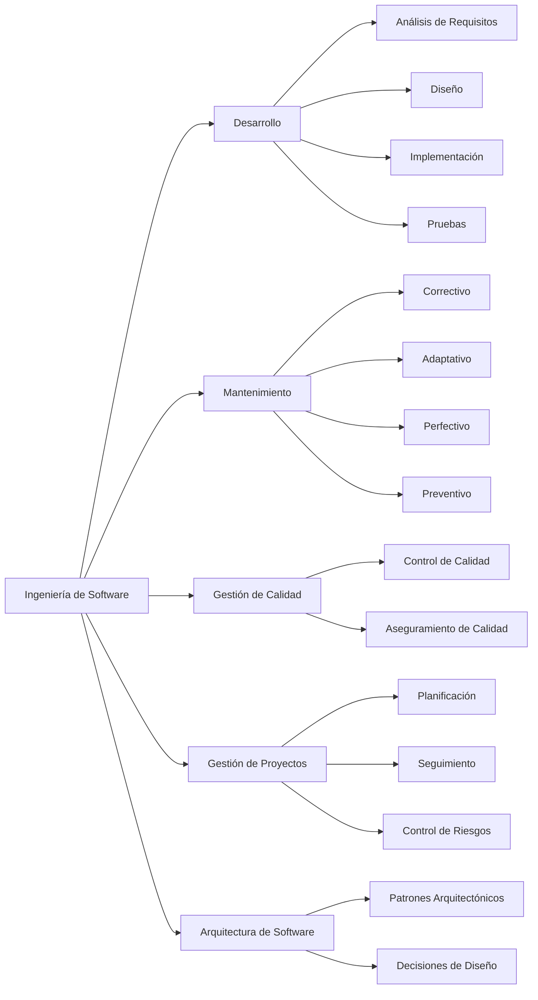
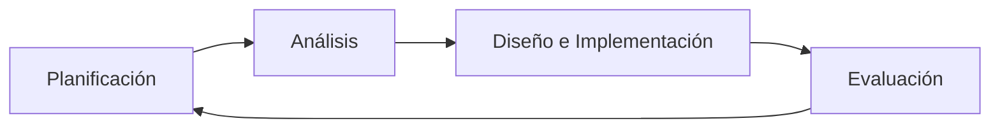

# Ingeniería de Software - Introducción a la ingeniería de software

## 1.1 Objetivos y campo de acción de la ingeniería de software.

---

La ingeniería de software es una disciplina que se enfoca en la aplicación de principios, métodos y herramientas para el desarrollo y mantenimiento de software de alta calidad. Según Sommerville (2010), es "una disciplina de ingeniería que se ocupa de todos los aspectos de la producción de software".

### Definición de Ingeniería de Software

La IEEE define la ingeniería de software como:

> "La aplicación de un enfoque sistemático, disciplinado y cuantificable al desarrollo, operación y mantenimiento del software"

### Objetivos de la Ingeniería de Software

#### Objetivos Fundamentales

1. **Desarrollar software de calidad**
2. **Cumplir con los requisitos del cliente**
3. **Mantener los costos dentro del presupuesto**
4. **Cumplir con los plazos establecidos**
5. **Garantizar mantenibilidad y escalabilidad**

#### Objetivos Cuantitativos

Los objetivos pueden medirse mediante métricas como:

- **Fiabilidad**: Probabilidad de operación libre de fallos

  $$ \text{Fiabilidad} = \frac{\text{Tiempo de operación sin fallos}}{\text{Tiempo total}} \times 100\% $$

- **Eficiencia**:

  $$ \text{Rendimiento} = \frac{\text{Operaciones completadas}}{\text{Tiempo de respuesta}} $$

### Campo de Acción de la Ingeniería de Software

#### Áreas de Aplicación



#### Funciones del Ingeniero de Software

1. **Análisis de requisitos**: Identificar necesidades del cliente
2. **Diseño de sistemas**: Crear arquitecturas software robustas
3. **Implementación**: Escribir código eficiente y mantenible
4. **Pruebas**: Verificar y validar el software
5. **Mantenimiento**: Actualizar y mejorar sistemas existentes

### Procesos y Métodos

#### Modelos de Desarrollo

**Modelo en Cascada**:


**Modelo Iterativo**:



#### Métricas Importantes

- **Puntos de Función**: Medida de la funcionalidad entregada
- **Líneas de Código**: $LOC = \sum_{i=1}^{n} \text{líneas}_i$
- **Complejidad Ciclomática**: $V(G) = E - N + 2P$
  Donde:
  - $E$ = número de aristas
  - $N$ = número de nodos
  - $P$ = número de componentes conexos

### Ejemplo de Cálculo de Métricas

Supongamos un módulo con:

- 1500 líneas de código
- 30 puntos de función
- Tiempo de desarrollo: 3 meses

Productividad = $\frac{\text{Puntos de función}}{\text{Esfuerzo}} = \frac{30}{3} = 10$ PF/mes

### Ejercicios Propuestos

1. **Cálculo de Fiabilidad**:
   Un sistema opera durante 720 horas con 5 fallos. Calcule la fiabilidad.

2. **Análisis de Complejidad**:
   Dado un grafo de control con 15 nodos, 20 aristas y 1 componente, calcule la complejidad ciclomática.

3. **Caso Práctico**:
   Identifique los objetivos de ingeniería de software en el desarrollo de una aplicación móvil bancaria.

4. **Comparativa de Modelos**:
   Compare ventajas y desventajas del modelo en cascada vs. desarrollo ágil para un proyecto de 6 meses.

### Código de Ejemplo: Calculadora de Métricas

```python
def calcular_fiabilidad(tiempo_total, fallos):
    tiempo_sin_fallos = tiempo_total - (fallos * 2)  # Suponiendo 2 horas por fallo
    return (tiempo_sin_fallos / tiempo_total) * 100

def complejidad_ciclomatica(nodos, aristas, componentes):
    return aristas - nodos + (2 * componentes)

# Ejemplo de uso
print(f"Fiabilidad: {calcular_fiabilidad(720, 5):.2f}%")
print(f"Complejidad ciclomática: {complejidad_ciclomatica(15, 20, 1)}")
```

### Referencias

#### Bibliografía Básica

1. Sommerville, Ian. (2010). _Software Engineering_ (9th edition). Addison Wesley.
2. Pfleeger, S. L., & Atlee, J. M. (2010). _Software Engineering: Theory and Practice_ (4th edition). Prentice Hall.

#### Bibliografía Complementaria

1. Cockburn, A. (2004). _Crystal Clear: A Human-Powered Methodology for Small Teams_. Addison-Wesley.
2. Boehm, B. W., & Turner, R. (2003). _Balancing Agility and Discipline: A Guide for the Perplexed_. Addison-Wesley.
3. Evans, E. (2003). _Domain-Driven Design: Tackling Complexity in the Heart of Software_. Addison Wesley.
4. Cockburn, A. (2006). _Agile Software Development: The Cooperative Game_ (2nd edition). Addison-Wesley.
5. Monson-Haefel, R. (Ed.). (2009). _97 Things Every Software Architect Should Know_. O'Reilly Media.

### Conclusión

La ingeniería de software tiene como objetivo principal la producción sistemática de software de calidad que satisfaga las necesidades de los usuarios, dentro de restricciones de tiempo y presupuesto. Su campo de acción abarca desde el análisis inicial hasta el mantenimiento continuo, aplicando principios de ingeniería para crear productos confiables, eficientes y mantenibles.

La comprensión de estos objetivos y del amplio campo de acción es fundamental para cualquier profesional que desee desarrollarse en esta disciplina, permitiendo tomar decisiones informadas sobre métodos, herramientas y prácticas apropiadas para cada contexto de desarrollo.
