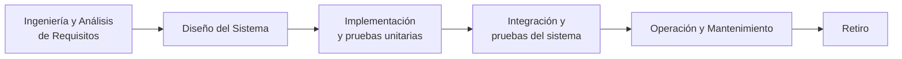
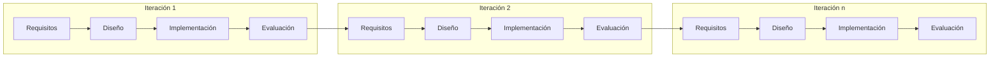
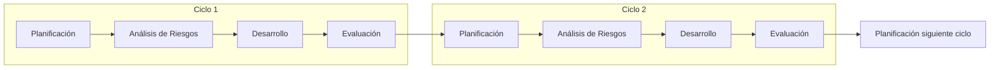
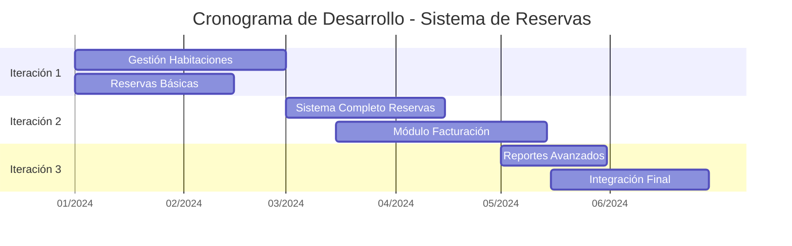

# Ingeniería de Software - Introducción a la ingeniería de software

## 1.2 Ciclo de vida del software.

---

El ciclo de vida del software representa el marco conceptual que describe las fases por las que pasa un sistema software desde su concepción inicial hasta su retiro final. Según Sommerville (2010), "un modelo de ciclo de vida del software es una representación abstracta de los procesos involucrados en el desarrollo de software".

### Definición del Ciclo de Vida del Software

El ciclo de vida del software es el conjunto de fases o etapas through which un producto software pasa, desde su concepción inicial hasta su retiro del mercado. Incluye todos los procesos de desarrollo, operación y mantenimiento.

### Modelos de Ciclo de Vida

#### Modelo en Cascada (Waterfall)



**Características principales**:

- Fases secuenciales y discretas
- Documentación exhaustiva en cada fase
- Poco flexible a cambios
- Ideal para proyectos con requisitos bien definidos

#### Modelo Iterativo e Incremental



**Fórmula de complejidad por iteración**:

$$ C_i = \frac{C_t}{n} \times f_i $$

Donde:

- $C_i$ = Complejidad de la iteración i
- $C_t$ = Complejidad total del proyecto
- $n$ = Número de iteraciones
- $f_i$ = Factor de prioridad de la iteración

#### Modelo en Espiral (Boehm, 1988)



**Ecuación del riesgo**:

$$ R = P \times I $$

Donde:

- $R$ = Riesgo total
- $P$ = Probabilidad de ocurrencia
- $I$ = Impacto potencial

### Fases del Ciclo de Vida

#### 1. Definición de Requisitos

**Objetivo**: Establecer qué debe hacer el sistema

```python
class Requisito:
    def __init__(self, id, descripcion, prioridad, estado):
        self.id = id
        self.descripcion = descripcion
        self.prioridad = prioridad  # Alta, Media, Baja
        self.estado = estado  # Pendiente, En desarrollo, Completado

    def calcular_prioridad_numerica(self):
        prioridades = {"Alta": 3, "Media": 2, "Baja": 1}
        return prioridades.get(self.prioridad, 0)
```

#### 2. Diseño del Sistema

**Arquitectura y diseño detallado**

$$ C = E - N + 2P $$

(Complejidad ciclomática de McCabe)

#### 3. Implementación

**Desarrollo y pruebas unitarias**

```python
def calcular_metricas_codigo(lineas_codigo, lineas_comentarios, complejidad):
    """
    Calcula métricas de calidad de código
    """
    total_lineas = lineas_codigo + lineas_comentarios
    densidad_comentarios = (lineas_comentarios / total_lineas) * 100 if total_lineas > 0 else 0

    return {
        'total_lineas': total_lineas,
        'densidad_comentarios': densidad_comentarios,
        'complejidad_promedio': complejidad
    }
```

#### 4. Pruebas y Validación

**Tipos de pruebas**:

- Unitarias
- Integración
- Sistema
- Aceptación

#### 5. Despliegue e Implementación

**Estrategias**:

- Despliegue big bang
- Despliegue gradual
- Canary releases

#### 6. Mantenimiento y Evolución

**Tipos de mantenimiento**:

- Correctivo (arreglar fallos)
- Adaptativo (nuevos entornos)
- Perfectivo (mejoras funcionales)
- Preventivo (mejoras técnicas)

### Métricas del Ciclo de Vida

#### Tiempo de Desarrollo

$$ T_{total} = \sum_{i=1}^{n} T_{fase_i} $$

#### Coste del Ciclo de Vida

$$ C_{Vida} = C_{Desarrollo} + C_{Mantenimiento} $$

Donde típicamente:

- $C_{Desarrollo}$: 20-40% del total
- $C_{Mantenimiento}$: 60-80% del total

### Ejercicios Propuestos

#### Ejercicio 1: Selección de Modelo de Ciclo de Vida

**Escenario**: Desarrollar un sistema de control para una central nuclear
**Requisitos**: Alta confiabilidad, requisitos bien definidos, regulaciones estrictas
**Pregunta**: ¿Qué modelo de ciclo de vida elegiría y por qué?

#### Ejercicio 2: Cálculo de Métricas

Calcule las siguientes métricas para un proyecto:

- 6 meses de desarrollo
- 3 años de mantenimiento estimado
- Coste desarrollo: $150,000
- Coste mantenimiento anual: $50,000

$$ C_{Vida} = ? $$

$$ \text{Proporción mantenimiento} = ? $$

#### Ejercicio 3: Análisis de Riesgos

Para un proyecto con:

- Probabilidad de fallo técnico: 30%
- Impacto financiero potencial: $100,000

  $$ R = P \times I = ? $$

#### Ejercicio 4: Planificación Iterativa

Divida un proyecto de 12 meses en 4 iteraciones con factores de prioridad: [0.4, 0.3, 0.2, 0.1]

$$ C_i = \frac{C_t}{4} \times f_i $$

### Caso de Estudio: Sistema de Reservas Hotelera

**Requisitos iniciales**:

- Gestión de habitaciones
- Sistema de reservas
- Facturación
- Reportes

**Ciclo de vida propuesto**: Iterativo incremental con 3 iteraciones:



### Referencias Bibliográficas

#### Bibliografía Básica

1. **Sommerville, Ian (2010)**. _Software Engineering_ (9th edition). Addison Wesley.
   - Capítulo 2: "Software Processes"
   - Capítulo 3: "Agile Software Development"

2. **Pfleeger, S. L., & Atlee, J. M. (2010)**. _Software Engineering: Theory and Practice_ (4th edition). Prentice Hall.
   - Capítulo 1: "The Software Process"
   - Capítulo 2: "Process Models"

#### Bibliografía Complementaria

3. **Boehm, B. W., & Turner, R. (2003)**. _Balancing Agility and Discipline: A Guide for the Perplexed_. Addison-Wesley.
   - Capítulo 4: "A Risk-Based Approach"

4. **Cockburn, A. (2006)**. _Agile Software Development: The Cooperative Game_ (2nd edition). Addison-Wesley.
   - Capítulo 3: "Methodologies"

5. **IEEE Std 1074-2006**. IEEE Standard for Developing a Software Project Life Cycle Process.

### Best Practices y Lecciones Aprendidas

1. **Documentación adecuada** en cada fase del ciclo
2. **Gestión de riesgos** proactiva
3. **Flexibilidad** para adaptarse a cambios
4. **Participación del cliente** throughout el ciclo
5. **Medición y mejora** continua de procesos

### Conclusión

La selección adecuada del modelo de ciclo de vida es crucial para el éxito de cualquier proyecto software. Cada modelo tiene sus ventajas y desventajas, y la elección debe basarse en factores como la naturaleza del proyecto, los requisitos, los riesgos y la experiencia del equipo. La comprensión profunda de estos modelos permite a los ingenieros de software seleccionar y adaptar el enfoque más apropiado para cada situación específica.
