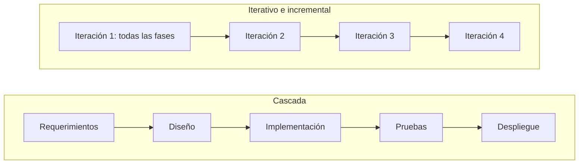

# Ingeniería de Software - Introducción a la ingeniería de software

## 1.2 Ciclo de vida del software.

---

El **ciclo de vida del software** es el periodo que va desde que se concibe un sistema hasta que se retira de servicio, junto con las actividades que lo llenan. El estándar ISO/IEC/IEEE 12207 lo describe como un conjunto de procesos: adquisición y suministro, definición de requerimientos, arquitectura, implementación, integración, verificación, transición, validación, operación, mantenimiento y retiro. Un **modelo de ciclo de vida** dice en qué orden se realizan esas actividades y cómo se repiten. Este tema presenta las fases, los modelos clásicos, la distribución del costo a lo largo de la vida de un sistema y el análisis de riesgos que guía la elección del modelo.

### Fases

Todos los modelos realizan las mismas actividades; cambia su orden y su repetición.

1. **Requerimientos:** qué debe hacer el sistema y con qué restricciones de calidad, costo y plazo. El producto es una especificación validada con los interesados (tema 4).
2. **Diseño:** la arquitectura, la división en componentes y sus interfaces, y el diseño detallado de cada componente (temas 2 y 5).
3. **Implementación:** programar los componentes y probarlos individualmente.
4. **Integración y pruebas:** combinar los componentes y verificar el sistema completo contra su especificación; validar con los usuarios que resuelve su problema (tema 6).
5. **Despliegue o transición:** instalar, migrar datos, capacitar y poner en operación.
6. **Operación y mantenimiento:** corregir, adaptar y mejorar el sistema mientras está en uso (tema 7).
7. **Retiro:** migrar los datos a un reemplazo y dar de baja el sistema.

### Modelos

- **Cascada** (Royce, 1970; Benington, 1956): las fases se suceden una vez, y cada una termina con un documento aprobado antes de empezar la siguiente. Es fácil de planear y de auditar, y funciona cuando los requerimientos son estables y bien conocidos. Su debilidad es que el software funcional aparece al final, y un error de requerimientos se descubre cuando corregirlo es más caro. El artículo de Royce, que suele citarse como origen del modelo, en realidad lo presentaba como riesgoso y proponía iterar y construir un prototipo.
- **Modelo en V:** una cascada en la que cada fase de definición se empareja con un nivel de prueba: requerimientos con aceptación, arquitectura con integración, diseño detallado con prueba unitaria. Se usa en sistemas críticos y regulados.
- **Iterativo e incremental:** el sistema se construye en **incrementos**, cada uno una versión funcional que agrega capacidades, y en cada **iteración** se recorren todas las fases para una parte del sistema. Los requerimientos se refinan con la retroalimentación de cada entrega. Es la base del Proceso Unificado y de los métodos ágiles (tema 3).
- **Espiral** (Boehm, 1988): un modelo iterativo **guiado por el riesgo**. Cada vuelta de la espiral tiene cuatro cuadrantes: fijar objetivos y alternativas, **evaluar y reducir los riesgos**, con prototipos o simulaciones, desarrollar y verificar, y planear la siguiente vuelta. El riesgo dominante decide qué hacer: si es la interfaz de usuario, se prototipa; si los requerimientos son estables y el riesgo es bajo, la vuelta se parece a una cascada.
- **Prototipado:** se construye rápidamente una versión parcial para aclarar requerimientos y se desecha, o se evoluciona hasta el sistema final.



### Costo del ciclo de vida

El costo total de un sistema es el de desarrollarlo más el de operarlo y mantenerlo durante su vida:

$$C_{\text{vida}} = C_{\text{desarrollo}} + \sum_{k=1}^{n} C_{\text{mant}, k}.$$

Los estudios clásicos, como los de Lientz y Swanson, estiman que el mantenimiento representa entre 60 y 80 % del costo total de los sistemas de vida larga. La proporción no es una constante: depende de cuántos años se mantenga el sistema. Para comparar alternativas con gastos en años distintos se usa el **valor presente**, $\sum_k C_k / (1 + r)^k,$ con $r$ la tasa de descuento.

### Riesgos

Un **riesgo** es un evento incierto que, si ocurre, afecta al proyecto. Su **exposición** es

$$\mathrm{RE} = P(\text{pérdida}) \cdot \text{tamaño de la pérdida}.$$

Boehm propone ordenar los riesgos por exposición y decidir qué mitigaciones valen la pena con el **apalancamiento de reducción del riesgo**,

$$\mathrm{RRL} = \frac{\mathrm{RE}_{\text{antes}} - \mathrm{RE}_{\text{después}}}{\text{costo de la mitigación}}.$$

Una mitigación con $\mathrm{RRL} \gt 1$ reduce la exposición más de lo que cuesta. Los riesgos más frecuentes, según Boehm, son la falta de personal, los calendarios y presupuestos irreales, el desarrollo de funciones equivocadas o de una interfaz equivocada, el exceso de funciones, el cambio continuo de los requerimientos y las limitaciones de desempeño.

### Implementación en Python

El programa resuelve los ejercicios 2 a 4: calcula el costo del ciclo de vida y su valor presente, y muestra cómo cambia la proporción del mantenimiento con la duración; calcula la exposición al riesgo y el apalancamiento de una mitigación hipotética, y corrige la fórmula de la planeación iterativa. Al final simula proyectos con requerimientos que cambian a distintas tasas, para comparar cuántos requerimientos se entregan correctamente con cascada y con entregas trimestrales.

```python
import random

# ---------- Ejercicio 2: costo del ciclo de vida ----------
dev, mant_anual, anios = 150_000, 50_000, 3
mant = mant_anual * anios
vida = dev + mant
print(f"ejercicio 2: C_vida = {dev:,} + {anios}·{mant_anual:,} = {vida:,} | mantenimiento {mant / vida:.0%} del total")
for tasa in (0.0, 0.10):                                   # valor presente: el dinero futuro vale menos hoy
    vp = dev + sum(mant_anual / (1 + tasa) ** k for k in range(1, anios + 1))
    print(f"   valor presente con tasa {tasa:.0%}: {vp:,.0f}")
for n in (5, 10, 15):
    print(f"   con {n:>2} años de mantenimiento, la proporción sería {mant_anual * n / (dev + mant_anual * n):.0%}")

# ---------- Ejercicio 3: exposición al riesgo ----------
riesgos = [("fallo técnico", 0.30, 100_000)]
for nombre, p, i in riesgos: print(f"ejercicio 3: exposición de '{nombre}' = {p} · {i:,} = {p * i:,.0f}")
mitigacion, p_nueva = 12_000, 0.10                         # una mitigación hipotética: un prototipo de 12 000
rrl = (0.30 * 100_000 - p_nueva * 100_000) / mitigacion
print(f"   un prototipo de {mitigacion:,} que baja la probabilidad a {p_nueva:.0%}: reducción de exposición "
      f"{0.30 * 100_000 - p_nueva * 100_000:,.0f}, apalancamiento RRL = {rrl:.2f} (> 1: conviene)")

# ---------- Ejercicio 4: planeación iterativa ----------
Ct, meses, f = 120_000, 12, [0.4, 0.3, 0.2, 0.1]           # Ct supuesto para el ejemplo
mal = [Ct / 4 * fi for fi in f]
bien = [Ct * fi for fi in f]
print(f"ejercicio 4: con C_i = C_t/4 · f_i la suma es {sum(mal):,.0f}, solo una cuarta parte de C_t = {Ct:,}")
print("   con C_i = C_t · f_i:", [f"{c:,.0f}" for c in bien], "suma", f"{sum(bien):,.0f}")
mes = 0
for k, fi in enumerate(f, 1):
    print(f"   iteración {k}: meses {mes + 1}–{mes + 3}, presupuesto {Ct * fi:,.0f} ({fi:.0%}), valor acumulado entregado {sum(f[:k]):.0%}")
    mes += 3

# ---------- Cascada frente a incremental cuando cambian los requerimientos ----------
def simula(modelo, prob_cambio, rng, n_req=20, meses=12):
    """Cada mes, cada requerimiento puede cambiar con probabilidad prob_cambio. En cascada, lo construido según
    la especificación inicial se entrega al final; un requerimiento que cambió después del diseño (mes 3) se
    entrega mal. En incremental, cada trimestre se construyen y validan los requerimientos de esa iteración:
    solo fallan los que cambian después de su entrega. Devuelve la fracción entregada correctamente al mes 12."""
    cambio = [[rng.random() < prob_cambio for _ in range(meses)] for _ in range(n_req)]
    if modelo == "cascada":
        return sum(not any(c[3:]) for c in cambio) / n_req
    ok = 0
    for r, c in enumerate(cambio):
        entrega = 3 * (r * 4 // n_req + 1)                  # iteraciones que terminan en los meses 3, 6, 9 y 12
        ok += not any(c[entrega:])
    return ok / n_req
rng = random.Random(1)
print("cascada frente a incremental: fracción de requerimientos correctos al final, promedio de 2000 proyectos")
for p in (0.0, 0.01, 0.03, 0.06):
    c = sum(simula("cascada", p, rng) for _ in range(2000)) / 2000
    i = sum(simula("incremental", p, rng) for _ in range(2000)) / 2000
    print(f"   cambio mensual {p:4.0%}: cascada {c:.3f} | incremental {i:.3f}")
```

Salida:

```text
ejercicio 2: C_vida = 150,000 + 3·50,000 = 300,000 | mantenimiento 50% del total
   valor presente con tasa 0%: 300,000
   valor presente con tasa 10%: 274,343
   con  5 años de mantenimiento, la proporción sería 62%
   con 10 años de mantenimiento, la proporción sería 77%
   con 15 años de mantenimiento, la proporción sería 83%
ejercicio 3: exposición de 'fallo técnico' = 0.3 · 100,000 = 30,000
   un prototipo de 12,000 que baja la probabilidad a 10%: reducción de exposición 20,000, apalancamiento RRL = 1.67 (> 1: conviene)
ejercicio 4: con C_i = C_t/4 · f_i la suma es 30,000, solo una cuarta parte de C_t = 120,000
   con C_i = C_t · f_i: ['48,000', '36,000', '24,000', '12,000'] suma 120,000
   iteración 1: meses 1–3, presupuesto 48,000 (40%), valor acumulado entregado 40%
   iteración 2: meses 4–6, presupuesto 36,000 (30%), valor acumulado entregado 70%
   iteración 3: meses 7–9, presupuesto 24,000 (20%), valor acumulado entregado 90%
   iteración 4: meses 10–12, presupuesto 12,000 (10%), valor acumulado entregado 100%
cascada frente a incremental: fracción de requerimientos correctos al final, promedio de 2000 proyectos
   cambio mensual   0%: cascada 1.000 | incremental 1.000
   cambio mensual   1%: cascada 0.915 | incremental 0.955
   cambio mensual   3%: cascada 0.759 | incremental 0.878
   cambio mensual   6%: cascada 0.575 | incremental 0.774
```

### Ejercicios Propuestos

1. **Selección de modelo.** Se va a desarrollar el sistema de control de una central nuclear, con requerimientos de alta confiabilidad, bien definidos y sujetos a regulaciones estrictas. ¿Qué modelo de ciclo de vida elegirías y por qué?

2. **Costo.** Un proyecto tiene 6 meses de desarrollo con un costo de 150 000, y 3 años de mantenimiento estimado con un costo anual de 50 000. Calcula el costo del ciclo de vida y la proporción del mantenimiento.

3. **Riesgo.** Un proyecto tiene una probabilidad de fallo técnico de 30 % con un impacto financiero de 100 000. Calcula la exposición al riesgo, $R = P \cdot I.$

4. **Planeación iterativa.** Divide un proyecto de 12 meses en 4 iteraciones con factores de prioridad 0.4, 0.3, 0.2 y 0.1, y presupuesto $C_i = \frac{C_t}{4} f_i.$

### Soluciones

**Ejercicio 1.** El **modelo en V**, con métodos formales en los componentes críticos. Los requerimientos son estables y conocidos, que es la condición en la que un modelo secuencial funciona bien, y el factor dominante es la **verificación**: los reguladores, con normas como IEC 60880 para el software de seguridad de centrales nucleares, exigen trazabilidad de cada requerimiento a su diseño, su código y su prueba, documentos aprobados en cada fase y evidencia de verificación independiente. El modelo en V organiza exactamente esa trazabilidad, emparejando cada nivel de especificación con su nivel de prueba. Un enfoque iterativo puede usarse dentro de fases acotadas, por ejemplo para prototipar la interfaz de los operadores, que sí tiene incertidumbre; pero entregar incrementos a producción no es aceptable en un sistema que debe certificarse completo.

**Ejercicio 2.** $C_{\text{vida}} = 150\,000 + 3 \cdot 50\,000 = 300\,000,$ y el mantenimiento es el 50 % del total. Es menos que el 60 a 80 % que se cita habitualmente, porque 3 años es una vida corta: con 5 años sería 62 %, con 10, 77 %, y con 15, 83 %. Si se considera el valor del dinero en el tiempo con una tasa de 10 %, el costo del ciclo de vida en valor presente es de 274 343.

**Ejercicio 3.** $\mathrm{RE} = 0.30 \cdot 100\,000 = 30\,000.$ El número sirve para comparar riesgos y para justificar mitigaciones: un prototipo de 12 000 que bajara la probabilidad a 10 % reduciría la exposición en 20 000, con $\mathrm{RRL} = 1.67,$ y valdría la pena; uno de 25 000, con $\mathrm{RRL} = 0.8,$ no.

**Ejercicio 4.** La fórmula del enunciado es incorrecta: como $\sum f_i = 1,$ los presupuestos suman $\frac{C_t}{4} \sum f_i = C_t/4,$ una cuarta parte del total. La correcta es $C_i = C_t \cdot f_i.$ Con iteraciones de 3 meses y, por ejemplo, $C_t = 120\,000,$ los presupuestos son 48 000, 36 000, 24 000 y 12 000. Ordenar las iteraciones por prioridad es la idea central del desarrollo incremental: después de la mitad del proyecto ya se entregó el 70 % del valor, y si el proyecto se recorta o se cancela, lo que falta es lo menos importante.

La simulación final muestra por qué la retroalimentación temprana importa. Con requerimientos que no cambian, ambos modelos entregan todo correctamente; con un 3 % de probabilidad de cambio mensual por requerimiento, cascada entrega bien el 76 % y las entregas trimestrales el 88 %. El modelo es simple, supone que un requerimiento entregado antes de cambiar queda mal, y no incluye el costo de rehacer, pero captura la diferencia: en cascada, todo cambio posterior al diseño afecta al producto, y en incremental solo los cambios posteriores a la entrega de cada parte.

### Referencias

1. Sommerville, I., _Software Engineering_. Pearson, 2016. Capítulo 2.
2. Royce, W. W., Managing the development of large software systems. _Proceedings of IEEE WESCON_, 1970.
3. Boehm, B. W., A spiral model of software development and enhancement. _Computer_ 21(5), 1988.
4. Boehm, B. W., Software risk management: principles and practices. _IEEE Software_ 8(1), 1991.
5. ISO/IEC/IEEE 12207:2017, _Systems and software engineering: Software life cycle processes_.
6. Lientz, B. P., and Swanson, E. B., _Software Maintenance Management_. Addison-Wesley, 1980.
