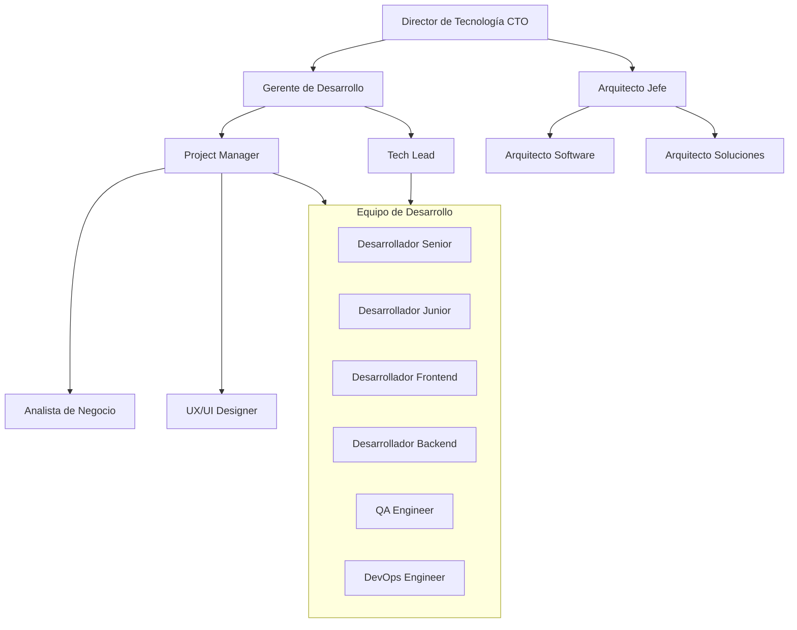
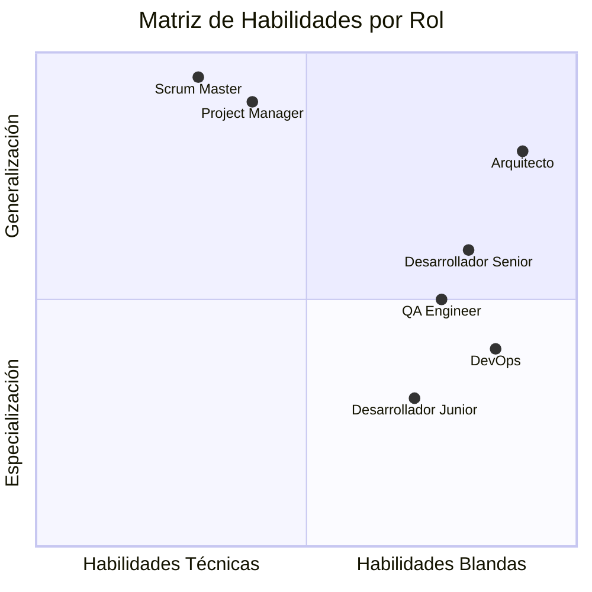

# Ingeniería de Software - Introducción a la ingeniería de software

## 1.3 Roles comunes en el desarrollo de software.

---

Los roles en el desarrollo de software definen las responsabilidades, habilidades y actividades específicas que cada miembro del equipo realiza durante el ciclo de vida del proyecto. Según Pfleeger y Atlee (2010), "la adecuada definición de roles es crucial para el éxito de cualquier proyecto software, ya que establece claramente las expectativas y responsabilidades de cada participante".

### Marco Conceptual de Roles

#### Jerarquía de Roles Típica



### Roles Técnicos Principales

#### 1. Desarrollador de Software

**Responsabilidades**:

- Implementación de funcionalidades
- Escritura de código limpio y mantenible
- Participación en revisiones de código
- Resolución de problemas técnicos

**Habilidades técnicas**:

```python
class Desarrollador:
    def __init__(self, nivel, lenguajes, especialidad):
        self.nivel = nivel  # Junior, Mid, Senior
        self.lenguajes = lenguajes
        self.especialidad = especialidad  # Frontend, Backend, Fullstack

    def calcular_productividad(self, lineas_codigo, horas_trabajo):
        if horas_trabajo > 0:
            return lineas_codigo / horas_trabajo
        return 0

    def evaluar_seniority(self, experiencia_años, proyectos_completados):
        puntaje = (experiencia_años * 0.4) + (proyectos_completados * 0.6)
        return "Senior" if puntaje > 7 else "Mid" if puntaje > 4 else "Junior"
```

#### 2. Arquitecto de Software

**Responsabilidades**:

- Definición de la arquitectura del sistema
- Toma de decisiones técnicas críticas
- Establecimiento de estándares y patrones
- Evaluación de tecnologías

**Fórmula de complejidad arquitectónica**:

$$ C_a = \sum_{i=1}^{n} w_i \times c_i $$

Donde:

- $C_a$ = Complejidad arquitectónica total
- $w_i$ = Peso del componente i
- $c_i$ = Complejidad del componente i

#### 3. Ingeniero de Calidad (QA)

**Métricas de calidad**:

$$ Calidad = \frac{Pruebas\_Exitosas}{Pruebas\_Totales} \times 100\% $$

**Cobertura de pruebas**:

$$ Cobertura = \frac{\text{Código}\_Probado}{\text{Código}\_Total} \times 100\% $$

### Roles de Gestión

#### 4. Project Manager

**Responsabilidades**:

- Planificación y seguimiento del proyecto
- Gestión de recursos y riesgos
- Comunicación con stakeholders
- Control de calidad y tiempo

**Fórmulas de gestión**:

- **Valor Ganado**: $ EV = \%Completado \times PresupuestoTotal $
- **CPI**: $CPI = \frac{EV}{AC}$ (Cost Performance Index)
- **SPI**: $SPI = \frac{EV}{PV}$ (Schedule Performance Index)

#### 5. Scrum Master (en metodologías ágiles)

**Funciones**:

- Facilitar ceremonias ágiles
- Remover impedimentos
- Garantizar adherencia a prácticas ágiles
- Coach del equipo

### Roles de Soporte y Especializados

#### 6. DevOps Engineer

**Responsabilidades**:

- Automatización de CI/CD
- Gestión de infraestructura
- Monitoreo y performance
- Seguridad de infraestructura

**Métricas DevOps**:

$$ DeploymentFrequency = \frac{Number\\_of\\_Deployments}{Time\\_Period} $$

$$ MeanTimeToRecovery = \frac{\sum Recovery\\_Time}{Number\\_of\\_Incidents} $$

#### 7. UX/UI Designer

**Focus**:

- Experiencia de usuario
- Interfaz visual
- Investigación de usuarios
- Prototipado y testing

### Matriz de Habilidades por Rol



### Ejercicios Propuestos

#### Ejercicio 1: Asignación de Roles

**Proyecto**: Sistema de e-commerce para PYME
**Requisitos**: 6 meses de desarrollo, equipo de 8 personas, presupuesto limitado
**Pregunta**: ¿Qué roles serían esenciales y por qué?

#### Ejercicio 2: Cálculo de Métricas

Para un equipo de:

- 3 desarrolladores (productividad: 100 LOC/hora)
- 1 QA (cobertura objetivo: 85%)
- Proyecto: 50,000 LOC estimadas

Calcule:

- Horas totales de desarrollo estimadas
- Horas de testing necesarias

#### Ejercicio 3: Análisis de Costos

Calcule el costo mensual del equipo:

- 2 Senior Developers: $5,000 c/u
- 1 Mid Developer: $3,500
- 1 QA Engineer: $4,000
- 0.5 Project Manager: $3,000
- 0.5 UX Designer: $2,500

$$ CostoMensual = ? $$

#### Ejercicio 4: Gestión de Valor Ganado

Proyecto con:

- Presupuesto: $100,000
- % Completado real: 40%
- AC (Actual Cost): $45,000
- PV (Planned Value): $50,000

Calcule:

- EV = ?
- CPI = ?
- SPI = ?
- ¿El proyecto está sobre o bajo presupuesto?

### Caso de Estudio: Startup FinTech

**Contexto**: Startup en fase inicial desarrollando plataforma de inversiones

**Equipo mínimo viable**:

```python
class EquipoStartup:
    def __init__(self):
        self.roles = {
            'CTO': {'habilidades': ['arquitectura', 'desarrollo', 'liderazgo'], 'experiencia': 8},
            'Senior_Backend': {'habilidades': ['Python', 'Django', 'APIs'], 'experiencia': 5},
            'Mid_Frontend': {'habilidades': ['React', 'JavaScript', 'CSS'], 'experiencia': 3},
            'FullStack': {'habilidades': ['Node.js', 'React', 'BD'], 'experiencia': 4},
            'DevOps_PartTime': {'habilidades': ['AWS', 'Docker', 'CI/CD'], 'experiencia': 6}
        }

    def calcular_costo_mensual(self):
        salarios = {
            'CTO': 7000,
            'Senior_Backend': 5000,
            'Mid_Frontend': 3500,
            'FullStack': 4500,
            'DevOps_PartTime': 3000  # medio tiempo
        }
        return sum(salarios.values())

    def evaluar_brechas_habilidades(self, requerimientos):
        brechas = []
        for req in requerimientos:
            if not any(req in rol['habilidades'] for rol in self.roles.values()):
                brechas.append(req)
        return brechas
```

### Referencias Bibliográficas

#### Bibliografía Básica

1. **Sommerville, Ian (2010)**. _Software Engineering_ (9th edition). Addison Wesley.
   - Capítulo 24: "Project Management"
   - Capítulo 25: "Project Planning"

2. **Pfleeger, S. L., & Atlee, J. M. (2010)**. _Software Engineering: Theory and Practice_ (4th edition). Prentice Hall.
   - Capítulo 3: "Process Models"
   - Capítulo 4: "The Team"

#### Bibliografía Complementaria

3. **Cockburn, A. (2006)**. _Agile Software Development: The Cooperative Game_ (2nd edition). Addison-Wesley.
   - Capítulo 5: "Communicating, Cooperating Teams"

4. **Monson-Haefel, R. (Ed.). (2009)**. _97 Things Every Software Architect Should Know_. O'Reilly Media.
   - "Architects Must Be Hands-On"
   - "Communication is King"

5. **Evans, E. (2003)**. _Domain-Driven Design: Tackling Complexity in the Heart of Software_. Addison Wesley.
   - Capítulo 6: "The Life Cycle of a Domain Object"

### Best Practices en Gestión de Roles

#### 1. Definición Clara de Responsabilidades

```python
class Rol:
    def __init__(self, nombre, responsabilidades, habilidades_requeridas, metricas):
        self.nombre = nombre
        self.responsabilidades = responsabilidades
        self.habilidades = habilidades_requeridas
        self.metricas = metricas  # KPI específicos

    def evaluar_desempeno(self, metricas_actuales):
        return all(metricas_actuales[k] >= v for k, v in self.metricas.items())
```

#### 2. Plan de Carrera y Desarrollo

- **Junior → Mid**: 2-3 años, 3+ proyectos
- **Mid → Senior**: 4-6 años, liderazgo técnico
- **Senior → Architect**: 6+ años, visión sistémica

#### 3. Balance de Habilidades en Equipo

$$ Balance = \frac{\sum Habilidades\\_\text{Técnicas}}{\sum Habilidades\\_Blandas} \times \frac{Diversidad\\_Roles}{Total\\_Miembros} $$

### Conclusión

La adecuada definición y distribución de roles es fundamental para el éxito de los proyectos de software. Cada rol contribuye con habilidades y perspectivas únicas que, cuando se combinan efectivamente, permiten entregar productos de alta calidad. La comprensión de estas responsabilidades ayuda en la formación de equipos balanceados y en la planificación efectiva de recursos humanos.

La evolución de roles en la industria continúa adaptándose a nuevas metodologías y tecnologías, haciendo esencial el aprendizaje continuo y la flexibilidad organizacional.
