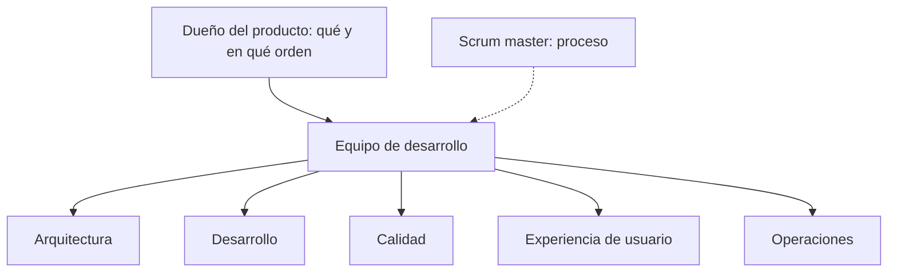

# Ingeniería de Software - Introducción a la ingeniería de software

## 1.3 Roles comunes en el desarrollo de software.

---

Un proyecto de software lo realizan personas con responsabilidades distintas. Un **rol** es un conjunto de responsabilidades, no un puesto: en un equipo pequeño una persona cumple varios roles, y en uno grande un rol se reparte entre varias personas. Este tema describe los roles técnicos, de gestión y de apoyo más comunes, cómo cambian entre los procesos tradicionales y los ágiles, y algunas cuentas que todo responsable de un equipo debe saber hacer: el costo de comunicación, el esfuerzo, el costo del equipo y el seguimiento con valor ganado.

### Roles técnicos

- **Analista de requerimientos o de negocio:** obtiene las necesidades de los interesados, las analiza y las especifica, y mantiene la trazabilidad de cada requerimiento (tema 4).
- **Arquitecto de software:** toma las decisiones estructurales del sistema, las que son costosas de cambiar después: la división en componentes, las tecnologías, la forma de cumplir los requerimientos de calidad como el desempeño y la seguridad. Documenta las decisiones y sus razones (tema 5).
- **Desarrollador:** diseña en detalle, programa, prueba sus unidades, revisa el código de otros y mantiene el sistema. Sus niveles, de júnior a sénior, se distinguen sobre todo por la autonomía y por el tamaño de los problemas que resuelve sin ayuda.
- **Ingeniero de calidad o de pruebas:** planea y ejecuta la verificación y la validación, automatiza las pruebas y mide la calidad (tema 6). En equipos modernos, más que probar al final, ayuda a que los desarrolladores prueben bien desde el principio.
- **Diseñador de experiencia de usuario:** investiga a los usuarios, diseña la interacción y la interfaz y las valida con pruebas de usabilidad.
- **Ingeniero de operaciones, DevOps o de confiabilidad (SRE):** automatiza la integración, el despliegue y la infraestructura, y vigila el sistema en producción con objetivos de nivel de servicio.

### Roles de gestión

- **Líder o gerente de proyecto:** planea el alcance, el calendario y el presupuesto, gestiona los riesgos y los interesados, y da seguimiento al avance, por ejemplo con valor ganado.
- **Dueño del producto** (*product owner*, en Scrum): representa a los interesados, decide qué se construye y en qué orden, y ordena la lista de pendientes según su valor.
- **Scrum master:** facilita el proceso, elimina obstáculos y protege al equipo de interrupciones. No es el jefe del equipo: Scrum no tiene un rol de gerente, y el equipo se organiza solo.
- **Líder técnico:** el desarrollador con más experiencia que orienta las decisiones técnicas diarias, entre el arquitecto y el equipo.

### Comunicación y tamaño del equipo

Un equipo de $n$ personas tiene $n(n-1)/2$ pares que pueden necesitar comunicarse: 10 con 5 personas y 28 con 8. El costo de coordinación crece con el cuadrado del tamaño, mientras que la capacidad de trabajo crece linealmente, y por eso Brooks enunció su ley: **agregar personas a un proyecto atrasado lo atrasa más**, porque las nuevas deben aprender y aumentan la comunicación. La práctica para equipos grandes es dividirlos en equipos pequeños, de 10 personas o menos según la guía de Scrum de 2020, con interfaces claras entre ellos. La **ley de Conway** observa que la arquitectura de un sistema tiende a reproducir la estructura de comunicación de la organización que lo construye, de modo que la división en equipos es también una decisión de arquitectura.

### Valor ganado

El método del **valor ganado** (*earned value*) compara tres cantidades en una fecha de corte:

- **PV**, el valor planeado: el costo presupuestado del trabajo que **debía** estar hecho;
- **EV**, el valor ganado: el costo presupuestado del trabajo que **está** hecho, el avance real por el presupuesto total, BAC;
- **AC**, el costo real de lo hecho.

De ellas se obtienen las variaciones y los índices:

$$\mathrm{CV} = \mathrm{EV} - \mathrm{AC}, \qquad \mathrm{SV} = \mathrm{EV} - \mathrm{PV}, \qquad \mathrm{CPI} = \frac{\mathrm{EV}}{\mathrm{AC}}, \qquad \mathrm{SPI} = \frac{\mathrm{EV}}{\mathrm{PV}}.$$

Un índice menor que 1 indica sobrecosto o atraso. Con ellos se pronostica el costo final, $\mathrm{EAC} = \mathrm{BAC} / \mathrm{CPI},$ si el desempeño se mantiene, y la eficiencia necesaria en lo que falta para cumplir el presupuesto, $\mathrm{TCPI} = (\mathrm{BAC} - \mathrm{EV}) / (\mathrm{BAC} - \mathrm{AC}).$ Christensen y Heise (1993), con cientos de contratos del Departamento de Defensa de Estados Unidos, encontraron que el CPI se estabiliza hacia el 20 % del avance y rara vez mejora después.



### Implementación en Python

El programa calcula los canales de comunicación para varios tamaños de equipo. Para el ejercicio 2 calcula las horas con los datos del enunciado y con rangos de productividad realistas, y estima las pruebas como fracción del desarrollo. Para el ejercicio 3 calcula el costo mensual del equipo, y para el ejercicio 4, los indicadores y pronósticos de valor ganado.

```python
# ---------- Ejercicio 1: canales de comunicación de un equipo ----------
def canales(n): return n * (n - 1) // 2
print("ejercicio 1: canales de comunicación n(n−1)/2:", {n: canales(n) for n in (3, 5, 8, 12)},
      "| dos subequipos de 4 con un enlace:", 2 * canales(4) + 1)

# ---------- Ejercicio 2: horas de desarrollo y de pruebas ----------
loc, devs, loc_h = 50_000, 3, 100
h_total = loc / loc_h
print(f"ejercicio 2: con {loc_h} LOC/h: {h_total:.0f} horas-persona, {h_total / devs:.1f} horas por desarrollador "
      f"({h_total / devs / 8:.1f} jornadas de 8 h)")
for loc_dia in (10, 25, 50):                               # rango empírico de código terminado por persona-día
    dias = loc / loc_dia
    print(f"   con {loc_dia} LOC terminadas por persona-día: {dias:,.0f} persona-días = {dias / 20:,.0f} persona-meses, "
          f"{dias / 20 / devs:.1f} meses con 3 desarrolladores")
for frac in (0.25, 0.35, 0.5):                              # pruebas como fracción del esfuerzo de desarrollo
    print(f"   pruebas al {frac:.0%} del esfuerzo de desarrollo (con 25 LOC/día): {loc / 25 * 8 * frac:,.0f} horas para el QA,"
          f" {loc / 25 * 8 * frac / 160:.1f} meses de una persona")

# ---------- Ejercicio 3: costo mensual del equipo ----------
equipo = [("Senior Developer", 2, 5000), ("Mid Developer", 1, 3500), ("QA Engineer", 1, 4000),
          ("Project Manager", 0.5, 3000), ("UX Designer", 0.5, 2500)]
total = sum(n * c for _, n, c in equipo)
print(f"ejercicio 3: costo mensual {total:,.0f} | {sum(n for _, n, _ in equipo):.0f} personas equivalentes de tiempo completo"
      f" | costo cargado con 40 % de prestaciones y gastos: {total * 1.4:,.0f}")
for r, n, c in equipo: print(f"   {r:16} {n:>3} × {c:,} = {n * c:>8,.0f}")

# ---------- Ejercicio 4: valor ganado ----------
BAC, avance, AC, PV = 100_000, 0.40, 45_000, 50_000
EV = avance * BAC
CPI, SPI = EV / AC, EV / PV
EAC = BAC / CPI                                            # si el desempeño de costo sigue igual
print(f"ejercicio 4: EV = {EV:,.0f} | CV = EV − AC = {EV - AC:,.0f} | SV = EV − PV = {EV - PV:,.0f}")
print(f"   CPI = {CPI:.3f} (cada peso gastado produce {CPI:.2f} de valor) | SPI = {SPI:.2f}")
print(f"   EAC = BAC/CPI = {EAC:,.0f} | ETC = {EAC - AC:,.0f} | VAC = {BAC - EAC:,.0f} | "
      f"EAC si lo que falta se hace al costo planeado = {AC + (BAC - EV):,.0f}")
print(f"   TCPI = (BAC − EV)/(BAC − AC) = {(BAC - EV) / (BAC - AC):.3f}: eficiencia necesaria para terminar dentro del presupuesto")
```

Salida:

```text
ejercicio 1: canales de comunicación n(n−1)/2: {3: 3, 5: 10, 8: 28, 12: 66} | dos subequipos de 4 con un enlace: 13
ejercicio 2: con 100 LOC/h: 500 horas-persona, 166.7 horas por desarrollador (20.8 jornadas de 8 h)
   con 10 LOC terminadas por persona-día: 5,000 persona-días = 250 persona-meses, 83.3 meses con 3 desarrolladores
   con 25 LOC terminadas por persona-día: 2,000 persona-días = 100 persona-meses, 33.3 meses con 3 desarrolladores
   con 50 LOC terminadas por persona-día: 1,000 persona-días = 50 persona-meses, 16.7 meses con 3 desarrolladores
   pruebas al 25% del esfuerzo de desarrollo (con 25 LOC/día): 4,000 horas para el QA, 25.0 meses de una persona
   pruebas al 35% del esfuerzo de desarrollo (con 25 LOC/día): 5,600 horas para el QA, 35.0 meses de una persona
   pruebas al 50% del esfuerzo de desarrollo (con 25 LOC/día): 8,000 horas para el QA, 50.0 meses de una persona
ejercicio 3: costo mensual 20,250 | 5 personas equivalentes de tiempo completo | costo cargado con 40 % de prestaciones y gastos: 28,350
   Senior Developer   2 × 5,000 =   10,000
   Mid Developer      1 × 3,500 =    3,500
   QA Engineer        1 × 4,000 =    4,000
   Project Manager  0.5 × 3,000 =    1,500
   UX Designer      0.5 × 2,500 =    1,250
ejercicio 4: EV = 40,000 | CV = EV − AC = -5,000 | SV = EV − PV = -10,000
   CPI = 0.889 (cada peso gastado produce 0.89 de valor) | SPI = 0.80
   EAC = BAC/CPI = 112,500 | ETC = 67,500 | VAC = -12,500 | EAC si lo que falta se hace al costo planeado = 105,000
   TCPI = (BAC − EV)/(BAC − AC) = 1.091: eficiencia necesaria para terminar dentro del presupuesto
```

### Ejercicios Propuestos

1. **Asignación de roles.** Para un sistema de comercio electrónico de una PYME, con 6 meses de desarrollo, un equipo de 8 personas y presupuesto limitado, ¿qué roles son esenciales y por qué?

2. **Horas.** Un equipo tiene 3 desarrolladores, con una productividad de 100 LOC por hora, y 1 QA, con una cobertura objetivo de 85 %. El proyecto tiene 50 000 LOC estimadas. Calcula las horas totales de desarrollo y las de pruebas.

3. **Costo.** Calcula el costo mensual de un equipo con 2 desarrolladores sénior de 5 000 cada uno, 1 desarrollador intermedio de 3 500, 1 QA de 4 000, medio tiempo de un líder de proyecto de 3 000 y medio tiempo de un diseñador UX de 2 500.

4. **Valor ganado.** Un proyecto tiene un presupuesto de 100 000, un avance real de 40 %, un costo real de 45 000 y un valor planeado de 50 000. Calcula EV, CPI y SPI. ¿Está sobre o bajo el presupuesto?

### Soluciones

**Ejercicio 1.** Con 8 personas y presupuesto limitado, cada persona debe cubrir más de un rol, y los esenciales son los que reducen los riesgos mayores de un comercio electrónico:

- un **dueño del producto** de la propia PYME, que conoce el negocio y decide prioridades; sin él, el equipo construye lo que supone;
- un **líder técnico** que actúa como arquitecto, porque las decisiones sobre la plataforma, como construir sobre una existente o desde cero, la pasarela de pagos y el alojamiento, determinan el costo de todo el proyecto;
- **4 desarrolladores**, de preferencia con al menos uno fuerte en el frente y otro en el servidor y los pagos;
- **1 QA** que automatice pruebas del flujo de compra y de pagos, donde un defecto cuesta dinero directamente;
- **1 diseñador UX** de tiempo completo, o compartido con desarrollo del frente, porque la conversión de la tienda depende de la facilidad de compra;
- la **gestión del proyecto** y la facilitación las asume el líder técnico o un desarrollador, y la **operación** se resuelve con un servicio administrado en la nube, en lugar de una persona dedicada.

Con 8 personas hay 28 canales de comunicación; con un solo equipo y reuniones diarias breves es manejable.

**Ejercicio 2.** Con los datos del enunciado, $50\,000 / 100 = 500$ horas-persona, unas 167 horas por desarrollador, o 21 jornadas: el sistema estaría listo en un mes. El resultado es inverosímil porque 100 LOC por **hora** no es una productividad realista para código terminado, que incluye diseño, pruebas, revisión y corrección. Las cifras empíricas, de Brooks a las bases de datos de proyectos como la de ISBSG, están entre 10 y 50 LOC por persona-**día** según el tipo de sistema; con 25, el proyecto requiere 100 persona-meses, más de 33 meses con 3 desarrolladores. Para estimar las pruebas, la cobertura objetivo no basta, porque no es una medida de esfuerzo; una regla empírica es que la prueba ocupa entre 25 y 50 % del esfuerzo de desarrollo, y con el 35 % serían 5 600 horas, 35 meses para un solo QA. El ejercicio muestra que el equipo está mal dimensionado para el proyecto, y que estimar con un método fundamentado como COCOMO, del tema 1.4, es indispensable.

**Ejercicio 3.**

$$C = 2 \cdot 5\,000 + 3\,500 + 4\,000 + 0.5 \cdot 3\,000 + 0.5 \cdot 2\,500 = 20\,250.$$

Son 5 personas equivalentes de tiempo completo. El costo para la empresa es mayor que la suma de salarios: con prestaciones, impuestos, equipo y espacio, un factor de 1.3 a 1.5 es habitual, y con 1.4 el costo cargado es de 28 350 al mes.

**Ejercicio 4.** $\mathrm{EV} = 0.40 \cdot 100\,000 = 40\,000;$ $\mathrm{CPI} = 40\,000 / 45\,000 = 0.889;$ $\mathrm{SPI} = 40\,000 / 50\,000 = 0.80.$ El proyecto está **sobre el presupuesto**, porque se gastaron 45 000 en un trabajo que valía 40 000, y **atrasado**, porque se hizo el trabajo de 40 000 de los 50 000 planeados a la fecha. Si el desempeño de costo se mantiene, el costo final será $100\,000 / 0.889 = 112\,500,$ con un sobrecosto de 12 500; para terminar dentro de los 100 000, el resto del trabajo tendría que hacerse con una eficiencia de 1.091, mejor que la que se ha tenido, lo que rara vez ocurre sin cambiar algo, como el alcance o el equipo.

### Referencias

1. Sommerville, I., _Software Engineering_. Pearson, 2016. Capítulos 22 y 23.
2. Brooks, F. P., _The Mythical Man-Month_. Addison-Wesley, 1995.
3. Schwaber, K., and Sutherland, J., _The Scrum Guide_, 2020.
4. Project Management Institute, _A Guide to the Project Management Body of Knowledge (PMBOK Guide)_. PMI, 2021.
5. Conway, M. E., How do committees invent? _Datamation_ 14(4), 1968.
6. Fleming, Q. W., and Koppelman, J. M., _Earned Value Project Management_. PMI, 2016.
