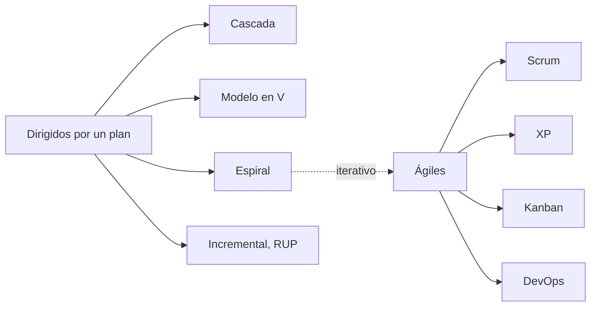

# Ingeniería de Software - Introducción a la ingeniería de software

## 1.4 Principales modelos de desarrollo de software.

---

Un **modelo de desarrollo**, o modelo de proceso, es una descripción simplificada de cómo se organiza el trabajo de construir software: qué actividades se hacen, en qué orden, quién las hace y qué productos resultan. Ningún modelo es el mejor en general; cada uno responde a un tipo de riesgo. Este tema presenta los modelos **dirigidos por un plan**, que fijan el trabajo por adelantado, los **ágiles**, que lo ajustan con retroalimentación frecuente, y los criterios para elegir entre ellos, junto con dos herramientas de planeación: el análisis de riesgos de la espiral y la estimación con COCOMO.

### Modelos dirigidos por un plan

- **Cascada:** fases secuenciales, cada una cerrada con un documento aprobado (tema 1.2). Supone requerimientos estables y conocidos.
- **Modelo en V:** la cascada con un nivel de prueba emparejado a cada nivel de especificación: aceptación con requerimientos, sistema con análisis, integración con arquitectura, unidad con diseño detallado. Las pruebas se diseñan cuando se escribe la especificación correspondiente, no al final. Es el modelo de las normas de sistemas críticos, como DO-178C en aviación, ISO 26262 en automóviles e IEC 62304 en dispositivos médicos.
- **Espiral** (Boehm, 1988): iteraciones guiadas por el riesgo, cada una con la identificación y reducción del riesgo dominante (tema 1.2).
- **Incremental:** el sistema se entrega en partes funcionales, planeadas desde el inicio, cada una construida con un ciclo completo. El Proceso Unificado de Rational lo organiza en cuatro fases, inicio, elaboración, construcción y transición, cada una con varias iteraciones.

### Modelos ágiles

El **Manifiesto ágil** de 2001 valora a los individuos y sus interacciones sobre los procesos y las herramientas, el software que funciona sobre la documentación exhaustiva, la colaboración con el cliente sobre la negociación de contratos, y la respuesta al cambio sobre el seguimiento de un plan. No rechaza lo segundo: dice que lo primero vale más.

- **Scrum:** el trabajo se organiza en **sprints** de duración fija, de una a cuatro semanas. El dueño del producto ordena la **lista de pendientes** del producto; en la **planeación del sprint**, el equipo elige lo que puede terminar y define el objetivo del sprint; cada día hay una reunión breve de sincronización, y al final una **revisión** del incremento con los interesados y una **retrospectiva** del proceso. El tamaño de las historias se estima en **puntos**, una medida relativa, y la **velocidad**, los puntos terminados por sprint, permite pronosticar.
- **Programación extrema** (XP, Beck, 1999): un conjunto de prácticas técnicas llevadas al extremo: desarrollo guiado por pruebas, programación en pareja, integración continua, diseño simple, refactorización continua, entregas pequeñas, propiedad colectiva del código y un cliente disponible para el equipo.
- **Kanban:** sin iteraciones fijas; el trabajo fluye por un tablero con columnas por estado y un **límite de trabajo en curso** por columna, que hace visibles los cuellos de botella. Por la ley de Little, el tiempo de entrega medio es el trabajo en curso dividido entre el rendimiento.

### DevOps y modelos híbridos

**DevOps** extiende la agilidad a la operación: integración y entrega continuas, infraestructura definida como código, monitoreo y despliegues frecuentes y reversibles. Las cuatro métricas de DORA miden su desempeño: frecuencia de despliegue, tiempo de entrega de un cambio, tasa de cambios que fallan y tiempo de recuperación. Muchas organizaciones usan modelos **híbridos**: un plan y una arquitectura definidos por adelantado, con entregas ágiles dentro de ese marco, o marcos de agilidad a escala como SAFe para coordinar muchos equipos.

### Elección del modelo

Boehm y Turner proponen decidir con cinco factores, en cada uno de los cuales un extremo favorece a los métodos ágiles y el otro a los dirigidos por un plan:

| Factor             | Favorece ágil                              | Favorece un plan                              |
| ------------------ | ------------------------------------------ | --------------------------------------------- |
| Tamaño             | Equipos pequeños                           | Muchos equipos, cientos de personas           |
| Criticidad         | Una falla cuesta comodidad o dinero menor  | Una falla cuesta vidas o mucho dinero         |
| Dinamismo          | Muchos cambios de requerimientos           | Requerimientos estables                       |
| Personal           | Mayoría con experiencia                    | Mayoría sin experiencia                       |
| Cultura            | Se valora la autonomía                     | Se valoran el orden y los procedimientos      |

### Estimación con COCOMO

El modelo COCOMO de Boehm (1981) estima el esfuerzo en persona-meses a partir del tamaño en miles de líneas de código, KLOC. En su versión básica,

$$E = a \cdot \mathrm{KLOC}^{b}, \qquad T = c \cdot E^{d},$$

con $T$ la duración en meses y constantes según el modo del proyecto: **orgánico**, equipos pequeños con experiencia en problemas conocidos, $a = 2.4,$ $b = 1.05,$ $c = 2.5,$ $d = 0.38;$ **semiacoplado**, $3.0,$ $1.12,$ $2.5,$ $0.35;$ y **empotrado**, con restricciones estrictas de hardware y operación, $3.6,$ $1.20,$ $2.5,$ $0.32.$ El exponente $b \gt 1$ refleja las **deseconomías de escala**: el doble de código cuesta más del doble de esfuerzo, por la comunicación y la integración. La versión intermedia multiplica $E$ por un **factor de ajuste del esfuerzo**, el producto de 15 multiplicadores como la confiabilidad requerida y la experiencia del equipo. COCOMO II (2000) actualiza el modelo para procesos iterativos y reutilización.



### Implementación en Python

El programa resuelve el ejercicio 2 calculando la exposición de cada riesgo y simulando la distribución de la pérdida. Para el ejercicio 3 planea dos sprints con tres políticas: con la velocidad histórica, con un compromiso al 85 % respetando la prioridad, y llenando los huecos con historias de menor prioridad. Para el ejercicio 4 aplica COCOMO básico en los tres modos y las interpretaciones posibles de la constante del enunciado.

```python
import random

# ---------- Ejercicio 2: riesgos de un proyecto en espiral ----------
riesgos = {"fallo técnico": (0.25, 200_000), "cambio de requerimientos": (0.60, 100_000)}
expo = {r: p * i for r, (p, i) in riesgos.items()}
for r, e in sorted(expo.items(), key=lambda x: -x[1]): print(f"ejercicio 2: {r:25} RE = {riesgos[r][0]:.2f} · {riesgos[r][1]:,} = {e:,.0f}")
print(f"   exposición total (pérdida esperada) = {sum(expo.values()):,.0f}")
rng = random.Random(3)                                      # distribución de la pérdida, si los riesgos son independientes
perdidas = [sum(i for p, i in riesgos.values() if rng.random() < p) for _ in range(100_000)]
dist = {v: perdidas.count(v) / len(perdidas) for v in sorted(set(perdidas))}
print("   distribución de la pérdida:", {f"{k:,}": round(v, 3) for k, v in dist.items()}, "| media", f"{sum(perdidas) / len(perdidas):,.0f}")

# ---------- Ejercicio 3: planeación de dos sprints ----------
backlog = [("A", 13, "alta"), ("B", 8, "alta"), ("C", 5, "media"), ("D", 13, "media"), ("E", 8, "baja")]
orden = {"alta": 0, "media": 1, "baja": 2}
def planea(backlog, capacidad, sprints, llenar=False):
    pendientes, plan = sorted(backlog, key=lambda x: orden[x[2]]), []   # sort estable: respeta el orden dentro de cada prioridad
    for _ in range(sprints):
        sprint, libre = [], capacidad
        for item in list(pendientes):
            if item[1] <= libre: sprint.append(item); libre -= item[1]; pendientes.remove(item)
            elif not llenar: break                             # respetar la prioridad: no adelantar una historia menor
        plan.append((sprint, capacidad - libre))
    return plan, pendientes
for cap, llenar in ((40, False), (34, False), (34, True)):    # 34: compromiso al 85 % de la velocidad histórica
    plan, resto = planea(backlog, cap, 2, llenar)
    print(f"ejercicio 3, capacidad {cap}{', llenando huecos' if llenar else ''}:", " | ".join(f"sprint {k}: {[i[0] for i in s]} = {u} puntos" for k, (s, u) in enumerate(plan, 1)),
          "| pendiente:", [i[0] for i in resto])
total = sum(p for _, p, _ in backlog)
print(f"   total del backlog {total} puntos: cabe en {-(-total // 40)} sprints de 40")

# ---------- Ejercicio 4: COCOMO básico ----------
kloc = 50
modos = {"orgánico": (2.4, 1.05, 2.5, 0.38), "semiacoplado": (3.0, 1.12, 2.5, 0.35), "empotrado": (3.6, 1.20, 2.5, 0.32)}
for modo, (a, b, c, d) in modos.items():
    E = a * kloc ** b; T = c * E ** d
    print(f"ejercicio 4, {modo:12}: E = {a}·{kloc}^{b} = {E:6.1f} persona-mes | T = {c}·E^{d} = {T:4.1f} meses | personal medio {E / T:4.1f}")
E = 2.4 * kloc ** 1.05
print(f"   si c = 1.2 es un factor de ajuste del esfuerzo (EAF): E = {E:.1f} · 1.2 = {E * 1.2:.1f} persona-mes")
print(f"   si c = 1.2 fuera el exponente: 2.4·50^1.2 = {2.4 * kloc ** 1.2:.1f}, que no corresponde a ningún modo")
```

Salida:

```text
ejercicio 2: cambio de requerimientos  RE = 0.60 · 100,000 = 60,000
ejercicio 2: fallo técnico             RE = 0.25 · 200,000 = 50,000
   exposición total (pérdida esperada) = 110,000
   distribución de la pérdida: {'0': 0.302, '100,000': 0.449, '200,000': 0.099, '300,000': 0.15} | media 109,806
ejercicio 3, capacidad 40: sprint 1: ['A', 'B', 'C', 'D'] = 39 puntos | sprint 2: ['E'] = 8 puntos | pendiente: []
ejercicio 3, capacidad 34: sprint 1: ['A', 'B', 'C'] = 26 puntos | sprint 2: ['D', 'E'] = 21 puntos | pendiente: []
ejercicio 3, capacidad 34, llenando huecos: sprint 1: ['A', 'B', 'C', 'E'] = 34 puntos | sprint 2: ['D'] = 13 puntos | pendiente: []
   total del backlog 47 puntos: cabe en 2 sprints de 40
ejercicio 4, orgánico    : E = 2.4·50^1.05 =  145.9 persona-mes | T = 2.5·E^0.38 = 16.6 meses | personal medio  8.8
ejercicio 4, semiacoplado: E = 3.0·50^1.12 =  239.9 persona-mes | T = 2.5·E^0.35 = 17.0 meses | personal medio 14.1
ejercicio 4, empotrado   : E = 3.6·50^1.2 =  393.6 persona-mes | T = 2.5·E^0.32 = 16.9 meses | personal medio 23.3
   si c = 1.2 es un factor de ajuste del esfuerzo (EAF): E = 145.9 · 1.2 = 175.1 persona-mes
   si c = 1.2 fuera el exponente: 2.4·50^1.2 = 262.4, que no corresponde a ningún modo
```

### Ejercicios Propuestos

1. **Selección de modelo.** Para un sistema de control hospitalario, altamente regulado, con requerimientos estables y crítico para la seguridad, ¿qué modelo elegirías y por qué?

2. **Riesgo.** En un proyecto en espiral, la probabilidad de un fallo técnico es de 25 % con un impacto de 200 000, y la de un cambio de requerimientos es de 60 % con un impacto de 100 000. Calcula los riesgos y priorízalos.

3. **Scrum.** Un equipo tiene una velocidad histórica de 40 puntos por sprint, y su lista de pendientes es: A, 13 puntos, prioridad alta; B, 8, alta; C, 5, media; D, 13, media; E, 8, baja. Planea 2 sprints considerando las prioridades.

4. **COCOMO.** Para un proyecto de 50 KLOC con constantes $a = 2.4,$ $b = 1.05$ y $c = 1.2,$ calcula el esfuerzo en persona-meses.

### Soluciones

**Ejercicio 1.** El **modelo en V**, por las mismas razones que en el ejercicio 1 del tema 1.2. Los requerimientos estables permiten planear por adelantado, y la criticidad y la regulación exigen trazabilidad completa y evidencia de verificación en cada nivel. En dispositivos médicos, la norma IEC 62304 asigna una clase de seguridad al software, de A a C según el daño posible, y la clase determina las actividades obligatorias, como la verificación de cada unidad en la clase C. En la tabla de Boehm y Turner, la criticidad y el dinamismo apuntan al plan. Las prácticas ágiles caben dentro del modelo, como la integración continua y las pruebas automatizadas, y la guía AAMI TIR45 describe cómo usarlas sin perder el cumplimiento.

**Ejercicio 2.** La exposición del cambio de requerimientos es $0.60 \cdot 100\,000 = 60\,000$ y la del fallo técnico, $0.25 \cdot 200\,000 = 50\,000.$ Por exposición, el primero es el prioritario, aunque su impacto sea la mitad, porque es más del doble de probable. La pérdida esperada total es de 110 000 si se suman, lo que vale sin suponer independencia. Con independencia, la simulación muestra que el 30 % de los proyectos no pierde nada y el 15 % pierde 300 000: la exposición es un promedio, y un proyecto concreto puede perder mucho más. Las respuestas en una espiral son, para el cambio de requerimientos, prototipos y entregas tempranas para validar los requerimientos con los usuarios; para el fallo técnico, una prueba de concepto de la tecnología en la primera vuelta.

**Ejercicio 3.** Ordenando por prioridad y con 40 puntos de capacidad, el sprint 1 lleva A, B, C y D, 39 puntos, y el sprint 2, E, con 8; el total de 47 puntos cabe en dos sprints. Pero comprometer el 98 % de la velocidad histórica es arriesgado: la velocidad es un promedio, y en una parte de los sprints se termina menos. Con un compromiso al 85 %, 34 puntos, hay dos opciones:

- **respetar la prioridad:** el sprint 1 lleva A, B y C, 26 puntos, porque D no cabe, y el sprint 2, D y E;
- **llenar los huecos:** el sprint 1 lleva A, B, C y E, 34 puntos, adelantando una historia de prioridad baja frente a D.

La primera es la correcta en Scrum si D es más valiosa que E: la capacidad sobrante del sprint 1 se usa en refinar historias, pagar deuda técnica o adelantar parte de D. Además, D, con 13 puntos, es candidata a dividirse en historias menores, lo que permite planear con más precisión.

**Ejercicio 4.** Las constantes 2.4 y 1.05 son las del modo **orgánico** de COCOMO básico, pero la tercera no es $c = 2.5,$ la del tiempo, y el enunciado no dice qué es. La interpretación más plausible es un factor de ajuste del esfuerzo de COCOMO intermedio:

$$E = 2.4 \cdot 50^{1.05} \cdot 1.2 \approx 145.9 \cdot 1.2 \approx 175.1 \text{ persona-mes}.$$

Sin el factor, el esfuerzo es de 145.9 persona-meses, con una duración de $2.5 \cdot 145.9^{0.38} \approx 16.6$ meses y un equipo medio de unas 9 personas. En modo empotrado el mismo tamaño costaría 393.6 persona-meses, casi el triple, lo que muestra cuánto pesa la clasificación del proyecto. COCOMO calibrado con datos de la propia organización es mucho más preciso que con las constantes publicadas, que provienen de 63 proyectos de los años setenta.

### Referencias

1. Sommerville, I., _Software Engineering_. Pearson, 2016. Capítulos 2 y 3.
2. Boehm, B. W., _Software Engineering Economics_. Prentice Hall, 1981.
3. Boehm, B. W., and Turner, R., _Balancing Agility and Discipline_. Addison-Wesley, 2003.
4. Beck, K., et al., _Manifesto for Agile Software Development_, 2001.
5. Schwaber, K., and Sutherland, J., _The Scrum Guide_, 2020.
6. Forsgren, N., Humble, J., and Kim, G., _Accelerate_. IT Revolution, 2018.
