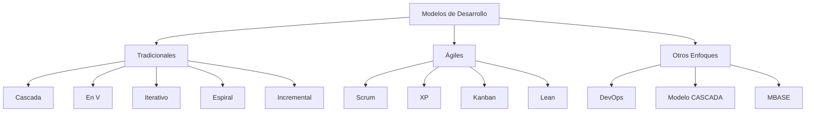
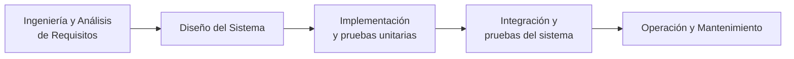
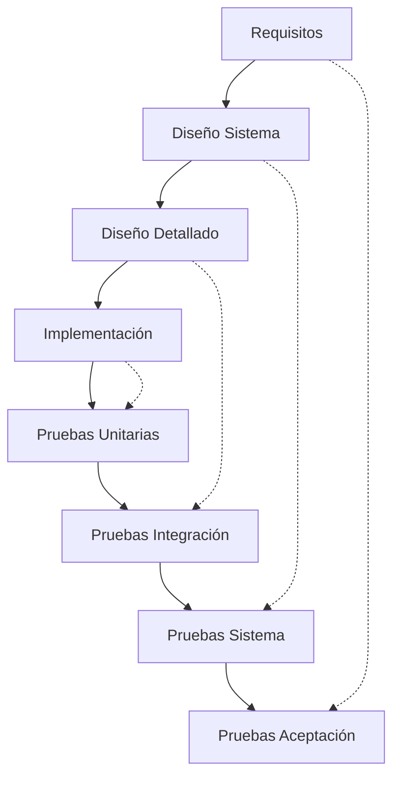
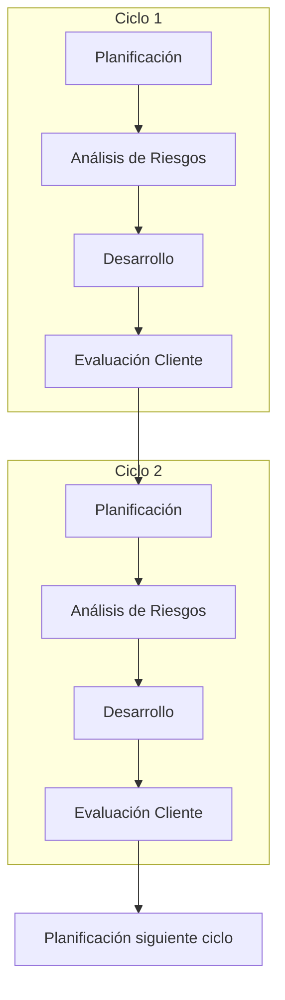
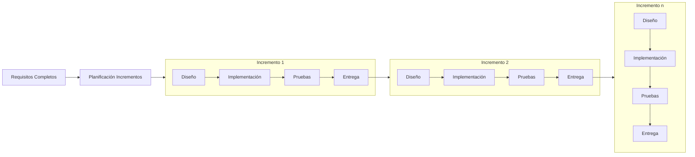
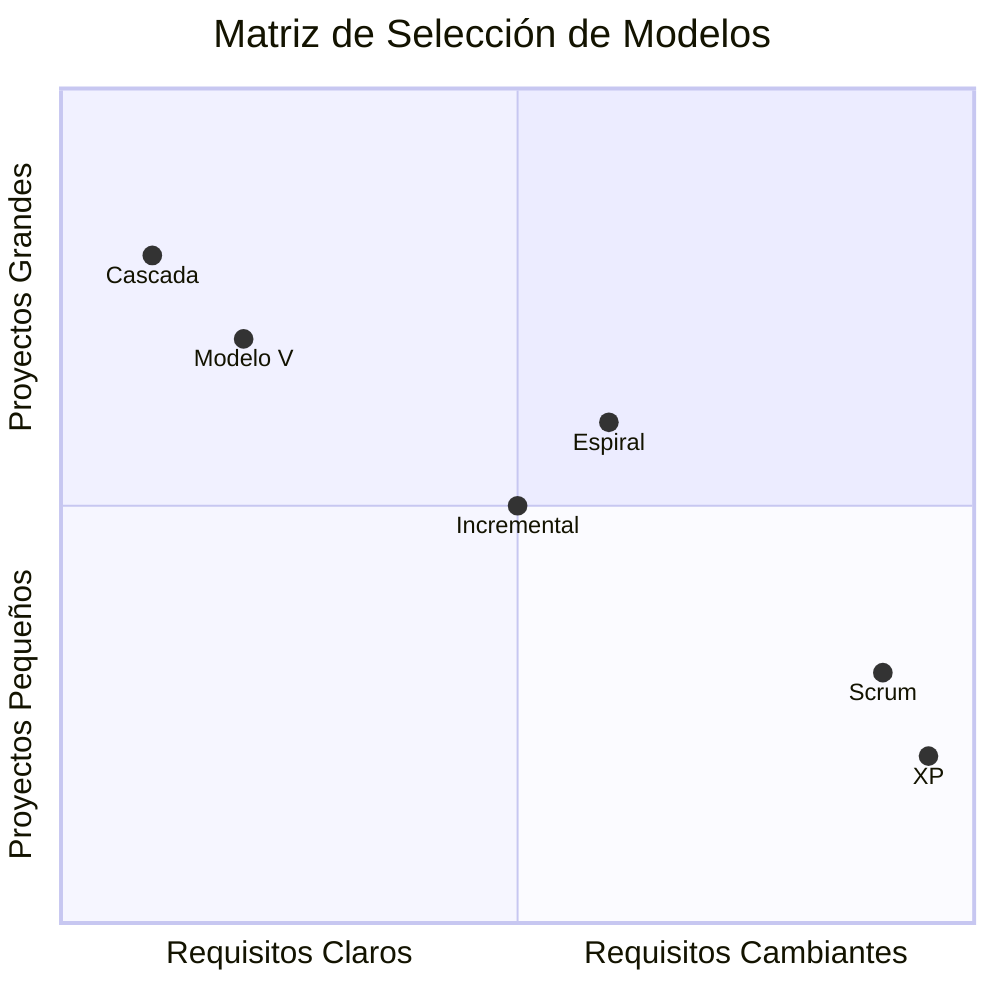

# Ingeniería de Software - Introducción a la ingeniería de software

## 1.4 Principales modelos de desarrollo de software.

---

Los modelos de desarrollo de software representan marcos de trabajo que definen el proceso para construir software. Según Sommerville (2010), "un modelo de proceso software es una representación abstracta de un proceso software que presenta una descripción de ese proceso desde una perspectiva particular".

### Clasificación de Modelos de Desarrollo



### Modelos Tradicionales

#### 1. Modelo en Cascada (Waterfall)

**Características principales**:

- Fases secuenciales y discretas
- Cada fase debe completarse antes de comenzar la siguiente
- Documentación exhaustiva
- Poco flexible a cambios



**Fórmula de estimación**:

$$ E = a + b \times S^c $$

Donde:

- $E$ = Esfuerzo en personas-mes
- $S$ = Tamaño estimado (KLOC)
- $a, b, c$ = Constantes del proyecto

#### 2. Modelo en V (V-Model)

**Relación verificación-validación**:



#### 3. Modelo Espiral (Boehm, 1988)

**Ciclo iterativo de gestión de riesgos**:

$$ R_i = P_i \times I_i $$

Donde:

- $R_i$ = Riesgo de la iteración i
- $P_i$ = Probabilidad de ocurrencia
- $I_i$ = Impacto potencial



### Modelos Ágiles

#### 4. Scrum

**Framework iterativo e incremental**:

```python
class Sprint:
    def __init__(self, duracion_semanas, capacidad_equipo):
        self.duracion = duracion_semanas
        self.capacidad = capacidad_equipo  # en puntos de historia
        self.objetivo = ""
        self.items = []

    def calcular_velocidad(self, puntos_completados):
        return puntos_completados / self.duracion

    def planificar_sprint(self, backlog_priorizado):
        capacidad_disponible = self.capacidad
        items_seleccionados = []

        for item in backlog_priorizado:
            if item.estimacion <= capacidad_disponible:
                items_seleccionados.append(item)
                capacidad_disponible -= item.estimacion

        return items_seleccionados
```

#### 5. Extreme Programming (XP)

**Prácticas técnicas**:

- Programación en pares
- Desarrollo guiado por pruebas (TDD)
- Integración continua
- Refactoring continuo

**Fórmula de productividad en pares**:

$$ P_{pair} = k \times \frac{P_1 + P_2}{2} $$

Donde $k$ ≈ 1.2-1.5 (factor de mejora)

### Modelo Incremental

**Entrega progresiva de funcionalidades**:

$$ ValorEntregado = \sum_{i=1}^{n} V_i \times P_i $$

Donde:

- $V_i$ = Valor del incremento i
- $P_i$ = Prioridad del incremento i



### Comparativa de Modelos

#### Matriz de Selección



#### Métricas Comparativas

**Tiempo de entrega**:

$$ T_{entrega} = T_{desarrollo} + T_{pruebas} + T_{espera} $$

**Eficiencia por modelo**:

- Cascada: $E_c = \frac{Calidad}{Tiempo} \times 0.8$
- Ágil: $E_a = \frac{ValorEntregado}{Tiempo} \times 1.2$

### Ejercicios Propuestos

#### Ejercicio 1: Selección de Modelo

**Proyecto**: Sistema de control para hospital
**Requisitos**: Altamente regulado, requisitos estables, crítica de seguridad
**Pregunta**: ¿Qué modelo elegiría y por qué?

#### Ejercicio 2: Cálculo de Riesgo

Para un proyecto espiral con:

- Probabilidad fallo técnico: 25%
- Impacto financiero: $200,000
- Probabilidad cambio requisitos: 60%
- Impacto cambios: $100,000

Calcule riesgos totales y priorice.

#### Ejercicio 3: Planificación Scrum

Equipo con velocidad histórica: 40 puntos/sprint
Backlog:

- Feature A: 13 puntos (Alta prioridad)
- Feature B: 8 puntos (Alta)
- Feature C: 5 puntos (Media)
- Feature D: 13 puntos (Media)
- Feature E: 8 puntos (Baja)

Planifique 2 sprints considerando prioridades.

#### Ejercicio 4: Estimación Cascada

Proyecto de 50 KLOC, constantes:

- a = 2.4, b = 1.05, c = 1.2
  Calcule esfuerzo en personas-mes.

### Caso de Estudio: Plataforma E-commerce

**Requisitos**:

- Catálogo productos
- Carrito compras
- Sistema pagos
- Gestión usuarios
- Reportes analytics

**Modelo híbrido propuesto**:

```python
class ModeloHibrido:
    def __init__(self, componentes_estables, componentes_cambiantes):
        self.estables = componentes_estables  # Cascada
        self.cambiantes = componentes_cambiantes  # Ágil

    def planificar_desarrollo(self):
        plan = {
            'fase_1': {
                'modelo': 'Cascada',
                'componentes': self.estables,
                'duracion': '3 meses'
            },
            'fase_2': {
                'modelo': 'Scrum',
                'componentes': self.cambiantes,
                'sprints': 4,
                'duracion_sprint': '2 semanas'
            }
        }
        return plan

# Uso del modelo
componentes_estables = ['BD', 'Autenticación', 'Core']
componentes_cambiantes = ['UI/UX', 'Recomendaciones', 'Analytics']

proyecto = ModeloHibrido(componentes_estables, componentes_cambiantes)
print(proyecto.planificar_desarrollo())
```

### Referencias Bibliográficas

#### Bibliografía Básica

1. **Sommerville, Ian (2010)**. _Software Engineering_ (9th edition). Addison Wesley.
   - Capítulo 2: "Software Processes"
   - Capítulo 3: "Agile Software Development"

2. **Pfleeger, S. L., & Atlee, J. M. (2010)**. _Software Engineering: Theory and Practice_ (4th edition). Prentice Hall.
   - Capítulo 2: "Process Models"
   - Capítulo 3: "Agile Processes"

#### Bibliografía Complementaria

3. **Boehm, B. W., & Turner, R. (2003)**. _Balancing Agility and Discipline: A Guide for the Perplexed_. Addison-Wesley.
   - Capítulo 4: "A Risk-Based Approach"

4. **Cockburn, A. (2004)**. _Crystal Clear: A Human-Powered Methodology for Small Teams_. Addison-Wesley.
   - Capítulo 3: "Methodology Elements"

5. **Schwaber, K., & Beedle, M. (2002)**. _Agile Software Development with Scrum_. Prentice Hall.

### Tendencias Actuales

#### DevOps

**Integración desarrollo-operaciones**:

$$ LeadTime = \frac{Tiempo\\_Desarrollo + Tiempo\\_Operaciones}{\text{Número}\\_Cambios} $$

#### Modelos Híbridos

**Combinación lo mejor de ambos enfoques**:

- Cascada para requisitos estables
- Ágil para componentes cambiantes
- DevOps para entrega continua

### Best Practices

#### Selección de Modelo

```python
def seleccionar_modelo(requisitos, equipo, proyecto):
    factores = {
        'estabilidad_requisitos': requisitos.estabilidad,
        'tamaño_equipo': len(equipo),
        'complejidad_proyecto': proyecto.complejidad,
        'criticidad_seguridad': proyecto.criticidad
    }

    if factores['estabilidad_requisitos'] > 0.8 and factores['criticidad_seguridad'] > 0.7:
        return "Cascada o Modelo V"
    elif factores['estabilidad_requisitos'] < 0.5:
        return "Ágil (Scrum/XP)"
    else:
        return "Híbrido o Incremental"
```

### Conclusión

La selección del modelo de desarrollo adecuado es crucial para el éxito del proyecto. Cada modelo tiene sus fortalezas y debilidades, y la elección debe basarse en:

1. **Naturaleza de los requisitos** (estables vs. cambiantes)
2. **Tamaño y complejidad del proyecto**
3. **Experiencia del equipo**
4. **Restricciones de tiempo y presupuesto**
5. **Nivel de criticidad y seguridad requerido**

La tendencia actual favorece enfoques ágiles e híbridos que permiten adaptarse a cambios mientras mantienen cierta estructura para garantizar calidad y predictibilidad.
