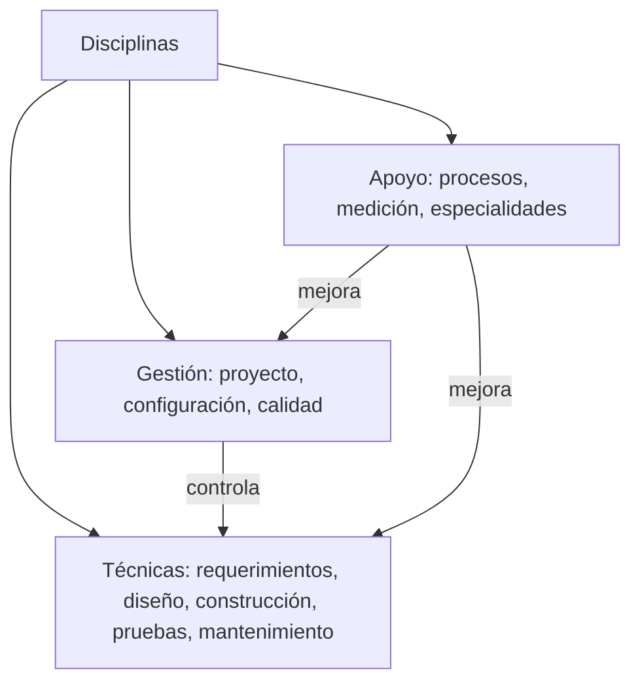

# Ingeniería de Software - Introducción a la ingeniería de software

## 1.5 Disciplinas de la ingeniería de software.

---

La ingeniería de software agrupa varias **disciplinas**, cada una con sus propios métodos, herramientas y métricas: unas se ocupan de construir el producto, otras de dirigir el proyecto y otras de sostener el proceso. La guía SWEBOK las organiza en áreas de conocimiento, y el Proceso Unificado las llama disciplinas porque atraviesan todas las fases del proyecto: en cada iteración se hace algo de requerimientos, algo de diseño, algo de pruebas. Este tema describe las disciplinas principales, lo que produce cada una y cómo se mide su trabajo.

### Disciplinas técnicas

- **Ingeniería de requerimientos:** obtiene las necesidades de los interesados, las analiza, las especifica y las valida, y gestiona sus cambios. Para decidir qué construir primero, cada requerimiento se evalúa por su **valor**, combinando impacto y urgencia, y por su **costo**; un criterio común es ordenar por valor sobre costo, que es la idea de la prioridad WSJF de SAFe (tema 4).
- **Diseño:** decide la arquitectura y la estructura interna de los componentes, con criterios como la cohesión y el acoplamiento (temas 2 y 5).
- **Construcción:** programación, revisión de código, pruebas unitarias e integración, con estándares de codificación y análisis estático.
- **Pruebas:** verificación y validación en varios niveles, de la unidad a la aceptación (tema 6).
- **Mantenimiento:** corrección, adaptación, mejora y prevención sobre el sistema en uso (tema 7).

### Disciplinas de gestión

- **Gestión de proyectos:** estimación, planeación, seguimiento con métricas como el valor ganado, y gestión de riesgos (temas 1.3 y 1.4).
- **Gestión de la configuración:** identifica los elementos del sistema que se controlan, como el código, la documentación y la configuración de los ambientes; registra cada cambio con un sistema de control de versiones; controla los cambios con solicitudes revisadas, y permite reconstruir cualquier versión entregada. Las métricas de historia del repositorio, como la **frecuencia de cambios** por archivo, señalan los puntos calientes, archivos que cambian mucho y suelen concentrar defectos.
- **Gestión de la calidad:** define los estándares y los procesos, y verifica que se cumplan, con revisiones, auditorías y métricas de calidad del producto.

### Disciplinas de apoyo

- **Ingeniería de procesos:** define, mide y mejora el proceso de desarrollo. Modelos como CMMI evalúan la madurez de los procesos de una organización en cinco niveles, de inicial a en optimización.
- **Medición:** define métricas útiles y las recolecta sin distorsionar el trabajo. El enfoque GQM de Basili parte de una meta, la convierte en preguntas y solo entonces elige las métricas que responden esas preguntas.
- **Experiencia de usuario, seguridad y otras especialidades** que atraviesan todo el ciclo.

### Métricas de calidad

- **Densidad de defectos:** defectos encontrados por mil líneas de código, KLOC. Permite comparar módulos y proyectos de tamaño distinto.
- **Eficiencia de eliminación de defectos** (DRE, Jones): la fracción de los defectos que se eliminan antes de la entrega,

$$\mathrm{DRE} = \frac{D_{\text{antes}}}{D_{\text{antes}} + D_{\text{después}}}.$$

  Solo puede calcularse cuando se conocen los defectos encontrados en operación, y es la medida directa de la efectividad de las pruebas y las revisiones.
- **Cobertura de pruebas:** la fracción del código que las pruebas ejecutan. Es una condición necesaria, porque un defecto en código no ejecutado no se detecta, pero no suficiente: una prueba que ejecuta una línea sin revisar su resultado no detecta nada.



### Implementación en Python

El programa resuelve los cuatro ejercicios. Calcula el valor de negocio de los requerimientos y los ordena también por valor sobre tamaño; calcula la densidad de defectos, la productividad y la eficiencia de eliminación de defectos para varios escenarios, y simula por qué la cobertura no mide la efectividad; identifica los archivos con más cambios, y estima el mantenimiento con el tráfico anual de cambios de COCOMO.

```python
import random

# ---------- Ejercicio 1: valor de negocio de los requerimientos ----------
reqs = [("RF-01 Gestión de habitaciones", 0.9, 1.0, 5), ("RF-02 Sistema de reservas", 0.8, 0.9, 8),
        ("RF-03 Facturación", 0.6, 0.7, 3), ("RF-04 Reportes estadísticos", 0.4, 0.5, 2)]   # último: tamaño supuesto
print("ejercicio 1: valor = impacto · urgencia, y valor por unidad de esfuerzo (tamaño supuesto)")
for nombre, imp, urg, tam in sorted(reqs, key=lambda r: -r[1] * r[2]):
    print(f"   {nombre:30} {imp} · {urg} = {imp * urg:.2f} | tamaño {tam} → valor/tamaño {imp * urg / tam:.3f}")
print("   orden por valor/tamaño:", [r[0][:5] for r in sorted(reqs, key=lambda r: -r[1] * r[2] / r[3])])

# ---------- Ejercicio 2: métricas de un módulo ----------
loc, defectos, horas, cobertura = 2000, 15, 120, 0.85
print(f"ejercicio 2: densidad de defectos {defectos / (loc / 1000):.1f} defectos/KLOC | productividad {loc / horas:.1f} LOC/h"
      f" ({loc / horas * 8:.0f} LOC por jornada)")
for en_produccion in (0, 5, 15):
    print(f"   si después se encuentran {en_produccion:>2} defectos en producción: DRE = {defectos}/({defectos} + {en_produccion}) = "
          f"{defectos / (defectos + en_produccion):.0%}")
# la cobertura no mide la efectividad: simulación de una prueba que ejecuta líneas sin verificar resultados
rng = random.Random(5)
lineas_def = set(rng.sample(range(loc), 40))                 # 40 defectos reales, en líneas al azar
cubiertas = set(rng.sample(range(loc), int(cobertura * loc)))
for prob_oraculo in (1.0, 0.5, 0.2):                          # probabilidad de que la prueba revise el resultado afectado
    hallados = sum(1 for l in lineas_def if l in cubiertas and rng.random() < prob_oraculo)
    print(f"   con 85 % de cobertura y oráculos que revisan {prob_oraculo:.0%} de los efectos: se detectan {hallados} de 40 defectos")

# ---------- Ejercicio 3: gestión de configuración, archivos con más cambios ----------
cambios = {"A": 15, "B": 8, "C": 22} | {f"R{i}": 5 for i in range(1, 8)}
total = sum(cambios.values())
media = total / len(cambios)
print(f"ejercicio 3: {total} cambios en 10 archivos, media {media:.1f}")
acum = 0
for a, c in sorted(cambios.items(), key=lambda x: -x[1]):
    acum += c
    if c > media: print(f"   {a}: {c} cambios = {c / total:.1%} del total ({c / media:.1f} veces la media), acumulado {acum / total:.1%}")
print(f"   los tres archivos A, B, C concentran {(15 + 8 + 22) / total:.1%} de los cambios")

# ---------- Ejercicio 4: costo de mantenimiento ----------
dev, factor, anios = 100_000, 1.5, 5
for act in (0.10, 0.15, 0.20):                               # tráfico anual de cambios: fracción del código que cambia por año
    anual = act * dev * factor
    print(f"ejercicio 4: ACT = {act:.0%}: anual {anual:,.0f}, en {anios} años {anual * anios:,.0f} "
          f"({anual * anios / (dev + anual * anios):.0%} del ciclo de vida)")
```

Salida:

```text
ejercicio 1: valor = impacto · urgencia, y valor por unidad de esfuerzo (tamaño supuesto)
   RF-01 Gestión de habitaciones  0.9 · 1.0 = 0.90 | tamaño 5 → valor/tamaño 0.180
   RF-02 Sistema de reservas      0.8 · 0.9 = 0.72 | tamaño 8 → valor/tamaño 0.090
   RF-03 Facturación              0.6 · 0.7 = 0.42 | tamaño 3 → valor/tamaño 0.140
   RF-04 Reportes estadísticos    0.4 · 0.5 = 0.20 | tamaño 2 → valor/tamaño 0.100
   orden por valor/tamaño: ['RF-01', 'RF-03', 'RF-04', 'RF-02']
ejercicio 2: densidad de defectos 7.5 defectos/KLOC | productividad 16.7 LOC/h (133 LOC por jornada)
   si después se encuentran  0 defectos en producción: DRE = 15/(15 + 0) = 100%
   si después se encuentran  5 defectos en producción: DRE = 15/(15 + 5) = 75%
   si después se encuentran 15 defectos en producción: DRE = 15/(15 + 15) = 50%
   con 85 % de cobertura y oráculos que revisan 100% de los efectos: se detectan 34 de 40 defectos
   con 85 % de cobertura y oráculos que revisan 50% de los efectos: se detectan 18 de 40 defectos
   con 85 % de cobertura y oráculos que revisan 20% de los efectos: se detectan 8 de 40 defectos
ejercicio 3: 80 cambios en 10 archivos, media 8.0
   C: 22 cambios = 27.5% del total (2.8 veces la media), acumulado 27.5%
   A: 15 cambios = 18.8% del total (1.9 veces la media), acumulado 46.2%
   los tres archivos A, B, C concentran 56.2% de los cambios
ejercicio 4: ACT = 10%: anual 15,000, en 5 años 75,000 (43% del ciclo de vida)
ejercicio 4: ACT = 15%: anual 22,500, en 5 años 112,500 (53% del ciclo de vida)
ejercicio 4: ACT = 20%: anual 30,000, en 5 años 150,000 (60% del ciclo de vida)
```

### Ejercicios Propuestos

1. **Requerimientos.** Para un sistema de reservas de hotel con los requerimientos RF-01, gestión de habitaciones, de prioridad alta; RF-02, sistema de reservas, alta; RF-03, facturación, media, y RF-04, reportes estadísticos, baja, calcula el valor de negocio con impactos 0.9, 0.8, 0.6 y 0.4 y urgencias 1.0, 0.9, 0.7 y 0.5.

2. **Métricas.** Un módulo tiene 2000 líneas de código, 15 defectos encontrados, 120 horas de desarrollo y una cobertura de pruebas de 85 %. Calcula la densidad de defectos, la productividad y la efectividad de las pruebas.

3. **Configuración.** En un sistema de 10 archivos, en los últimos 6 meses el archivo A tuvo 15 cambios, B 8, C 22, y el resto un promedio de 5. Identifica los archivos con mayor tasa de cambios y propón acciones.

4. **Mantenimiento.** Para un proyecto con un costo de desarrollo de 100 000, un factor de complejidad de 1.5 y una vida útil de 5 años, calcula el costo total de mantenimiento.

### Soluciones

**Ejercicio 1.** Con valor igual a impacto por urgencia: RF-01, $0.9 \cdot 1.0 = 0.90;$ RF-02, $0.72;$ RF-03, $0.42;$ RF-04, $0.20.$ El orden coincide con las prioridades asignadas. El valor solo ordena bien si todos los requerimientos cuestan lo mismo; si se conoce su tamaño, conviene ordenar por **valor sobre tamaño**. Con tamaños supuestos de 5, 8, 3 y 2, el orden cambia a RF-01, RF-03, RF-04 y RF-02: el sistema de reservas, valioso pero grande, baja al final. En un hotel, sin embargo, la reserva es la razón de ser del sistema y las dependencias importan: la facturación necesita reservas. El cálculo es una ayuda para decidir, no un sustituto del criterio.

**Ejercicio 2.**

- **Densidad de defectos:** $15 / 2 = 7.5$ defectos por KLOC.
- **Productividad:** $2000 / 120 \approx 16.7$ LOC por hora, unas 133 por jornada. Es alta para código terminado; conviene confirmar si las 120 horas incluyen diseño y pruebas.
- **Efectividad de las pruebas:** no puede calcularse con estos datos. La cobertura de 85 % no es la efectividad: dice qué parte del código se ejecutó, no cuántos defectos se encontraron. La medida es la DRE, que requiere saber cuántos defectos aparecieron después: si en producción aparecieran 5 más, la DRE sería $15/20 = 75\,\%;$ si aparecieran 15, sería 50 %. La simulación del programa muestra la diferencia: con la misma cobertura de 85 %, unas pruebas que revisan todos los resultados detectan 34 de 40 defectos, y unas que revisan solo el 20 % detectan 8. La **prueba de mutación**, que introduce defectos artificiales y cuenta cuántos detectan las pruebas, mide esa capacidad directamente (tema 6).

**Ejercicio 3.** El total es de $15 + 8 + 22 + 7 \cdot 5 = 80$ cambios, con una media de 8 por archivo. C, con 22 cambios, el 27.5 % del total y casi tres veces la media, y A, con 15, son los puntos calientes; juntos concentran el 46 % de los cambios en el 20 % de los archivos. B está en la media. Las acciones:

1. **Investigar la causa** con el historial: si los cambios de C son correcciones de defectos, C es frágil; si son funciones nuevas, es el centro del sistema y es natural que cambie.
2. **Revisar el diseño:** un archivo que cambia por muchas razones distintas tiene varias responsabilidades y conviene dividirlo, según el principio de responsabilidad única.
3. **Reforzar las pruebas y las revisiones** de A y C, porque la frecuencia de cambios es uno de los mejores predictores de defectos, según los estudios de Nagappan y Ball.
4. **Cruzar con la complejidad:** un archivo con muchos cambios y alta complejidad ciclomática es el primer candidato a refactorizar.

**Ejercicio 4.** El enunciado no da un modelo, y el resultado depende del que se elija. El de COCOMO estima el esfuerzo anual de mantenimiento como el **tráfico anual de cambios**, ACT, la fracción del código que se agrega o modifica en un año, por el esfuerzo de desarrollo; con el factor de complejidad como multiplicador:

$$C_{\text{mant, anual}} = \mathrm{ACT} \cdot C_{\text{dev}} \cdot F.$$

Con un ACT típico de 10 a 20 %, el mantenimiento anual va de 15 000 a 30 000, y el total en 5 años, de 75 000 a 150 000, entre 43 y 60 % del costo del ciclo de vida. El ACT real se mide en el repositorio, con las líneas cambiadas por año.

### Referencias

1. Washizaki, H. (ed.), _Guide to the Software Engineering Body of Knowledge (SWEBOK)_, versión 4.0. IEEE Computer Society, 2024.
2. Jones, C., _Applied Software Measurement_. McGraw-Hill, 2008.
3. Basili, V. R., Caldiera, G., and Rombach, H. D., The goal question metric approach. _Encyclopedia of Software Engineering_, Wiley, 1994.
4. Nagappan, N., and Ball, T., Use of relative code churn measures to predict system defect density. _ICSE_, 2005.
5. CMMI Institute, _CMMI Model V2.0_, 2018.
6. Boehm, B. W., _Software Engineering Economics_. Prentice Hall, 1981. Capítulo 30.
