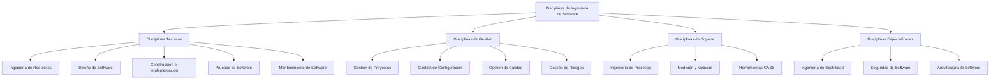
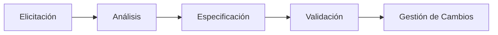
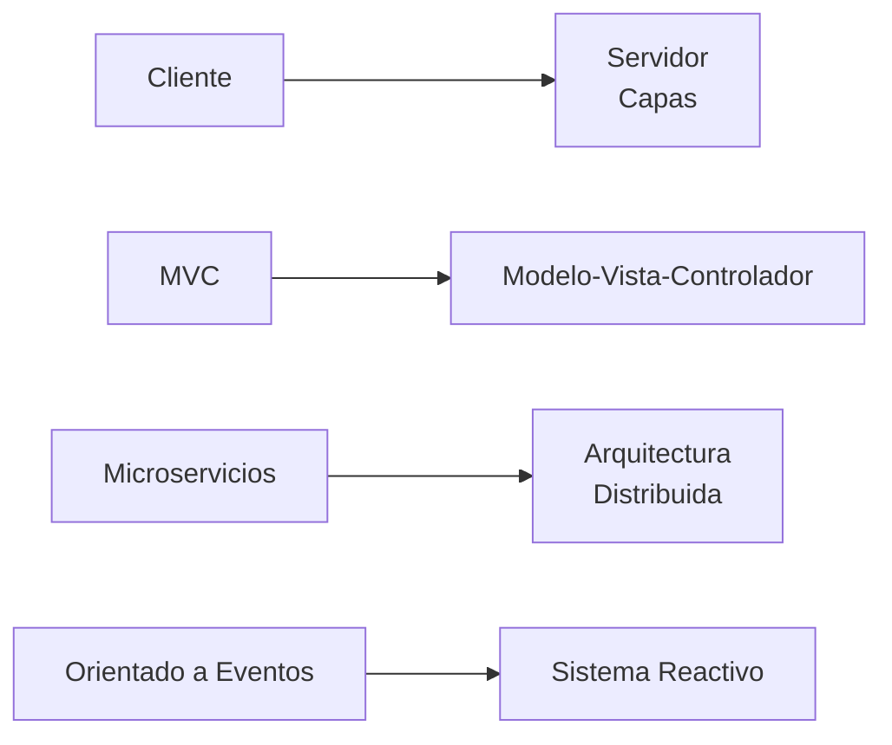
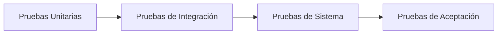
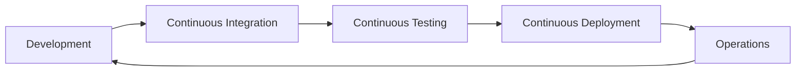

# Ingeniería de Software - Introducción a la ingeniería de software

## 1.5 Disciplinas de la ingeniería de software.

---

Las disciplinas de la ingeniería de software representan las áreas de conocimiento y práctica especializada que componen esta field. Según Sommerville (2010), "la ingeniería de software no es solo programación, sino un conjunto de disciplinas interrelacionadas que aseguran la producción sistemática de software de calidad".

### Marco de Disciplinas Principales



### Disciplinas Técnicas Centrales

#### 1. Ingeniería de Requisitos

**Proceso sistemático de elicitar, analizar, especificar y validar requisitos**:



**Métricas de requisitos**:

$$ ComplejidadRequisitos = \frac{N_{funcionales} \times P_{prioridad}}{N_{total}} $$

**Ejemplo de especificación**:

```python
class Requisito:
    def __init__(self, id, descripcion, tipo, prioridad, estado):
        self.id = id
        self.descripcion = descripcion
        self.tipo = tipo  # Funcional, No funcional
        self.prioridad = prioridad  # Alta, Media, Baja
        self.estado = estado  # Propuesto, Aprobado, Implementado

    def calcular_valor_negocio(self, impacto, urgencia):
        return impacto * urgencia

# Ejemplo de uso
req1 = Requisito("RF-001", "Sistema debe autenticar usuarios", "Funcional", "Alta", "Aprobado")
valor = req1.calcular_valor_negocio(0.8, 0.9)
```

#### 2. Diseño de Software

**Arquitectura y diseño detallado del sistema**:

**Principios de diseño**:

- Acoplamiento bajo: $ C = \frac{1}{N\_{interfaces}} $
- Cohesión alta: $  Cohesion = \frac{ N_{funciones\\\_relacionadas} }{ N_{ total\\\_funciones } }  $

**Patrones arquitectónicos comunes**:



#### 3. Construcción e Implementación

**Desarrollo de código y prácticas de programación**:

**Métricas de código**:

$$ \text{Complejidad Ciclomática} = E - N + 2P $$

Donde:

- $E$ = Número de aristas
- $N$ = Número de nodos
- $P$ = Número de componentes conexos

**Ejemplo de código bien estructurado**:

```python
def calcular_complejidad_ciclomatica(nodos, aristas, componentes):
    """
    Calcula la complejidad ciclomática de McCabe
    """
    return aristas - nodos + (2 * componentes)

class CalculadoraMetricas:
    def __init__(self, codigo_fuente):
        self.codigo = codigo_fuente
        self.metricas = {}

    def analizar_codigo(self):
        self.metricas['lineas_codigo'] = self.contar_lineas_codigo()
        self.metricas['complejidad'] = self.calcular_complejidad()
        return self.metricas

    def contar_lineas_codigo(self):
        # Implementación simplificada
        return len(self.codigo.split('\n'))
```

#### 4. Pruebas de Software

**Verificación y validación del software**:

**Niveles de testing**:



**Métricas de pruebas**:

$$ Cobertura = \frac{\text{Código}\\\_Ejecutado}{\text{Código}\\\_Total} \times 100\% $$

$$ Efectividad = \frac{Defectos\_Encontrados}{Defectos\_Totales} \times 100\% $$

#### 5. Mantenimiento de Software

**Tipos de mantenimiento**:

- Correctivo: Arreglar defectos
- Adaptativo: Adaptar a nuevos entornos
- Perfectivo: Mejorar funcionalidad
- Preventivo: Mejorar mantenibilidad

**Costo de mantenimiento**:

$$ CostoMantenimiento = CostoDesarrollo \times FactorComplexidad \times Tiempo $$

### Disciplinas de Gestión

#### 6. Gestión de Proyectos

**Planificación, ejecución y control de proyectos**:

**Métricas de gestión**:

- **Valor Ganado**: $ EV = \%Completado \times PresupuestoTotal $
- **CPI**: $CPI = \frac{EV}{AC}$ (Cost Performance Index)
- **SPI**: $SPI = \frac{EV}{PV}$ (Schedule Performance Index)

#### 7. Gestión de Configuración

**Control de versiones y cambios**:

```python
class SistemaConfiguracion:
    def __init__(self):
        self.versiones = {}
        self.cambios_pendientes = []

    def registrar_cambio(self, archivo, version, descripcion):
        if archivo not in self.versiones:
            self.versiones[archivo] = []
        self.versiones[archivo].append({
            'version': version,
            'descripcion': descripcion,
            'timestamp': datetime.now()
        })

    def calcular_tasa_cambios(self, archivo):
        if archivo in self.versiones:
            return len(self.versiones[archivo])
        return 0
```

### Disciplinas de Soporte

#### 8. Ingeniería de Procesos

**Definición y mejora de procesos software**:

**Capability Maturity Model (CMMI)**:

- Nivel 1: Initial (Ad-hoc)
- Nivel 2: Managed
- Nivel 3: Defined
- Nivel 4: Quantitatively Managed
- Nivel 5: Optimizing

#### 9. Medición y Métricas

**Métricas clave**:

$$ Productividad = \frac{\text{TamañoSoftware}}{Esfuerzo} $$

$$ Calidad = \frac{Defectos}{\text{TamañoSoftware}} \times 1000 $$

### Ejercicios Propuestos

#### Ejercicio 1: Análisis de Requisitos

**Proyecto**: Sistema de reservas de hotel
**Lista de requisitos**:

- RF-01: Gestión de habitaciones (Prioridad: Alta)
- RF-02: Sistema de reservas (Prioridad: Alta)
- RF-03: Facturación (Prioridad: Media)
- RF-04: Reportes estadísticos (Prioridad: Baja)

Calcule el valor de negocio considerando impacto [0.9, 0.8, 0.6, 0.4] y urgencia [1.0, 0.9, 0.7, 0.5].

#### Ejercicio 2: Cálculo de Métricas

Para un módulo con:

- 2000 líneas de código
- 15 defectos encontrados
- 120 horas de desarrollo
- Cobertura de pruebas: 85%

Calcule:

- Densidad de defectos
- Productividad
- Efectividad de pruebas

#### Ejercicio 3: Gestión de Configuración

Sistema con 10 archivos, cambios en últimos 6 meses:

- Archivo A: 15 cambios
- Archivo B: 8 cambios
- Archivo C: 22 cambios
- Resto: promedio 5 cambios

Identifique archivos con mayor tasa de cambios y proponga acciones.

#### Ejercicio 4: Estimación de Mantenimiento

Proyecto con:

- Costo desarrollo: $100,000
- Factor complejidad: 1.5
- Vida útil: 5 años

Calcule costo total de mantenimiento.

### Caso de Estudio Integral

**Proyecto**: Sistema de gestión académica

```python
class ProyectoSoftware:
    def __init__(self, nombre, disciplinas_aplicadas):
        self.nombre = nombre
        self.disciplinas = disciplinas_aplicadas
        self.metricas = {}
        self.estado = "Iniciado"

    def aplicar_disciplina(self, disciplina, actividades):
        print(f"Aplicando {disciplina} con actividades: {actividades}")
        # Implementación específica de cada disciplina

    def calcular_metricas_proyecto(self):
        metricas = {
            'productividad': self.calcular_productividad(),
            'calidad': self.calcular_calidad(),
            'cumplimiento': self.calcular_cumplimiento()
        }
        return metricas

    def ejecutar_ciclo_vida(self):
        # Flujo integrado de disciplinas
        disciplinas = [
            ('Ingeniería de Requisitos', ['Elicitación', 'Análisis', 'Especificación']),
            ('Diseño', ['Arquitectura', 'Diseño detallado']),
            ('Implementación', ['Codificación', 'Pruebas unitarias']),
            ('Pruebas', ['Integración', 'Sistema', 'Aceptación']),
            ('Mantenimiento', ['Soporte', 'Mejoras'])
        ]

        for disciplina, actividades in disciplinas:
            self.aplicar_disciplina(disciplina, actividades)
```

### Referencias Bibliográficas

#### Bibliografía Básica

1. **Sommerville, Ian (2010)**. _Software Engineering_ (9th edition). Addison Wesley.
   - Capítulo 4: "Requirements Engineering"
   - Capítulo 6: "Architectural Design"
   - Capítulo 8: "Software Testing"

2. **Pfleeger, S. L., & Atlee, J. M. (2010)**. _Software Engineering: Theory and Practice_ (4th edition). Prentice Hall.
   - Capítulo 3: "Process Models"
   - Capítulo 4: "The Team"

#### Bibliografía Complementaria

3. **Pressman, R. S. (2010)**. _Software Engineering: A Practitioner's Approach_ (7th edition). McGraw-Hill.
   - Capítulo 5: "Software Project Planning"
   - Capítulo 9: "Software Quality Assurance"

4. **IEEE Computer Society (2004)**. _Guide to the Software Engineering Body of Knowledge (SWEBOK)_

5. **CMMI Institute (2010)**. _CMMI for Development, Version 1.3_

### Tendencias Actuales

#### DevOps Integrado



#### Ingeniería de Software Basada en Valor

$$ Valor = \frac{Beneficios}{Costos} \times Calidad \times \text{SatisfacciónUsuario} $$

### Best Practices por Disciplina

#### Checklist de Calidad

```python
def verificar_calidad_disciplina(disciplina, metricas):
    umbrales = {
        'Ingeniería de Requisitos': {'completitud': 0.95, 'consistencia': 0.9},
        'Diseño': {'acoplamiento': 0.3, 'cohesion': 0.8},
        'Implementación': {'complejidad': 10, 'cobertura': 0.8},
        'Pruebas': {'efectividad': 0.9, 'cobertura': 0.85}
    }

    if disciplina in umbrales:
        return all(metricas[k] >= v for k, v in umbrales[disciplina].items())
    return False
```

### Conclusión

Las disciplinas de la ingeniería de software representan el conjunto organizado de conocimientos y prácticas que permiten el desarrollo sistemático de software de calidad. La efectiva integración de estas disciplinas, junto con la aplicación apropiada de métricas y mejores prácticas, es esencial para el éxito de cualquier proyecto software.

La comprensión profunda de cada disciplina y su interrelación permite a los ingenieros de software seleccionar y adaptar los enfoques más apropiados para cada contexto específico, balanceando aspectos técnicos, de gestión y de calidad para entregar valor real a los stakeholders.
