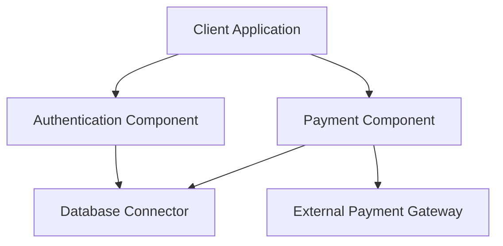

# Ingeniería de Software - Elementos de diseño de sistemas

## 2.1 Características y beneficios del uso de componentes.

---

### Introducción a los componentes de software

Un **componente de software** es una unidad de composición con interfaces especificadas contractualmente y dependencias de contexto explícitas. Según Sommerville (2010), un componente es "una unidad de software que tiene un interfaz bien definido y que puede ser desplegada de forma independiente y está sujeta a composición por terceros".

$$
\text{Componente} = \{\text{Interfaz}, \text{Implementación}, \text{Documentación}\}
$$

### Características fundamentales de los componentes

#### 1. Encapsulación

Los componentes encapsulan funcionalidad específica, ocultando los detalles de implementación y exponiendo solo interfaces bien definidas.

```java
// Ejemplo de componente encapsulado
public interface PaymentProcessor {
    PaymentResult processPayment(PaymentRequest request);
}

public class PayPalProcessor implements PaymentProcessor {
    // Implementación oculta
    private boolean validatePayment(PaymentRequest request) {
        // Lógica de validación interna
        return true;
    }

    @Override
    public PaymentResult processPayment(PaymentRequest request) {
        if (!validatePayment(request)) {
            return new PaymentResult(false, "Invalid payment");
        }
        // Procesar pago
        return new PaymentResult(true, "Payment successful");
    }
}
```

#### 2. Reusabilidad

Los componentes están diseñados para ser reutilizados en múltiples contextos y aplicaciones.

#### 3. Interoperabilidad

Los componentes pueden comunicarse e interactuar con otros componentes a través de interfaces estandarizadas.

#### 4. Componibilidad

Los componentes pueden combinarse para formar sistemas más complejos.

#### 5. Independencia de despliegue

Los componentes pueden desplegarse y actualizarse de forma independiente.

### Beneficios del uso de componentes

#### 1. Reducción de costos de desarrollo

$$
\text{Ahorro} = \sum_{i=1}^{n} (C_d(i) - C_r(i))
$$

Donde:

- $C_d(i)$: Costo de desarrollar el componente i desde cero
- $C_r(i)$: Costo de reutilizar el componente i
- $n$: Número de componentes reutilizados

#### 2. Mejora de la calidad

Los componentes probados y validados reducen errores y aumentan la confiabilidad del sistema.

#### 3. Reducción del tiempo de desarrollo

La reutilización acelera el proceso de construcción del software.

#### 4. Facilidad de mantenimiento

Los componentes permiten actualizaciones y correcciones localizadas.

#### 5. Escalabilidad

Los sistemas basados en componentes pueden crecer de manera modular.

### Patrones de diseño de componentes

#### Diagrama de componentes UML



### Ejemplo práctico: Sistema de comercio electrónico

```typescript
// Componente de catálogo de productos
interface ProductCatalog {
  getProducts(): Product[];
  getProductById(id: string): Product;
  searchProducts(query: string): Product[];
}

// Componente de carrito de compras
interface ShoppingCart {
  addItem(product: Product, quantity: number): void;
  removeItem(productId: string): void;
  getTotal(): number;
  checkout(): Order;
}

// Componente de procesamiento de pagos
interface PaymentGateway {
  processPayment(order: Order, paymentDetails: PaymentDetails): PaymentResult;
}
```

### Ejercicios propuestos

#### Ejercicio 1: Identificación de componentes

Analice el siguiente sistema y identifique los componentes potenciales:

"Sistema de gestión universitaria que debe manejar: matrícula de estudiantes, gestión de cursos, calificaciones, pagos, y reportes administrativos."

#### Ejercicio 2: Diseño de interfaces

Diseñe las interfaces para un componente de "Gestión de Usuarios" que debe proporcionar:

- Registro de nuevos usuarios
- Autenticación
- Recuperación de contraseña
- Gestión de perfiles

#### Ejercicio 3: Cálculo de ROI

Calcule el retorno de inversión para un proyecto que desarrolla 15 componentes, donde:

- 5 componentes se reutilizan (costo de reutilización: $2,000 c/u)
- 10 componentes se desarrollan desde cero (costo: $8,000 c/u)
- El costo de desarrollar todos desde cero hubiera sido de $12,000 por componente

$$
ROI = \frac{\text{Beneficio} - \text{Inversión}}{\text{Inversión}} \times 100
$$

### Mejores prácticas en el diseño de componentes

1. **Principio de responsabilidad única**: Cada componente debe tener una única responsabilidad bien definida.

2. **Acoplamiento débil**: Los componentes deben minimizar las dependencias entre sí.

3. **Cohesión fuerte**: Los elementos dentro de un componente deben estar fuertemente relacionados.

4. **Interfaces estables**: Las interfaces públicas deben cambiar lo menos posible.

5. **Documentación completa**: Cada componente debe incluir documentación de uso, restricciones y ejemplos.

### Referencias

#### Bibliografía básica

1. Sommerville, Ian. (2010). _Software Engineering_ (9th edition). Addison Wesley. (Capítulo 19: Component-based software engineering)
2. Pfleeger, S. L., & Atlee, J. M. (2010). _Software Engineering: Theory and Practice_ (4th Edition). Prentice Hall. (Capítulo 7: Design and Implementation)

#### Bibliografía complementaria

1. Evans, E. (2003). _Domain-Driven Design: Tackling Complexity in the Heart of Software_. Addison Wesley.
2. Monson-Haefel, R. (Ed.). (2009). _97 Things Every Software Architect Should Know_. O'Reilly Media.

### Evaluación de conocimientos

1. Defina qué es un componente de software y enumere tres características principales.
2. Explique cómo el uso de componentes mejora la mantenibilidad del software.
3. Describa el principio de "acoplamiento débil" y por qué es importante en el diseño de componentes.
4. Calcule el ahorro en un proyecto que reutiliza 8 componentes cuyo desarrollo desde cero costaría $ \text{\textdollar 10,000} $ cada uno, pero su reutilización tiene un costo de $ \text{\textdollar 3,000} $ por componente.

### Recursos adicionales

- Frameworks populares de componentes: Spring Framework, .NET Components, EJB
- Estándares de componentes: CORBA, COM/DCOM, JavaBeans
- Herramientas de gestión de componentes: Maven, npm, NuGet

Esta guía proporciona una base sólida para comprender las características y beneficios del uso de componentes en ingeniería de software, con referencias a la bibliografía recomendada y ejercicios prácticos para reforzar el aprendizaje.
