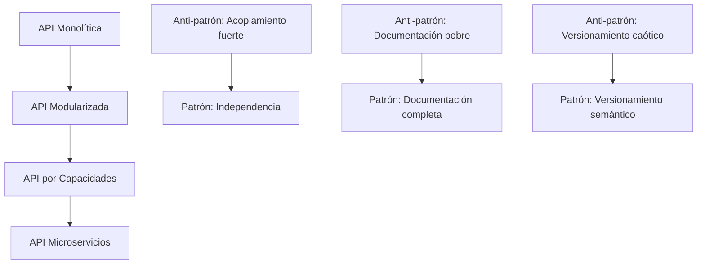

# Ingeniería de Software - Elementos de diseño de sistemas

## 2.2 Cualidades deseables en APIs.

---

Una **Interfaz de Programación de Aplicaciones (API)** es un conjunto de definiciones, protocolos y herramientas que permite la comunicación entre diferentes componentes de software. Según Pfleeger y Atlee (2010), "una API define cómo los componentes software deben interactuar, proporcionando un contrato claro entre diferentes partes del sistema".

$$
\text{API} = \{\text{Endpoints}, \text{Parámetros}, \text{Respuestas}, \text{Contrato}\}
$$

### Cualidades fundamentales de las APIs

#### 1. Consistencia

Las APIs deben seguir convenciones y patrones consistentes en todo su diseño, lo que facilita su aprendizaje y uso.

```typescript
// Ejemplo de API inconsistente vs consistente
// INCONSISTENTE: Diferentes convenciones de nomenclatura
GET / getUsers;
POST / create_user;
PUT / UpdateUser;

// CONSISTENTE: Mismas convenciones
GET / users;
POST / users;
PUT / users / { id };
```

#### 2. Simplicidad

Las APIs deben ser simples de entender y usar, incluso para desarrolladores que las encuentren por primera vez.

#### 3. Completitud

Debe ofrecer toda la funcionalidad necesaria para los casos de uso que pretende resolver, sin requerir workarounds.

#### 4. Documentación clara

La documentación debe ser exhaustiva, accesible y con ejemplos prácticos.

#### 5. Retrocompatibilidad

Los cambios en la API no deben romper clientes existentes.

$$
\text{Compatibilidad} = \frac{\text{Cambios no disruptivos}}{\text{Cambios totales}} \times 100
$$

### Principios de diseño de APIs

#### Principio de menor asombro

La API debe comportarse como los desarrolladores esperan que lo haga.

#### Ley de Postel (Principio de robustez)

"Sé conservador en lo que envías, y liberal en lo que aceptas".

#### Abstracción adecuada

La API debe ocultar la complejidad interna mientras expone funcionalidad útil.

### Atributos de calidad en APIs

#### 1. Usabilidad

Facilidad con la que los desarrolladores pueden aprender y usar la API efectivamente.

#### 2. Mantenibilidad

Facilidad para modificar y extender la API sin introducir errores.

#### 3. Rendimiento

La API debe responder dentro de tiempos aceptables.

#### 4. Seguridad

Debe proteger los datos y recursos contra accesos no autorizados.

#### 5. Confiabilidad

Disponibilidad constante y comportamiento predecible.

### Ejemplo de API bien diseñada

```python
# Ejemplo de API RESTful para gestión de libros
from flask import Flask, request, jsonify
from flask_restful import Api, Resource

app = Flask(__name__)
api = Api(app)

class Libro(Resource):
    def get(self, id=None):
        # Obtener libro(s)
        if id:
            return obtener_libro_por_id(id)
        else:
            limit = request.args.get('limit', 10)
            offset = request.args.get('offset', 0)
            return obtener_libros(limit, offset)

    def post(self):
        datos = request.get_json()
        return crear_libro(datos)

    def put(self, id):
        datos = request.get_json()
        return actualizar_libro(id, datos)

    def delete(self, id):
        return eliminar_libro(id)

# Configuración de endpoints
api.add_resource(Libro, '/libros', '/libros/<string:id>')

if __name__ == '__main__':
    app.run(debug=True)
```

### Patrones y anti-patrones en diseño de APIs

#### Diagrama de evolución de API



### Ejercicios propuestos

#### Ejercicio 1: Evaluación de API

Analice la siguiente API y identifique problemas de diseño:

```
GET /getAllCustomers
POST /addNewCustomer
PUT /modifyCustomerDetails
GET /fetchCustomerOrders?customerID=123
DELETE /removeCustomer/?id=123
```

Proponga una redesign mejorada aplicando los principios de APIs RESTful.

#### Ejercicio 2: Diseño de endpoint

Diseñe un endpoint para una API que debe:

- Permitir búsqueda de productos con filtros múltiples
- Soportar paginación
- Permitir selección de campos a devolver
- Incluir ordenamiento por diferentes criterios

Defina la firma del endpoint y todos los parámetros posibles.

#### Ejercicio 3: Versionamiento semántico

Dada la siguiente historia de versiones de una API:

- v1.0.0: Versión inicial
- v1.0.1: Corrección de bug crítico
- v1.1.0: Nuevas funcionalidades compatibles
- v2.0.0: Cambios incompatibles con versiones anteriores

Aplique la fórmula de semver:

$$
\text{MAYOR}.\text{MENOR}.\text{PARCHÉ}
$$

y explique qué tipo de cambios justifican cada incremento.

### Métricas de calidad de APIs

#### 1. Tasa de adopción

$$
\text{Adopción} = \frac{\text{Número de clientes activos}}{\text{Número de clientes potenciales}} \times 100
$$

#### 2. Tiempo medio de integración (MTTI)

Tiempo promedio que toma a un desarrollador integrar la API.

#### 3. Tasa de errores

$$
\text{Tasa de errores} = \frac{\text{Número de requests fallidos}}{\text{Número total de requests}} \times 100
$$

#### 4. Satisfacción del desarrollador

Medida mediante encuestas (ej: escala 1-5).

### Mejores prácticas en diseño de APIs

1. **Nomenclatura consistente**: Usar convenciones claras y mantenerse fiel a ellas.

2. **Versionamiento**: Implementar versionamiento semántico desde el inicio.

3. **Manejo de errores**: Proporcionar mensajes de error claros y útiles.

4. **Límites de tasa**: Implementar throttling para prevenir abusos.

5. **Documentación interactiva**: Proporcionar sandbox para testing.

6. **Deprecación gradual**: Anunciar cambios con suficiente anticipación.

### Referencias

#### Bibliografía básica

1. Sommerville, Ian. (2010). _Software Engineering_ (9th edition). Addison Wesley. (Capítulo 18: Application architecture)
2. Pfleeger, S. L., & Atlee, J. M. (2010). _Software Engineering: Theory and Practice_ (4th Edition). Prentice Hall. (Capítulo 6: Design)

#### Bibliografía complementaria

1. Evans, E. (2003). _Domain-Driven Design: Tackling Complexity in the Heart of Software_. Addison Wesley. (Capítulo 14: Maintaining model integrity)
2. Monson-Haefel, R. (Ed.). (2009). _97 Things Every Software Architect Should Know_. O'Reilly Media. (Sección sobre diseño de interfaces)

### Evaluación de conocimientos

1. Liste cinco cualidades deseables en una API y explique por qué son importantes.
2. Describa el Principio de Robustez (Ley de Postel) y su aplicación en diseño de APIs.
3. Explique la importancia del versionamiento semántico en las APIs.
4. Diseñe la firma de un endpoint RESTful para buscar productos con filtros avanzados, paginación y selección de campos.

### Recursos adicionales

- Herramientas de documentación: Swagger/OpenAPI, API Blueprint
- Patrones de diseño: API Gateway, Backend for Frontend (BFF)
- Estándares: JSON API, HAL, OData
- Herramientas de testing: Postman, Insomnia
