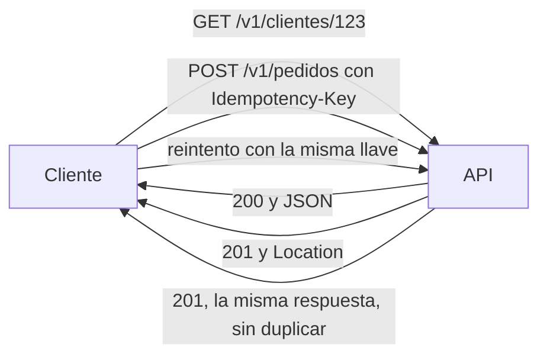

# Ingeniería de Software - Elementos de diseño de sistemas

## 2.2 Cualidades deseables en APIs.

---

Una **API** (*application programming interface*) es la interfaz con la que un componente, una biblioteca o un servicio se ofrece a otros programas. A diferencia del código interno, una API publicada es difícil de cambiar: cada cliente que la usa depende de ella, y un cambio incompatible los rompe a todos. Bloch lo resume: las API públicas, como los diamantes, son para siempre. Por eso su calidad importa más que la de casi cualquier otra parte del sistema. Este tema describe las cualidades que distinguen a una buena API, con énfasis en las API web de estilo REST, y cómo se versionan sin romper a sus clientes.

### Cualidades

- **Fácil de aprender y de usar, difícil de usar mal:** el uso correcto es el más natural, y el incorrecto falla pronto y con un mensaje claro. Un ejemplo de lo contrario: una función que recibe tres enteros en un orden fácil de confundir.
- **Consistente:** la misma convención en todas partes, para nombres, formatos de fecha, paginación y errores. Quien aprendió un endpoint puede adivinar los demás.
- **Mínima y completa:** hace todo lo que sus clientes necesitan y nada más. Cada operación pública es un compromiso permanente; en caso de duda, se deja fuera, porque agregar después es compatible y quitar no.
- **Abstracta:** expone conceptos del dominio, no detalles de la implementación como nombres de tablas o de clases internas.
- **Predecible y segura de reintentar:** las operaciones tienen la semántica que su nombre sugiere, y las que pueden repetirse por un fallo de red son **idempotentes**.
- **Evolucionable:** admite cambios compatibles, como campos nuevos, y tiene una política de versiones y de retiro para los incompatibles.
- **Documentada:** con un contrato preciso de cada operación, ejemplos y una especificación legible por máquina, como OpenAPI, de la que se generan clientes, documentación y pruebas.
- **Eficiente y segura:** paginación de colecciones grandes, selección de campos, límites de tasa, autenticación y validación estricta de las entradas.

### REST

El estilo REST, definido por Fielding en su tesis de 2000, modela una API como un conjunto de **recursos** identificados por URL, sobre los que se opera con los métodos uniformes de HTTP. Las convenciones que se derivan:

- las rutas son **sustantivos** en plural, `/clientes`, `/clientes/123`, `/clientes/123/pedidos`, y la acción la indica el método;
- `GET` lee sin efectos; `POST` crea en una colección; `PUT` reemplaza un recurso completo; `PATCH` lo modifica parcialmente; `DELETE` lo elimina;
- los identificadores van en la ruta, y los filtros, el orden y la paginación en la consulta;
- los códigos de estado comunican el resultado: 200, 201 con la cabecera `Location`, 204, 400, 401, 403, 404, 409, 422 y 429, entre otros.

Las propiedades de los métodos están definidas en el RFC 9110. `GET`, `HEAD`, `PUT` y `DELETE` son **idempotentes**: repetir la petición deja el servidor en el mismo estado que una sola vez. `POST` no lo es: si un cliente reintenta un `POST` porque no recibió la respuesta, puede crear el recurso dos veces. La solución habitual, usada por las API de pago, es una cabecera `Idempotency-Key` con un identificador único que el servidor recuerda: una petición repetida con la misma llave devuelve la respuesta original sin volver a ejecutarse.

### Versionamiento semántico

El versionamiento semántico, SemVer 2.0.0, numera las versiones como $\mathrm{MAYOR}.\mathrm{MENOR}.\mathrm{PARCHE}:$

- se incrementa el **parche** con correcciones compatibles que no cambian la interfaz;
- se incrementa la **menor**, y el parche vuelve a 0, al agregar funcionalidad compatible, como un endpoint, un campo en una respuesta o un parámetro opcional;
- se incrementa la **mayor**, y las otras dos vuelven a 0, con cualquier cambio incompatible: quitar o renombrar un campo, cambiar su tipo, volver obligatorio un parámetro o cambiar el significado de una operación.

La versión 0.y.z es para el desarrollo inicial, en el que todo puede cambiar. En las API web, la versión mayor suele ir en la ruta, `/v1/`, o en una cabecera, y la anterior se mantiene durante un periodo de retiro anunciado, con cabeceras como `Deprecation` y `Sunset`.



### Métricas

- **Tasa de errores:** peticiones fallidas sobre el total, separando los errores del cliente, 4xx, que indican una API confusa o mal documentada, de los del servidor, 5xx, que indican defectos o falta de capacidad.
- **Latencia por percentiles:** el p50, el p95 y el p99, porque el promedio oculta la cola lenta.
- **Tiempo hasta la primera llamada exitosa:** cuánto tarda un desarrollador nuevo en lograr su primera petición correcta; mide la facilidad de aprendizaje.
- **Adopción y uso de versiones:** clientes activos y en qué versión están, para planear los retiros.

### Implementación en Python

El programa resuelve el ejercicio 1 con un revisor automático que aplica las convenciones REST a cada endpoint del enunciado y a su rediseño, y simula los reintentos con `POST`, con `PUT` y con una llave de idempotencia. Para el ejercicio 2 implementa el análisis y la validación de los parámetros de la búsqueda de productos, con mensajes de error para cada parámetro inválido, y la paginación por cursor. Para el ejercicio 3 calcula la versión siguiente a partir de la lista de cambios de cada entrega.

```python
import re
from urllib.parse import urlsplit, parse_qs

# ---------- Ejercicio 1: revisión automática de una lista de endpoints ----------
VERBOS = ("get", "fetch", "add", "new", "create", "modify", "update", "remove", "delete", "list", "all")
def revisa(endpoint):
    metodo, url = endpoint.split(maxsplit=1)
    partes = urlsplit(url); segmentos = [s for s in partes.path.split("/") if s]
    problemas = []
    for s in segmentos:
        palabras = re.findall(r"[a-z]+|[A-Z][a-z]*", s)
        if any(p.lower() in VERBOS for p in palabras): problemas.append(f"verbo en la ruta '{s}': la acción la da el método HTTP")
        if re.search(r"[A-Z]", s): problemas.append(f"mayúsculas en '{s}': usar minúsculas con guiones")
    if partes.path.endswith("/") and partes.path != "/": problemas.append("barra final")
    q = parse_qs(partes.query)
    if any(k.lower().endswith("id") for k in q): problemas.append(f"identificador en la consulta {list(q)}: va en la ruta")
    return metodo, url, problemas
api = ["GET /getAllCustomers", "POST /addNewCustomer", "PUT /modifyCustomerDetails",
       "GET /fetchCustomerOrders?customerID=123", "DELETE /removeCustomer/?id=123"]
print("ejercicio 1:")
for e in api:
    m, u, p = revisa(e); print(f"   {m:6} {u:40} {len(p)} problemas: {'; '.join(p)}")
nueva = ["GET /customers", "POST /customers", "GET /customers/123", "PUT /customers/123", "PATCH /customers/123",
         "DELETE /customers/123", "GET /customers/123/orders"]
print("   rediseño:", "sin problemas" if not any(revisa(e)[2] for e in nueva) else "con problemas", "|", ", ".join(nueva))

# --- idempotencia: un cliente reintenta cuando no recibe respuesta ---
def simula(metodo, reintentos):
    clientes, pedidos = {}, []
    for _ in range(1 + reintentos):
        if metodo == "POST": pedidos.append({"cliente": 123, "total": 50})      # cada POST crea un recurso
        elif metodo == "PUT": clientes[123] = {"nombre": "Ana"}                 # PUT reemplaza: mismo estado final
    return len(pedidos) if metodo == "POST" else len(clientes)
def post_con_llave(llaves, llave, pedidos):
    if llave in llaves: return llaves[llave]               # Idempotency-Key: repetir devuelve la respuesta original
    pedidos.append({"total": 50}); llaves[llave] = len(pedidos); return llaves[llave]
llaves, pedidos = {}, []
for _ in range(3): post_con_llave(llaves, "a1b2", pedidos)
print(f"   2 reintentos: POST crea {simula('POST', 2)} pedidos | PUT deja {simula('PUT', 2)} cliente | POST con llave de idempotencia crea {len(pedidos)}")

# ---------- Ejercicio 2: búsqueda de productos con filtros, paginación, campos y orden ----------
CAMPOS = {"id", "nombre", "precio", "categoria", "marca", "stock", "calificacion"}
FILTROS = {"categoria": str, "marca": str, "precio_min": float, "precio_max": float, "en_stock": lambda v: v == "true", "q": str}
def analiza(url):
    q = {k: v[-1] for k, v in parse_qs(urlsplit(url).query).items()}
    errores, consulta = [], {"filtros": {}, "limite": 20, "cursor": None, "campos": None, "orden": [("id", "asc")]}
    for k, v in q.items():
        if k in FILTROS:
            try: consulta["filtros"][k] = FILTROS[k](v)
            except ValueError: errores.append(f"{k}: '{v}' no es válido")
        elif k == "limite":
            if not v.isdigit() or not 1 <= int(v) <= 100: errores.append("limite: entero entre 1 y 100")
            else: consulta["limite"] = int(v)
        elif k == "cursor": consulta["cursor"] = v
        elif k == "campos":
            c = v.split(","); malos = set(c) - CAMPOS
            if malos: errores.append(f"campos desconocidos: {sorted(malos)}")
            consulta["campos"] = c
        elif k == "orden":
            orden = []
            for t in v.split(","):
                campo, sentido = (t[1:], "desc") if t.startswith("-") else (t, "asc")
                if campo not in CAMPOS: errores.append(f"orden por campo desconocido '{campo}'")
                orden.append((campo, sentido))
            consulta["orden"] = orden
        else: errores.append(f"parámetro desconocido '{k}'")
    if {"precio_min", "precio_max"} <= consulta["filtros"].keys() and consulta["filtros"]["precio_min"] > consulta["filtros"]["precio_max"]:
        errores.append("precio_min mayor que precio_max")
    return (400, errores) if errores else (200, consulta)
for url in ("/v1/productos?categoria=audio&precio_max=2000&en_stock=true&orden=-calificacion,precio&campos=id,nombre,precio&limite=10",
            "/v1/productos?precio_min=500&precio_max=100&limite=1000&orden=popularidad&color=rojo"):
    print("ejercicio 2:", url, "→", *analiza(url))
productos = [{"id": i, "nombre": f"P{i}", "precio": (i * 37) % 900 + 100} for i in range(1, 26)]
def pagina(cursor, limite):                                # paginación por cursor sobre el id: estable aunque se inserten datos
    resto = [p for p in productos if cursor is None or p["id"] > cursor][:limite]
    return resto, (resto[-1]["id"] if len(resto) == limite else None)
cur, paginas = None, []
while True:
    items, cur = pagina(cur, 10); paginas.append([p["id"] for p in items])
    if cur is None: break
print("   paginación por cursor de 10 en 10:", [f"{p[0]}–{p[-1]}" for p in paginas])

# ---------- Ejercicio 3: versionamiento semántico ----------
def incremento(cambios):
    if any(c in ("elimina campo", "cambia tipo", "elimina endpoint", "campo obligatorio nuevo en petición") for c in cambios): return "mayor"
    if any(c in ("campo nuevo en respuesta", "endpoint nuevo", "parámetro opcional nuevo") for c in cambios): return "menor"
    return "parche"
def siguiente(v, tipo):
    M, m, p = map(int, v.split("."))
    return {"mayor": f"{M + 1}.0.0", "menor": f"{M}.{m + 1}.0", "parche": f"{M}.{m}.{p + 1}"}[tipo]
v = "1.0.0"; historia = [v]
for cambios in (["corrige error"], ["endpoint nuevo", "corrige error"], ["elimina campo"], ["parámetro opcional nuevo"]):
    v = siguiente(v, incremento(cambios)); historia.append(f"{v} ({', '.join(cambios)})")
print("ejercicio 3:", " → ".join(historia))
```

Salida:

```text
ejercicio 1:
   GET    /getAllCustomers                         2 problemas: verbo en la ruta 'getAllCustomers': la acción la da el método HTTP; mayúsculas en 'getAllCustomers': usar minúsculas con guiones
   POST   /addNewCustomer                          2 problemas: verbo en la ruta 'addNewCustomer': la acción la da el método HTTP; mayúsculas en 'addNewCustomer': usar minúsculas con guiones
   PUT    /modifyCustomerDetails                   2 problemas: verbo en la ruta 'modifyCustomerDetails': la acción la da el método HTTP; mayúsculas en 'modifyCustomerDetails': usar minúsculas con guiones
   GET    /fetchCustomerOrders?customerID=123      3 problemas: verbo en la ruta 'fetchCustomerOrders': la acción la da el método HTTP; mayúsculas en 'fetchCustomerOrders': usar minúsculas con guiones; identificador en la consulta ['customerID']: va en la ruta
   DELETE /removeCustomer/?id=123                  4 problemas: verbo en la ruta 'removeCustomer': la acción la da el método HTTP; mayúsculas en 'removeCustomer': usar minúsculas con guiones; barra final; identificador en la consulta ['id']: va en la ruta
   rediseño: sin problemas | GET /customers, POST /customers, GET /customers/123, PUT /customers/123, PATCH /customers/123, DELETE /customers/123, GET /customers/123/orders
   2 reintentos: POST crea 3 pedidos | PUT deja 1 cliente | POST con llave de idempotencia crea 1
ejercicio 2: /v1/productos?categoria=audio&precio_max=2000&en_stock=true&orden=-calificacion,precio&campos=id,nombre,precio&limite=10 → 200 {'filtros': {'categoria': 'audio', 'precio_max': 2000.0, 'en_stock': True}, 'limite': 10, 'cursor': None, 'campos': ['id', 'nombre', 'precio'], 'orden': [('calificacion', 'desc'), ('precio', 'asc')]}
ejercicio 2: /v1/productos?precio_min=500&precio_max=100&limite=1000&orden=popularidad&color=rojo → 400 ['limite: entero entre 1 y 100', "orden por campo desconocido 'popularidad'", "parámetro desconocido 'color'", 'precio_min mayor que precio_max']
   paginación por cursor de 10 en 10: ['1–10', '11–20', '21–25']
ejercicio 3: 1.0.0 → 1.0.1 (corrige error) → 1.1.0 (endpoint nuevo, corrige error) → 2.0.0 (elimina campo) → 2.1.0 (parámetro opcional nuevo)
```

### Ejercicios Propuestos

1. **Evaluación.** Identifica los problemas de diseño de esta API y propón un rediseño con los principios REST:

    ```text
    GET /getAllCustomers
    POST /addNewCustomer
    PUT /modifyCustomerDetails
    GET /fetchCustomerOrders?customerID=123
    DELETE /removeCustomer/?id=123
    ```

2. **Endpoint.** Diseña un endpoint de búsqueda de productos con filtros múltiples, paginación, selección de los campos devueltos y ordenamiento por varios criterios. Define su firma y todos sus parámetros.

3. **Versionamiento.** Para la historia v1.0.0, versión inicial; v1.0.1, corrección de un error crítico; v1.1.0, funciones nuevas compatibles, y v2.0.0, cambios incompatibles, explica qué tipo de cambio justifica cada incremento de $\mathrm{MAYOR}.\mathrm{MENOR}.\mathrm{PARCHE}.$

### Soluciones

**Ejercicio 1.** La API tiene cuatro tipos de problemas: **verbos en las rutas**, como `get`, `add`, `modify`, `fetch` y `remove`, que duplican la información del método y además son inconsistentes entre sí, pues usa cuatro verbos distintos para leer y modificar; **mayúsculas** en las rutas, que en HTTP distinguen URL distintas; **identificadores en la consulta**, con dos nombres distintos, `customerID` e `id`; y una **barra final** en el último. Además, `PUT /modifyCustomerDetails` no indica qué cliente modifica. El rediseño:

| Operación                   | Endpoint                         |
| --------------------------- | -------------------------------- |
| Listar clientes             | `GET /customers`                 |
| Crear un cliente            | `POST /customers`                |
| Leer un cliente             | `GET /customers/123`             |
| Reemplazar un cliente       | `PUT /customers/123`             |
| Modificar campos            | `PATCH /customers/123`           |
| Eliminar un cliente         | `DELETE /customers/123`          |
| Pedidos de un cliente       | `GET /customers/123/orders`      |

La lista de clientes debe paginarse, y la creación debe devolver 201 con la URL del cliente creado. El revisor del programa confirma que el rediseño no tiene ninguno de los problemas. La simulación muestra por qué importa usar el método correcto: con dos reintentos, `PUT` deja un solo cliente, y `POST` crea tres pedidos, salvo que use una llave de idempotencia.

**Ejercicio 2.** La firma es `GET /v1/productos`, con estos parámetros de consulta, todos opcionales:

| Parámetro               | Ejemplo                       | Significado                                             |
| ----------------------- | ----------------------------- | ------------------------------------------------------- |
| `q`                     | `q=audífonos`                 | Búsqueda de texto en nombre y descripción               |
| `categoria`, `marca`    | `categoria=audio`             | Filtros por igualdad                                    |
| `precio_min`, `precio_max` | `precio_max=2000`          | Rango de precio                                         |
| `en_stock`              | `en_stock=true`               | Solo productos disponibles                              |
| `orden`                 | `orden=-calificacion,precio`  | Campos de orden; el signo menos indica descendente      |
| `campos`                | `campos=id,nombre,precio`     | Selección de los campos de cada producto                |
| `limite`                | `limite=20`                   | Tamaño de página, de 1 a 100; 20 por omisión            |
| `cursor`                | `cursor=eyJpZCI6MTB9`         | Posición opaca devuelta por la página anterior          |

La respuesta es `200` con `{"datos": [...], "siguiente": "<cursor>"}`, sin `siguiente` en la última página. La paginación por **cursor**, que recuerda el último elemento visto, es preferible a la de desplazamiento, `offset`, porque no repite ni salta elementos cuando se insertan datos entre dos peticiones y no se vuelve lenta en páginas profundas. Cualquier parámetro inválido o desconocido produce un `400` con la lista completa de errores, como en la segunda petición del programa, y no se ignora en silencio, porque un filtro mal escrito ignorado devolvería resultados engañosos.

**Ejercicio 3.**

- **v1.0.1:** una corrección de un error que no cambia la interfaz incrementa el parche. Si la corrección cambiara un comportamiento del que dependen los clientes, sería incompatible aunque fuera una corrección.
- **v1.1.0:** las funciones nuevas compatibles, como endpoints, campos opcionales o campos nuevos en las respuestas, incrementan la menor, y el parche vuelve a 0. Que un campo nuevo en una respuesta sea compatible supone que los clientes ignoran los campos que no conocen, una regla que la API debe documentar.
- **v2.0.0:** un cambio incompatible incrementa la mayor, y la menor y el parche vuelven a 0. Debe ir acompañado de una guía de migración y de un periodo en que v1 sigue disponible.

El programa aplica las reglas a una historia de cambios: un error corregido da 1.0.1; un endpoint nuevo junto con una corrección da 1.1.0, porque el cambio de mayor nivel decide; quitar un campo da 2.0.0.

### Referencias

1. Bloch, J., How to design a good API and why it matters. _OOPSLA Companion_, 2006.
2. Fielding, R. T., _Architectural Styles and the Design of Network-based Software Architectures_. Tesis doctoral, University of California, Irvine, 2000.
3. Fielding, R., Nottingham, M., and Reschke, J. (eds.), RFC 9110: HTTP Semantics. IETF, 2022.
4. Preston-Werner, T., _Semantic Versioning 2.0.0_. semver.org, 2013.
5. Lauret, A., _The Design of Web APIs_. Manning, 2019.
