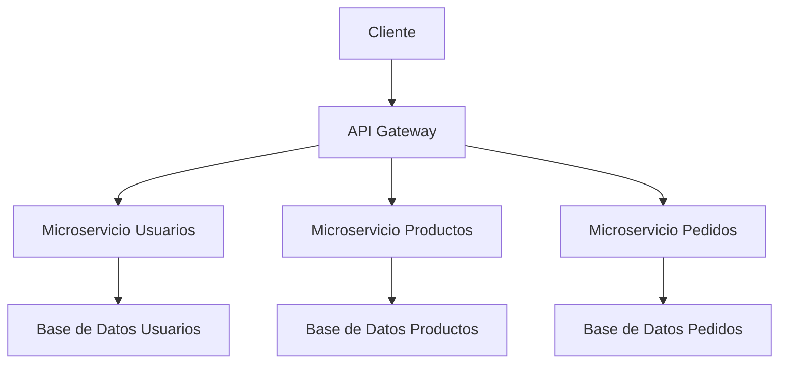

# Ingeniería de Software - Elementos de diseño de sistemas

## 2.3 Diseño de APIs.

---

Una **Interfaz de Programación de Aplicaciones (API)** es un conjunto de definiciones, protocolos y herramientas que permite la comunicación entre diferentes componentes de software. Según Sommerville (2010), "el diseño de APIs es fundamental para la construcción de sistemas modulares y mantenibles, ya que define los contratos entre componentes".

$$
\text{Calidad API} = f(\text{Consistencia}, \text{Simplicidad}, \text{Documentación}, \text{Performance})
$$

### Principios fundamentales del diseño de APIs

#### 1. Principio de ocultamiento de información

Las APIs deben exponer solo lo necesario, ocultando los detalles de implementación.

#### 2. Ley de Postel (Principio de robustez)

"Sé conservador en lo que envías, y liberal en lo que aceptas".

#### 3. Principio de menor asombro

La API debe comportarse como los desarrolladores esperan que lo haga.

#### 4. Cohesión y acoplamiento

- Alta cohesión: cada endpoint tiene una responsabilidad única
- Bajo acoplamiento: mínimas dependencias entre endpoints

### Elementos clave en el diseño de APIs

#### Estructura de endpoints RESTful

```http
# Ejemplo de estructura coherente
GET /resources          # Listar recursos
POST /resources         # Crear recurso
GET /resources/{id}     # Obtener recurso específico
PUT /resources/{id}     # Actualizar recurso completo
PATCH /resources/{id}   # Actualizar parcialmente
DELETE /resources/{id}  # Eliminar recurso
```

#### Diseño de respuestas

```json
// Ejemplo de respuesta estructurada
{
  "data": {
    "id": "123",
    "type": "users",
    "attributes": {
      "name": "Juan Pérez",
      "email": "juan@example.com"
    }
  },
  "meta": {
    "timestamp": "2023-10-25T10:30:00Z",
    "version": "v1.0"
  },
  "links": {
    "self": "/users/123",
    "related": "/users/123/articles"
  }
}
```

### Patrones de diseño de APIs

#### Diagrama de arquitectura API Gateway



### Versionamiento de APIs

#### Estrategias de versionamiento

```http
# Versionamiento en URL
GET /v1/users
GET /v2/users

# Versionamiento con headers
GET /users
Headers: Accept: application/vnd.api.v2+json

# Versionamiento por parámetros
GET /users?version=2
```

#### Fórmula de compatibilidad

$$
C = \frac{N_c}{N_t} \times 100
$$

Donde:

- $C$: Porcentaje de compatibilidad
- $N_c$: Número de endpoints compatibles
- $N_t$: Número total de endpoints

### Diseño de operaciones y parámetros

#### Ejemplo de API bien diseñada

```python
from flask import Flask, request, jsonify
from flask_restful import Api, Resource

app = Flask(__name__)
api = Api(app)

class UserCollection(Resource):
    def get(self):
        # Parámetros de consulta con valores por defecto
        page = request.args.get('page', 1, type=int)
        limit = request.args.get('limit', 10, type=int)
        sort = request.args.get('sort', 'name')

        # Lógica de negocio
        users = get_users(page, limit, sort)
        return jsonify({
            'data': users,
            'pagination': {
                'page': page,
                'limit': limit,
                'total': get_total_users()
            }
        })

    def post(self):
        data = request.get_json()

        # Validación de entrada
        if not validate_user_data(data):
            return {'error': 'Datos inválidos'}, 400

        user = create_user(data)
        return jsonify({'data': user}), 201

class UserItem(Resource):
    def get(self, user_id):
        user = get_user_by_id(user_id)
        if not user:
            return {'error': 'Usuario no encontrado'}, 404
        return jsonify({'data': user})

    def put(self, user_id):
        # Implementación de actualización
        pass

    def delete(self, user_id):
        # Implementación de eliminación
        pass

# Registro de endpoints
api.add_resource(UserCollection, '/users')
api.add_resource(UserItem, '/users/<string:user_id>')
```

### Manejo de errores

#### Estructura consistente de errores

```json
{
  "error": {
    "code": "VALIDATION_ERROR",
    "message": "El campo email es requerido",
    "details": [
      {
        "field": "email",
        "issue": "FIELD_REQUIRED",
        "description": "El campo email es obligatorio"
      }
    ]
  },
  "meta": {
    "timestamp": "2023-10-25T10:30:00Z",
    "request_id": "req_123456"
  }
}
```

#### Códigos HTTP apropiados

| Código | Significado       | Uso                     |
| ------ | ----------------- | ----------------------- |
| 200    | OK                | Respuesta exitosa       |
| 201    | Created           | Recurso creado          |
| 400    | Bad Request       | Solicitud mal formada   |
| 401    | Unauthorized      | Autenticación requerida |
| 403    | Forbidden         | Sin permisos            |
| 404    | Not Found         | Recurso no existe       |
| 429    | Too Many Requests | Límite de tasa excedido |
| 500    | Internal Error    | Error del servidor      |

### Seguridad en APIs

#### Elementos de seguridad

```python
# Ejemplo de implementación de seguridad
from flask_httpauth import HTTPTokenAuth
from flask import g

auth = HTTPTokenAuth(scheme='Bearer')

@auth.verify_token
def verify_token(token):
    user = User.verify_auth_token(token)
    if not user:
        return False
    g.current_user = user
    return True

@app.route('/protected')
@auth.login_required
@rate_limit(limit=100, period=3600)  # 100 requests por hora
def protected_resource():
    return jsonify({'data': 'Recurso protegido'})
```

### Ejercicios propuestos

#### Ejercicio 1: Diseño de endpoint

Diseñe un endpoint para una API de biblioteca que permita:

- Buscar libros por múltiples criterios (título, autor, género)
- Paginación de resultados
- Ordenamiento por diferentes campos
- Selección de campos a devolver

Defina:

1. La firma del endpoint HTTP
2. Los parámetros de consulta
3. La estructura de respuesta esperada

#### Ejercicio 2: Versionamiento semántico

Dada la siguiente historia de cambios:

- v1.0.0: API inicial
- Se añade campo "birthdate" a usuarios (compatible)
- Se cambia el tipo de "age" de string a number (incompatible)
- Se corrige bug en filtro de búsqueda (parche)

Determine las versiones resultantes aplicando semver:

$$
\text{MAYOR}.\text{MENOR}.\text{PARCHÉ}
$$

#### Ejercicio 3: Diseño de manejo de errores

Para un endpoint de creación de usuario, diseñe las respuestas de error para:

1. Email inválido
2. Usuario ya existente
3. Campos requeridos faltantes
4. Límite de tasa excedido

Incluya código HTTP, código de error y mensajes descriptivos.

### Métricas de calidad de APIs

#### 1. Tasa de adopción

$$
A = \frac{N_u}{N_p} \times 100
$$

Donde:

- $A$: Tasa de adopción
- $N_u$: Número de usuarios activos
- $N_p$: Número de usuarios potenciales

#### 2. Tiempo medio de integración (MTTI)

Tiempo promedio que los desarrolladores tardan en integrar la API.

#### 3. Tasa de errores

$$
E = \frac{R_f}{R_t} \times 100
$$

Donde:

- $E$: Tasa de errores
- $R_f$: Requests fallidos
- $R_t$: Requests totales

### Mejores prácticas en diseño de APIs

1. **Consistencia**: Mantener patrones coherentes en naming, estructuras y comportamientos

2. **Documentación**: Proveer documentación completa con ejemplos interactivos

3. **Versionamiento**: Implementar versionamiento semántico desde el inicio

4. **Validación**: Validar entradas exhaustivamente y proporcionar errores claros

5. **Paginación**: Implementar paginación estándar para colecciones grandes

6. **Rate limiting**: Proteger la API con límites de uso adecuados

7. **Caching**: Implementar caching apropiado usando headers HTTP estándar

### Referencias

#### Bibliografía básica

1. Sommerville, Ian. (2010). _Software Engineering_ (9th edition). Addison Wesley. (Capítulo 18: Application architecture)
2. Pfleeger, S. L., & Atlee, J. M. (2010). _Software Engineering: Theory and Practice_ (4th Edition). Prentice Hall. (Capítulo 6: Design)

#### Bibliografía complementaria

1. Evans, E. (2003). _Domain-Driven Design: Tackling Complexity in the Heart of Software_. Addison Wesley.
2. Monson-Haefel, R. (Ed.). (2009). _97 Things Every Software Architect Should Know_. O'Reilly Media.

### Evaluación de conocimientos

1. Explique los principios de diseño de robustez y menor asombro en el contexto de APIs
2. Diseñe la estructura completa de un endpoint RESTful para gestionar productos
3. Describa tres estrategias diferentes para el versionamiento de APIs
4. Calcule la tasa de errores de una API que recibió 10,000 requests con 150 errores

### Recursos adicionales

- OpenAPI Specification: Estándar para documentación de APIs
- Postman: Herramienta para testing de APIs
- Swagger: Framework para documentación interactiva
- JSON API: Especificación para APIs JSON
