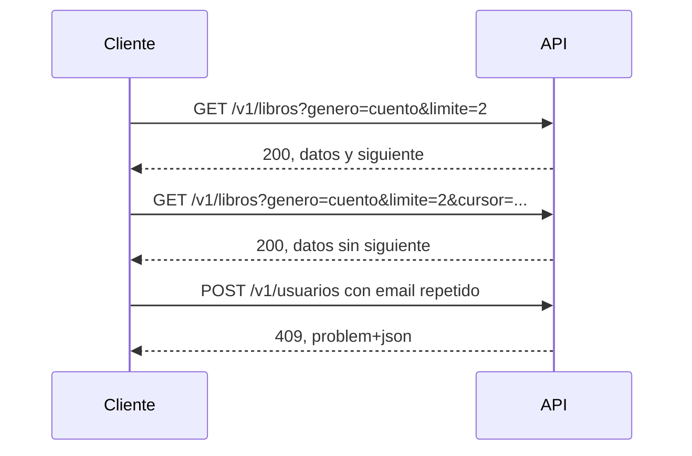

# Ingeniería de Software - Elementos de diseño de sistemas

## 2.3 Diseño de APIs.

---

El tema 2.2 describió las cualidades de una buena API; este trata el **proceso** de diseñarla y las decisiones concretas que lo componen: cómo se modelan los recursos, cómo se buscan y paginan las colecciones, cómo se representan los errores, cómo se protege la API del abuso y cómo se documenta. La regla que guía todo el proceso es diseñar **desde el cliente**: empezar por los casos de uso de quien va a consumir la API, escribir el código cliente que se quisiera poder escribir, y solo después la implementación. Una API diseñada desde la base de datos expone tablas; una diseñada desde el cliente expone tareas.

### Proceso

1. **Casos de uso:** quiénes son los clientes y qué tareas necesitan hacer. Para una biblioteca: buscar libros, consultar disponibilidad, reservar, registrarse.
2. **Modelo de recursos:** los sustantivos del dominio, sus relaciones y sus identificadores: `/libros`, `/libros/{id}`, `/usuarios`, `/usuarios/{id}/prestamos`.
3. **Operaciones:** los métodos HTTP de cada recurso, con sus códigos de estado.
4. **Representaciones:** el formato de cada recurso en JSON, con convenciones uniformes de nombres, fechas en ISO 8601 y montos con su moneda.
5. **Contrato:** la especificación en OpenAPI, revisada por clientes reales antes de implementarla. Es el enfoque *API first*: el contrato se acuerda primero, y de él se generan servidores simulados para que los clientes empiecen a trabajar, pruebas de contrato y documentación.
6. **Implementación y pruebas** contra el contrato, y **publicación** con su política de versiones (tema 2.2).

### Colecciones

Las colecciones grandes necesitan cuatro mecanismos, todos con parámetros de consulta: **filtrado** por campos, **búsqueda** de texto, **ordenamiento**, por ejemplo `orden=-anio,titulo` con el signo menos para descendente, y **paginación**. La paginación por **cursor** devuelve con cada página un valor opaco que identifica dónde continuar; el cliente no debe interpretarlo, lo que permite al servidor cambiar su formato. Es más robusta que la de desplazamiento, `offset=40&limite=20`, que repite o salta elementos cuando la colección cambia entre peticiones, y que se vuelve lenta en páginas profundas porque la base de datos debe recorrer todas las filas anteriores. La **selección de campos**, `campos=titulo,autor`, reduce el tamaño de las respuestas.

### Errores

Un error debe decirle al cliente qué pasó, si es su culpa o del servidor, y qué puede hacer. El código de estado da la categoría:

| Código | Significado                                                         |
| ------ | ------------------------------------------------------------------- |
| 400    | Petición mal formada: JSON inválido, parámetro con tipo incorrecto  |
| 401    | Falta autenticación o es inválida                                   |
| 403    | Autenticado, pero sin permiso                                       |
| 404    | El recurso no existe                                                |
| 409    | Conflicto con el estado actual, como un recurso duplicado           |
| 422    | Petición bien formada, pero con datos que no pasan la validación    |
| 429    | Límite de tasa excedido; la cabecera `Retry-After` dice cuándo volver |
| 500    | Error del servidor; el cliente no puede corregirlo                  |

El cuerpo usa el formato estándar de **detalles de problema**, el RFC 9457, con tipo de contenido `application/problem+json` y los campos `type`, una URL que identifica el tipo de error y que el cliente puede usar en su código; `title`, un resumen legible; `status`; `detail`, la explicación de esta ocurrencia, y extensiones propias, como una lista de errores por campo. Un error nunca debe exponer detalles internos, como trazas de la pila o consultas SQL, que ayudan a un atacante.

### Límites de tasa

Una API pública limita el número de peticiones por cliente para protegerse del abuso y repartir su capacidad. El algoritmo más común es la **cubeta de fichas**: cada cliente tiene una cubeta de capacidad $b$ que se llena a razón de $r$ fichas por segundo, y cada petición consume una. Se permiten ráfagas de hasta $b$ peticiones y un ritmo sostenido de $r$ por segundo. Al agotarse, la API responde 429 con `Retry-After`.



### Implementación en Python

El programa implementa la API de biblioteca como una aplicación WSGI, el estándar de Python para servidores web, y la prueba llamándola directamente, sin red. Para el ejercicio 1 implementa la búsqueda con filtros, orden, selección de campos y paginación por cursor; para el ejercicio 3, la creación de usuarios con las respuestas de error en formato RFC 9457 y un límite de tasa con cubeta de fichas. Para el ejercicio 2 calcula la sucesión de versiones.

```python
import base64, io, json, re
from urllib.parse import parse_qs
from wsgiref.util import setup_testing_defaults

# ---------- Ejercicios 1 y 3: una API WSGI de biblioteca, probada sin red ----------
LIBROS = [{"id": i, "titulo": t, "autor": a, "genero": g, "anio": y} for i, (t, a, g, y) in enumerate([
    ("Cien años de soledad", "García Márquez", "novela", 1967), ("Pedro Páramo", "Rulfo", "novela", 1955),
    ("El llano en llamas", "Rulfo", "cuento", 1953), ("Ficciones", "Borges", "cuento", 1944),
    ("El Aleph", "Borges", "cuento", 1949), ("Rayuela", "Cortázar", "novela", 1963),
    ("Bestiario", "Cortázar", "cuento", 1951), ("La región más transparente", "Fuentes", "novela", 1958)], 1)]
USUARIOS = {"ana@ejemplo.mx"}
class Reloj:
    t = 0.0
class Cubeta:                                              # límite de tasa: cubeta de fichas por cliente
    def __init__(self, capacidad=3, por_segundo=1.0): self.cap, self.ritmo, self.estado = capacidad, por_segundo, {}
    def permite(self, cliente):
        fichas, t0 = self.estado.get(cliente, (self.cap, Reloj.t))
        fichas = min(self.cap, fichas + (Reloj.t - t0) * self.ritmo)
        if fichas < 1: self.estado[cliente] = (fichas, Reloj.t); return False, (1 - fichas) / self.ritmo
        self.estado[cliente] = (fichas - 1, Reloj.t); return True, 0
limite = Cubeta()
def problema(status, tipo, titulo, detalle, **extra):     # RFC 9457: application/problem+json
    cuerpo = {"type": f"https://api.biblioteca.mx/errores/{tipo}", "title": titulo, "status": int(status[:3]), "detail": detalle} | extra
    return status, [("Content-Type", "application/problem+json")], cuerpo
def cursor_de(i): return base64.urlsafe_b64encode(json.dumps({"despues": i}).encode()).decode().rstrip("=")
def de_cursor(c): return json.loads(base64.urlsafe_b64decode(c + "=" * (-len(c) % 4)))["despues"]
def busca_libros(q):
    try:
        datos = LIBROS
        for campo in ("titulo", "autor", "genero"):
            if campo in q: datos = [l for l in datos if q[campo].lower() in l[campo].lower()]
        orden = q.get("orden", "id")
        desc = orden.startswith("-"); campo = orden.lstrip("-")
        if campo not in ("id", "titulo", "autor", "anio"): return problema("400 Bad Request", "orden-invalido", "Orden inválido", f"no se puede ordenar por '{campo}'")
        datos = sorted(datos, key=lambda l: (l[campo], l["id"]), reverse=desc)
        limite_ = int(q.get("limite", 3))
        if not 1 <= limite_ <= 50: raise ValueError
        inicio = de_cursor(q["cursor"]) if "cursor" in q else 0
    except (ValueError, KeyError, json.JSONDecodeError):
        return problema("400 Bad Request", "parametro-invalido", "Parámetro inválido", "limite debe ser de 1 a 50 y el cursor debe ser uno devuelto por la API")
    pagina = datos[inicio:inicio + limite_]
    if "campos" in q: pagina = [{k: l[k] for k in q["campos"].split(",") if k in l} for l in pagina]
    cuerpo = {"datos": pagina, "total": len(datos)}
    if inicio + limite_ < len(datos): cuerpo["siguiente"] = cursor_de(inicio + limite_)
    return "200 OK", [("Content-Type", "application/json")], cuerpo
def crea_usuario(cuerpo):
    faltan = [c for c in ("email", "nombre", "password") if not cuerpo.get(c)]
    if faltan:
        return problema("422 Unprocessable Content", "campos-faltantes", "Faltan campos obligatorios", "la petición no incluye todos los campos obligatorios",
                        errores=[{"campo": c, "codigo": "requerido"} for c in faltan])
    if not re.fullmatch(r"[^@\s]+@[^@\s]+\.[^@\s]+", cuerpo["email"]):
        return problema("422 Unprocessable Content", "email-invalido", "Email inválido", f"'{cuerpo['email']}' no es una dirección de correo válida",
                        errores=[{"campo": "email", "codigo": "formato"}])
    if cuerpo["email"].lower() in USUARIOS:
        return problema("409 Conflict", "usuario-existente", "El usuario ya existe", "ya hay una cuenta con ese email")
    USUARIOS.add(cuerpo["email"].lower())
    return "201 Created", [("Content-Type", "application/json"), ("Location", f"/v1/usuarios/{len(USUARIOS)}")], {"id": len(USUARIOS), "email": cuerpo["email"]}
def app(environ, start_response):
    ok, espera = limite.permite(environ.get("REMOTE_ADDR"))
    if not ok:
        status, headers, cuerpo = problema("429 Too Many Requests", "limite-de-tasa", "Demasiadas peticiones", "espera antes de reintentar")
        headers.append(("Retry-After", str(int(-(-espera // 1)))))
    elif environ["PATH_INFO"] == "/v1/libros" and environ["REQUEST_METHOD"] == "GET":
        status, headers, cuerpo = busca_libros({k: v[-1] for k, v in parse_qs(environ["QUERY_STRING"]).items()})
    elif environ["PATH_INFO"] == "/v1/usuarios" and environ["REQUEST_METHOD"] == "POST":
        try: datos = json.loads(environ["wsgi.input"].read(int(environ.get("CONTENT_LENGTH") or 0)) or b"{}")
        except json.JSONDecodeError: datos = None
        status, headers, cuerpo = crea_usuario(datos) if isinstance(datos, dict) else problema("400 Bad Request", "json-invalido", "JSON inválido", "el cuerpo no es un objeto JSON")
    else:
        status, headers, cuerpo = problema("404 Not Found", "no-encontrado", "Recurso no encontrado", environ["PATH_INFO"])
    start_response(status, headers); return [json.dumps(cuerpo, ensure_ascii=False).encode()]
def pide(metodo, url, cuerpo=None, cliente="10.0.0.1"):
    ruta, _, consulta = url.partition("?"); datos = json.dumps(cuerpo).encode() if cuerpo is not None else b""
    env = {"REQUEST_METHOD": metodo, "PATH_INFO": ruta, "QUERY_STRING": consulta, "REMOTE_ADDR": cliente,
           "CONTENT_LENGTH": str(len(datos)), "wsgi.input": io.BytesIO(datos)}
    setup_testing_defaults(env); r = {}
    salida = app(env, lambda s, h: r.update(status=s, headers=dict(h)))
    Reloj.t += 1.0                                          # cada petición, un segundo después
    return r["status"], r["headers"], json.loads(b"".join(salida))
print("ejercicio 1:")
s, h, c = pide("GET", "/v1/libros?genero=cuento&orden=-anio&campos=titulo,autor,anio&limite=2")
print("  ", s, c)
s, h, c = pide("GET", f"/v1/libros?genero=cuento&orden=-anio&campos=titulo,anio&limite=2&cursor={c['siguiente']}")
print("   página 2:", s, c)
print("   autor=rulfo:", [l["titulo"] for l in pide("GET", "/v1/libros?autor=rulfo")[2]["datos"]])
print("   orden inválido:", pide("GET", "/v1/libros?orden=isbn")[2]["detail"])
print("ejercicio 3:")
for cuerpo in ({"email": "ana-sin-arroba", "nombre": "Ana", "password": "x" * 12}, {"email": "ana@ejemplo.mx", "nombre": "Ana", "password": "x" * 12},
               {"email": "luis@ejemplo.mx"}, {"email": "luis@ejemplo.mx", "nombre": "Luis", "password": "x" * 12}):
    s, h, c = pide("POST", "/v1/usuarios", cuerpo, cliente="10.0.0.2")
    print(f"   {s:28}", {k: c[k] for k in ("title", "errores") if k in c} or c, "| Location:", h.get("Location", "—"))
Reloj.t = 100.0
codigos = []
for _ in range(5):
    s, h, c = pide("GET", "/v1/libros", cliente="10.0.0.3"); Reloj.t -= 0.9   # 5 peticiones en 0.4 s
    codigos.append(s[:3] + (f" Retry-After {h['Retry-After']}" if "Retry-After" in h else ""))
print("   ráfaga de 5 peticiones con capacidad 3:", codigos)

# ---------- Ejercicio 2: versionamiento semántico ----------
v, historia = (1, 0, 0), ["1.0.0 API inicial"]
for cambio, tipo in (("se agrega birthdate", "menor"), ("age pasa de string a number", "mayor"), ("se corrige el filtro de búsqueda", "parche")):
    M, m, p = v
    v = {"mayor": (M + 1, 0, 0), "menor": (M, m + 1, 0), "parche": (M, m, p + 1)}[tipo]
    historia.append(f"{'.'.join(map(str, v))} {cambio}")
print("ejercicio 2:", " → ".join(historia))
```

Salida:

```text
ejercicio 1:
   200 OK {'datos': [{'titulo': 'El llano en llamas', 'autor': 'Rulfo', 'anio': 1953}, {'titulo': 'Bestiario', 'autor': 'Cortázar', 'anio': 1951}], 'total': 4, 'siguiente': 'eyJkZXNwdWVzIjogMn0'}
   página 2: 200 OK {'datos': [{'titulo': 'El Aleph', 'anio': 1949}, {'titulo': 'Ficciones', 'anio': 1944}], 'total': 4}
   autor=rulfo: ['Pedro Páramo', 'El llano en llamas']
   orden inválido: no se puede ordenar por 'isbn'
ejercicio 3:
   422 Unprocessable Content    {'title': 'Email inválido', 'errores': [{'campo': 'email', 'codigo': 'formato'}]} | Location: —
   409 Conflict                 {'title': 'El usuario ya existe'} | Location: —
   422 Unprocessable Content    {'title': 'Faltan campos obligatorios', 'errores': [{'campo': 'nombre', 'codigo': 'requerido'}, {'campo': 'password', 'codigo': 'requerido'}]} | Location: —
   201 Created                  {'id': 2, 'email': 'luis@ejemplo.mx'} | Location: /v1/usuarios/2
   ráfaga de 5 peticiones con capacidad 3: ['200', '200', '200', '429 Retry-After 1', '429 Retry-After 1']
ejercicio 2: 1.0.0 API inicial → 1.1.0 se agrega birthdate → 2.0.0 age pasa de string a number → 2.0.1 se corrige el filtro de búsqueda
```

### Ejercicios Propuestos

1. **Endpoint.** Diseña un endpoint para una API de biblioteca que permita buscar libros por título, autor y género, con paginación, ordenamiento y selección de campos. Define la firma HTTP, los parámetros de consulta y la estructura de la respuesta.

2. **Versionamiento.** A partir de la versión 1.0.0, se agrega un campo `birthdate` a los usuarios, de forma compatible; se cambia el tipo de `age` de cadena a número, de forma incompatible, y se corrige un error en el filtro de búsqueda. Determina las versiones resultantes con SemVer.

3. **Errores.** Diseña las respuestas de error de un endpoint de creación de usuarios para un email inválido, un usuario existente, campos obligatorios faltantes y el límite de tasa excedido, con el código HTTP, un código de error y mensajes descriptivos.

### Soluciones

**Ejercicio 1.** La firma es `GET /v1/libros`, con los parámetros:

- `titulo`, `autor`, `genero`: filtros por coincidencia parcial, sin distinguir mayúsculas; varios se combinan con "y";
- `orden`: uno o varios campos entre `id`, `titulo`, `autor` y `anio`, con `-` para descendente; por omisión, `id`;
- `campos`: lista de campos de cada libro;
- `limite`, de 1 a 50, y `cursor`, el valor `siguiente` de la página anterior.

La respuesta es

```json
{
  "datos": [{"titulo": "El llano en llamas", "autor": "Rulfo", "anio": 1953}],
  "total": 4,
  "siguiente": "eyJkZXNwdWVzIjogMn0"
}
```

sin `siguiente` en la última página. En el programa, los cuentos ordenados del más reciente al más antiguo, de dos en dos, dan dos páginas, y la segunda se pide con el cursor de la primera. Un detalle necesario para que el cursor sea correcto: el orden debe ser **total**, y por eso se desempata siempre por `id`; con dos libros del mismo año y un orden solo por año, la frontera entre páginas sería ambigua. Un parámetro inválido, como ordenar por un campo inexistente, responde 400.

**Ejercicio 2.** v1.0.0; agregar `birthdate` es compatible y da **1.1.0**; cambiar el tipo de `age` rompe a los clientes que lo leen como cadena y da **2.0.0**; la corrección del filtro da **2.0.1**. Si la corrección se publicara también para los clientes de la versión 1, sería **1.1.1** en esa rama de mantenimiento. Una alternativa al cambio incompatible es agregar un campo nuevo, por ejemplo `age_years` numérico, marcar `age` como obsoleto y quitarlo solo en la siguiente versión mayor, junto con otros cambios incompatibles acumulados.

**Ejercicio 3.**

| Caso                   | Código | `type`                 | `title`                       | Detalle                                       |
| ---------------------- | ------ | ---------------------- | ----------------------------- | --------------------------------------------- |
| Email inválido         | 422    | `email-invalido`       | Email inválido                | La dirección no tiene formato válido; error en el campo `email` |
| Usuario existente      | 409    | `usuario-existente`    | El usuario ya existe          | Ya hay una cuenta con ese email               |
| Campos faltantes       | 422    | `campos-faltantes`     | Faltan campos obligatorios    | Lista de campos con código `requerido`        |
| Límite de tasa         | 429    | `limite-de-tasa`       | Demasiadas peticiones         | Con la cabecera `Retry-After`                 |

Las decisiones de diseño: 422 y no 400 para los errores de validación, porque el JSON es correcto y lo que falla son los datos, y 400 se reserva para el JSON mal formado; los errores por campo en una lista, para que un formulario los muestre junto a cada campo, y **todos** los errores a la vez, no solo el primero. El 409 de usuario existente revela que el email está registrado: en un servicio donde eso sea sensible, la alternativa es responder siempre 202 y enviar un correo al dueño de la cuenta. En el programa, una ráfaga de cinco peticiones contra una cubeta de capacidad 3 recibe tres respuestas 200 y dos 429 con `Retry-After: 1`.

### Referencias

1. Lauret, A., _The Design of Web APIs_. Manning, 2019.
2. Nottingham, M., Wilde, E., and Dalal, S., RFC 9457: Problem Details for HTTP APIs. IETF, 2023.
3. Fielding, R., Nottingham, M., and Reschke, J. (eds.), RFC 9110: HTTP Semantics. IETF, 2022.
4. OpenAPI Initiative, _OpenAPI Specification_, versión 3.1, 2021.
5. Higginbotham, J., _Principles of Web API Design_. Addison-Wesley, 2021.
