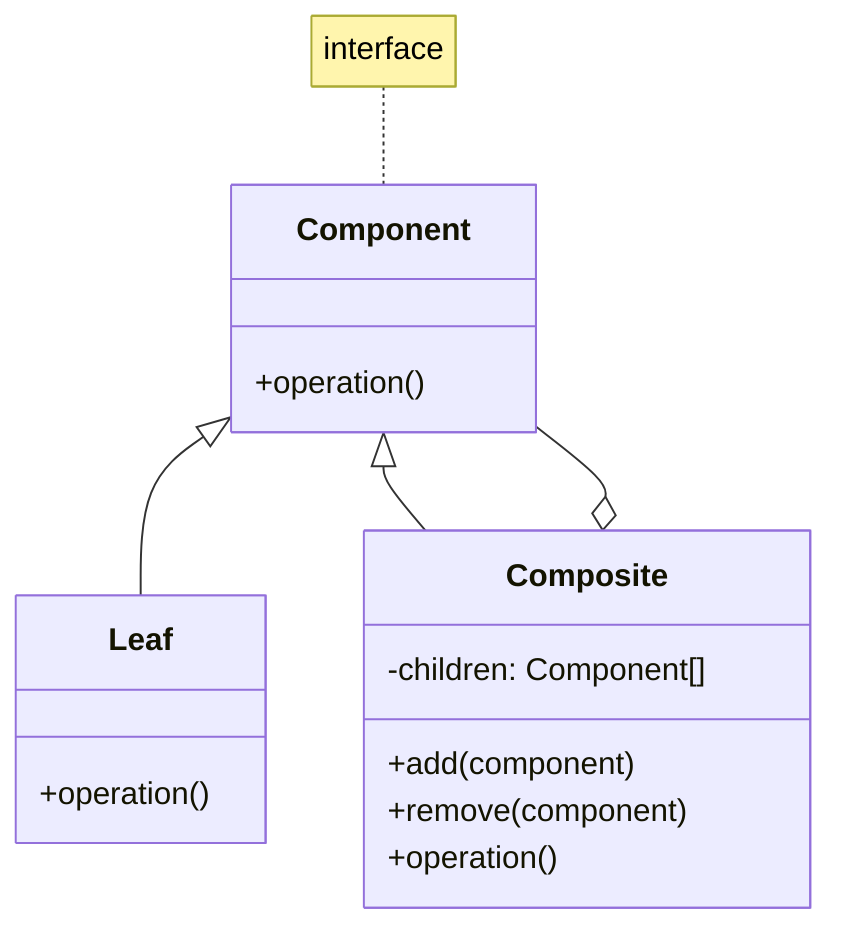
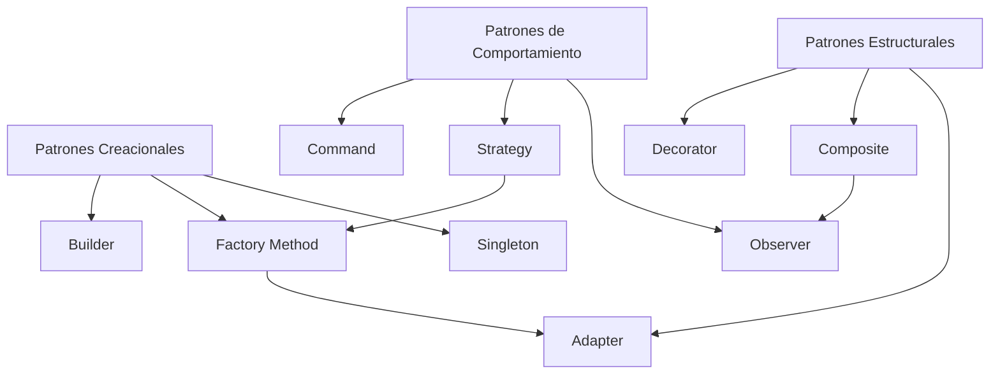

# Ingeniería de Software - Elementos de diseño de sistemas

## 2.4 Patrones de diseño.

---

Un **patrón de diseño** es una solución reutilizable para problemas comunes en el diseño de software. Según Gamma et al. (1994), "los patrones de diseño capturan soluciones que se han desarrollado y evolucionado a través del tiempo por diseñadores de software experimentados".

$$
\text{Patrón} = \{\text{Problema}, \text{Solución}, \text{Consecuencias}\}
$$

### Clasificación de patrones de diseño

#### 1. Patrones creacionales

Gestionan la creación de objetos, proporcionando mecanismos apropiados para la instanciación.

#### 2. Patrones estructurales

Se enfocan en cómo las clases y objetos se componen para formar estructuras más grandes.

#### 3. Patrones de comportamiento

Se centran en la interacción y distribución de responsabilidades entre objetos.

### Patrones creacionales fundamentales

#### Singleton

Garantiza que una clase tenga solo una instancia y proporciona un punto de acceso global a ella.

```java
public class Singleton {
    private static Singleton instance;

    private Singleton() {
        // Constructor privado para prevenir instanciación
    }

    public static Singleton getInstance() {
        if (instance == null) {
            instance = new Singleton();
        }
        return instance;
    }

    public void businessMethod() {
        System.out.println("Método de negocio del Singleton");
    }
}

// Uso
Singleton singleton = Singleton.getInstance();
singleton.businessMethod();
```

#### Factory Method

Define una interfaz para crear un objeto, pero permite a las subclases decidir qué clase instanciar.

```python
from abc import ABC, abstractmethod

class Document(ABC):
    @abstractmethod
    def open(self):
        pass

class PDFDocument(Document):
    def open(self):
        return "Abriendo documento PDF"

class WordDocument(Document):
    def open(self):
        return "Abriendo documento Word"

class DocumentFactory(ABC):
    @abstractmethod
    def create_document(self):
        pass

class PDFFactory(DocumentFactory):
    def create_document(self):
        return PDFDocument()

class WordFactory(DocumentFactory):
    def create_document(self):
        return WordDocument()

# Uso
factory = PDFFactory()
document = factory.create_document()
print(document.open())  # Output: Abriendo documento PDF
```

### Patrones estructurales fundamentales

#### Adapter

Permite que interfaces incompatibles trabajen juntas actuando como intermediario.

```typescript
// Interfaz antigua
class OldSystem {
  specificRequest(): string {
    return 'Request específica del sistema antiguo';
  }
}

// Nueva interfaz esperada por el cliente
interface NewSystem {
  request(): string;
}

// Adapter que adapta OldSystem a NewSystem
class Adapter implements NewSystem {
  private oldSystem: OldSystem;

  constructor(oldSystem: OldSystem) {
    this.oldSystem = oldSystem;
  }

  request(): string {
    return this.oldSystem.specificRequest();
  }
}

// Uso
const oldSystem = new OldSystem();
const adapter = new Adapter(oldSystem);
console.log(adapter.request());
```

#### Composite

Permite tratar objetos individuales y composiciones de objetos de manera uniforme.



### Patrones de comportamiento fundamentales

#### Observer

Define una dependencia uno-a-muchos entre objetos, de modo que cuando un objeto cambia de estado, todos sus dependientes son notificados automáticamente.

```java
import java.util.ArrayList;
import java.util.List;

interface Observer {
    void update(String message);
}

interface Subject {
    void attach(Observer observer);
    void detach(Observer observer);
    void notifyObservers();
}

class ConcreteSubject implements Subject {
    private List<Observer> observers = new ArrayList<>();
    private String state;

    public void setState(String state) {
        this.state = state;
        notifyObservers();
    }

    public void attach(Observer observer) {
        observers.add(observer);
    }

    public void detach(Observer observer) {
        observers.remove(observer);
    }

    public void notifyObservers() {
        for (Observer observer : observers) {
            observer.update(state);
        }
    }
}

class ConcreteObserver implements Observer {
    private String name;

    public ConcreteObserver(String name) {
        this.name = name;
    }

    public void update(String message) {
        System.out.println(name + " recibió: " + message);
    }
}

// Uso
Subject subject = new ConcreteSubject();
Observer obs1 = new ConcreteObserver("Observer 1");
Observer obs2 = new ConcreteObserver("Observer 2");

subject.attach(obs1);
subject.attach(obs2);
subject.setState("Nuevo estado");
```

#### Strategy

Define una familia de algoritmos, encapsula cada uno y los hace intercambiables.

```python
from abc import ABC, abstractmethod

class PaymentStrategy(ABC):
    @abstractmethod
    def pay(self, amount: float) -> str:
        pass

class CreditCardPayment(PaymentStrategy):
    def pay(self, amount: float) -> str:
        return f"Pagado ${amount} con tarjeta de crédito"

class PayPalPayment(PaymentStrategy):
    def pay(self, amount: float) -> str:
        return f"Pagado ${amount} con PayPal"

class ShoppingCart:
    def __init__(self):
        self.amount = 0
        self.payment_strategy = None

    def set_payment_strategy(self, strategy: PaymentStrategy):
        self.payment_strategy = strategy

    def checkout(self):
        if self.payment_strategy:
            return self.payment_strategy.pay(self.amount)
        return "Estrategia de pago no configurada"

# Uso
cart = ShoppingCart()
cart.amount = 100.0
cart.set_payment_strategy(CreditCardPayment())
print(cart.checkout())
```

### Análisis de patrones

#### Ventajas de usar patrones

- **Reutilización**: Soluciones probadas y validadas
- **Comunicación**: Lenguaje común entre desarrolladores
- **Mantenibilidad**: Código más estructurado y comprensible
- **Flexibilidad**: Facilita cambios y extensiones

#### Desventajas potenciales

- **Sobre-ingeniería**: Usar patrones donde no son necesarios
- **Complejidad**: Algunos patrones añaden complejidad innecesaria
- **Curva de aprendizaje**: Requiere tiempo para dominarlos

### Fórmula de beneficio de patrones

$$
B = R \times M \times (1 - C)
$$

Donde:

- $B$: Beneficio del patrón
- $R$: Factor de reutilización (0-1)
- $M$: Mejora en mantenibilidad (0-1)
- $C$: Complejidad añadida (0-1)

### Ejercicios propuestos

#### Ejercicio 1: Identificación de patrones

Para cada escenario, identifique el patrón más apropiado:

1. Sistema que necesita crear diferentes tipos de documentos (PDF, Word, Excel)
2. Sistema que debe notificar a múltiples componentes cuando cambia un estado
3. Sistema que necesita adaptar una interfaz antigua a una nueva
4. Sistema que debe seleccionar entre diferentes algoritmos de ordenamiento

#### Ejercicio 2: Implementación de Factory Method

Implemente un Factory Method para crear diferentes tipos de conexiones de base de datos (MySQL, PostgreSQL, SQLite). Incluya:

- Interfaz común para todas las conexiones
- Factory Method para crear instancias
- Código cliente que use el factory

#### Ejercicio 3: Análisis de Composite

Diseñe e implemente un sistema de archivos usando el patrón Composite donde:

- Los archivos son hojas
- Los directorios son composites que pueden contener archivos u otros directorios
- Todos deben implementar métodos como `getSize()` y `getName()`

### Diagrama de relaciones entre patrones



### Caso de estudio: Sistema de notificaciones

Diseñe un sistema de notificaciones que:

1. Use Factory Method para crear diferentes tipos de notificaciones (email, SMS, push)
2. Use Observer para notificar a los suscriptores
3. Use Strategy para diferentes estrategias de envío (inmediato, programado, por lote)

```java
// Esqueleto del sistema
interface Notification {
    void send();
}

class EmailNotification implements Notification {
    public void send() {
        System.out.println("Enviando email...");
    }
}

class NotificationFactory {
    public Notification createNotification(String type) {
        switch (type.toLowerCase()) {
            case "email":
                return new EmailNotification();
            case "sms":
                return new SMSNotification();
            default:
                throw new IllegalArgumentException("Tipo no soportado");
        }
    }
}
```

### Referencias

#### Bibliografía básica

1. Gamma, E., Helm, R., Johnson, R., & Vlissides, J. (1994). _Design Patterns: Elements of Reusable Object-Oriented Software_. Addison-Wesley.
2. Sommerville, Ian. (2010). _Software Engineering_ (9th edition). Addison Wesley. (Capítulo 7: Design and implementation)
3. Pfleeger, S. L., & Atlee, J. M. (2010). _Software Engineering: Theory and Practice_ (4th Edition). Prentice Hall. (Capítulo 6: Design)

#### Bibliografía complementaria

1. Freeman, E., Robson, E., Bates, B., & Sierra, K. (2004). _Head First Design Patterns_. O'Reilly Media.
2. Fowler, M. (2002). _Patterns of Enterprise Application Architecture_. Addison-Wesley.

### Evaluación de conocimientos

1. Defina qué es un patrón de diseño y explique sus tres elementos principales
2. Compare los patrones Factory Method y Abstract Factory
3. Explique cuándo usar el patrón Adapter vs. el patrón Facade
4. Implemente un patrón Observer simple en el lenguaje de su preferencia

### Recursos adicionales

- Catálogo de patrones GoF (Gang of Four)
- Pattern Languages of Program Design (PLoP) conferences
- Refactoring Guru: Explicaciones visuales de patrones
- Diagramas UML para representar patrones
