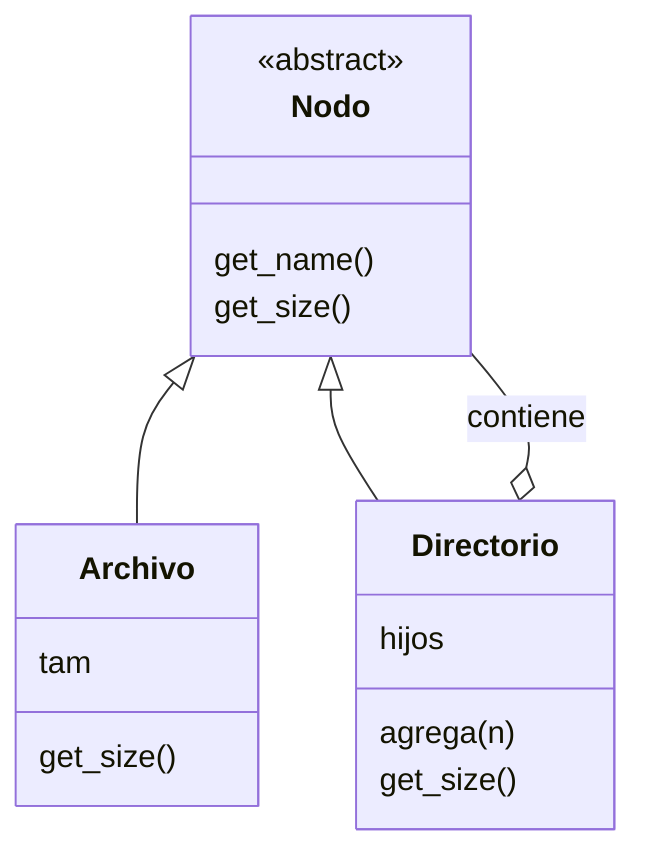

# Ingeniería de Software - Elementos de diseño de sistemas

## 2.4 Patrones de diseño.

---

Un **patrón de diseño** es una solución probada a un problema de diseño que se repite en un contexto determinado. La idea viene de la arquitectura: Christopher Alexander describió en 1977 un lenguaje de patrones para edificios y ciudades, y en 1994 Gamma, Helm, Johnson y Vlissides, conocidos como la "pandilla de los cuatro", catalogaron 23 patrones para el diseño orientado a objetos. Un patrón no es código para copiar, sino una descripción con cuatro partes: un **nombre**, que da vocabulario común al equipo; el **problema** y su contexto; la **solución**, como una estructura de clases y responsabilidades, y las **consecuencias**, es decir, lo que se gana y lo que se paga. Este tema presenta la clasificación de los patrones, los más usados de cada grupo y sus consecuencias.

### Clasificación

- **Creacionales:** abstraen la creación de objetos, de modo que el código cliente no dependa de las clases concretas. Factory Method, Abstract Factory, Builder, Prototype y Singleton.
- **Estructurales:** componen clases y objetos en estructuras mayores. Adapter, Bridge, Composite, Decorator, Facade, Flyweight y Proxy.
- **De comportamiento:** reparten responsabilidades y organizan la comunicación entre objetos. Chain of Responsibility, Command, Iterator, Mediator, Memento, Observer, State, Strategy, Template Method, Visitor e Interpreter.

Casi todos aplican dos principios del libro: **programar contra una interfaz, no contra una implementación**, y **preferir la composición de objetos a la herencia de clases**.

### Creacionales

- **Factory Method:** una clase define un método abstracto que crea un objeto, y las subclases deciden qué clase concreta instanciar. El resto de la clase trabaja solo con la interfaz del producto. Una variante muy usada es la **fábrica con registro**: un diccionario de identificadores a funciones creadoras, al que se agregan productos nuevos sin modificar la fábrica.
- **Abstract Factory:** una interfaz para crear **familias** de objetos relacionados, como los controles de una interfaz gráfica para cada sistema operativo, que deben usarse juntos.
- **Builder:** separa la construcción paso a paso de un objeto complejo de su representación final.
- **Singleton:** garantiza una sola instancia de una clase con un punto de acceso global. Es el patrón más criticado del catálogo: es estado global disfrazado, oculta dependencias y dificulta las pruebas. La implementación perezosa habitual en Java, `if (instance == null) instance = new Singleton();`, **no es segura con hilos**: dos hilos pueden ver `null` a la vez y crear dos instancias. Las formas correctas son el idiom del contenedor estático, `private static class Holder { static final Singleton I = new Singleton(); }`, que la JVM inicializa una sola vez, o un `enum` de un solo valor. En la mayoría de los casos, inyectar una sola instancia como dependencia es preferible.

### Estructurales

- **Adapter:** convierte la interfaz de una clase en la que espera el cliente, para integrar código existente o de terceros sin modificarlo.
- **Composite:** compone objetos en árboles y permite tratar igual a una hoja y a un grupo, porque ambos implementan la misma interfaz. Es la estructura de los sistemas de archivos, las interfaces gráficas y los árboles de sintaxis.
- **Decorator:** agrega responsabilidades a un objeto envolviéndolo en otro con la misma interfaz, como los flujos de entrada con búfer y compresión de Java.
- **Facade:** una interfaz simple para un subsistema complejo.
- **Proxy:** un sustituto que controla el acceso a otro objeto, para carga perezosa, control de acceso o acceso remoto.

### De comportamiento

- **Observer:** un sujeto mantiene una lista de observadores y les notifica sus cambios de estado, sin conocer sus clases. Es la base de los eventos de las interfaces gráficas y de la programación reactiva. Su consecuencia negativa más común es la fuga de memoria por observadores que nunca se desuscriben, y por eso conviene que suscribirse devuelva la forma de desuscribirse.
- **Strategy:** encapsula una familia de algoritmos intercambiables tras una interfaz. En lenguajes con funciones de primera clase, una estrategia es simplemente una función.
- **Template Method:** la superclase fija el esqueleto de un algoritmo y las subclases redefinen los pasos.
- **Command:** representa una petición como un objeto, lo que permite encolarla, registrarla y deshacerla.
- **State:** un objeto cambia su comportamiento según su estado delegando en un objeto por estado.



### Consecuencias y antipatrones

Cada patrón agrega indirección: más clases y más niveles entre quien pide algo y quien lo hace. Aplicado sin el problema que resuelve, complica el código sin beneficio, un antipatrón que se ha llamado **patronitis**. Algunos patrones también reflejan limitaciones de los lenguajes en que se catalogaron: Norvig mostró en 1996 que 16 de los 23 son invisibles o más simples en lenguajes dinámicos con funciones de primera clase, como Strategy y Command, que se reducen a funciones.

### Implementación en Python

El programa resuelve el ejercicio 1 con un ejemplo mínimo de cada uno de los cuatro patrones identificados. Para el ejercicio 2 implementa la fábrica de conexiones con registro y la usa con dos motores reales, SQLite y PostgreSQL, con el mismo código cliente; el de MySQL informa que falta su controlador. Para el ejercicio 3 implementa el sistema de archivos con Composite, con tamaños recursivos, búsqueda y rechazo de ciclos.

```python
import sqlite3
from abc import ABC, abstractmethod

# ---------- Ejercicio 1: un ejemplo mínimo de cada patrón ----------
class Documento(ABC):                                       # 1. Factory Method: la subclase decide qué documento crear
    @abstractmethod
    def exporta(self, texto) -> bytes: ...
class PDF(Documento):
    def exporta(self, texto): return b"%PDF-1.7 " + texto.encode()
class CSV(Documento):
    def exporta(self, texto): return ("columna\n" + texto).encode()
class Exportador(ABC):
    @abstractmethod
    def crea_documento(self) -> Documento: ...               # el método fábrica
    def exporta(self, texto): return self.crea_documento().exporta(texto)   # el resto no conoce la clase concreta
class ExportadorPDF(Exportador):
    def crea_documento(self): return PDF()
class ExportadorCSV(Exportador):
    def crea_documento(self): return CSV()
class Sujeto:                                               # 2. Observer
    def __init__(self): self._obs, self._estado = [], None
    def suscribe(self, f): self._obs.append(f); return lambda: self._obs.remove(f)   # devuelve cómo desuscribirse
    @property
    def estado(self): return self._estado
    @estado.setter
    def estado(self, v):
        self._estado = v
        for f in list(self._obs): f(v)
class ImpresoraVieja:                                       # 3. Adapter: interfaz antigua
    def imprimir_texto(self, cadena, mayusculas_bool): return (cadena.upper() if mayusculas_bool else cadena) + " [impresa]"
class Salida(ABC):
    @abstractmethod
    def escribe(self, texto: str) -> str: ...
class AdaptadorImpresora(Salida):
    def __init__(self, vieja): self.vieja = vieja
    def escribe(self, texto): return self.vieja.imprimir_texto(texto, False)
def burbuja(xs):                                            # 4. Strategy: algoritmos intercambiables
    xs = list(xs)
    for i in range(len(xs)):
        for j in range(len(xs) - 1 - i):
            if xs[j] > xs[j + 1]: xs[j], xs[j + 1] = xs[j + 1], xs[j]
    return xs
class Ordenador:
    def __init__(self, estrategia=sorted): self.estrategia = estrategia
    def ordena(self, xs): return self.estrategia(xs)
log = []
s = Sujeto(); baja = s.suscribe(lambda v: log.append(f"panel ve {v}")); s.suscribe(lambda v: log.append(f"bitácora registra {v}"))
s.estado = "pagado"; baja(); s.estado = "enviado"
print("ejercicio 1: Factory Method:", [type(e).__name__ + ": " + e.exporta("hola").decode().replace("\n", " ⏎ ") for e in (ExportadorPDF(), ExportadorCSV())])
print("   Observer:", log)
print("   Adapter:", AdaptadorImpresora(ImpresoraVieja()).escribe("hola"))
datos = [5, 2, 9, 1, 7]
print("   Strategy:", Ordenador().ordena(datos), Ordenador(burbuja).ordena(datos), Ordenador(lambda xs: sorted(xs, reverse=True)).ordena(datos))

# ---------- Ejercicio 2: Factory Method para conexiones de bases de datos ----------
class Conexion(ABC):
    marcador = "?"
    @abstractmethod
    def ejecuta(self, sql: str, params: tuple = ()) -> list: ...
    @abstractmethod
    def cierra(self) -> None: ...
    def __enter__(self): return self
    def __exit__(self, *exc): self.cierra()
class ConexionSQLite(Conexion):
    def __init__(self, ruta=":memory:"): self.c = sqlite3.connect(ruta)
    def ejecuta(self, sql, params=()):
        cur = self.c.execute(sql, params); self.c.commit(); return cur.fetchall()
    def cierra(self): self.c.close()
class ConexionPostgreSQL(Conexion):
    marcador = "%s"
    def __init__(self, dsn):
        import psycopg                                      # el controlador se importa solo si se usa
        self.c = psycopg.connect(dsn, autocommit=True)
    def ejecuta(self, sql, params=()):
        cur = self.c.execute(sql, params); return cur.fetchall() if cur.description else []
    def cierra(self): self.c.close()
class ConexionMySQL(Conexion):
    marcador = "%s"
    def __init__(self, dsn):
        try: import pymysql  # noqa: F401
        except ImportError: raise RuntimeError("falta el controlador pymysql para MySQL") from None
    def ejecuta(self, sql, params=()): raise NotImplementedError
    def cierra(self): pass
class FabricaConexiones:
    """Registro de creadores: agregar un motor no requiere modificar la fábrica (abierto-cerrado)."""
    _creadores = {}
    @classmethod
    def registra(cls, esquema):
        def deco(f): cls._creadores[esquema] = f; return f
        return deco
    @classmethod
    def crea(cls, url: str) -> Conexion:
        esquema, _, resto = url.partition("://")
        if esquema not in cls._creadores: raise ValueError(f"motor no soportado: {esquema!r}; disponibles {sorted(cls._creadores)}")
        return cls._creadores[esquema](resto)
FabricaConexiones.registra("sqlite")(lambda r: ConexionSQLite(r or ":memory:"))
FabricaConexiones.registra("postgresql")(lambda r: ConexionPostgreSQL(r))
FabricaConexiones.registra("mysql")(lambda r: ConexionMySQL(r))
def cliente(url):                                           # código cliente: solo conoce Conexion y la fábrica
    with FabricaConexiones.crea(url) as cx:
        p = cx.marcador
        cx.ejecuta("DROP TABLE IF EXISTS libro")
        cx.ejecuta("CREATE TABLE libro (id INTEGER PRIMARY KEY, titulo TEXT)")
        for i, t in enumerate(("Ficciones", "Rayuela", "Pedro Páramo"), 1): cx.ejecuta(f"INSERT INTO libro VALUES ({p}, {p})", (i, t))
        return type(cx).__name__, cx.ejecuta(f"SELECT titulo FROM libro WHERE id > {p} ORDER BY titulo", (1,))
for url in ("sqlite://", "postgresql://dbname=patrones", "mysql://localhost/x", "oracle://x"):
    try: print("ejercicio 2:", url, "→", cliente(url))
    except (RuntimeError, ValueError) as e: print("ejercicio 2:", url, "→", type(e).__name__ + ":", e)

# ---------- Ejercicio 3: Composite para un sistema de archivos ----------
class Nodo(ABC):
    def __init__(self, nombre): self.nombre = nombre
    def get_name(self): return self.nombre
    @abstractmethod
    def get_size(self) -> int: ...
    def muestra(self, nivel=0): return ["  " * nivel + f"{self.nombre} ({self.get_size()} B)"]
class Archivo(Nodo):
    def __init__(self, nombre, tam): super().__init__(nombre); self.tam = tam
    def get_size(self): return self.tam
class Directorio(Nodo):
    def __init__(self, nombre, *hijos): super().__init__(nombre); self.hijos = []; [self.agrega(h) for h in hijos]
    def agrega(self, h):
        n = self
        while n is not None:                                # evita ciclos: un directorio no puede contenerse a sí mismo
            if n is h: raise ValueError(f"{h.nombre} no puede contener a {self.nombre}")
            n = getattr(n, "padre", None)
        h.padre = self; self.hijos.append(h); return self
    def get_size(self): return sum(h.get_size() for h in self.hijos)   # recursión uniforme: hojas y compuestos
    def muestra(self, nivel=0): return super().muestra(nivel) + [l for h in self.hijos for l in h.muestra(nivel + 1)]
    def busca(self, pred): return [h for h in self.hijos if pred(h)] + [x for h in self.hijos if isinstance(h, Directorio) for x in h.busca(pred)]
raiz = Directorio("/", Directorio("docs", Archivo("tesis.pdf", 2_400_000), Archivo("notas.md", 3_200)),
                  Directorio("src", Archivo("main.py", 8_100), Directorio("lib", Archivo("util.py", 2_050))), Archivo("README", 900))
print("ejercicio 3:"); print("\n".join("   " + l for l in raiz.muestra()))
print("   archivos de más de 5 KB:", [n.get_name() for n in raiz.busca(lambda n: isinstance(n, Archivo) and n.get_size() > 5000)])
docs = raiz.hijos[0]
try: docs.hijos[0].padre.agrega(raiz)
except ValueError as e: print("   ciclo rechazado:", e)
```

Salida:

```text
ejercicio 1: Factory Method: ['ExportadorPDF: %PDF-1.7 hola', 'ExportadorCSV: columna ⏎ hola']
   Observer: ['panel ve pagado', 'bitácora registra pagado', 'bitácora registra enviado']
   Adapter: hola [impresa]
   Strategy: [1, 2, 5, 7, 9] [1, 2, 5, 7, 9] [9, 7, 5, 2, 1]
ejercicio 2: sqlite:// → ('ConexionSQLite', [('Pedro Páramo',), ('Rayuela',)])
ejercicio 2: postgresql://dbname=patrones → ('ConexionPostgreSQL', [('Pedro Páramo',), ('Rayuela',)])
ejercicio 2: mysql://localhost/x → RuntimeError: falta el controlador pymysql para MySQL
ejercicio 2: oracle://x → ValueError: motor no soportado: 'oracle'; disponibles ['mysql', 'postgresql', 'sqlite']
ejercicio 3:
   / (2414250 B)
     docs (2403200 B)
       tesis.pdf (2400000 B)
       notas.md (3200 B)
     src (10150 B)
       main.py (8100 B)
       lib (2050 B)
         util.py (2050 B)
     README (900 B)
   archivos de más de 5 KB: ['tesis.pdf', 'main.py']
   ciclo rechazado: / no puede contener a docs
```

### Ejercicios Propuestos

1. **Identificación.** Identifica el patrón más apropiado para cada escenario:

    1. un sistema que necesita crear diferentes tipos de documentos, como PDF, Word o Excel;
    2. un sistema que debe notificar a múltiples componentes cuando cambia un estado;
    3. un sistema que necesita adaptar una interfaz antigua a una nueva;
    4. un sistema que debe elegir entre diferentes algoritmos de ordenamiento.

2. **Factory Method.** Implementa un Factory Method para crear conexiones a bases de datos MySQL, PostgreSQL y SQLite, con una interfaz común, el método fábrica y código cliente que lo use.

3. **Composite.** Diseña e implementa un sistema de archivos con Composite, en el que los archivos son hojas y los directorios pueden contener archivos y otros directorios, y todos implementan `getSize()` y `getName()`.

### Soluciones

**Ejercicio 1.**

1. **Factory Method**, o **Abstract Factory** si cada tipo de documento requiere una familia de objetos coordinados, como un escritor, un estilo y un formato de tablas. El código que genera el contenido es el mismo; solo cambia el objeto que lo serializa.
2. **Observer:** el sujeto notifica a los suscriptores sin conocerlos, y se pueden agregar suscriptores sin modificarlo. En un sistema distribuido, la misma idea se implementa con un intermediario de mensajes, en el estilo publicador-suscriptor.
3. **Adapter:** una clase que implementa la interfaz nueva y traduce cada llamada a la antigua, como `AdaptadorImpresora` en el programa, que fija el parámetro de mayúsculas que la interfaz nueva no tiene.
4. **Strategy:** el ordenador recibe el algoritmo como un objeto o, en Python, como una función. En la práctica, la elección entre algoritmos de ordenamiento casi nunca es necesaria, porque el de la biblioteca estándar, Timsort en Python y Java, es adecuado para casi todos los casos; la estrategia útil suele ser el **criterio** de orden, como la clave o el sentido.

**Ejercicio 2.** La interfaz `Conexion` define `ejecuta` y `cierra`, más el protocolo de contexto, para que el cliente use `with` y la conexión se cierre aunque ocurra una excepción. Cada motor tiene su clase concreta. La fábrica es un **registro**: `FabricaConexiones.crea("postgresql://dbname=patrones")` busca el creador por el esquema de la URL, y un motor nuevo se registra sin modificar la fábrica. El código cliente es idéntico para SQLite y PostgreSQL y produce el mismo resultado. Dos detalles que la abstracción debe resolver, y que el enunciado no menciona:

- los **marcadores de parámetros** difieren, `?` en SQLite y `%s` en psycopg y pymysql, y la interfaz los expone como atributo; el cliente nunca concatena valores en el SQL, para evitar la inyección;
- el **controlador** de cada motor se importa solo al crear su conexión, de modo que no hace falta instalar los de todos los motores; si falta, el error es claro.

En proyectos reales, esta abstracción ya existe: la DB-API 2.0 de Python, el PEP 249, define la interfaz común, y SQLAlchemy implementa exactamente esta fábrica con sus URL de conexión.

**Ejercicio 3.** `Nodo` es el componente abstracto con `get_name` y `get_size`; `Archivo` es la hoja, con un tamaño propio, y `Directorio` es el compuesto, cuyo tamaño es la suma recursiva del de sus hijos. El cliente llama a `get_size` sin preguntar qué tipo de nodo tiene, que es el objetivo del patrón. El programa agrega dos operaciones típicas: mostrar el árbol con sangría y buscar nodos con un predicado. Hay una restricción que el patrón no impone y el sistema de archivos sí: el árbol no debe tener **ciclos**, porque `get_size` no terminaría. `agrega` sube por los padres del directorio destino y rechaza el nodo si es uno de ellos. Una decisión de diseño es dónde declarar `agrega`: en el componente, para tratar todo igual, con el riesgo de llamarlo sobre un archivo, o solo en el compuesto, que es más seguro y es la opción del programa.

### Referencias

1. Gamma, E., Helm, R., Johnson, R., and Vlissides, J., _Design Patterns: Elements of Reusable Object-Oriented Software_. Addison-Wesley, 1994.
2. Alexander, C., et al., _A Pattern Language_. Oxford University Press, 1977.
3. Freeman, E., and Robson, E., _Head First Design Patterns_. O'Reilly, 2020.
4. Norvig, P., Design patterns in dynamic programming. _Object World_, 1996.
5. Bloch, J., _Effective Java_. Addison-Wesley, 2018. Capítulo 2.
6. Lemburg, M.-A., PEP 249: Python Database API Specification v2.0, 2001.
