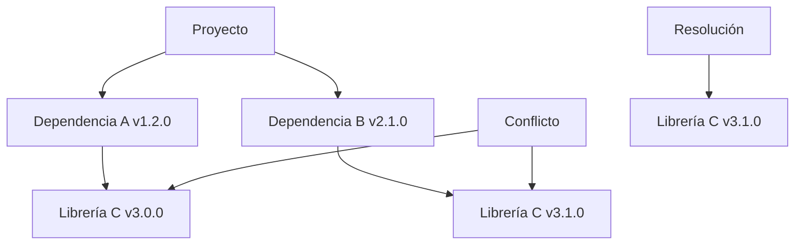

# Ingeniería de Software - Elementos de diseño de sistemas

## 2.5 Herramientas para el manejo de dependencias.

---

El **manejo de dependencias** es el proceso de administrar las bibliotecas, frameworks y módulos externos que un proyecto de software requiere para funcionar correctamente. Según Pfleeger y Atlee (2010), "la gestión efectiva de dependencias es crucial para mantener la consistencia, reproducibilidad y mantenibilidad de los sistemas software".

$$
\text{Calidad del Sistema} = \frac{1}{\text{Complejidad de Dependencias}} \times \text{Cohesión}
$$

### Conceptos fundamentales

#### 1. Dependencia directa vs. transitiva

- **Directa**: Dependencias explícitamente declaradas por el desarrollador
- **Transitiva**: Dependencias requeridas por las dependencias directas

#### 2. Resolución de dependencias

Proceso de determinar qué versiones de paquetes deben incluirse para satisfacer todos los requisitos.

#### 3. Conflictos de versiones

Ocurren cuando múltiples dependencias requieren versiones incompatibles de la misma biblioteca.

### Herramientas principales por lenguaje

#### Maven (Java)

Herramienta de construcción y gestión de dependencias usando XML para configuración.

```xml
<!-- pom.xml ejemplo -->
<project>
    <modelVersion>4.0.0</modelVersion>
    <groupId>com.miempresa</groupId>
    <artifactId>mi-proyecto</artifactId>
    <version>1.0.0</version>

    <dependencies>
        <dependency>
            <groupId>org.springframework</groupId>
            <artifactId>spring-core</artifactId>
            <version>5.3.8</version>
        </dependency>
        <dependency>
            <groupId>junit</groupId>
            <artifactId>junit</artifactId>
            <version>4.13.2</version>
            <scope>test</scope>
        </dependency>
    </dependencies>
</project>
```

#### npm (JavaScript)

Gestor de paquetes para Node.js con archivo package.json.

```json
{
  "name": "mi-proyecto",
  "version": "1.0.0",
  "dependencies": {
    "express": "^4.17.1",
    "lodash": "4.17.21"
  },
  "devDependencies": {
    "jest": "^27.0.6",
    "eslint": "7.32.0"
  }
}
```

#### pip (Python)

Sistema de gestión de paquetes para Python.

```python
# requirements.txt
Django==3.2.5
requests>=2.25.1,<3.0.0
numpy==1.21.0

# requirements-dev.txt
pytest==6.2.4
flake8==3.9.2
black==21.7b0
```

### Resolución de conflictos

#### Algoritmo de resolución

La resolución de dependencias puede modelarse como un problema de satisfacción de restricciones:

$$
\begin{aligned}
&\text{Minimizar } \sum_{i=1}^{n} C_i(x_i) \\
&\text{Sujeto a } \forall (i,j) \in E, x_i \sim x_j
\end{aligned}
$$

Donde:

- $C_i$: Función de costo para la dependencia $i$
- $x_i$: Versión seleccionada para la dependencia $i$
- $E$: Conjunto de restricciones entre dependencias

### Estrategias de control de versiones

#### Versionamiento semántico (SemVer)

Formato: `MAYOR.MENOR.PARCHÉ`

- **MAYOR**: Cambios incompatibles
- **MENOR**: Funcionalidades compatibles
- **PARCHÉ**: Correcciones compatibles

#### Especificadores de versión

| Especificador | Significado          | Ejemplo           |
| ------------- | -------------------- | ----------------- |
| `^1.2.3`      | Compatible con 1.2.3 | 1.2.3 ≤ v < 2.0.0 |
| `~1.2.3`      | Parche compatible    | 1.2.3 ≤ v < 1.3.0 |
| `1.2.x`       | Cualquier parche     | 1.2.0 ≤ v < 1.3.0 |
| `*`           | Cualquier versión    | Latest            |

### Diagrama de resolución de dependencias



### Herramientas de gestión avanzada

#### Docker para dependencias del sistema

```dockerfile
FROM python:3.9-slim

# Instalar dependencias del sistema
RUN apt-get update && apt-get install -y \
    build-essential \
    libpq-dev \
    && rm -rf /var/lib/apt/lists/*

# Copiar requirements e instalar dependencias de Python
COPY requirements.txt .
RUN pip install --no-cache-dir -r requirements.txt

COPY . .
CMD ["python", "app.py"]
```

#### Terraform para infraestructura como código

```hcl
# Gestionar dependencias de infraestructura
provider "aws" {
  region = "us-west-2"
}

resource "aws_s3_bucket" "storage" {
  bucket = "mi-app-bucket"
}

resource "aws_rds_cluster" "database" {
  depends_on = [aws_s3_bucket.storage]

  cluster_identifier = "mi-cluster"
  engine            = "aurora-postgresql"
  # ... más configuración
}
```

### Ejercicios propuestos

#### Ejercicio 1: Análisis de dependencias

Dado el siguiente package.json:

```json
{
  "dependencies": {
    "react": "^17.0.0",
    "react-dom": "17.0.2",
    "axios": "~0.21.1",
    "lodash": "*"
  }
}
```

Determine:

1. ¿Qué versión de react se instalará si la última es 17.2.0?
2. ¿Qué problema potencial existe con la dependencia de lodash?
3. ¿Es compatible react-dom con react 17.2.0?

#### Ejercicio 2: Resolución de conflictos

Un proyecto tiene las siguientes dependencias:

- Paquete A v2.0.0 requiere Paquete C >=3.0.0, <4.0.0
- Paquete B v1.5.0 requiere Paquete C >=3.5.0, <3.6.0
- Las versiones disponibles de Paquete C son: 3.0.0, 3.5.0, 3.5.1, 4.0.0

¿Qué versión de Paquete C debería seleccionarse y por qué?

#### Ejercicio 3: Dockerfile optimization

Optimice el siguiente Dockerfile para mejor manejo de dependencias:

```dockerfile
FROM node:16
WORKDIR /app
COPY . .
RUN npm install
RUN npm run build
EXPOSE 3000
CMD ["npm", "start"]
```

### Buenas prácticas

#### 1. Lock files

Archivos que aseguran versiones exactas (package-lock.json, Pipfile.lock, etc.)

#### 2. Dependencias de desarrollo vs. producción

Separar dependencias necesarias solo para desarrollo.

#### 3. Escaneo de vulnerabilidades

Usar herramientas como `npm audit`, `safety check`, `dependabot`.

#### 4. Actualizaciones regulares

Mantener dependencias actualizadas para seguridad y performance.

### Auditoría de seguridad

#### Fórmula de riesgo de vulnerabilidad

$$
R = \frac{C \times E \times U}{P}
$$

Donde:

- $R$: Riesgo total
- $C$: Impacto crítico (1-10)
- $E$: Exploitabilidad (1-10)
- $U$: Uso en el proyecto (1-10)
- $P$: Parches disponibles (1-10)

#### Ejemplo de auditoría con npm

```bash
# Escanear vulnerabilidades
npm audit

# Escanear y arreglar automáticamente
npm audit fix

# Escanear con formato JSON
npm audit --json
```

### Referencias

#### Bibliografía básica

1. Sommerville, Ian. (2010). _Software Engineering_ (9th edition). Addison Wesley. (Capítulo 25: Configuration management)
2. Pfleeger, S. L., & Atlee, J. M. (2010). _Software Engineering: Theory and Practice_ (4th Edition). Prentice Hall. (Capítulo 11: Software evolution)

#### Bibliografía complementaria

1. Bass, L., Weber, I., & Zhu, L. (2015). _DevOps: A Software Architect's Perspective_. Addison-Wesley.
2. Forsgren, N., Humble, J., & Kim, G. (2018). _Accelerate: The Science of Lean Software and DevOps_. IT Revolution Press.

### Evaluación de conocimientos

1. Explique la diferencia entre dependencias directas y transitivas
2. Describa tres estrategias para resolver conflictos de versiones
3. ¿Por qué es importante usar lock files en el manejo de dependencias?
4. Implemente un requirements.txt para una aplicación Django con al menos 5 dependencias

### Recursos adicionales

- **OWASP Dependency Check**: Herramienta de escaneo de vulnerabilidades
- **Dependabot**: Servicio de actualización automática de dependencias
- **Renovate**: Alternativa open source para actualización de dependencias
- **Snyk**: Plataforma de seguridad para dependencias
