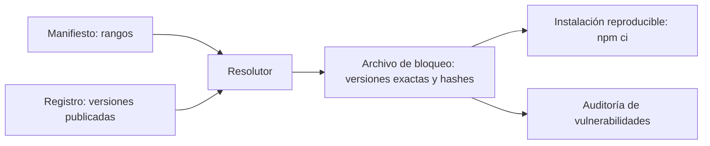

# Ingeniería de Software - Elementos de diseño de sistemas

## 2.5 Herramientas para el manejo de dependencias.

---

Casi ningún programa moderno se escribe desde cero: una aplicación web típica depende de cientos de paquetes de terceros, la mayoría de forma **transitiva**, es decir, dependencias de sus dependencias. Un **gestor de dependencias** declara qué paquetes y qué versiones necesita el proyecto, encuentra un conjunto de versiones compatibles entre sí, las descarga y las instala de forma reproducible. Ejemplos son npm y pnpm para JavaScript, pip, Poetry y uv para Python, Maven y Gradle para Java, Cargo para Rust y los módulos de Go. Este tema explica cómo se declaran los rangos de versiones, cómo se resuelven los conflictos, cómo se logra la reproducibilidad y cuáles son los riesgos de la cadena de suministro.

### Declaración y rangos

Un proyecto declara sus dependencias en un **manifiesto**, como `package.json`, `pyproject.toml` o `pom.xml`, con un **rango** de versiones aceptables para cada una. Los rangos se apoyan en el versionamiento semántico (tema 2.2): si el autor respeta SemVer, cualquier versión con la misma mayor es compatible. En npm:

| Rango        | Equivale a               | Permite                                      |
| ------------ | ------------------------ | -------------------------------------------- |
| `17.0.2`     | `=17.0.2`                | Solo esa versión                             |
| `^17.0.0`    | `>=17.0.0 <18.0.0`       | Menores y parches de la misma mayor          |
| `~0.21.1`    | `>=0.21.1 <0.22.0`       | Solo parches                                 |
| `^0.21.1`    | `>=0.21.1 <0.22.0`       | Con mayor 0, igual que `~`                   |
| `1.2.x`      | `>=1.2.0 <1.3.0`         | Cualquier parche de 1.2                      |
| `*`          | cualquiera               | Todo, incluidas versiones mayores nuevas     |

La regla de `^` es no cambiar el primer componente distinto de cero: con versiones 0.y.z, SemVer considera que cualquier cambio de menor puede ser incompatible.

Las dependencias se separan por su uso: las de **producción**, que la aplicación necesita para ejecutarse; las de **desarrollo**, como compiladores, probadores y analizadores, que no se instalan en producción, y las **dependencias pares** (*peer dependencies*), que un complemento declara para indicar con qué versión del paquete anfitrión funciona, sin instalar una copia propia.

### Resolución

Encontrar versiones que satisfagan todos los rangos, incluidos los transitivos, es un problema de satisfacibilidad. En general es **NP-completo**: Russ Cox mostró en 2016 cómo codificar 3-SAT como un problema de dependencias con rangos arbitrarios. Los gestores lo resuelven con distintas estrategias:

- **búsqueda con retroceso**, que prueba primero las versiones más nuevas y retrocede ante un conflicto, como pip;
- **resolutores SAT o CDCL**, que aprenden de los conflictos, como el algoritmo PubGrub de Dart, usado también por uv y Poetry;
- **selección de versión mínima**, de los módulos de Go: cada dependencia declara solo un mínimo, y se elige la menor versión que satisface todos, lo que hace la resolución polinomial y reproducible sin archivo de bloqueo;
- **duplicación**: npm puede instalar dos versiones de un paquete en lugares distintos del árbol de `node_modules`, de modo que dos dependencias con rangos incompatibles reciben cada una la suya. Funciona para bibliotecas sin estado global, pero no para paquetes que deben ser únicos, como React.

### Reproducibilidad

El manifiesto declara rangos; el **archivo de bloqueo**, como `package-lock.json`, `poetry.lock` o `uv.lock`, registra las versiones exactas resueltas de todas las dependencias, transitivas incluidas, con un **hash** de integridad de cada paquete. Se versiona junto con el código, y la instalación en integración continua y en producción se hace con él, `npm ci` en lugar de `npm install`, para que todos los ambientes usen exactamente los mismos paquetes. Actualizar las dependencias es entonces una decisión explícita, revisable en el control de versiones, y herramientas como Dependabot o Renovate abren solicitudes de cambio con cada actualización.

### Riesgos de la cadena de suministro

Cada dependencia es código de terceros que se ejecuta con los permisos de la aplicación:

- **vulnerabilidades conocidas**, que se detectan comparando las versiones instaladas con bases de datos como la de GitHub Advisory o OSV, con `npm audit` o `pip-audit`;
- **paquetes maliciosos**, por suplantación de nombres parecidos, por cuentas de mantenedores comprometidas o por scripts de instalación que se ejecutan al instalar;
- **abandono**: el incidente de `left-pad` en 2016, al retirarse un paquete de 11 líneas del que dependían miles, rompió compilaciones en todo el mundo;
- **licencias** incompatibles con el uso que se le da al software.

Las prácticas de defensa son fijar las versiones con el archivo de bloqueo, verificar los hashes, revisar las dependencias nuevas antes de agregarlas, minimizar su número, escanear las vulnerabilidades en cada integración y generar una **lista de materiales del software** (SBOM), en formatos como SPDX o CycloneDX.



### Implementación en Python

El programa implementa la semántica de los rangos de npm para versiones sin etiquetas preliminares, y la usa para resolver el ejercicio 1 contra un registro de ejemplo y comprobar la dependencia par de `react-dom`. La implementación se comparó con la biblioteca `semver` 7.6.3 de npm sobre 20 rangos y 27 versiones, sin diferencias. Para el ejercicio 2 implementa un resolutor con retroceso que muestra su traza, con el caso del enunciado y con uno sin solución.

```python
import re

# ---------- Rangos de versiones al estilo de npm (sin versiones preliminares) ----------
def v(s): return tuple(int(x) for x in s.split("."))
def comparadores(rango):
    """Traduce ^, ~, *, x y comparadores explícitos a una lista de (operador, versión)."""
    out = []
    for t in rango.replace(", ", " ").split():
        if t in ("*", "x", ""): continue
        m = re.fullmatch(r"(\^|~|>=|<=|>|<|=)?(\d+|x|\*)(?:\.(\d+|x|\*))?(?:\.(\d+|x|\*))?", t)
        if not m: raise ValueError(f"rango inválido: {t}")
        op, partes = m.group(1) or "=", [p for p in m.groups()[1:]]
        comodin = next((i for i, p in enumerate(partes) if p is None or p in "x*"), None)
        nums = [int(p) if p is not None and p not in "x*" else 0 for p in partes]
        M, n, p = nums
        if op == "^":                                   # no cambia el primer componente distinto de cero
            if M > 0 or comodin == 1: tope = (M + 1, 0, 0)
            elif n > 0 or comodin == 2: tope = (0, n + 1, 0)
            else: tope = (0, 0, p + 1)
            out += [(">=", (M, n, p)), ("<", tope)]
        elif op == "~":                                 # permite cambios de parche, o de menor si no la da
            out += [(">=", (M, n, p)), ("<", (M + 1, 0, 0) if comodin == 1 else (M, n + 1, 0))]
        elif op == "=" and comodin is not None:         # 1.2.x  equivale a  >=1.2.0 <1.3.0
            if comodin == 0: continue
            out += [(">=", (M, n, 0) if comodin == 2 else (M, 0, 0)), ("<", (M, n + 1, 0) if comodin == 2 else (M + 1, 0, 0))]
        else: out.append((op, (M, n, p)))
    return out
OPS = {"=": lambda a, b: a == b, ">=": lambda a, b: a >= b, "<=": lambda a, b: a <= b, ">": lambda a, b: a > b, "<": lambda a, b: a < b}
def satisface(version, rango): return all(OPS[o](v(version), b) for o, b in comparadores(rango))
def maxima(disponibles, rango): return max((x for x in disponibles if satisface(x, rango)), key=v, default=None)

# ---------- Ejercicio 1 ----------
deps = {"react": "^17.0.0", "react-dom": "17.0.2", "axios": "~0.21.1", "lodash": "*"}
registro = {"react": ["16.14.0", "17.0.0", "17.0.1", "17.0.2", "17.2.0", "18.0.0", "18.3.1"],
            "axios": ["0.21.1", "0.21.4", "0.22.0", "1.7.0"], "lodash": ["3.10.1", "4.17.21", "5.0.0"]}
print("ejercicio 1:")
for paquete, rango in deps.items():
    print(f"   {paquete:9} {rango:8} ≡ {' '.join(o + '.'.join(map(str, b)) for o, b in comparadores(rango)) or 'cualquier versión':22}"
          f" → {maxima(registro.get(paquete, [rango]), rango)}")
print("   react-dom 17.0.2 declara peerDependencies react = 17.0.2: ¿17.2.0 lo satisface?", satisface("17.2.0", "17.0.2"))
otros = ["1.2.3", "1.2.9", "1.3.0", "1.9.0", "2.0.0"]
print("   ^ frente a ~ con mayor ≥ 1:", {r: maxima(otros, r) for r in ("^1.2.3", "~1.2.3")},
      "| con mayor 0 coinciden:", {r: maxima(registro["axios"], r) for r in ("^0.21.1", "~0.21.1")})

# ---------- Ejercicio 2: resolución de conflictos con retroceso ----------
paquetes = {
    "A": {"2.0.0": {"C": ">=3.0.0 <4.0.0"}},
    "B": {"1.5.0": {"C": ">=3.5.0 <3.6.0"}},
    "C": {"3.0.0": {}, "3.5.0": {}, "3.5.1": {}, "4.0.0": {}},
}
def resuelve(pendientes, elegidas, traza):
    if not pendientes: return elegidas
    (nombre, rango), resto = pendientes[0], pendientes[1:]
    if nombre in elegidas:
        ok = satisface(elegidas[nombre], rango)
        traza.append(f"{nombre} {elegidas[nombre]} {'cumple' if ok else 'no cumple'} {rango}")
        return resuelve(resto, elegidas, traza) if ok else None
    for ver in sorted(paquetes[nombre], key=v, reverse=True):             # prueba primero la más nueva
        if not satisface(ver, rango): continue
        traza.append(f"prueba {nombre} {ver}")
        r = resuelve(resto + list(paquetes[nombre][ver].items()), elegidas | {nombre: ver}, traza)
        if r: return r
        traza.append(f"retrocede de {nombre} {ver}")
    return None
traza = []
sol = resuelve([("A", "2.0.0"), ("B", "1.5.0")], {}, traza)
print("ejercicio 2:", sol); print("   traza:", " → ".join(traza))
print("   intersección de rangos de C:", [x for x in paquetes["C"] if satisface(x, ">=3.0.0 <4.0.0") and satisface(x, ">=3.5.0 <3.6.0")])
paquetes["B"]["1.5.0"] = {"C": ">=4.0.0"}
traza = []; print("   si B pidiera C >=4.0.0:", resuelve([("A", "2.0.0"), ("B", "1.5.0")], {}, traza), "| traza:", " → ".join(traza))
```

Salida:

```text
ejercicio 1:
   react     ^17.0.0  ≡ >=17.0.0 <18.0.0       → 17.2.0
   react-dom 17.0.2   ≡ =17.0.2                → 17.0.2
   axios     ~0.21.1  ≡ >=0.21.1 <0.22.0       → 0.21.4
   lodash    *        ≡ cualquier versión      → 5.0.0
   react-dom 17.0.2 declara peerDependencies react = 17.0.2: ¿17.2.0 lo satisface? False
   ^ frente a ~ con mayor ≥ 1: {'^1.2.3': '1.9.0', '~1.2.3': '1.2.9'} | con mayor 0 coinciden: {'^0.21.1': '0.21.4', '~0.21.1': '0.21.4'}
ejercicio 2: {'A': '2.0.0', 'B': '1.5.0', 'C': '3.5.1'}
   traza: prueba A 2.0.0 → prueba B 1.5.0 → prueba C 3.5.1 → C 3.5.1 cumple >=3.5.0 <3.6.0
   intersección de rangos de C: ['3.5.0', '3.5.1']
   si B pidiera C >=4.0.0: None | traza: prueba A 2.0.0 → prueba B 1.5.0 → prueba C 3.5.1 → C 3.5.1 no cumple >=4.0.0 → retrocede de C 3.5.1 → prueba C 3.5.0 → C 3.5.0 no cumple >=4.0.0 → retrocede de C 3.5.0 → prueba C 3.0.0 → C 3.0.0 no cumple >=4.0.0 → retrocede de C 3.0.0 → retrocede de B 1.5.0 → retrocede de A 2.0.0
```

### Ejercicios Propuestos

1. **Análisis.** Para este `package.json`:

    ```json
    {
      "dependencies": {
        "react": "^17.0.0",
        "react-dom": "17.0.2",
        "axios": "~0.21.1",
        "lodash": "*"
      }
    }
    ```

    1. ¿Qué versión de `react` se instalará si la última es 17.2.0?
    2. ¿Qué problema tiene la dependencia de `lodash`?
    3. ¿Es compatible `react-dom` con `react` 17.2.0?

2. **Conflictos.** El paquete A 2.0.0 requiere C `>=3.0.0, <4.0.0`; el paquete B 1.5.0 requiere C `>=3.5.0, <3.6.0`, y las versiones disponibles de C son 3.0.0, 3.5.0, 3.5.1 y 4.0.0. ¿Qué versión de C debe elegirse y por qué?

3. **Dockerfile.** Optimiza este Dockerfile para manejar mejor las dependencias:

    ```dockerfile
    FROM node:16
    WORKDIR /app
    COPY . .
    RUN npm install
    RUN npm run build
    EXPOSE 3000
    CMD ["npm", "start"]
    ```

### Soluciones

**Ejercicio 1.**

1. `^17.0.0` equivale a `>=17.0.0 <18.0.0`, y se instala **17.2.0**, la mayor que lo satisface, salvo que un archivo de bloqueo fije otra. En la realidad, la última versión de React 17 es 17.0.2, y 17.2.0 es hipotética.
2. `*` acepta **cualquier** versión, incluida una mayor nueva con cambios incompatibles: una instalación sin archivo de bloqueo podría pasar de lodash 4 a una hipotética 5 y romper el código. Además, hace imposible saber con qué versión se probó. Debe fijarse un rango como `^4.17.21`.
3. **No.** `react-dom` 17.0.2 declara la dependencia par `react: 17.0.2`, exacta, como confirma `npm view react-dom@17.0.2 peerDependencies`, porque ambos paquetes comparten estructuras internas y deben ser de la misma versión. Con `react` 17.2.0, npm 7 o posterior falla con un error `ERESOLVE`. La solución es declarar ambos con el mismo rango, por ejemplo `^17.0.2` en los dos.

Por último, `~0.21.1` en axios permite solo parches, 0.21.4; como la mayor es 0, `^0.21.1` daría lo mismo.

**Ejercicio 2.** C debe satisfacer ambos rangos a la vez: la intersección de `>=3.0.0 <4.0.0` y `>=3.5.0 <3.6.0` es `>=3.5.0 <3.6.0`, que cumplen 3.5.0 y 3.5.1. Se elige **3.5.1**, la más nueva de la intersección, porque incluye las correcciones de 3.5.0 y los gestores prefieren la más reciente compatible. 3.0.0 no satisface a B, y 4.0.0 no satisface a A. Con la selección de versión mínima de Go se elegiría 3.5.0, el mínimo que satisface a ambos. Si B pidiera `>=4.0.0`, no habría solución: el resolutor prueba todas las versiones de C, retrocede hasta A y lo informa; las salidas son cambiar la versión de A o de B, o, en npm, instalar dos copias de C si el paquete lo tolera.

**Ejercicio 3.**

```dockerfile
# Etapa de construcción
FROM node:22-alpine AS build
WORKDIR /app
COPY package.json package-lock.json ./
RUN npm ci
COPY . .
RUN npm run build && npm prune --omit=dev

# Etapa de ejecución
FROM node:22-alpine
WORKDIR /app
ENV NODE_ENV=production
COPY --from=build /app/node_modules ./node_modules
COPY --from=build /app/dist ./dist
COPY package.json ./
USER node
EXPOSE 3000
CMD ["node", "dist/server.js"]
```

Los cambios, en orden de impacto:

- **Copiar primero solo el manifiesto y el archivo de bloqueo.** Docker reutiliza una capa si sus entradas no cambiaron; en el original, `COPY . .` antes de instalar invalida la caché de dependencias con cualquier cambio en el código, y cada compilación reinstala todo.
- **`npm ci`** en lugar de `npm install`: instala exactamente lo del archivo de bloqueo y falla si no coincide con el manifiesto.
- **Construcción en dos etapas:** la imagen final no contiene las dependencias de desarrollo, el código fuente ni las herramientas de compilación, y es mucho más pequeña.
- **Imagen base vigente y ligera:** Node 16 dejó de recibir actualizaciones de seguridad en septiembre de 2023.
- **Usuario sin privilegios** y ejecución directa con `node`, que recibe correctamente las señales de terminación, en lugar de `npm start`.
- Un archivo `.dockerignore` con `node_modules`, `.git` y los archivos de entorno, para que no entren al contexto de construcción.

La ruta `dist/server.js` depende del proyecto.

### Referencias

1. npm, Inc., _About semantic versioning_ y _package.json_. docs.npmjs.com.
2. Cox, R., Version SAT, 2016; y Minimal version selection, 2018. research.swtch.com.
3. Weizenbaum, N., PubGrub: next-generation version solving, 2018.
4. Docker, Inc., _Best practices for Dockerfile instructions_. docs.docker.com.
5. Ohm, M., Plate, H., Sykosch, A., and Meier, M., Backstabber's knife collection: a review of open source software supply chain attacks. _DIMVA_, 2020.
