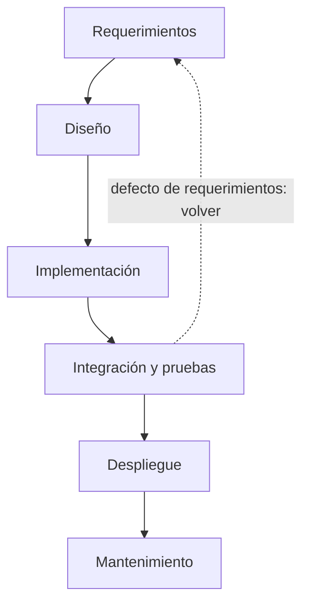

# Ingeniería de Software - Procesos de desarrollo de software

## 3.1 Modelo de cascada.

---

El **modelo de cascada** organiza el desarrollo en fases que se ejecutan una sola vez y en orden, cada una terminada y aprobada antes de empezar la siguiente, como el agua que cae de un nivel al siguiente sin volver. Fue el primer modelo de proceso de software y el que dominó durante décadas en la industria y los contratos gubernamentales, por su parecido con la forma de trabajar de otras ingenierías. Este tema describe sus fases y sus documentos, su origen, las condiciones en que funciona, sus limitaciones y la estimación del esfuerzo y del plazo con COCOMO.

### Origen

El artículo de Winston Royce de 1970, que suele citarse como origen del modelo, describe la secuencia de fases y dice de ella que "es riesgosa e invita al fracaso", porque las pruebas al final descubren problemas que obligan a rediseñar. Royce proponía cinco correcciones: hacer un diseño preliminar antes del análisis, documentar mucho, **hacerlo dos veces**, construyendo primero un prototipo, planear y controlar las pruebas, e involucrar al cliente. El modelo puramente secuencial se institucionalizó después, en estándares como el DOD-STD-2167 del Departamento de Defensa de Estados Unidos de 1985, y su sucesor de 1994, MIL-STD-498, dejó de imponer esa secuencia y admitió modelos incrementales y evolutivos.

### Fases y productos

| Fase                          | Producto que la cierra                                    |
| ----------------------------- | --------------------------------------------------------- |
| Requerimientos                | Especificación de requerimientos aprobada (SRS)           |
| Diseño del sistema            | Documento de arquitectura y de diseño detallado           |
| Implementación                | Código y pruebas unitarias                                |
| Integración y pruebas         | Informe de pruebas del sistema y de aceptación            |
| Despliegue                    | Sistema en operación, manuales y capacitación             |
| Mantenimiento                 | Versiones corregidas y registro de cambios                |

Cada transición es un **hito** con una revisión formal. Los documentos aprobados son la **línea base**: un cambio posterior debe pasar por un proceso de control de cambios (tema 3.4).



### Cuándo funciona

La cascada funciona cuando se cumplen a la vez varias condiciones: los requerimientos son **estables y bien entendidos**, la tecnología es conocida, el sistema es de un tipo que el equipo ya construyó, y hay necesidad de documentación y aprobaciones formales, por contrato o por regulación. Sus ventajas en ese caso son reales: el plan, el costo y el calendario se conocen desde el principio; cada fase tiene criterios de terminación claros, y la documentación facilita las auditorías y la incorporación de personas.

### Limitaciones

- **Retroalimentación tardía:** los usuarios ven el sistema al final. Un requerimiento mal entendido se descubre en las pruebas de aceptación, cuando ya está diseñado, programado e integrado.
- **Costo creciente de los cambios:** Boehm estimó que corregir un defecto de requerimientos cuesta unas 5 veces más en diseño, 10 en codificación, entre 20 y 50 en pruebas y hasta 100 o 200 en operación que en la propia fase de requerimientos. La cascada concentra el descubrimiento en las fases caras.
- **Integración al final:** los problemas entre componentes aparecen todos juntos, en la fase de integración, que suele ser la que más se atrasa.
- **Avance aparente:** durante meses solo hay documentos, y el avance real es difícil de medir.
- **Supuesto irreal:** en la mayoría de los proyectos, los usuarios no pueden especificar por completo lo que necesitan antes de ver algo funcionando.

### Estimación con COCOMO

En un proyecto en cascada, la estimación se hace al terminar los requerimientos, con el modelo COCOMO del tema 1.4. El plazo nominal, $T = c \cdot E^{d},$ supone un tamaño del equipo que crece y decrece a lo largo del proyecto, con un promedio de $E/T$ personas. Reducir el equipo alarga el plazo, y aumentarlo no lo acorta en la misma proporción, por la ley de Brooks: COCOMO II considera que comprimir el plazo por debajo del 75 % del nominal no es factible, y que cualquier compresión aumenta el esfuerzo total.

### Implementación en Python

El programa resuelve el ejercicio 2 con COCOMO orgánico, el plazo con 5 desarrolladores y el límite de compresión. Después simula el costo de corregir los defectos de requerimientos en un proyecto en cascada y en uno iterativo con demostraciones periódicas, con los factores de escalamiento de Boehm.

```python
import random

# ---------- Ejercicio 2: COCOMO orgánico, 50 KLOC ----------
a, b, c, d, kloc = 2.4, 1.05, 2.5, 0.38, 50
E = a * kloc ** b
T = c * E ** d
print(f"ejercicio 2: E = {a}·{kloc}^{b} = {E:.1f} persona-mes | T = {c}·{E:.1f}^{d} = {T:.1f} meses | personal medio E/T = {E / T:.1f}")
print(f"   con 5 desarrolladores, si el esfuerzo no cambiara: {E / 5:.1f} meses ({E / 5 / T:.2f} veces el plazo nominal)")
print(f"   comprimir el plazo: COCOMO II no admite menos de 75 % del nominal → mínimo {0.75 * T:.1f} meses, con {E / (0.75 * T):.1f} personas en promedio y un esfuerzo mayor")

# ---------- Costo de un defecto de requerimientos según la fase en que se detecta ----------
factor = {"requerimientos": 1, "diseño": 5, "codificación": 10, "pruebas": 50, "operación": 150}   # órdenes de magnitud de Boehm
print("costo relativo de corregir un defecto de requerimientos:", factor)
rng = random.Random(11)
def proyecto(modelo, n_def=40):
    """Cascada: los defectos de requerimientos que escapan a la revisión se descubren en pruebas o en operación.
    Iterativo: la demostración al final de cada iteración detecta la mitad de los que escapan, al costo de diseño."""
    costo = 0
    for _ in range(n_def):
        if rng.random() < 0.5: costo += factor["requerimientos"]                # la revisión de requerimientos lo encuentra
        elif modelo == "iterativo" and rng.random() < 0.5: costo += factor["diseño"]
        else: costo += factor["pruebas"] if rng.random() < 0.8 else factor["operación"]
    return costo
for m in ("cascada", "iterativo"):
    print(f"   {m:9}: costo medio de 40 defectos de requerimientos = {sum(proyecto(m) for _ in range(5000)) / 5000:,.0f} unidades")
```

Salida:

```text
ejercicio 2: E = 2.4·50^1.05 = 145.9 persona-mes | T = 2.5·145.9^0.38 = 16.6 meses | personal medio E/T = 8.8
   con 5 desarrolladores, si el esfuerzo no cambiara: 29.2 meses (1.76 veces el plazo nominal)
   comprimir el plazo: COCOMO II no admite menos de 75 % del nominal → mínimo 12.5 meses, con 11.7 personas en promedio y un esfuerzo mayor
costo relativo de corregir un defecto de requerimientos: {'requerimientos': 1, 'diseño': 5, 'codificación': 10, 'pruebas': 50, 'operación': 150}
   cascada  : costo medio de 40 defectos de requerimientos = 1,419 unidades
   iterativo: costo medio de 40 defectos de requerimientos = 768 unidades
```

### Ejercicios Propuestos

1. **Análisis de caso.** Un cliente solicita un sistema de gestión de biblioteca. Identifica los productos de cada fase del modelo de cascada y explica por qué el modelo podría ser apropiado o no.

2. **Estimación.** Un proyecto se estima en 50 KLOC. Con COCOMO orgánico, $a = 2.4,$ $b = 1.05,$ $c = 2.5$ y $d = 0.38,$ calcula el esfuerzo, el tiempo de desarrollo y el tiempo con un equipo de 5 desarrolladores.

3. **Limitaciones.** Para una aplicación móvil en un mercado competitivo, ¿qué limitaciones de la cascada serían problemáticas? Propón alternativas.

### Soluciones

**Ejercicio 1.** Los productos de cada fase:

- **Requerimientos:** la especificación con los requerimientos funcionales, como el catálogo, la búsqueda, los préstamos, las devoluciones, las multas y las reservas, y los no funcionales, como el número de usuarios simultáneos, la disponibilidad y la integración con el sistema escolar de credenciales.
- **Diseño:** la arquitectura, el modelo de datos con libros, ejemplares, usuarios y préstamos, y las interfaces.
- **Implementación:** los módulos de catálogo, circulación y usuarios, con sus pruebas unitarias.
- **Pruebas:** la prueba del sistema con casos para cada requerimiento, y la de aceptación con los bibliotecarios.
- **Despliegue:** la migración del catálogo existente, la capacitación y el arranque.

Un sistema de biblioteca es un dominio **bien conocido**, con reglas estables y sistemas parecidos en todas partes, lo que favorece la cascada. Pero conviene evaluar antes si la solución no es adoptar un sistema existente, como Koha, uno de código abierto. Y la parte con más incertidumbre, la interfaz de búsqueda para los lectores, se beneficiaría de un prototipo validado con usuarios, como recomendaba el propio Royce.

**Ejercicio 2.** $E = 2.4 \cdot 50^{1.05} \approx 145.9$ persona-meses, y $T = 2.5 \cdot 145.9^{0.38} \approx 16.6$ meses, con un equipo medio de 8.8 personas. Con 5 desarrolladores, si el esfuerzo fuera el mismo, el plazo sería de $145.9 / 5 \approx 29.2$ meses, 1.76 veces el nominal. La división supone que el esfuerzo no depende del tamaño del equipo, lo que es razonable al **reducirlo**, porque disminuye la comunicación. El razonamiento inverso no vale: 15 personas no lo terminarían en 10 meses, porque COCOMO II pone el mínimo factible en el 75 % del nominal, unos 12.5 meses, con un esfuerzo mayor.

**Ejercicio 3.** En un mercado competitivo, las limitaciones decisivas son:

- **el tiempo hasta el mercado:** nada se entrega hasta el final, y un competidor que entrega antes captura a los usuarios;
- **la incertidumbre del producto:** qué funciones valoran los usuarios se descubre usándolas, no especificándolas, y la cascada no tiene un mecanismo para aprender;
- **el entorno cambia durante el proyecto:** nuevas versiones del sistema operativo móvil, nuevas reglas de las tiendas de aplicaciones y competidores con funciones nuevas;
- **la integración tardía** con servicios externos, como pagos y notificaciones.

La alternativa es un proceso iterativo e incremental, como Scrum (tema 3.5), con un **producto mínimo viable** que se publica pronto, métricas de uso y entregas frecuentes. La simulación del programa cuantifica una parte del argumento: con los mismos defectos de requerimientos, detectar la mitad de los que escapan a la revisión en una demostración, en lugar de en las pruebas, reduce su costo de corrección casi a la mitad.

### Referencias

1. Royce, W. W., Managing the development of large software systems. _Proceedings of IEEE WESCON_, 1970.
2. Boehm, B. W., _Software Engineering Economics_. Prentice Hall, 1981.
3. Boehm, B. W., et al., _Software Cost Estimation with COCOMO II_. Prentice Hall, 2000.
4. Sommerville, I., _Software Engineering_. Pearson, 2016. Capítulo 2.
5. Larman, C., and Basili, V. R., Iterative and incremental development: a brief history. _Computer_ 36(6), 2003.
