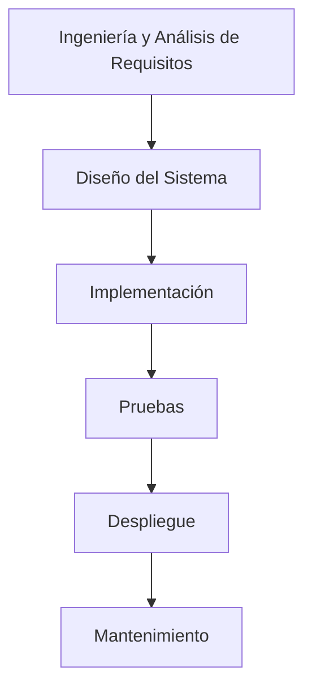

# Ingeniería de Software - Procesos de desarrollo de software

## 3.1 Modelo de cascada.

---

El Modelo de Cascada, también conocido como "Waterfall Model", es uno de los primeros enfoques sistemáticos del proceso de desarrollo de software. Fue formalizado por primera vez por Winston W. Royce en 1970, aunque él mismo señaló sus limitaciones. Según Sommerville (2010), este modelo representa un proceso de desarrollo secuencial donde el progreso fluye en una dirección descendente a través de las fases, similar a una cascada.

### Definición

El Modelo de Cascada es un proceso de desarrollo secuencial que divide el desarrollo de software en fases discretas. Cada fase debe completarse antes de que comience la siguiente, y no hay solapamiento entre ellas. Es un enfoque lineal y rígido que enfatiza la planificación exhaustiva y la documentación detallada.

### Fases del Modelo de Cascada



#### 1. Ingeniería y Análisis de Requisitos

En esta fase, se recopilan y documentan todos los requisitos del sistema de manera exhaustiva. El resultado es un documento de especificación de requisitos que sirve como contrato entre el cliente y el equipo de desarrollo.

#### 2. Diseño del Sistema

Se crea el diseño arquitectónico del sistema basado en los requisitos. Esta fase produce documentos de diseño que especifican:

- Arquitectura del sistema
- Diagramas de clases
- Diagramas de base de datos
- Esquemas de interfaz de usuario

#### 3. Implementación o Desarrollo

Los desarrolladores escriben el código según las especificaciones de diseño. Esta fase convierte el diseño en un producto software funcional.

#### 4. Pruebas

El sistema completo se prueba para detectar y corregir defectos. Incluye:

- Pruebas unitarias
- Pruebas de integración
- Pruebas del sistema
- Pruebas de aceptación

#### 5. Despliegue

El software terminado se implementa en el entorno productivo y se pone a disposición de los usuarios finales.

#### 6. Mantenimiento

Se corrigen errores descubiertos después del despliegue y se realizan actualizaciones para adaptarse a nuevos requisitos.

### Características Principales

- **Secuencialidad estricta**: Cada fase debe completarse antes de comenzar la siguiente
- **Énfasis en documentación**: Cada fase produce documentación detallada
- **Baja flexibilidad**: Los cambios son difíciles y costosos de implementar una vez avanzado el proyecto
- **Claridad en los hitos**: Los puntos de entrega y revisión están bien definidos

### Fórmulas y Métricas Relacionadas

El esfuerzo en el Modelo de Cascada puede estimarse usando la fórmula de COCOMO (Constructive Cost Model) básico:

$$ E = a \times (KLOC)^b $$

Donde:

- $E$ es el esfuerzo en persona-mes
- $KLOC$ es el tamaño estimado del software en miles de líneas de código
- $a$ y $b$ son constantes que dependen del tipo de proyecto

El tiempo de desarrollo (TDEV) se calcula como:

$$ TDEV = c \times (E)^d $$

Donde $c$ y $d$ son constantes derivadas empíricamente.

### Ventajas y Desventajas

#### Ventajas

- Fácil de entender y gestionar
- Fases bien definidas con entregables claros
- Funciona bien para proyectos con requisitos estables y bien comprendidos
- La documentación exhaustiva facilita el mantenimiento

#### Desventajas

- Poca flexibilidad ante cambios en los requisitos
- El producto final solo se ve al final del proceso
- Alto riesgo e incertidumbre
- No adecuado para proyectos largos y complejos

### Ejemplo de Aplicación

Un proyecto adecuado para el Modelo de Cascada sería el desarrollo de un sistema de nóminas para una empresa donde:

- Los requisitos son estables y bien definidos
- La tecnología es familiar para el equipo de desarrollo
- No se anticipan cambios significativos durante el desarrollo

### Ejercicios Propuestos

1. **Análisis de Caso**: Un cliente solicita un sistema de gestión de biblioteca. Identifica los requisitos para cada fase del Modelo de Cascada y explica por qué este modelo podría ser apropiado o no.

2. **Estimación de Esfuerzo**:
   - Si un proyecto se estima en 50 KLOC y usamos los valores típicos de COCOMO orgánico (a=2.4, b=1.05, c=2.5, d=0.38)
   - Calcula el esfuerzo necesario en persona-mes
   - Calcula el tiempo de desarrollo estimado
   - Si el equipo tiene 5 desarrolladores, ¿cuánto tiempo tomaría el proyecto?

3. **Identificación de Limitaciones**: Para un proyecto de desarrollo de aplicación móvil en un mercado competitivo, ¿qué limitaciones del Modelo de Cascada podrían ser problemáticas? Propone alternativas.

### Comparación con Otros Modelos

A diferencia de los modelos ágiles que son iterativos e incrementales, el Modelo de Cascada sigue un enfoque lineal. Mientras que en Scrum se entregan versiones funcionales del software en iteraciones cortas (sprints), en Cascada la entrega ocurre solo al final del proceso.

### Código de Ejemplo: Documentación de Requisitos

Aunque el Modelo de Cascada no prescribe lenguajes de programación específicos, enfatiza la documentación. Aquí un ejemplo de cómo se podrían documentar requisitos:

```
REQ-001: Sistema de Autenticación
Descripción: El sistema debe permitir a los usuarios autenticarse con nombre de usuario y contraseña
Prioridad: Alta
Criterios de Aceptación:
1. El usuario debe poder introducir credenciales
2. El sistema debe validar las credenciales contra la base de datos
3. Tras autenticación exitosa, redirigir al dashboard
4. Tras autenticación fallida, mostrar mensaje de error
```

### Referencias

1. Sommerville, Ian. (2010). Software Engineering (9th edition). Addison Wesley. (Capítulo 2: Software Processes)
2. Pfleeger, S. L., & Atlee, J. M. (2010). Software Engineering: Theory and Practice (4th edition). Prentice Hall. (Capítulo 3: Process Models)
3. Royce, W. W. (1970). Managing the Development of Large Software Systems. Proceedings of IEEE WESCON.
4. Boehm, B. W., & Turner, R. (2003). Balancing Agility and Discipline: A Guide for the Perplexed. Addison-Wesley.

### Conclusión

El Modelo de Cascada, aunque considerado obsoleto por muchos en la era ágil, sigue siendo relevante para proyectos con requisitos bien definidos y estables. Su enfoque estructurado y emphasis en la documentación lo hacen valioso en contextos donde la predictibilidad y el control son prioritarios. Sin embargo, su rigidez lo hace inadecuado para proyectos con requisitos volátiles o en entornos altamente cambiantes.
