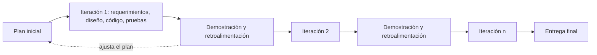

# Ingeniería de Software - Procesos de desarrollo de software

## 3.2 Modelo iterativo.

---

El **modelo iterativo** construye el sistema en ciclos: en cada **iteración** se recorren las actividades de requerimientos, diseño, implementación y pruebas para una parte del sistema, y al final de cada una hay software que funciona y que los interesados pueden evaluar. La retroalimentación de cada iteración ajusta las siguientes. Aunque suele presentarse como una reacción a la cascada, es casi tan antiguo como ella: Larman y Basili documentan su uso en proyectos de la NASA y de IBM desde los años cincuenta y sesenta. Este tema define el modelo, distingue lo iterativo de lo incremental, describe cómo se planean las iteraciones y cómo se estima su esfuerzo.

### Iterativo e incremental

Los dos términos suelen usarse juntos, pero no significan lo mismo:

- **Incremental:** el sistema se entrega en **partes**, cada una de las cuales agrega funcionalidad a la anterior. Es una estrategia de **entrega**.
- **Iterativo:** el sistema se **refina** en ciclos sucesivos; una misma parte puede rehacerse varias veces con lo aprendido. Es una estrategia de **retrabajo planeado**.

Patton lo ilustra con la Mona Lisa: hacerla incrementalmente es pintar una esquina completa, luego otra; hacerla iterativamente es bosquejar el cuadro entero y luego refinarlo todo. La mayoría de los procesos modernos combinan ambos: cada iteración agrega funciones y mejora las existentes.

### Planeación de las iteraciones

Las iteraciones tienen una duración fija, de dos a seis semanas en el Proceso Unificado y de una a cuatro en Scrum, y el **alcance** se ajusta a ella, no al revés. El orden de las funciones se decide con dos criterios, aplicados juntos:

- **Valor:** lo que más importa a los usuarios va primero, para que el sistema sea útil cuanto antes y lo menos valioso quede para el final, donde es más fácil recortarlo.
- **Riesgo:** lo más incierto técnicamente, como una integración con un sistema externo o un requerimiento de desempeño, va pronto, para descubrir los problemas cuando todavía hay tiempo de reaccionar. El Proceso Unificado dedica su fase de **elaboración** a esto: construir y probar una **arquitectura ejecutable** que resuelva los riesgos mayores.

Las **dependencias** restringen el orden: no se puede pagar una reserva que no existe.



### Estimación

El esfuerzo de una iteración se estima a partir de su tamaño, por ejemplo en puntos de función, con un modelo de la forma

$$E_i = a \cdot \mathit{FP}_i^{\,b} \cdot \mathit{CF}_i,$$

con $a$ y $b$ calibrados con los datos de la organización y $\mathit{CF}_i$ un factor de complejidad de la iteración. Cuando $b \gt 1,$ hay una trampa: sumar las estimaciones de partes pequeñas da menos que estimar el todo, porque cada término por separado no paga las deseconomías de escala. Pero en un sistema iterativo cada iteración **agrega** código a un sistema que ya existe, y la integración con lo anterior cuesta. Una forma de respetar la escala es estimar cada iteración como la diferencia entre el esfuerzo del sistema acumulado con y sin ella.

### Ventajas y desventajas

Las ventajas son las de la retroalimentación temprana: los requerimientos mal entendidos aparecen en la primera demostración; la integración es continua, no un evento al final; el avance se mide en software que funciona; y el proyecto puede detenerse en cualquier iteración con algo útil. Las desventajas son que el costo y el alcance finales son menos predecibles al inicio, lo que complica los contratos de precio fijo; que la arquitectura puede degradarse si cada iteración agrega sin rediseñar, lo que exige refactorización continua, y que requiere que los interesados participen en cada revisión.

### Implementación en Python

El programa resuelve el ejercicio 2 con la fórmula del enunciado, y la compara con la estimación del sistema completo y con la estimación por tamaño acumulado. Para el ejercicio 1 ordena las funciones de un sistema de reservas en iteraciones según su valor y su riesgo, respetando las dependencias.

```python
# ---------- Ejercicio 2: esfuerzo por iteración ----------
a, b = 0.6, 1.2
fp = [100, 150, 120, 80]
cf = [1.1, 1.0, 1.2, 0.9]
E = [a * f ** b * c for f, c in zip(fp, cf)]
for i, (f, c, e) in enumerate(zip(fp, cf, E), 1): print(f"ejercicio 2: iteración {i}: {a}·{f}^{b}·{c} = {e:7.1f}")
print(f"   total Σ E_i = {sum(E):.1f}")
total_fp = sum(fp); cf_medio = sum(f * c for f, c in zip(fp, cf)) / total_fp
print(f"   el mismo sistema estimado de una vez: {a}·{total_fp}^{b}·{cf_medio:.3f} = {a * total_fp ** b * cf_medio:.1f}")
acum, incrementos = 0, []                           # cada iteración agrega código a un sistema que crece
for f, c in zip(fp, cf):
    acum += f; incrementos.append(a * acum ** b * c - a * (acum - f) ** b * c)
print("   con tamaño acumulado, por iteración:", [round(x, 1) for x in incrementos], f"| total {sum(incrementos):.1f}")

# ---------- Ejercicio 1: orden de las iteraciones por valor y riesgo ----------
funciones = {   # función: (valor 1-10, riesgo técnico 1-10, depende de)
    "catálogo de habitaciones y tarifas": (8, 3, []), "búsqueda de disponibilidad": (9, 6, ["catálogo de habitaciones y tarifas"]),
    "reserva y confirmación": (10, 5, ["búsqueda de disponibilidad"]), "pago en línea": (8, 8, ["reserva y confirmación"]),
    "check-in y check-out": (7, 3, ["reserva y confirmación"]), "facturación": (6, 4, ["check-in y check-out"]),
    "integración con agencias en línea": (7, 9, ["búsqueda de disponibilidad"]), "reportes de ocupación": (4, 2, ["check-in y check-out"]),
}
hechas, iteraciones = set(), []
while len(hechas) < len(funciones):
    listas = [f for f, (_, _, dep) in funciones.items() if f not in hechas and set(dep) <= hechas]
    listas.sort(key=lambda f: -(funciones[f][0] + funciones[f][1]))       # valor más riesgo: lo importante y lo incierto primero
    it = listas[:2]; iteraciones.append(it); hechas |= set(it)
for i, it in enumerate(iteraciones, 1): print(f"ejercicio 1: iteración {i}: {', '.join(it)}")
```

Salida:

```text
ejercicio 2: iteración 1: 0.6·100^1.2·1.1 =   165.8
ejercicio 2: iteración 2: 0.6·150^1.2·1.0 =   245.2
ejercicio 2: iteración 3: 0.6·120^1.2·1.2 =   225.1
ejercicio 2: iteración 4: 0.6·80^1.2·0.9 =   103.8
   total Σ E_i = 739.8
   el mismo sistema estimado de una vez: 0.6·450^1.2·1.058 = 969.2
   con tamaño acumulado, por iteración: [165.8, 301.9, 326.2, 172.6] | total 966.5
ejercicio 1: iteración 1: catálogo de habitaciones y tarifas
ejercicio 1: iteración 2: búsqueda de disponibilidad
ejercicio 1: iteración 3: integración con agencias en línea, reserva y confirmación
ejercicio 1: iteración 4: pago en línea, check-in y check-out
ejercicio 1: iteración 5: facturación, reportes de ocupación
```

### Ejercicios Propuestos

1. **Planeación.** Para un sistema de reservas de hotel, identifica al menos 4 iteraciones con sus funciones principales y justifica el orden.

2. **Estimación.** Un proyecto tiene 4 iteraciones de 100, 150, 120 y 80 puntos de función. Con $a = 0.6,$ $b = 1.2$ y factores de complejidad 1.1, 1.0, 1.2 y 0.9, calcula el esfuerzo total.

3. **Comparación.** Compara el modelo iterativo con la cascada para una aplicación móvil, e identifica en qué casos conviene cada uno.

### Soluciones

**Ejercicio 1.** Con valor y riesgo como criterio y las dependencias como restricción, el programa obtiene:

1. **Catálogo de habitaciones y tarifas:** la base de todo lo demás.
2. **Búsqueda de disponibilidad:** valiosa y con riesgo de desempeño, porque cruza habitaciones, fechas y reservas.
3. **Reserva y confirmación**, el núcleo del valor, junto con la **integración con agencias en línea**, la función de mayor riesgo técnico, que debe probarse pronto porque depende de la API de un tercero.
4. **Pago en línea**, con riesgo alto por la pasarela y la seguridad, y **check-in y check-out**.
5. **Facturación y reportes de ocupación**, de menor valor y riesgo, recortables si el tiempo se acaba.

Al final de la iteración 3, el hotel ya puede recibir reservas propias y de las agencias. Las puntuaciones de valor y riesgo del programa son supuestas; en un proyecto real las asignan el dueño del producto y el arquitecto.

**Ejercicio 2.** Aplicando la fórmula:

$$E = 0.6 \cdot 100^{1.2} \cdot 1.1 + 0.6 \cdot 150^{1.2} \cdot 1.0 + 0.6 \cdot 120^{1.2} \cdot 1.2 + 0.6 \cdot 80^{1.2} \cdot 0.9 \approx 165.8 + 245.2 + 225.1 + 103.8 = 739.8.$$

El enunciado no dice en qué unidades está el resultado, que dependen de cómo se calibraron $a$ y $b;$ con estos valores serían plausiblemente horas-persona. El resultado subestima el esfuerzo: estimando los 450 puntos de función como un solo sistema, con el factor de complejidad promedio ponderado, se obtienen 969.2, un 31 % más. La diferencia es la deseconomía de escala que la suma por partes ignora. La estimación por tamaño acumulado, 966.5, la recupera, y además muestra que las iteraciones intermedias cuestan más de lo que su tamaño sugiere, porque se integran con un sistema más grande.

**Ejercicio 3.**

| Criterio                        | Iterativo                                       | Cascada                                        |
| ------------------------------- | ----------------------------------------------- | ---------------------------------------------- |
| Requerimientos inciertos        | Se descubren con cada demostración              | Deben conocerse al inicio                      |
| Tiempo hasta la primera versión | Semanas                                         | El proyecto completo                           |
| Contrato de precio fijo         | Más difícil; se fija el plazo, no el alcance    | Natural                                        |
| Cambios de la plataforma móvil  | Se absorben en la siguiente iteración           | Obligan a reabrir fases cerradas               |
| Documentación para auditorías   | Menor, salvo que se planee                      | Completa por diseño                            |

Para la mayoría de las aplicaciones móviles conviene el iterativo, porque el producto se valida con usuarios reales y la plataforma cambia constantemente. La cascada conviene para una aplicación con especificación cerrada, como una aplicación institucional que reproduce un trámite existente, o cuando un contrato o un regulador exige el alcance y la documentación por adelantado.

### Referencias

1. Larman, C., and Basili, V. R., Iterative and incremental development: a brief history. _Computer_ 36(6), 2003.
2. Kruchten, P., _The Rational Unified Process: An Introduction_. Addison-Wesley, 2003.
3. Patton, J., Don't know what I want, but I know how to get it. _jpattonassociates.com_, 2008.
4. Cockburn, A., Using both incremental and iterative development. _CrossTalk_ 21(5), 2008.
5. Sommerville, I., _Software Engineering_. Pearson, 2016. Capítulo 2.
