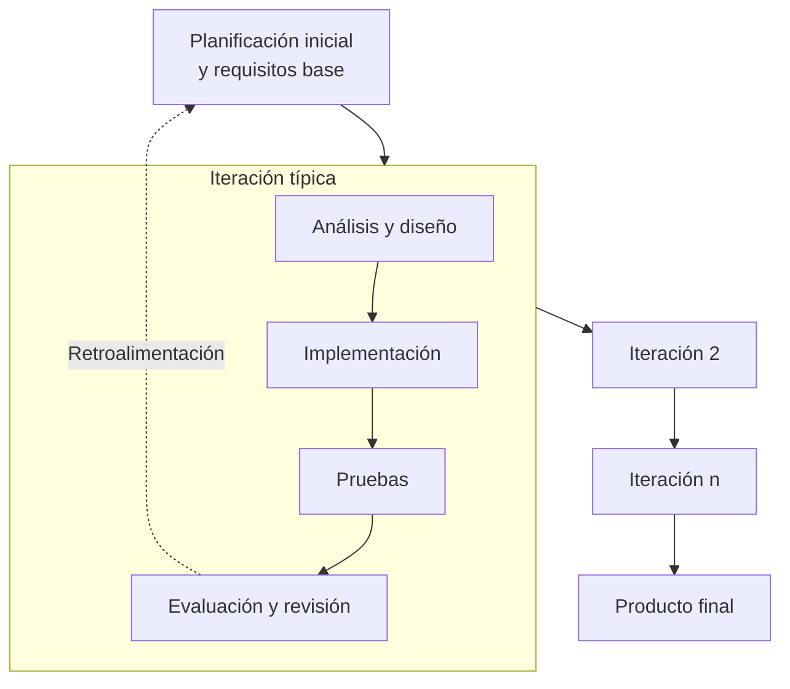

# Ingeniería de Software - Procesos de desarrollo de software

## 3.2 Modelo iterativo.

---

El Modelo Iterativo es un enfoque de desarrollo de software que se basa en la repetición cíclica de fases de desarrollo. A diferencia del modelo de cascada que sigue un enfoque lineal, el modelo iterativo permite refinamientos progresivos mediante ciclos repetitivos. Según Pfleeger y Atlee (2010), este modelo reconoce que los requisitos no pueden ser completamente especificados desde el inicio y permite incorporar cambios durante el proceso de desarrollo.

### Definición

El Modelo Iterativo es un proceso de desarrollo que divide el proyecto en pequeños incrementos, llamados iteraciones. Cada iteración pasa por las fases de requisitos, diseño, implementación y prueba, produciendo una versión ejecutable del software que se expande con cada ciclo hasta convertirse en el sistema completo.

### Fases del Modelo Iterativo



#### 1. Planificación inicial

Se establecen los requisitos base del sistema y se define el plan de iteraciones, identificando qué funcionalidades se desarrollarán en cada ciclo.

#### 2. Iteraciones

Cada iteración constituye un mini-proyecto que incluye:

- Análisis de los requisitos para esa iteración
- Diseño de las funcionalidades
- Implementación del código
- Pruebas y verificación
- Evaluación con el cliente

#### 3. Evaluación y refinamiento

Al final de cada iteración, se evalúa el progreso con los stakeholders y se ajustan los requisitos y el plan para las siguientes iteraciones.

#### 4. Entrega final

Al completar todas las iteraciones planificadas, se integran todos los componentes y se entrega el producto final.

### Características Principales

- **Desarrollo incremental**: El software se construye en partes que se integran progresivamente
- **Flexibilidad**: Permite adaptarse a cambios en los requisitos
- **Retroalimentación temprana**: Los clientes pueden ver progresos desde etapas tempranas
- **Gestión de riesgos**: Los riesgos se identifican y abordan en iteraciones tempranas

### Fórmulas y Métricas Relacionadas

La estimación del esfuerzo en modelos iterativos puede calcularse considerando la complejidad de cada iteración:

$$ E_{total} = \sum_{i=1}^{n} E_i $$

Donde:

- $E_{total}$ es el esfuerzo total del proyecto
- $E_i$ es el esfuerzo de la iteración $i$
- $n$ es el número total de iteraciones

El esfuerzo por iteración puede estimarse como:

$$ E_i = a \times (FP_i)^b \times CF_i $$

Donde:

- $FP_i$ son los puntos de función de la iteración $i$
- $CF_i$ es el factor de complejidad de la iteración $i$
- $a$ y $b$ son constantes derivadas empíricamente

### Ventajas y Desventajas

#### Ventajas

- Mejor gestión de riesgos técnicos y de requisitos
- Entrega temprana de funcionalidades críticas
- Mayor flexibilidad ante cambios
- Mejor involucramiento del cliente

#### Desventajas

- Puede requerir más recursos que enfoques lineales
- Complejidad en la gestión de configuración
- Puede dificultar la planificación a largo plazo
- Requiere disciplina para no extender iteraciones indefinidamente

### Ejemplo de Aplicación

Un proyecto adecuado para el Modelo Iterativo sería el desarrollo de un sistema de comercio electrónico donde:

- Algunos requisitos son conocidos pero otros emergerán durante el desarrollo
- Se priorizan funcionalidades críticas (catálogo, carrito) en primeras iteraciones
- El cliente quiere ver progresos tempranos y poder ajustar requisitos

Iteración 1: Catálogo de productos básico
Iteración 2: Carrito de compras y proceso de checkout
Iteración 3: Sistema de recomendaciones y perfiles de usuario
Iteración 4: Integración con pasarelas de pago y reportes

### Ejercicios Propuestos

1. **Planificación de Iteraciones**:
   - Para un sistema de reservas de hotel, identifica al menos 4 iteraciones con sus funcionalidades principales
   - Justifica el orden de priorización seleccionado

2. **Estimación de Esfuerzo**:
   - Un proyecto tiene 4 iteraciones con puntos de función estimados: 100, 150, 120, 80
   - Considerando a=0.6, b=1.2 y CF=[1.1, 1.0, 1.2, 0.9] para cada iteración
   - Calcula el esfuerzo total del proyecto

3. **Análisis Comparativo**:
   - Compara el modelo iterativo con el modelo de cascada para un proyecto de desarrollo de aplicación móvil
   - Identifica en qué casos sería preferible cada enfoque

### Comparación con Otros Modelos

A diferencia del modelo de cascada que es secuencial, el modelo iterativo permite refinamiento progresivo. En comparación con los modelos ágiles (como Scrum), el modelo iterativo tiende a tener iteraciones más largas y menos adaptación constante, pero comparte el principio de desarrollo incremental.

### Ejemplo de Planificación de Iteración

```
ITERACIÓN 2: Sistema de Autenticación y Perfiles de Usuario
Duración: 3 semanas
Objetivos:
- Implementar registro de usuarios
- Implementar autenticación segura
- Crear perfiles de usuario básicos
- Implementar recuperación de contraseñas

Entregables:
- Módulo de autenticación probado
- Base de datos de usuarios
- Interfaz de registro y login
- Documentación de la API

Métricas de éxito:
- 95% de cobertura de pruebas
- Tiempo de respuesta < 200ms
- Satisfacción del cliente > 4/5
```

### Referencias

1. Sommerville, Ian. (2010). Software Engineering (9th edition). Addison Wesley. (Capítulo 2: Software Processes)
2. Pfleeger, S. L., & Atlee, J. M. (2010). Software Engineering: Theory and Practice (4th edition). Prentice Hall. (Capítulo 3: Process Models)
3. Boehm, B. W. (1988). A Spiral Model of Software Development and Enhancement. Computer, 21(5), 61-72.
4. Larman, C., & Basili, V. R. (2003). Iterative and Incremental Development: A Brief History. Computer, 36(6), 47-56.

### Conclusión

El Modelo Iterativo representa un avance significativo respecto a los enfoques secuenciales puros, permitiendo mayor flexibilidad y adaptación a cambios. Es particularmente útil cuando los requisitos no están completamente definidos al inicio del proyecto o cuando es importante entregar funcionalidades críticas tempranamente. Aunque requiere una cuidadosa gestión para evitar desviaciones, proporciona un equilibrio entre estructura y adaptabilidad que lo hace adecuado para muchos tipos de proyectos software.
