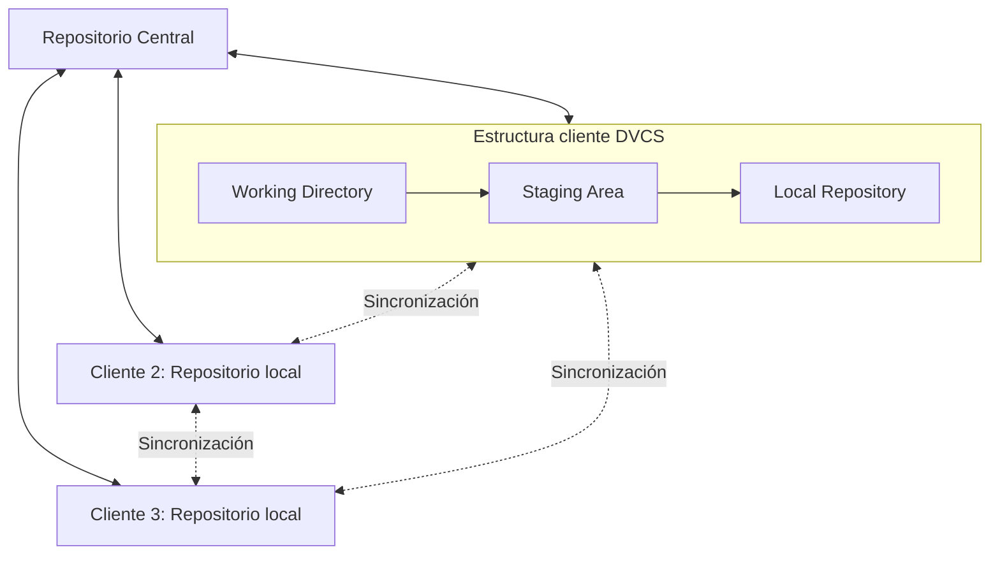
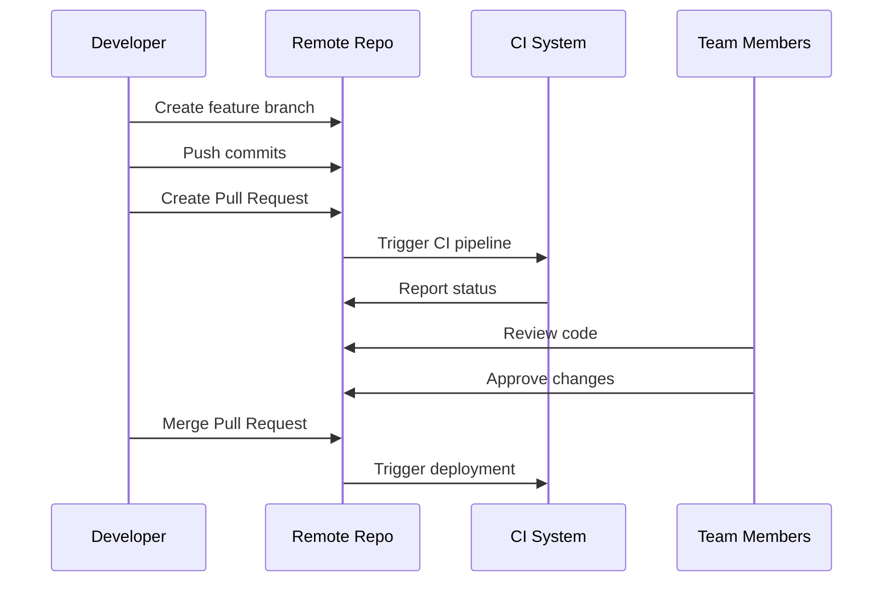

# Ingeniería de Software - Procesos de desarrollo de software

## 3.3 Herramientas de colaboración y control de versiones.

---

En el desarrollo de software moderno, las herramientas de colaboración y control de versiones son fundamentales para gestionar el trabajo en equipo, mantener la integridad del código y facilitar la integración de contribuciones múltiples. Según Sommerville (2010), estas herramientas constituyen la columna vertebral de la ingeniería de software colaborativa, permitiendo a los equipos trabajar de manera coordinada incluso en entornos distribuidos.

### Definición

El control de versiones es un sistema que registra los cambios realizados en un archivo o conjunto de archivos a lo largo del tiempo, permitiendo recuperar versiones específicas posteriormente. Las herramientas de colaboración facilitan el trabajo coordinado entre múltiples desarrolladores, gestionando conflictos y manteniendo la trazabilidad de los cambios.

### Tipos de Sistemas de Control de Versiones

#### 1. Sistemas Locales

Mantienen un registro de cambios en el mismo sistema donde se editan los archivos.

#### 2. Sistemas Centralizados (CVCS)

Utilizan un único servidor que contiene todos los archivos versionados, y varios clientes que check-out archivos desde ese lugar central.

#### 3. Sistemas Distribuidos (DVCS)

Los clientes replican completamente el repositorio, incluyendo su historial completo, permitiendo trabajo offline y redundancia.

### Arquitectura de un Sistema de Control de Versiones Distribuido



### Conceptos Fundamentales

#### Repository (Repositorio)

Almacena metadata y objetos de la base de datos del proyecto. Puede ser local o remoto.

#### Commit

Operación que guarda cambios en el repositorio con un identificador único, mensaje descriptivo y autor.

#### Branch (Rama)

Línea de desarrollo independiente que permite trabajar en características aisladas.

#### Merge (Fusión)

Proceso de combinar cambios de diferentes ramas en una sola.

#### Conflict

Ocurre cuando cambios simultáneos en la misma porción de código no pueden ser fusionados automáticamente.

### Flujo de Trabajo Típico con Git

```
# Inicializar un nuevo repositorio
git init

# Configurar usuario
git config user.name "Tu nombre"
git config user.email "tu@email.com"

# Añadir archivos al staging area
git add nombre_archivo.ext

# Confirmar cambios
git commit -m "Mensaje descriptivo del cambio"

# Conectar con repositorio remoto
git remote add origin URL_DEL_REPOSITORIO

# Subir cambios al repositorio remoto
git push -u origin main
```

### Comandos Esenciales y sus Funciones

| Comando        | Función                                 |
| -------------- | --------------------------------------- |
| `git status`   | Muestra el estado del working directory |
| `git log`      | Muestra el historial de commits         |
| `git diff`     | Muestra diferencias entre commits       |
| `git branch`   | Gestiona ramas                          |
| `git checkout` | Cambia entre ramas o commits            |
| `git pull`     | Obtiene cambios del repositorio remoto  |
| `git fetch`    | Descarga objetos del repositorio remoto |

### Estrategias de Branching

#### Git Flow

Estrategia que define ramas principales y de soporte con propósitos específicos:

- `main`: Contiene el historial de producción
- `develop`: Integración para características
- `feature/*`: Desarrollo de nuevas funcionalidades
- `release/*`: Preparación para nuevas releases
- `hotfix/*`: Arreglos urgentes de producción

#### GitHub Flow

Estrategia más simple centrada en deployment continuo:

- `main` siempre está desplegable
- Nuevas características se desarrollan en branches descriptivos
- Pull Requests para integrar cambios
- Deployment inmediato después de merge

### Resolución de Conflictos

Cuando ocurren conflictos durante un merge, Git marca las áreas problemáticas en los archivos:

```plaintext
<<<<<<< HEAD
Código de la rama actual
=======
Código de la rama que se está fusionando
>>>>>>> nombre_rama
```

El desarrollador debe editar manualmente estas secciones, conservando el código deseado y eliminando los marcadores de conflicto.

### Fórmulas y Métricas

#### Medición de Contribuciones

La contribución individual puede medirse mediante:

$$ C\_i = \sum\_{c=1}^{n} (L\_{\text{añadidas}\_c} - L\_{eliminadas\_c}) \times W\_{complejidad\_c} $$

Donde:

- $C_i$ es la contribución del desarrollador $i$
- $n$ es el número de commits
- $L$ representa líneas de código
- $W$ es un factor de peso por complejidad

#### Índice de Colaboración

Para medir el grado de colaboración en un equipo:

$$ IC = \frac{N\\\_{commits\\\_colaborativos}}{N\\\_{commits\\\_totales}} \times 100 $$

Donde un commit colaborativo es aquel que involucra múltiples autores o revisores.

### Herramientas de Colaboración Adicionales

#### Sistemas de seguimiento de issues

- Gestión de bugs, características y tareas
- Ejemplos: JIRA, GitHub Issues, GitLab Issues

#### Revisiones de código

- Pull Requests/Merge Requests
- Herramientas de revisión como Gerrit, Reviewable

#### Integración Continua/Despliegue Continuo (CI/CD)

- Automatización de builds, tests y despliegues
- Ejemplos: Jenkins, GitHub Actions, GitLab CI

### Ejercicios Propuestos

1. **Configuración Inicial**:
   - Instala Git en tu sistema
   - Configura tu usuario global y verifica la configuración
   - Crea un nuevo repositorio y realiza tu primer commit

2. **Flujo de Trabajo Colaborativo**:
   - Simula un escenario con dos desarrolladores
   - Crea conflictos intencionales y practica su resolución
   - Implementa tanto Git Flow como GitHub Flow en proyectos de ejemplo

3. **Análisis de Historial**:
   - Clona un proyecto open source de GitHub
   - Analiza su historial usando `git log --graph --oneline --all`
   - Identifica patrones de branching y merging
   - Calcula métricas básicas de contribución

4. **Automatización con Hooks**:
   - Crea un hook pre-commit que ejecute tests básicos
   - Implementa un hook post-commit que envíe notificaciones

### Ejemplo de Workflow con Pull Requests



### Buenas Prácticas

#### Mensajes de Commit Informativos

Usar formato convencional:

```
<tipo>(<alcance>): <asunto>

<cuerpo>

<pie>
```

Donde tipo puede ser: feat, fix, docs, style, refactor, test, chore.

#### .gitignore adecuado

Excluir archivos generados automáticamente, dependencias y configuraciones sensibles.

#### Commits Atómicos

Cada commit debe contener cambios relacionados conceptualmente y debe compilarse correctamente.

### Referencias

1. Sommerville, Ian. (2010). Software Engineering (9th edition). Addison Wesley. (Capítulo 25: Configuration Management)
2. Pfleeger, S. L., & Atlee, J. M. (2010). Software Engineering: Theory and Practice (4th edition). Prentice Hall. (Capítulo 4: Software Configuration Management)
3. Chacon, S., & Straub, B. (2014). Pro Git. Apress.
4. Loeliger, J., & McCullough, M. (2012). Version Control with Git. O'Reilly Media.

### Recursos Adicionales

- [Git Official Documentation](https://git-scm.com/doc)
- [GitHub Learning Lab](https://lab.github.com/)
- [Atlassian Git Tutorials](https://www.atlassian.com/git/tutorials)
- [Git Flow Cheatsheet](https://danielkummer.github.io/git-flow-cheatsheet/)

### Conclusión

Las herramientas de colaboración y control de versiones son esenciales para el desarrollo de software moderno, permitiendo trabajo coordinado, mantenimiento del historial de cambios y gestión eficiente de proyectos. Git se ha establecido como estándar de facto en la industria, pero su efectividad depende del entendimiento de sus conceptos fundamentales y la implementación de flujos de trabajo adecuados. El dominio de estas herramientas es una competencia crítica para cualquier ingeniero de software contemporáneo.
