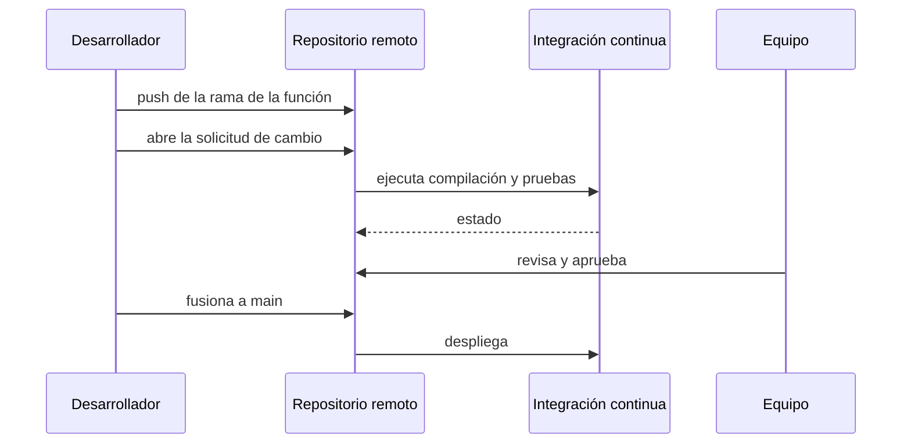

# Ingeniería de Software - Procesos de desarrollo de software

## 3.3 Herramientas de colaboración y control de versiones.

---

Cuando varias personas modifican el mismo código, hacen falta dos cosas: registrar cada cambio, con quién lo hizo, cuándo y por qué, y combinar los cambios hechos en paralelo sin perder ninguno. Eso es el **control de versiones**, la base técnica de la gestión de la configuración del tema 1.5. Alrededor de él se organizan las demás herramientas de colaboración: la revisión de código, la integración continua, el seguimiento de tareas y la comunicación del equipo. Este tema explica el modelo de Git, el sistema de control de versiones dominante, los flujos de trabajo con ramas, la resolución de conflictos, los hooks y la integración con las demás herramientas.

### Sistemas de control de versiones

Hubo tres generaciones:

- **locales**, como RCS (1982), que versionaban archivos individuales en una sola máquina;
- **centralizados**, como CVS y Subversion (2000), con un servidor que guarda la historia y clientes que obtienen una copia de trabajo;
- **distribuidos**, como Git y Mercurial (2005), en los que cada clon tiene la historia completa: se puede hacer commit, crear ramas y consultar la historia sin conexión, y cualquier clon sirve de respaldo.

Linus Torvalds escribió Git en 2005 para el desarrollo del núcleo de Linux, con tres objetivos: velocidad, integridad y soporte para un desarrollo muy distribuido.

### El modelo de Git

Git guarda la historia como un **grafo dirigido acíclico de commits**. Cada commit apunta a una instantánea completa del árbol de archivos y a sus commits padres: uno en un commit normal, dos o más en una fusión. Todo objeto, sea un archivo, un directorio o un commit, se identifica por el **hash** de su contenido, de modo que cambiar cualquier cosa en la historia cambia los identificadores de todos los commits posteriores: la historia es verificable. Una **rama** es solo un apuntador movible a un commit, y por eso crearla es instantáneo. Los archivos pasan por tres áreas: el **directorio de trabajo**, el **área de preparación** (*staging*), donde se arma el siguiente commit con `git add`, y el **repositorio**.

Las operaciones de colaboración son `clone`, `fetch`, que trae commits remotos sin modificar las ramas locales, `pull`, que hace `fetch` y fusiona, y `push`, que publica. Git **rechaza** un `push` que no sea un avance directo de la rama remota, es decir, si alguien publicó antes: quien publica después debe integrar primero los cambios ajenos.

### Fusiones y conflictos

Para fusionar dos ramas, Git busca su **ancestro común** y combina los cambios de cada lado respecto a él, una **fusión de tres vías**. Si los dos lados cambiaron líneas distintas, la combinación es automática. Si cambiaron las mismas líneas de forma distinta, hay un **conflicto**: Git marca el archivo con `<<<<<<<`, `=======` y `>>>>>>>` y deja la decisión a una persona. Resolverlo no es elegir un lado: es escribir el código que respeta la **intención** de ambos cambios, y verificarlo con las pruebas. Un conflicto sin marcas también es posible: dos cambios que se fusionan limpiamente pero que juntos rompen el programa, y solo las pruebas lo detectan.

La alternativa a fusionar es **rebasar**: reaplicar los commits propios sobre la punta de la rama ajena, lo que da una historia lineal a cambio de reescribir commits. La regla es no rebasar commits que otros ya tienen.

### Flujos de trabajo

- **GitHub Flow:** una rama principal siempre desplegable; cada cambio en una rama corta, integrado con una solicitud de cambio (*pull request*) revisada y aprobada por las pruebas automáticas.
- **Git Flow** (Driessen, 2010): ramas permanentes `main` y `develop`, y ramas de funciones, de versiones y de correcciones urgentes. Útil para productos con versiones numeradas que se mantienen en paralelo, y excesivo para un servicio que se despliega continuamente; su propio autor lo aclaró en 2020.
- **Desarrollo en el tronco** (*trunk-based*): todos integran en la rama principal al menos una vez al día, con ramas de horas, y las funciones incompletas se ocultan con interruptores de configuración. Es la práctica que el estudio DORA asocia con el mejor desempeño de entrega.



### Hooks y automatización

Los **hooks** son programas que Git ejecuta en ciertos eventos. Los del cliente, como `pre-commit`, `commit-msg` y `pre-push`, verifican el trabajo antes de registrarlo o publicarlo: formato, análisis estático, pruebas rápidas y mensajes con un formato acordado. Un hook que termina con un código distinto de cero **cancela** la operación. Los hooks locales no se versionan con el repositorio y cada desarrollador puede saltarlos con `--no-verify`, así que las verificaciones obligatorias deben repetirse en el servidor, en la integración continua. Herramientas como `pre-commit` distribuyen la configuración de los hooks dentro del repositorio.

### Implementación en Python

El programa ejecuta Git real en un directorio temporal, con nombres y fechas fijos para que los identificadores de los commits sean reproducibles. Crea un repositorio central y dos clones, simula a dos desarrolladores que cambian la misma función, muestra el rechazo del `push`, el conflicto con sus marcas, la resolución que combina ambas intenciones y la historia resultante. Después instala un hook `pre-commit` que ejecuta las pruebas y rechaza un commit con un error, y calcula métricas de la historia.

```python
import os, subprocess, tempfile, textwrap

raiz = tempfile.mkdtemp()
reloj = [1_700_000_000]
def git(*args, quien="Ana", repo="ana", ok=True):
    reloj[0] += 60                                          # fechas fijas: los hashes son reproducibles
    env = os.environ | {"GIT_AUTHOR_NAME": quien, "GIT_AUTHOR_EMAIL": f"{quien.lower()}@ejemplo.mx",
                        "GIT_COMMITTER_NAME": quien, "GIT_COMMITTER_EMAIL": f"{quien.lower()}@ejemplo.mx",
                        "GIT_AUTHOR_DATE": f"{reloj[0]} -0600", "GIT_COMMITTER_DATE": f"{reloj[0]} -0600",
                        "GIT_CONFIG_GLOBAL": os.devnull, "GIT_CONFIG_SYSTEM": os.devnull}
    r = subprocess.run(["git", *args], cwd=os.path.join(raiz, repo), env=env, capture_output=True, text=True)
    if ok and r.returncode: raise RuntimeError(r.stderr)
    return (r.stdout + r.stderr).strip()
def escribe(repo, archivo, texto):
    with open(os.path.join(raiz, repo, archivo), "w") as f: f.write(textwrap.dedent(texto).lstrip())

# ---------- Ejercicio 1: repositorio inicial ----------
subprocess.run(["git", "init", "-q", "--bare", "-b", "main", os.path.join(raiz, "origen.git")], check=True)
subprocess.run(["git", "clone", "-q", os.path.join(raiz, "origen.git"), os.path.join(raiz, "ana")], check=True, capture_output=True)
escribe("ana", "precios.py", """
    def total(precio, cantidad):
        return precio * cantidad
    """)
escribe("ana", "test_precios.py", """
    from precios import total
    assert total(10, 3) == 30
    """)
git("add", "."); git("commit", "-q", "-m", "Cálculo del total"); git("push", "-q", "origin", "main")
print("ejercicio 1:", git("log", "--oneline"))

# ---------- Ejercicio 2: dos desarrolladores y un conflicto ----------
subprocess.run(["git", "clone", "-q", os.path.join(raiz, "origen.git"), os.path.join(raiz, "luis")], check=True, capture_output=True)
escribe("luis", "precios.py", """
    def total(precio, cantidad):
        return round(precio * cantidad * 1.16, 2)   # con IVA
    """)
git("commit", "-qam", "Agrega IVA al total", quien="Luis", repo="luis"); git("push", "-q", "origin", "main", quien="Luis", repo="luis")
escribe("ana", "precios.py", """
    def total(precio, cantidad):
        return precio * cantidad - descuento(cantidad)

    def descuento(cantidad):
        return 5 if cantidad >= 10 else 0
    """)
git("commit", "-qam", "Descuento por volumen")
print("ejercicio 2: Ana intenta publicar:", git("push", "origin", "main", ok=False).splitlines()[1].strip())
git("fetch", "-q", "origin")
print("   fusión:", git("merge", "origin/main", ok=False).splitlines()[-1])
with open(os.path.join(raiz, "ana", "precios.py")) as f: print(textwrap.indent(f.read().rstrip(), "   │ ", lambda l: True))
escribe("ana", "precios.py", """
    def total(precio, cantidad):
        return round((precio * cantidad - descuento(cantidad)) * 1.16, 2)   # descuento antes del IVA

    def descuento(cantidad):
        return 5 if cantidad >= 10 else 0
    """)
escribe("ana", "test_precios.py", """
    from precios import total
    assert total(10, 3) == 34.8
    assert total(10, 10) == 110.2
    """)
git("add", "."); git("commit", "-q", "-m", "Fusiona IVA y descuento"); git("push", "-q", "origin", "main")
print("   historia:"); print("\n".join("   " + l.rstrip() for l in git("log", "--graph", "--oneline", "--all").splitlines()))

# ---------- Ejercicio 4: un hook pre-commit que ejecuta las pruebas ----------
hook = os.path.join(raiz, "ana", ".git", "hooks", "pre-commit")
with open(hook, "w") as f: f.write("#!/bin/sh\npython3 test_precios.py || { echo 'pre-commit: las pruebas fallan, commit rechazado'; exit 1; }\n")
os.chmod(hook, 0o755)
escribe("ana", "precios.py", """
    def total(precio, cantidad):
        return precio + cantidad   # error
    def descuento(cantidad):
        return 0
    """)
salida = git("commit", "-qam", "Cambio con error", ok=False)
print("ejercicio 4:", salida.splitlines()[-1], "| commits en main:", git("rev-list", "--count", "HEAD"))
git("checkout", "--", "precios.py")

# ---------- Ejercicio 3: métricas de la historia ----------
print("ejercicio 3: commits por autor:", [" ".join(l.split()) for l in git("shortlog", "-sn", "--all").splitlines()])
print("   cambios por archivo:", git("log", "--format=", "--name-only", "--all").split().count("precios.py"), "en precios.py |",
      "commits de fusión:", git("rev-list", "--merges", "--count", "HEAD"))
```

Salida:

```text
ejercicio 1: a4403ee Cálculo del total
ejercicio 2: Ana intenta publicar: ! [rejected]        main -> main (fetch first)
   fusión: Automatic merge failed; fix conflicts and then commit the result.
   │ def total(precio, cantidad):
   │ <<<<<<< HEAD
   │     return precio * cantidad - descuento(cantidad)
   │ 
   │ def descuento(cantidad):
   │     return 5 if cantidad >= 10 else 0
   │ =======
   │     return round(precio * cantidad * 1.16, 2)   # con IVA
   │ >>>>>>> origin/main
   historia:
   *   5ed1f5a Fusiona IVA y descuento
   |\
   | * 5bdf5b0 Agrega IVA al total
   * | 6072ff1 Descuento por volumen
   |/
   * a4403ee Cálculo del total
ejercicio 4: pre-commit: las pruebas fallan, commit rechazado | commits en main: 4
ejercicio 3: commits por autor: ['3 Ana', '1 Luis']
   cambios por archivo: 3 en precios.py | commits de fusión: 1
```

### Ejercicios Propuestos

1. **Configuración inicial.** Instala Git, configura tu usuario global, verifica la configuración, crea un repositorio y haz tu primer commit.

2. **Colaboración.** Simula un escenario con dos desarrolladores, crea un conflicto intencional y resuélvelo. Compara Git Flow y GitHub Flow.

3. **Historia.** Clona un proyecto de código abierto, analiza su historia con `git log --graph --oneline --all`, identifica sus patrones de ramas y fusiones, y calcula métricas básicas de contribución.

4. **Hooks.** Crea un hook `pre-commit` que ejecute pruebas básicas y uno `post-commit` que envíe una notificación.

### Soluciones

**Ejercicio 1.**

```bash
git config --global user.name "Ana Pérez"
git config --global user.email "ana@ejemplo.mx"
git config --global init.defaultBranch main
git config --list --show-origin      # verifica qué archivo define cada valor
mkdir proyecto && cd proyecto && git init
echo "# Proyecto" > README.md
git add README.md
git commit -m "Primer commit"
git log --oneline
```

El nombre y el correo quedan en cada commit; si el correo coincide con el de la cuenta de GitHub, los commits se asocian a ella. El programa configura la identidad con variables de entorno en lugar de la configuración global, para no depender de la máquina.

**Ejercicio 2.** En el programa, Luis agrega el IVA al total y publica; Ana, en paralelo, agrega un descuento por volumen. Su `push` es rechazado porque la rama remota avanzó. Al traer y fusionar, el conflicto aparece en la línea del `return`, que ambos cambiaron. Ninguno de los dos lados es correcto por sí solo: la resolución aplica el descuento **antes** del IVA, una decisión de negocio que hay que confirmar, no adivinar, y actualiza las pruebas para que cubran la combinación. La historia muestra la forma de diamante de la fusión, con sus dos padres.

Entre los dos flujos: **GitHub Flow** es más simple y conviene para un servicio que se despliega con frecuencia, como una aplicación web; **Git Flow** conviene para software que publica versiones numeradas y debe mantener varias a la vez, como una biblioteca o una aplicación de escritorio, a cambio de más ramas y fusiones. Para reducir los conflictos, el remedio más eficaz en ambos es **integrar a menudo**: un conflicto entre dos ramas de un día es pequeño, y uno entre ramas de un mes puede ser enorme.

**Ejercicio 3.** Con un proyecto real, los comandos útiles son:

```bash
git log --graph --oneline --all | head -50       # forma de la historia
git shortlog -sn --no-merges                     # commits por autor
git log --merges --oneline | wc -l               # número de fusiones
git log --format= --name-only | sort | uniq -c | sort -rn | head   # archivos que más cambian
git log --since="1 year ago" --format=%ad --date=format:%Y-%m | uniq -c   # actividad por mes
```

Una historia con muchas fusiones de ramas cortas indica GitHub Flow o desarrollo en el tronco; ramas largas `develop` y `release/*`, Git Flow; una historia lineal, rebases o fusiones aplastadas (*squash*). Las métricas de contribución deben leerse con cuidado: el número de commits no mide el trabajo, porque depende del estilo de cada persona. El programa calcula las mismas métricas sobre su repositorio de ejemplo.

**Ejercicio 4.** El hook `pre-commit` del programa es un script en `.git/hooks/pre-commit` con permiso de ejecución:

```bash
#!/bin/sh
python3 test_precios.py || { echo 'pre-commit: las pruebas fallan, commit rechazado'; exit 1; }
```

Al intentar registrar un cambio que rompe `total`, la prueba falla y el commit no se crea: la rama sigue con 4 commits. Un `post-commit` no puede cancelar nada, porque el commit ya existe; sirve para notificar, por ejemplo:

```bash
#!/bin/sh
curl -s -X POST -H 'Content-Type: application/json' \
     -d "{\"text\": \"$(git log -1 --format='%an: %s')\"}" "$WEBHOOK_URL" >/dev/null &
```

en segundo plano, para no hacer esperar al desarrollador. Pero notificar los commits **locales** rara vez es útil, porque todavía no están publicados; la notificación pertenece al servidor, en un evento de `push` o de fusión.

### Referencias

1. Chacon, S., and Straub, B., _Pro Git_. Apress, 2014. git-scm.com/book.
2. Driessen, V., A successful Git branching model, 2010, con la nota de 2020.
3. Forsgren, N., Humble, J., and Kim, G., _Accelerate_. IT Revolution, 2018.
4. Hammant, P., _Trunk Based Development_. trunkbaseddevelopment.com.
5. Sommerville, I., _Software Engineering_. Pearson, 2016. Capítulo 25.
