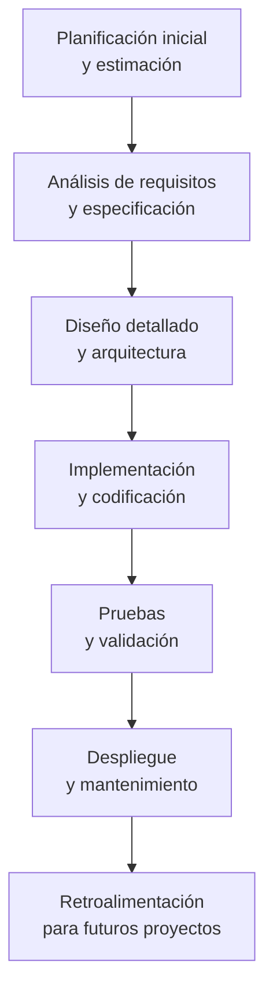

# Ingeniería de Software - Procesos de desarrollo de software

## 3.4 Métodos guiados por plan.

---

Los métodos guiados por plan, también conocidos como metodologías predictivas o plan-driven, representan enfoques de desarrollo de software donde el proceso se define completamente antes de iniciar el proyecto. Según Sommerville (2010), estos métodos se caracterizan por una planificación exhaustiva y documentación detallada, donde los requisitos se establecen al inicio y los cambios se gestionan mediante procesos formales de control de cambios.

### Definición

Los métodos guiados por plan son enfoques de desarrollo de software donde el proceso se define mediante planes detallados que especifican las actividades, artefactos, roles y cronogramas antes de iniciar el trabajo de desarrollo. Estos métodos enfatizan la previsibilidad, el control y la adherencia a planes establecidos.

### Características Principales

- **Planificación exhaustiva**: Todas las fases y actividades se planifican detalladamente al inicio
- **Documentación completa**: Generación extensa de documentación formal
- **Control de cambios formal**: Los requisitos cambian mediante procesos estructurados
- **Énfasis en predictibilidad**: El objetivo es seguir el plan establecido con mínimas desviaciones
- **Roles definidos**: Responsabilidades y roles claramente establecidos

### Ciclo de Vida de los Métodos Guiados por Plan



### Fases del Desarrollo Guiado por Plan

#### 1. Planificación y Estimación

- Definición del alcance del proyecto
- Estimación de esfuerzo, tiempo y costos
- Asignación de recursos
- Establecimiento de hitos y entregables

#### 2. Análisis de Requisitos

- Recopilación exhaustiva de requisitos
- Especificación formal de requisitos
- Validación y verificación de requisitos
- Creación del documento de especificación de requisitos

#### 3. Diseño del Sistema

- Diseño de arquitectura
- Diseño detallado de componentes
- Especificación de interfaces
- Diseño de base de datos

#### 4. Implementación

- Desarrollo según especificaciones de diseño
- Seguimiento de estándares de codificación
- Revisiones de código formales

#### 5. Pruebas

- Pruebas unitarias
- Pruebas de integración
- Pruebas del sistema
- Pruebas de aceptación

#### 6. Despliegue y Mantenimiento

- Implementación del sistema
- Soporte y mantenimiento
- Gestión de cambios post-implementación

### Modelos de Proceso Guiados por Plan

#### Modelo en Cascada

El paradigma original de los métodos guiados por plan, con fases secuenciales estrictas.

#### Modelo en V

Extensión del modelo en cascada que enfatiza la verificación y validación en cada fase.

#### Modelo Espiral

Iterativo pero con fuerte énfasis en análisis de riesgo y planificación.

### Fórmulas y Métricas de Estimación

#### Modelo COCOMO (Constructive Cost Model)

$$ E = a \times (KLOC)^b \times \prod_{i=1}^{n} EM_i $$

Donde:

- $E$ es el esfuerzo en persona-mes
- $KLOC$ es el tamaño estimado en miles de líneas de código
- $a$ y $b$ son constantes que dependen del tipo de proyecto
- $EM_i$ son los factores de ajuste de esfuerzo

#### Puntos de Función (Function Points)

$$ FP = \sum (Elementos \times Peso) \times [0.65 + (0.01 \times \sum F_i)] $$

Donde los elementos incluyen entradas, salidas, consultas, archivos e interfaces, y $F_i$ son factores de ajuste de complejidad.

#### Tiempo de Desarrollo Estimado

$$ TDEV = c \times (E)^d $$

Donde:

- $TDEV$ es el tiempo de desarrollo
- $E$ es el esfuerzo estimado
- $c$ y $d$ son constantes derivadas empíricamente

### Documentación en Métodos Guiados por Plan

#### Plan de Proyecto

Documento que define objetivos, alcance, cronograma, recursos, riesgos y métricas.

#### Especificación de Requisitos de Software (ERS)

Descripción detallada de lo que el sistema debe hacer.

#### Especificación de Diseño

Documentación de arquitectura y diseño detallado.

#### Plan de Pruebas

Estrategia, casos de prueba y criterios de aceptación.

#### Plan de Gestión de Configuración

Control de versiones, gestión de cambios y línea base.

### Ejemplo: Plan de Proyecto Simplificado

```
PROYECTO: Sistema de Gestión de Biblioteca

1. OBJETIVOS
   - Automatizar procesos de préstamo y devolución
   - Gestionar inventario de libros
   - Generar reportes estadísticos

2. ALCANCE
   - Módulos: Catalogación, Circulación, Usuarios, Reportes
   - Excluido: Sistema de compras y adquisiciones

3. CRONOGRAMA
   - Fase de análisis: 4 semanas
   - Fase de diseño: 6 semanas
   - Fase de implementación: 12 semanas
   - Fase de pruebas: 4 semanas
   - Despliegue: 2 semanas

4. RECURSOS
   - Equipo: 1 PM, 2 analistas, 4 desarrolladores, 2 testers
   - Presupuesto: $150,000

5. RIESGOS
   - Cambios en requisitos: Plan de gestión de cambios
   - Retrasos en entregas: Buffer de 15% en cronograma
```

### Ventajas y Desventajas

#### Ventajas

- Predictibilidad en costos y cronogramas
- Documentación completa facilita el mantenimiento
- Control estricto sobre el proceso
- Adecuado para proyectos con requisitos estables
- Cumplimiento regulatorio más fácil

#### Desventajas

- Poca flexibilidad ante cambios
- Largo tiempo para obtener software funcional
- Puede generar documentación excesiva
- Dificultad para adaptarse a requisitos cambiantes
- Menor involucramiento del cliente durante el desarrollo

### Ejercicios Propuestos

1. **Estimación con COCOMO**:
   - Un proyecto se estima en 45 KLOC y se clasifica como orgánico
   - Usando a=2.4, b=1.05, c=2.5, d=0.38
   - Calcula el esfuerzo necesario en persona-mes
   - Calcula el tiempo de desarrollo estimado
   - Si el equipo tiene 6 desarrolladores, ¿cuánto tiempo tomaría el proyecto?

2. **Análisis de Viabilidad**:
   - Para un sistema de reservas de hotel, identifica los documentos necesarios en un enfoque guiado por plan
   - Estima el esfuerzo de documentación como porcentaje del esfuerzo total

3. **Gestión de Cambios**:
   - Diseña un proceso formal de control de cambios para un proyecto guiado por plan
   - Define los roles, formularios y flujos de aprobación necesarios

4. **Comparativa de Métodos**:
   - Compara los métodos guiados por plan con los ágiles
   - Identifica para qué tipos de proyecto es más adecuado cada enfoque

### Casos de Estudio Aplicables

#### Sistemas Críticos

Proyectos donde la seguridad, confiabilidad y cumplimiento son prioritarios:

- Sistemas médicos
- Control de tráfico aéreo
- Sistemas bancarios
- Software de defensa

#### Proyectos con Requisitos Estables

Cuando los requisitos son bien entendidos y es improbable que cambien:

- Migración de sistemas legacy
- Implementación de estándares industriales
- Proyectos con regulaciones estrictas

#### Grandes Proyectos con Múltiples Equipos

Cuando la coordinación entre múltiples equipos requiere planificación detallada:

- Desarrollo de sistemas empresariales
- Proyectos con subcontratistas múltiples
- Implementaciones globales

### Referencias

1. Sommerville, Ian. (2010). Software Engineering (9th edition). Addison Wesley. (Capítulo 2: Software Processes)
2. Pfleeger, S. L., & Atlee, J. M. (2010). Software Engineering: Theory and Practice (4th edition). Prentice Hall. (Capítulo 3: Process Models)
3. Boehm, B. W. (1981). Software Engineering Economics. Prentice Hall.
4. Royce, W. W. (1970). Managing the Development of Large Software Systems. Proceedings of IEEE WESCON.
5. Pressman, R. S. (2010). Software Engineering: A Practitioner's Approach. McGraw-Hill.

### Conclusión

Los métodos guiados por plan representan un enfoque estructurado y disciplinado para el desarrollo de software, particularmente adecuado para proyectos con requisitos estables, alto grado de criticidad y necesidad de predictibilidad. Aunque han sido criticados por su rigidez en contraste con métodos ágiles, siguen siendo relevantes en contextos donde el control, la documentación completa y el cumplimiento de planes establecidos son prioritarios. La clave para el éxito con estos métodos reside en una planificación realista, gestión efectiva de riesgos y procesos bien definidos de control de cambios.
