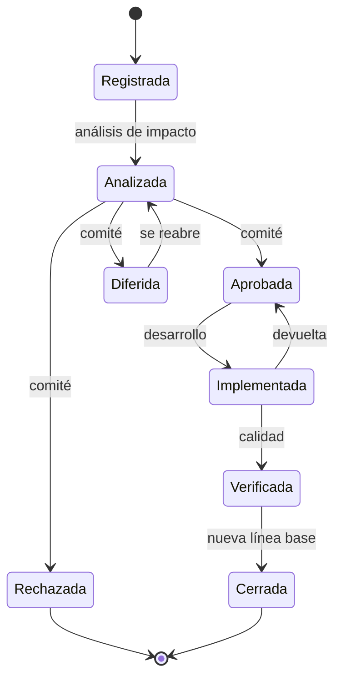

# Ingeniería de Software - Procesos de desarrollo de software

## 3.4 Métodos guiados por plan.

---

Un **método guiado por plan** decide por adelantado las actividades del proyecto, su secuencia, sus productos y sus recursos, y mide el avance contra ese plan. Sommerville lo define por oposición a los métodos ágiles: en un proceso guiado por plan, todas las actividades se planean antes y el avance se mide contra el plan; en uno ágil, la planeación es incremental y es más fácil cambiar el proceso según cambian los requerimientos. La cascada, el modelo en V, la espiral y el Proceso Unificado son guiados por plan en distintos grados. Este tema describe sus características, sus documentos, el control formal de los cambios, la estimación y los casos en que son la mejor opción.

### Características

- **Planeación inicial detallada:** alcance, calendario, presupuesto, recursos y riesgos se fijan antes de construir, con una estructura de desglose del trabajo y estimaciones (tema 3.6).
- **Fases con criterios de entrada y salida:** cada fase termina con una revisión formal y documentos aprobados que forman la **línea base**.
- **Documentación como medio de comunicación:** entre fases, entre equipos y con el cliente, en lugar de la conversación directa.
- **Control formal de los cambios:** un cambio a la línea base pasa por un análisis de impacto y una decisión explícita.
- **Medición del avance contra el plan**, por ejemplo con valor ganado (tema 1.3).
- **Roles especializados:** analistas, arquitectos, programadores, probadores, gestores de configuración y de calidad.

### Documentos

Los estándares de IEEE definen la estructura de los documentos principales:

| Documento                                   | Estándar de referencia      | Contenido                                                |
| ------------------------------------------- | --------------------------- | -------------------------------------------------------- |
| Plan de gestión del proyecto                | IEEE 16326                  | Alcance, organización, calendario, presupuesto, riesgos  |
| Especificación de requerimientos (SRS)      | ISO/IEC/IEEE 29148          | Requerimientos funcionales, no funcionales e interfaces  |
| Descripción de la arquitectura              | ISO/IEC/IEEE 42010          | Vistas, decisiones y razones                             |
| Plan, diseño y casos de prueba              | ISO/IEC/IEEE 29119-3        | Alcance de la prueba, casos y criterios de aceptación    |
| Plan de gestión de la configuración         | IEEE 828                    | Elementos controlados, líneas base, control de cambios   |

La documentación cuesta. Capers Jones encontró que en los grandes proyectos militares de Estados Unidos producir papel podía costar más que escribir el código. La pregunta útil no es si documentar, sino qué documentos tendrán un lector y cuánto detalle necesita.

### Control de cambios

Un cambio a la línea base sigue un proceso: se **registra** una solicitud; un analista **analiza su impacto**, es decir, los requerimientos, diseños, módulos y pruebas que afecta, su esfuerzo y su riesgo; un **comité de control de cambios** (CCB), con representantes del cliente, de la gestión y del área técnica, lo aprueba, lo rechaza o lo difiere; se implementa, se verifica y la gestión de la configuración actualiza la línea base. El proceso no busca impedir los cambios, sino que cada uno se decida con su costo a la vista y quede registrado.



### Cuándo conviene

Los métodos guiados por plan son la mejor opción cuando:

- el sistema es **crítico**, con consecuencias graves de una falla, y una norma exige evidencia de cada fase, como en aviación, transporte ferroviario, energía nuclear o dispositivos médicos;
- el proyecto es **grande**, con muchos equipos, a menudo de varias empresas, que necesitan interfaces y acuerdos escritos;
- el contrato fija el **alcance y el precio**, como en muchas licitaciones públicas;
- los requerimientos son **estables**, porque el sistema reemplaza uno existente o implementa una regulación.

Fuera de esos casos, el costo de planear y documentar todo por adelantado suele superar su beneficio, porque buena parte del plan se vuelve obsoleta al cambiar los requerimientos.

### Implementación en Python

El programa resuelve el ejercicio 1 con COCOMO orgánico. Para el ejercicio 2 desglosa el esfuerzo de documentación con porcentajes supuestos para cada documento. Para el ejercicio 3 implementa el proceso de control de cambios como una máquina de estados, en la que cada acción solo es válida en ciertos estados y para un rol, y el análisis de impacto exige sus datos.

```python
from dataclasses import dataclass, field

# ---------- Ejercicio 1: COCOMO orgánico, 45 KLOC ----------
a, b, c, d, kloc = 2.4, 1.05, 2.5, 0.38, 45
E = a * kloc ** b; T = c * E ** d
print(f"ejercicio 1: E = {E:.1f} persona-mes | T = {T:.1f} meses | personal medio {E / T:.1f}"
      f" | con 6 desarrolladores: {E / 6:.1f} meses ({E / 6 / T:.2f} veces el nominal)")

# ---------- Ejercicio 2: esfuerzo de documentación ----------
docs = {"plan del proyecto": 0.015, "especificación de requerimientos (SRS)": 0.04, "documento de arquitectura y diseño": 0.04,
        "plan y casos de prueba": 0.03, "plan de gestión de la configuración": 0.005, "manuales de usuario y operación": 0.025,
        "informes de revisión y de avance": 0.02}
print(f"ejercicio 2: documentación ≈ {sum(docs.values()):.1%} del esfuerzo, {sum(docs.values()) * E:.1f} persona-mes de {E:.1f}")
for nombre, f in docs.items(): print(f"   {nombre:40} {f:5.1%}  {f * E:4.1f} PM")

# ---------- Ejercicio 3: control formal de cambios ----------
TRANSICIONES = {          # estado: {acción: (rol autorizado, estado siguiente)}
    "registrada":   {"analiza": ("analista", "analizada")},
    "analizada":    {"aprueba": ("comité", "aprobada"), "rechaza": ("comité", "rechazada"), "difiere": ("comité", "diferida")},
    "diferida":     {"reabre": ("comité", "analizada")},
    "aprobada":     {"implementa": ("desarrollo", "implementada")},
    "implementada": {"verifica": ("calidad", "verificada"), "devuelve": ("calidad", "aprobada")},
    "verificada":   {"cierra": ("gestor de configuración", "cerrada")},
}
@dataclass
class SolicitudCambio:
    id: str; descripcion: str; solicitante: str
    estado: str = "registrada"; impacto: dict = field(default_factory=dict); historial: list = field(default_factory=list)
    def actua(self, accion, rol, **datos):
        opciones = TRANSICIONES.get(self.estado, {})
        if accion not in opciones: raise ValueError(f"{self.id}: '{accion}' no es válida en estado '{self.estado}'")
        autorizado, siguiente = opciones[accion]
        if rol != autorizado: raise PermissionError(f"{self.id}: '{accion}' la hace el rol '{autorizado}', no '{rol}'")
        if accion == "analiza":
            faltan = {"esfuerzo_pm", "artefactos", "riesgo"} - datos.keys()
            if faltan: raise ValueError(f"{self.id}: el análisis de impacto requiere {sorted(faltan)}")
            self.impacto = datos
        self.historial.append((self.estado, accion, rol)); self.estado = siguiente; return self
sc = SolicitudCambio("SC-017", "Agregar pago con transferencia", "gerente de recepción")
sc.actua("analiza", "analista", esfuerzo_pm=1.5, artefactos=["SRS 3.4", "diseño 5.2", "módulo pagos", "casos CP-40..CP-46"], riesgo="medio")
sc.actua("aprueba", "comité").actua("implementa", "desarrollo").actua("devuelve", "calidad")
sc.actua("implementa", "desarrollo").actua("verifica", "calidad").actua("cierra", "gestor de configuración")
print("ejercicio 3:", sc.id, "→", sc.estado, "| impacto:", sc.impacto)
print("   historial:", " → ".join(f"{a} ({r})" for _, a, r in sc.historial))
otra = SolicitudCambio("SC-018", "Cambiar colores", "usuario")
for accion, rol, datos in (("aprueba", "comité", {}), ("analiza", "desarrollo", {}), ("analiza", "analista", {"esfuerzo_pm": 0.1})):
    try: otra.actua(accion, rol, **datos)
    except (ValueError, PermissionError) as e: print("   rechazado:", e)
```

Salida:

```text
ejercicio 1: E = 130.6 persona-mes | T = 15.9 meses | personal medio 8.2 | con 6 desarrolladores: 21.8 meses (1.37 veces el nominal)
ejercicio 2: documentación ≈ 17.5% del esfuerzo, 22.9 persona-mes de 130.6
   plan del proyecto                         1.5%   2.0 PM
   especificación de requerimientos (SRS)    4.0%   5.2 PM
   documento de arquitectura y diseño        4.0%   5.2 PM
   plan y casos de prueba                    3.0%   3.9 PM
   plan de gestión de la configuración       0.5%   0.7 PM
   manuales de usuario y operación           2.5%   3.3 PM
   informes de revisión y de avance          2.0%   2.6 PM
ejercicio 3: SC-017 → cerrada | impacto: {'esfuerzo_pm': 1.5, 'artefactos': ['SRS 3.4', 'diseño 5.2', 'módulo pagos', 'casos CP-40..CP-46'], 'riesgo': 'medio'}
   historial: analiza (analista) → aprueba (comité) → implementa (desarrollo) → devuelve (calidad) → implementa (desarrollo) → verifica (calidad) → cierra (gestor de configuración)
   rechazado: SC-018: 'aprueba' no es válida en estado 'registrada'
   rechazado: SC-018: 'analiza' la hace el rol 'analista', no 'desarrollo'
   rechazado: SC-018: el análisis de impacto requiere ['artefactos', 'riesgo']
```

### Ejercicios Propuestos

1. **COCOMO.** Un proyecto orgánico se estima en 45 KLOC. Con $a = 2.4,$ $b = 1.05,$ $c = 2.5$ y $d = 0.38,$ calcula el esfuerzo, el tiempo de desarrollo y el tiempo con un equipo de 6 desarrolladores.

2. **Documentación.** Para un sistema de reservas de hotel desarrollado con un método guiado por plan, identifica los documentos necesarios y estima su esfuerzo como porcentaje del total.

3. **Control de cambios.** Diseña un proceso formal de control de cambios, con sus roles, formularios y flujos de aprobación.

4. **Comparación.** Compara los métodos guiados por plan con los ágiles e identifica para qué proyectos conviene cada uno.

### Soluciones

**Ejercicio 1.** $E = 2.4 \cdot 45^{1.05} \approx 130.6$ persona-meses y $T = 2.5 \cdot 130.6^{0.38} \approx 15.9$ meses, con 8.2 personas en promedio. Con 6 desarrolladores, el plazo sería de $130.6 / 6 \approx 21.8$ meses, 1.37 veces el nominal, suponiendo que el esfuerzo total no cambia al reducir el equipo. Con un equipo fijo, COCOMO supone además que esas 6 personas cubren todas las actividades, incluidas la gestión, los requerimientos y las pruebas, no solo la programación.

**Ejercicio 2.** Los documentos necesarios son los de la tabla de la sección de documentos, más los manuales de usuario y de operación y los informes de revisión y avance. Con porcentajes supuestos, típicos de un proyecto mediano no regulado, la documentación ronda el 17.5 % del esfuerzo, unos 23 de los 131 persona-meses de un sistema de 45 KLOC. Los porcentajes del programa no son datos medidos: dependen de la organización, del detalle exigido y de la regulación, y en un sistema crítico pueden duplicarse. Para reducirlos sin perder control, los documentos se generan donde se pueda, como la documentación de la API desde el código o la matriz de trazabilidad desde la herramienta de requerimientos.

**Ejercicio 3.**

- **Roles:** el **solicitante**, cualquiera; el **analista**, que evalúa el impacto; el **comité de control de cambios**, que decide; **desarrollo**, que implementa; **calidad**, que verifica, y el **gestor de configuración**, que actualiza la línea base.
- **Formulario de solicitud:** identificador, descripción, justificación, solicitante, urgencia, y la sección de impacto: artefactos afectados, esfuerzo estimado, efecto en el calendario y riesgo.
- **Flujo:** el del diagrama de estados. Los cambios urgentes, como una corrección de seguridad, pueden tener un flujo rápido con aprobación de un subconjunto del comité, registrado igual.

El programa implementa el flujo como una máquina de estados con dos reglas: cada acción solo es válida en ciertos estados, y solo la puede hacer un rol. Así rechaza aprobar una solicitud que no se ha analizado, o que desarrollo haga el análisis, y exige los datos del análisis de impacto. La solicitud SC-017 recorre el flujo completo, incluida una devolución de calidad a desarrollo.

**Ejercicio 4.**

| Aspecto            | Guiados por plan                                  | Ágiles                                             |
| ------------------ | ------------------------------------------------- | -------------------------------------------------- |
| Planeación         | Completa al inicio                                | Continua, por iteración                            |
| Requerimientos     | Fijados en una línea base                         | Se descubren y priorizan en cada iteración         |
| Comunicación       | Documentos                                        | Conversación y software funcionando                |
| Cambios            | Proceso formal con comité                         | Se incorporan a la lista de pendientes             |
| Medición           | Avance contra el plan                             | Software terminado y velocidad                     |
| Mejor para         | Sistemas críticos, regulados, grandes, de alcance fijo | Productos con incertidumbre, equipos pequeños, mercados cambiantes |

Los dos extremos rara vez se usan puros: un sistema regulado puede usar iteraciones internas y pruebas automatizadas, y un producto ágil grande necesita una arquitectura y una hoja de ruta planeadas. La tabla de Boehm y Turner del tema 1.4 da los criterios para decidir dónde ubicarse.

### Referencias

1. Sommerville, I., _Software Engineering_. Pearson, 2016. Capítulos 2 y 23.
2. Boehm, B. W., and Turner, R., _Balancing Agility and Discipline_. Addison-Wesley, 2003.
3. Jones, C., _Software Assessments, Benchmarks, and Best Practices_. Addison-Wesley, 2000.
4. ISO/IEC/IEEE 29148:2018, _Systems and software engineering: Life cycle processes, Requirements engineering_.
5. IEEE 828-2012, _Standard for Configuration Management in Systems and Software Engineering_.
