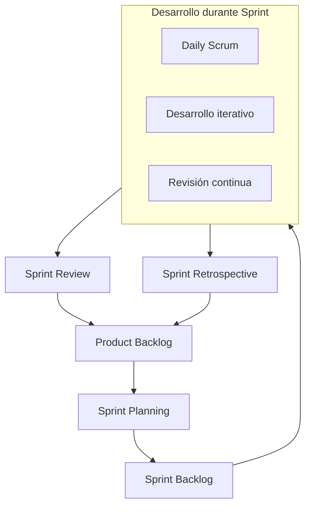

# Ingeniería de Software - Procesos de desarrollo de software

## 3.5 Metodologías ágiles.

---

Las metodologías ágiles representan un enfoque iterativo e incremental para el desarrollo de software que surgió como respuesta a las limitaciones de los métodos tradicionales guiados por plan. Según el Manifiesto Ágil (2001), estos métodos valoran más "a los individuos y su interacción que a los procesos y las herramientas", "el software funcionando que la documentación exhaustiva", "la colaboración con el cliente que la negociación contractual" y "la respuesta al cambio que el seguimiento de un plan".

### Definición

Las metodologías ágiles son un conjunto de prácticas y frameworks de desarrollo de software basados en los principios del Manifiesto Ágil. Estos métodos promueven desarrollos adaptativos, entrega temprana y continua, y mejoran la capacidad de respuesta a los cambios en los requisitos.

### Principios del Manifiesto Ágil

1. La prioridad es satisfacer al cliente mediante entrega temprana y continua de software valioso
2. Dar la bienvenida a los cambios de requisitos, incluso tarde en el desarrollo
3. Entregar software funcionando frecuentemente (entre dos semanas y dos meses)
4. La gente de negocio y los desarrolladores trabajan juntos diariamente
5. Proyectos construidos alrededor de individuos motivados
6. La conversación cara a cara es la forma más eficiente de comunicación
7. El software funcionando es la medida principal de progreso
8. Los procesos ágiles promueven el desarrollo sostenible
9. La atención continua a la excelencia técnica y buen diseño
10. La simplicidad como arte de maximizar el trabajo no realizado
11. Las mejores arquitecturas, requisitos y diseños emergen de equipos auto-organizados
12. El equipo reflexiona sobre cómo ser más efectivo a intervalos regulares

### Frameworks Ágiles Principales

#### Scrum

Framework iterativo e incremental para gestionar el desarrollo de productos complejos.

#### Kanban

Sistema de gestión visual del trabajo que limita el trabajo en progreso.

#### Extreme Programming (XP)

Metodología que enfatiza la retroalimentación, el proceso iterativo y la calidad del código.

#### Feature-Driven Development (FDD)

Enfoque centrado en el diseño y construcción de características.

### Scrum en Detalle



#### Roles en Scrum

- **Product Owner**: Representa los stakeholders y maximiza el valor del producto
- **Scrum Master**: Facilita el proceso y elimina impedimentos
- **Development Team**: Equipo auto-organizado que desarrolla el producto

#### Artefactos en Scrum

- **Product Backlog**: Lista priorizada de todo lo que se necesita en el producto
- **Sprint Backlog**: Conjunto de elementos del Product Backlog seleccionados para el Sprint
- **Increment**: Suma de todos los elementos completados durante el Sprint

#### Eventos en Scrum

- **Sprint Planning**: Planificación del trabajo para el Sprint
- **Daily Scrum**: Reunión diaria de 15 minutos para sincronización
- **Sprint Review**: Inspección del incremento y adaptación del Product Backlog
- **Sprint Retrospective**: Mejora continua del proceso

### Extreme Programming (XP)

#### Prácticas Técnicas de XP

- **Pair Programming**: Dos programadores trabajando juntos en una misma estación
- **Test-Driven Development (TDD)**: Escribir pruebas antes del código
- **Continuous Integration**: Integrar código frecuentemente
- **Refactoring**: Mejorar el diseño del código existente
- **Simple Design**: El diseño más simple que funciona

#### Ejemplo de TDD (Test-Driven Development)

```python
# Primer paso: Escribir una prueba fallida
def test_suma():
    assert suma(2, 3) == 5

# Segundo paso: Implementar el mínimo código para pasar la prueba
def suma(a, b):
    return a + b

# Tercer paso: Refactorizar si es necesario
```

### Métricas y Fórmulas en Métodos Ágiles

#### Velocity (Velocidad del Equipo)

Medida de la cantidad de trabajo que un equipo puede completar durante un sprint:

$$ V = \sum_{i=1}^{n} P_i $$

Donde:

- $V$ es la velocidad
- $P_i$ son los puntos de historia completados para cada ítem $i$
- $n$ es el número de ítems completados

#### Burn-down Chart

Gráfico que muestra el trabajo restante versus tiempo:

$$ Trabajo\ Restante_t = Trabajo\ Total - \sum_{i=1}^{t} Trabajo\ Completado_i $$

#### Capacity (Capacidad del Equipo)

Estimación de la cantidad de trabajo que un equipo puede realizar en un sprint:

$$ C = H \times D \times E $$

Donde:

- $C$ es la capacidad
- $H$ son las horas disponibles por persona
- $D$ es el número de desarrolladores
- $E$ es el factor de eficiencia (usualmente 0.6-0.8)

### Kanban y Gestión Visual

#### Principios de Kanban

- Visualizar el flujo de trabajo
- Limitar el trabajo en progreso (WIP)
- Gestionar el flujo
- Hacer políticas explícitas
- Mejorar colaborativamente

#### Ejemplo de Tablero Kanban

```
| POR HACER       | EN PROGRESO (WIP: 3) | REVISIÓN     | HECHO         |
|-----------------|----------------------|--------------|---------------|
| • Funcionalidad | • Login usuario      | • API datos  | • Diseño UI   |
| • Reporte PDF   | • Panel dashboard    |              | • Base datos  |
| • Notificaciones| • Configuración      |              |               |
```

### Ventajas y Desventajas

#### Ventajas

- Mayor adaptabilidad a cambios
- Entregas tempranas y frecuentes
- Mejor alineación con necesidades del cliente
- Mayor transparencia y visibilidad
- Mejora continua del proceso

#### Desventajas

- Puede ser difícil de escalar en grandes organizaciones
- Menor documentación puede ser problemática
- Requiere clientes comprometidos y disponibles
- Puede haber falta de énfasis en diseño arquitectónico
- No es adecuado para todos los tipos de proyectos

### Ejercicios Propuestos

1. **Planificación de Sprint**:
   - Dado un Product Backlog con 10 user stories con puntos: [3, 5, 8, 2, 13, 1, 3, 8, 5, 2]
   - La velocidad histórica del equipo es 20 puntos por sprint
   - Selecciona qué user stories incluirías en el próximo sprint
   - Justifica tu selección basado en prioridad y dependencias

2. **Cálculo de Métricas**:
   - Un equipo de 5 desarrolladores trabaja 6 horas diarias de desarrollo
   - El sprint es de 2 semanas (10 días hábiles)
   - El factor de eficiencia es 0.7
   - Calcula la capacidad del equipo en horas
   - Si la velocidad promedio es 25 puntos, ¿cuál es la relación puntos/hora?

3. **Diseño de Tablero Kanban**:
   - Diseña un tablero Kanban para un equipo de desarrollo móvil
   - Define las columnas, límites WIP y políticas explícitas
   - Incluye al menos 10 tarjetas distribuidas en el tablero

4. **Caso de Estudio**:
   - Analiza un proyecto tradicional que podría beneficiarse de métodos ágiles
   - Identifica los desafíos de migración y propón un plan de transición
   - Define los primeros 3 sprints con objetivos concretos

### Implementación de Métodos Ágiles

#### Roadmap de Implementación

1. Evaluación de la preparación organizacional
2. Selección del framework ágil apropiado
3. Formación y coaching del equipo
4. Implementación piloto en un proyecto
5. Retroalimentación y ajustes
6. Expansión gradual a otros proyectos

#### Barreras Comunes y Soluciones

- **Resistencia al cambio**: Comunicación clara de beneficios y participación temprana
- **Falta de compromiso ejecutivo**: Educación sobre ROI y beneficios empresariales
- **Clientes no disponibles**: Definición de roles claros y compromisos formales
- **Equipos distribuidos**: Herramientas de colaboración y comunicación estructurada

### Referencias

1. Sommerville, Ian. (2010). Software Engineering (9th edition). Addison Wesley. (Capítulo 3: Agile Software Development)
2. Pfleeger, S. L., & Atlee, J. M. (2010). Software Engineering: Theory and Practice (4th edition). Prentice Hall. (Capítulo 4: Agile Processes)
3. Beck, K. (2000). Extreme Programming Explained: Embrace Change. Addison-Wesley.
4. Schwaber, K., & Sutherland, J. (2017). The Scrum Guide. Scrum.org.
5. Cockburn, A. (2004). Crystal Clear: A Human-Powered Methodology for Small Teams. Addison-Wesley.
6. Anderson, D. J. (2010). Kanban: Successful Evolutionary Change for Your Technology Business. Blue Hole Press.

### Recursos Adicionales

- [Manifiesto Ágil](https://agilemanifesto.org/)
- [Scrum Guides](https://scrumguides.org/)
- [Atlassian Agile Tutorials](https://www.atlassian.com/agile)
- [Agile Alliance](https://www.agilealliance.org/)

### Conclusión

Las metodologías ágiles representan un cambio paradigmático en el desarrollo de software, enfocándose en la adaptabilidad, la colaboración y la entrega continua de valor. Aunque no son adecuadas para todos los contextos, han demostrado ser altamente efectivas en entornos con requisitos cambiantes y necesidad de rápida adaptación al mercado. El éxito de la implementación ágil depende no solo de la adopción de prácticas específicas, sino también de un cambio cultural hacia la colaboración, la transparencia y la mejora continua.
