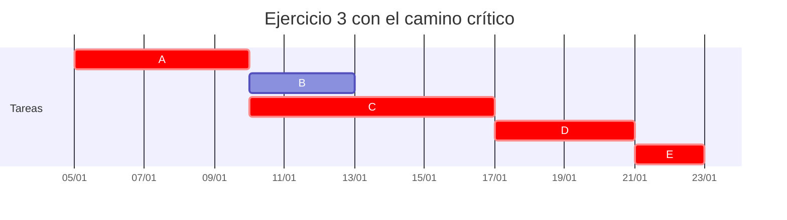

# Ingeniería de Software - Procesos de desarrollo de software

## 3.6 Técnicas y herramientas de planeación.

---

**Planear** un proyecto es decidir qué se va a hacer, cuánto costará, cuánto tardará, quién lo hará y qué puede salir mal, con información incompleta. Un plan de software no es una predicción exacta: es una base para tomar decisiones y para detectar pronto cuándo la realidad se aparta de lo previsto. Este tema presenta el proceso de planeación, las técnicas de estimación del tamaño y del esfuerzo, las de programación en el tiempo, como el camino crítico y PERT, y la gestión de riesgos.

### Proceso

1. **Definir el alcance** y descomponerlo en una **estructura de desglose del trabajo** (EDT): una jerarquía de entregables y actividades hasta paquetes de trabajo estimables, típicamente de una a dos semanas.
2. **Estimar** el tamaño, el esfuerzo y la duración de cada paquete.
3. **Secuenciar** las actividades según sus dependencias y **programarlas** en el calendario, con los recursos disponibles.
4. **Identificar y analizar los riesgos**, y reservar contingencia.
5. **Establecer la línea base** y **dar seguimiento**: comparar el avance real con el plan y replanear cuando la diferencia lo justifique.

### Estimación

- **Por analogía:** con proyectos anteriores parecidos, ajustados por las diferencias. Es la más rápida y, con datos históricos buenos, de las más precisas.
- **Por descomposición:** se estima cada paquete de la EDT y se suma; es mejor que estimar el todo, siempre que se incluyan la integración, la gestión y las pruebas.
- **Juicio de expertos estructurado:** como la técnica **Delphi de banda ancha**, en la que varios expertos estiman por separado, discuten sus diferencias y vuelven a estimar, o el **planning poker** de los equipos ágiles.
- **Modelos paramétricos:** fórmulas calibradas con datos, como COCOMO, que estima el esfuerzo desde el tamaño (tema 1.4), y los **puntos de función** de Albrecht, que miden el tamaño desde la funcionalidad.

Los **puntos de función** cuentan cinco tipos de elementos, cada uno con un peso según su complejidad: entradas externas, salidas externas, consultas externas, archivos lógicos internos y archivos de interfaz externos. Con complejidad media, los pesos de IFPUG son 4, 5, 4, 10 y 7. La suma ponderada son los **puntos de función sin ajustar**, y el **factor de ajuste**, $\mathrm{VAF} = 0.65 + 0.01 \cdot \mathrm{TDI},$ los multiplica, con $\mathrm{TDI}$ la suma de 14 características generales del sistema calificadas de 0 a 5. El factor va de 0.65 a 1.35. La norma ISO/IEC 20926:2009, que estandariza el método de IFPUG, solo incluye los puntos sin ajustar, y desde la versión 4.3 del manual de IFPUG el ajuste es opcional.

Boehm observó que, al inicio de un proyecto, las estimaciones pueden equivocarse por un factor de cuatro en cualquier sentido, y que la incertidumbre se reduce conforme avanza el proyecto: es el **cono de incertidumbre**. Una estimación responsable es un **rango** con una probabilidad, no un número.

### Programación

El **diagrama de Gantt** muestra las actividades como barras sobre el calendario, con sus dependencias. El **método del camino crítico** (CPM) calcula, con las duraciones y las dependencias, para cada actividad:

- el inicio y el fin **tempranos**, $\mathrm{ES} = \max_{p} \mathrm{EF}_p$ sobre sus predecesoras y $\mathrm{EF} = \mathrm{ES} + d,$ con una pasada hacia adelante;
- el fin y el inicio **tardíos**, $\mathrm{LF} = \min_{s} \mathrm{LS}_s$ sobre sus sucesoras y $\mathrm{LS} = \mathrm{LF} - d,$ con una pasada hacia atrás desde el fin del proyecto;
- la **holgura**, $\mathrm{LS} - \mathrm{ES},$ cuánto puede retrasarse sin retrasar el proyecto.

El **camino crítico** es la cadena de actividades con holgura cero: su duración es la del proyecto, y cualquier retraso en él lo retrasa todo.

**PERT** agrega incertidumbre: cada actividad tiene una estimación optimista $o,$ una más probable $m$ y una pesimista $p,$ y su duración esperada es $(o + 4m + p)/6,$ con desviación estándar $(p - o)/6.$ Sumar las esperanzas del camino crítico subestima la duración, porque ignora que un camino no crítico puede volverse crítico por azar; una **simulación de Monte Carlo** de toda la red da la distribución real de la duración del proyecto.

### Riesgos

Cada riesgo se describe con su probabilidad $P$ y su impacto $I,$ y su valor esperado, $\mathrm{EV} = P \cdot I,$ permite ordenarlos. Las respuestas posibles son **evitar**, cambiando el plan para que el riesgo no exista; **mitigar**, reduciendo su probabilidad o su impacto; **transferir**, con un seguro o un contrato, y **aceptar**, reservando contingencia. La suma de los valores esperados es una referencia para la **reserva de contingencia** del presupuesto.



### Implementación en Python

El programa resuelve el ejercicio 1 con COCOMO semiacoplado, el ejercicio 2 con el conteo de puntos de función y su ajuste, y el ejercicio 3 con las dos pasadas del camino crítico; agrega a este una estimación PERT con duraciones de tres puntos supuestas y una simulación de Monte Carlo de la red. Para el ejercicio 4 ordena cinco riesgos de un proyecto móvil por su valor esperado.

```python
import random, statistics

# ---------- Ejercicio 1: COCOMO semiacoplado, 35 KLOC ----------
a, b, c, d, kloc = 3.0, 1.12, 2.5, 0.35, 35
E = a * kloc ** b; T = c * E ** d
print(f"ejercicio 1: E = {a}·{kloc}^{b} = {E:.1f} persona-mes | T = {c}·E^{d} = {T:.1f} meses | personal medio {E / T:.1f}")
print(f"   con 8 personas: {E / 8:.1f} meses = {E / 8 / T:.0%} del nominal; mínimo factible ≈ {0.75 * T:.1f} meses")

# ---------- Ejercicio 2: puntos de función ----------
conteo = {"entradas externas": (15, 4), "salidas externas": (8, 5), "consultas externas": (12, 4),
          "archivos lógicos internos": (5, 10), "archivos de interfaz externos": (3, 7)}
pfna = sum(n * w for n, w in conteo.values())
vaf = 0.75
for k, (n, w) in conteo.items(): print(f"   {k:30} {n:>2} × {w:>2} = {n * w:>3}")
print(f"ejercicio 2: PF sin ajustar = {pfna} | VAF = 0.65 + 0.01·TDI = {vaf} → TDI = {round((vaf - 0.65) / 0.01)} | PF ajustados = {pfna * vaf:.2f}")
print(f"   rango posible del ajuste: {pfna * 0.65:.2f} a {pfna * 1.35:.2f}")

# ---------- Ejercicio 3: camino crítico ----------
tareas = {"A": (5, []), "B": (3, ["A"]), "C": (7, ["A"]), "D": (4, ["B", "C"]), "E": (2, ["D"])}
ES, EF = {}, {}
for t, (dur, pre) in tareas.items():                    # las tareas ya están en orden topológico
    ES[t] = max((EF[p] for p in pre), default=0); EF[t] = ES[t] + dur
fin = max(EF.values())
suc = {t: [s for s, (_, pre) in tareas.items() if t in pre] for t in tareas}
LS, LF = {}, {}
for t in reversed(list(tareas)):
    LF[t] = min((LS[s] for s in suc[t]), default=fin); LS[t] = LF[t] - tareas[t][0]
print("ejercicio 3: tarea  dur  ES  EF  LS  LF  holgura")
for t in tareas: print(f"             {t}     {tareas[t][0]:>2}  {ES[t]:>2}  {EF[t]:>2}  {LS[t]:>2}  {LF[t]:>2}  {LS[t] - ES[t]:>3}")
print("   camino crítico:", " → ".join(t for t in tareas if LS[t] == ES[t]), "| duración:", fin, "días")
# PERT: estimaciones de tres puntos (optimista, más probable, pesimista) supuestas, y simulación
tres = {"A": (4, 5, 8), "B": (2, 3, 6), "C": (5, 7, 12), "D": (3, 4, 6), "E": (1, 2, 4)}
media = {t: (o + 4 * m + p) / 6 for t, (o, m, p) in tres.items()}
print("   PERT, duración esperada de cada tarea:", {t: round(v, 2) for t, v in media.items()},
      "| camino A-C-D-E:", round(sum(media[t] for t in "ACDE"), 2))
rng = random.Random(8)
def dura():
    x = {t: rng.triangular(o, p, m) for t, (o, m, p) in tres.items()}
    return x["A"] + max(x["B"], x["C"]) + x["D"] + x["E"]
muestras = sorted(dura() for _ in range(20_000))
print(f"   Monte Carlo: media {statistics.mean(muestras):.1f} días | P(≤ 18) = {sum(m <= 18 for m in muestras) / len(muestras):.0%}"
      f" | percentil 85: {muestras[int(0.85 * len(muestras))]:.1f} días")

# ---------- Ejercicio 4: riesgos de un proyecto móvil ----------
riesgos = [("rechazo en la tienda de aplicaciones", 0.30, 40_000, "revisar las guías antes de cada envío; beta en TestFlight"),
           ("fragmentación de dispositivos Android", 0.60, 25_000, "matriz de dispositivos y granja de pruebas en la nube"),
           ("cambio de la API del proveedor de pagos", 0.20, 70_000, "capa de adaptación y contrato con aviso previo"),
           ("salida de un desarrollador clave", 0.10, 80_000, "programación en pareja y documentación de decisiones"),
           ("desempeño insuficiente en equipos de gama baja", 0.45, 30_000, "presupuesto de desempeño y pruebas en gama baja desde el sprint 1")]
print("ejercicio 4:")
for n, p, i, m in sorted(riesgos, key=lambda r: -r[1] * r[2]):
    print(f"   {n:47} P = {p:.2f}  I = {i:>6,}  EV = {p * i:>7,.0f} | {m}")
print(f"   exposición total {sum(p * i for _, p, i, _ in riesgos):,.0f}: reserva de contingencia sugerida")
```

Salida:

```text
ejercicio 1: E = 3.0·35^1.12 = 160.9 persona-mes | T = 2.5·E^0.35 = 14.8 meses | personal medio 10.9
   con 8 personas: 20.1 meses = 136% del nominal; mínimo factible ≈ 11.1 meses
   entradas externas              15 ×  4 =  60
   salidas externas                8 ×  5 =  40
   consultas externas             12 ×  4 =  48
   archivos lógicos internos       5 × 10 =  50
   archivos de interfaz externos   3 ×  7 =  21
ejercicio 2: PF sin ajustar = 219 | VAF = 0.65 + 0.01·TDI = 0.75 → TDI = 10 | PF ajustados = 164.25
   rango posible del ajuste: 142.35 a 295.65
ejercicio 3: tarea  dur  ES  EF  LS  LF  holgura
             A      5   0   5   0   5    0
             B      3   5   8   9  12    4
             C      7   5  12   5  12    0
             D      4  12  16  12  16    0
             E      2  16  18  16  18    0
   camino crítico: A → C → D → E | duración: 18 días
   PERT, duración esperada de cada tarea: {'A': 5.33, 'B': 3.33, 'C': 7.5, 'D': 4.17, 'E': 2.17} | camino A-C-D-E: 19.17
   Monte Carlo: media 20.3 días | P(≤ 18) = 11% | percentil 85: 22.4 días
ejercicio 4:
   fragmentación de dispositivos Android           P = 0.60  I = 25,000  EV =  15,000 | matriz de dispositivos y granja de pruebas en la nube
   cambio de la API del proveedor de pagos         P = 0.20  I = 70,000  EV =  14,000 | capa de adaptación y contrato con aviso previo
   desempeño insuficiente en equipos de gama baja  P = 0.45  I = 30,000  EV =  13,500 | presupuesto de desempeño y pruebas en gama baja desde el sprint 1
   rechazo en la tienda de aplicaciones            P = 0.30  I = 40,000  EV =  12,000 | revisar las guías antes de cada envío; beta en TestFlight
   salida de un desarrollador clave                P = 0.10  I = 80,000  EV =   8,000 | programación en pareja y documentación de decisiones
   exposición total 62,500: reserva de contingencia sugerida
```

### Ejercicios Propuestos

1. **COCOMO.** Un proyecto semiacoplado se estima en 35 KLOC. Calcula el esfuerzo y el tiempo de desarrollo. ¿Es viable el tiempo estimado con un equipo de 8 desarrolladores?

2. **Puntos de función.** Un sistema tiene 15 entradas externas de peso 4, 8 salidas externas de peso 5, 12 consultas de peso 4, 5 archivos lógicos de peso 10 y 3 interfaces de peso 7, con un factor de ajuste de 0.75. Calcula los puntos de función ajustados.

3. **Camino crítico.** Para las tareas A, de 5 días, sin predecesoras; B, de 3 días, después de A; C, de 7 días, después de A; D, de 4 días, después de B y C, y E, de 2 días, después de D, calcula ES, EF, LS y LF, el camino crítico y la duración del proyecto.

4. **Riesgos.** Identifica 5 riesgos de un proyecto de desarrollo móvil, asígnales probabilidad e impacto, calcula su valor esperado y propón estrategias de mitigación.

### Soluciones

**Ejercicio 1.** Con las constantes del modo semiacoplado, $E = 3.0 \cdot 35^{1.12} \approx 160.9$ persona-meses y $T = 2.5 \cdot 160.9^{0.35} \approx 14.8$ meses, con un equipo medio de 10.9 personas. Con 8, el proyecto tardaría unos $160.9 / 8 \approx 20.1$ meses, el 136 % del plazo nominal. Es viable, pero no en 14.8 meses: si el plazo de 14.8 es un compromiso, hay que agregar personas al inicio, no a la mitad, o reducir el alcance. Comprimir por debajo de unos 11 meses no es factible a ningún costo, según COCOMO II.

**Ejercicio 2.** $\mathrm{PFNA} = 15 \cdot 4 + 8 \cdot 5 + 12 \cdot 4 + 5 \cdot 10 + 3 \cdot 7 = 60 + 40 + 48 + 50 + 21 = 219,$ y $\mathrm{PFA} = 219 \cdot 0.75 = 164.25.$ Un factor de 0.75 corresponde a una suma de características de 10 sobre 70, un sistema de complejidad general baja. Los pesos del enunciado son los de complejidad media para todos los elementos; un conteo real clasifica cada elemento como de complejidad baja, media o alta según los datos y archivos que referencia.

**Ejercicio 3.**

| Tarea | Duración | ES  | EF  | LS  | LF  | Holgura |
| ----- | -------- | --- | --- | --- | --- | ------- |
| A     | 5        | 0   | 5   | 0   | 5   | 0       |
| B     | 3        | 5   | 8   | 9   | 12  | 4       |
| C     | 7        | 5   | 12  | 5   | 12  | 0       |
| D     | 4        | 12  | 16  | 12  | 16  | 0       |
| E     | 2        | 16  | 18  | 16  | 18  | 0       |

En la pasada hacia adelante, D empieza cuando terminan B y C, en el máximo de 8 y 12, es decir, 12. En la pasada hacia atrás, B debe terminar a más tardar cuando D empieza, en 12, y puede empezar hasta el día 9: tiene 4 días de holgura. El camino crítico es $A \to C \to D \to E,$ y el proyecto dura **18 días**. Con estimaciones de tres puntos supuestas, PERT da 19.2 días para ese camino, y la simulación de Monte Carlo da una media de 20.3 días y solo un 11 % de probabilidad de terminar en 18. Hay dos razones para la diferencia: las distribuciones triangulares de la simulación tienen una media mayor que la fórmula de PERT, y en algunas muestras B se vuelve más larga que C y el camino crítico cambia. El plan del día 18 es optimista; con 85 % de confianza, el compromiso sería de unos 22 días.

**Ejercicio 4.**

| Riesgo                                           | P    | Impacto | EV      | Mitigación                                              |
| ------------------------------------------------ | ---- | ------- | ------- | ------------------------------------------------------- |
| Fragmentación de dispositivos Android            | 0.60 | 25 000  | 15 000  | Matriz de dispositivos y granja de pruebas en la nube   |
| Cambio de la API del proveedor de pagos          | 0.20 | 70 000  | 14 000  | Capa de adaptación y contrato con aviso previo          |
| Desempeño insuficiente en equipos de gama baja   | 0.45 | 30 000  | 13 500  | Presupuesto de desempeño y pruebas en gama baja         |
| Rechazo en la tienda de aplicaciones             | 0.30 | 40 000  | 12 000  | Revisar las guías antes de cada envío; versiones beta   |
| Salida de un desarrollador clave                 | 0.10 | 80 000  | 8 000   | Programación en pareja y documentación de decisiones    |

Las probabilidades e impactos son supuestos para el ejemplo. La exposición total, 62 500, es una referencia para la reserva de contingencia. El orden por valor esperado no es el único criterio: la salida de un desarrollador clave tiene el menor valor esperado, pero el mayor impacto, y si la organización no puede absorber una pérdida de 80 000, ese riesgo merece atención aunque sea improbable.

### Referencias

1. Project Management Institute, _A Guide to the Project Management Body of Knowledge (PMBOK Guide)_. PMI, 2021.
2. McConnell, S., _Software Estimation: Demystifying the Black Art_. Microsoft Press, 2006.
3. Albrecht, A. J., Measuring application development productivity. _Proceedings of the Joint SHARE/GUIDE/IBM Application Development Symposium_, 1979.
4. ISO/IEC 20926:2009, _Software and systems engineering: Software measurement, IFPUG functional size measurement method_.
5. Boehm, B. W., et al., _Software Cost Estimation with COCOMO II_. Prentice Hall, 2000.
6. Malcolm, D. G., Roseboom, J. H., Clark, C. E., and Fazar, W., Application of a technique for research and development program evaluation. _Operations Research_ 7(5), 1959.
