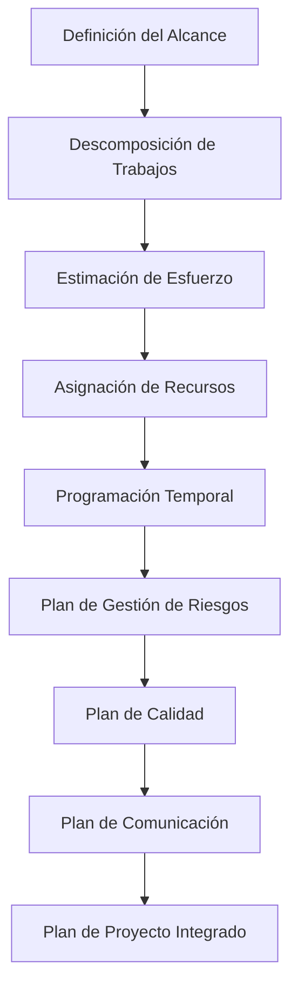
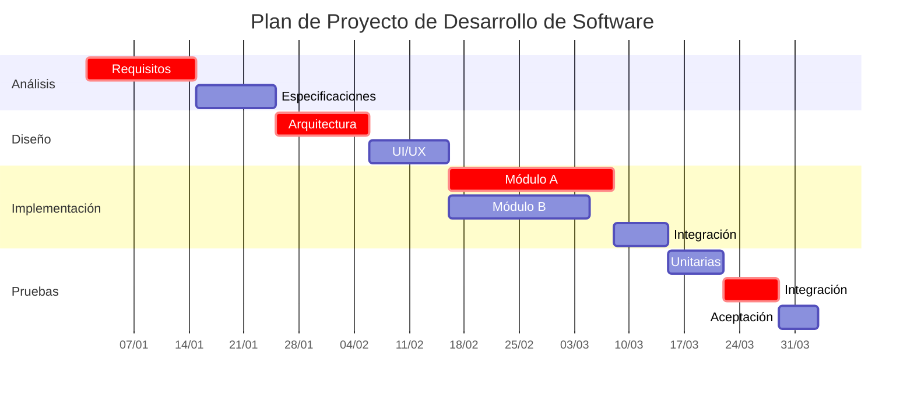
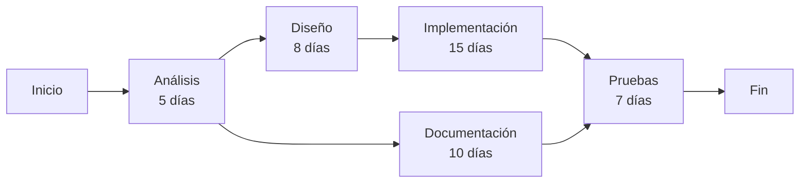

# Ingeniería de Software - Procesos de desarrollo de software

## 3.6 Técnicas y herramientas de planeación.

---

La planeación es una actividad crítica en el desarrollo de software que determina el éxito o fracaso de un proyecto. Según Sommerville (2010), la planeación efectiva implica la identificación de actividades, estimación de recursos, asignación de tareas y definición de cronogramas realistas. Esta guía cubre las principales técnicas y herramientas utilizadas en la planeación de proyectos de software.

### Definición

La planeación de software es el proceso de definir objetivos, determinar estrategias y desarrollar planes para coordinar y controlar las actividades necesarias para alcanzar estos objetivos. Incluye estimación de esfuerzo, asignación de recursos, programación temporal y gestión de riesgos.

### Proceso de Planeación



### Técnicas de Estimación

#### 1. Estimación por Analogía

Comparar el proyecto actual con proyectos similares completados anteriormente.

#### 2. Descomposición

Dividir el proyecto en componentes más pequeños y estimar cada uno por separado.

#### 3. Modelos Paramétricos

Usar fórmulas matemáticas basadas en parámetros del proyecto.

### Modelos de Estimación

#### Modelo COCOMO (Constructive Cost Model)

##### COCOMO Básico

$$ E = a \times (KLOC)^b $$
$$ D = c \times (E)^d $$

Donde:

- $E$ = Esfuerzo en persona-mes
- $D$ = Tiempo de desarrollo en meses
- $KLOC$ = Miles de líneas de código estimadas
- $a, b, c, d$ = Constantes que dependen del tipo de proyecto

##### Tipos de Proyecto COCOMO

- **Orgánico**: $a = 2.4$, $b = 1.05$, $c = 2.5$, $d = 0.38$
- **Semi-acoplado**: $a = 3.0$, $b = 1.12$, $c = 2.5$, $d = 0.35$
- **Empotrado**: $a = 3.6$, $b = 1.20$, $c = 2.5$, $d = 0.32$

#### Puntos de Función (Function Points)

$$ FP = \sum (Elementos \times Peso) \times [0.65 + (0.01 \times \sum F_i)] $$

Donde los elementos incluyen:

- Entradas externas
- Salidas externas
- Consultas externas
- Archivos lógicos internos
- Interfaces externas

### Herramientas de Planificación

#### Diagrama de Gantt

Herramienta visual para programación de actividades a lo largo del tiempo.

#### PERT (Program Evaluation and Review Technique)

Técnica para analizar las tareas involucradas en completar un proyecto.

#### CPM (Critical Path Method)

Método para identificar las tareas críticas que determinan la duración del proyecto.

### Ejemplo: Diagrama de Gantt con Mermaid



### Técnicas de Programación Temporal

#### Método del Camino Crítico (CPM)



#### Cálculo del Camino Crítico

Para cada tarea:

- **Tiempo temprano de inicio (ES)**: Máximo de los tiempos tempranos de finalización de las predecesoras
- **Tiempo temprano de finalización (EF)**: ES + duración
- **Tiempo tardío de finalización (LF)**: Mínimo de los tiempos tardíos de inicio de las sucesoras
- **Tiempo tardío de inicio (LS)**: LF - duración
- **Holgura**: LS - ES o LF - EF

### Gestión de Riesgos

#### Matriz de Probabilidad-Impacto

| Probabilidad | Impacto Alto | Impacto Medio | Impacto Bajo |
| ------------ | ------------ | ------------- | ------------ |
| Alta         | Riesgo Alto  | Riesgo Alto   | Riesgo Medio |
| Media        | Riesgo Alto  | Riesgo Medio  | Riesgo Bajo  |
| Baja         | Riesgo Medio | Riesgo Bajo   | Riesgo Bajo  |

#### Fórmula de Valor Esperado de Riesgo

$$ EVR = P \times I $$

Donde:

- $EVR$ = Valor esperado del riesgo
- $P$ = Probabilidad de ocurrencia (0-1)
- $I$ = Impacto económico o en tiempo

### Herramientas de Productividad

#### Velocidad en Métodos Ágiles

$$ V = \frac{\text{Puntos de Historia Completados}}{\text{Número de Sprints}} $$

#### Factor de Productividad

$$ FP = \frac{LDC}{Esfuerzo} $$

Donde:

- $FP$ = Factor de productividad (LDC/persona-mes)
- $LDC$ = Líneas de código entregadas

### Ejercicios Propuestos

1. **Estimación COCOMO**:
   - Un proyecto se estima en 35 KLOC y se clasifica como semi-acoplado
   - Calcula el esfuerzo necesario y el tiempo de desarrollo
   - Si el equipo tiene 8 desarrolladores, ¿es viable el tiempo estimado?

2. **Cálculo de Puntos de Función**:
   - Un sistema tiene: 15 entradas externas (peso 4), 8 salidas externas (peso 5), 12 consultas (peso 4), 5 archivos lógicos (peso 10), 3 interfaces (peso 7)
   - El factor de ajuste total es 0.75
   - Calcula los puntos de función ajustados

3. **Análisis del Camino Crítico**:
   Dadas las siguientes tareas:

   ```
   A: Duración 5 días, predecesoras: ninguna
   B: Duración 3 días, predecesoras: A
   C: Duración 7 días, predecesoras: A
   D: Duración 4 días, predecesoras: B, C
   E: Duración 2 días, predecesoras: D
   ```
   - Calcula ES, EF, LS, LF para cada tarea
   - Identifica el camino crítico y la duración total del proyecto

4. **Gestión de Riesgos**:
   - Identifica 5 riesgos potenciales para un proyecto de desarrollo móvil
   - Asigna probabilidad e impacto a cada riesgo
   - Calcula el valor esperado para cada riesgo
   - Propone estrategias de mitigación

### Herramientas Software de Planificación

#### Herramientas Comerciales

- Microsoft Project
- JIRA
- Asana
- Trello

#### Herramientas Open Source

- GanttProject
- ProjectLibre
- Taiga
- OpenProject

#### Características Deseables

- Diagramas de Gantt interactivos
- Gestión de recursos
- Seguimiento de progreso
- Gestión de riesgos
- Colaboración en equipo
- Reportes personalizados

### Plan de Comunicación

#### Matriz de Comunicación

| Stakeholder       | Información Requerida | Frecuencia | Canal              | Responsable |
| ----------------- | --------------------- | ---------- | ------------------ | ----------- |
| Cliente           | Progreso general      | Semanal    | Reunión presencial | PM          |
| Equipo desarrollo | Tareas detalladas     | Diario     | Daily stand-up     | Team Lead   |
| Patrocinador      | Estado financiero     | Mensual    | Reporte formal     | PM          |
| Usuarios finales  | Demos funcionales     | Trimestral | Sesión demo        | UX Lead     |

### Referencias

1. Sommerville, Ian. (2010). Software Engineering (9th edition). Addison Wesley. (Capítulo 5: Project Planning)
2. Pfleeger, S. L., & Atlee, J. M. (2010). Software Engineering: Theory and Practice (4th edition). Prentice Hall. (Capítulo 7: Planning and Managing the Project)
3. Boehm, B. W. (1981). Software Engineering Economics. Prentice Hall.
4. McConnell, S. (2006). Software Estimation: Demystifying the Black Art. Microsoft Press.
5. Project Management Institute. (2017). A Guide to the Project Management Body of Knowledge (PMBOK Guide).

### Plantilla de Plan de Proyecto

```markdown
# Plan de Proyecto: [Nombre del Proyecto]

### 1. Resumen Ejecutivo

[Descripción breve del proyecto, objetivos y alcance]

### 2. Estructura de Desglose de Trabajo (EDT)

[Descomposición jerárquica de todas las actividades]

### 3. Estimaciones de Esfuerzo y Costo

| Fase           | Esfuerzo (persona-mes) | Costo Estimado | Duración |
| -------------- | ---------------------- | -------------- | -------- |
| Análisis       |                        |                |          |
| Diseño         |                        |                |          |
| Implementación |                        |                |          |
| Pruebas        |                        |                |          |
| **Total**      |                        |                |          |

### 4. Cronograma

[Diagrama de Gantt con hitos principales]

### 5. Asignación de Recursos

[Roles, responsabilidades y asignación de personal]

### 6. Plan de Gestión de Riesgos

[Identificación, análisis y plan de mitigación de riesgos]

### 7. Plan de Comunicación

[Estrategias y frecuencia de comunicación con stakeholders]

### 8. Plan de Calidad

[Estándares, métricas y procesos de assurance de calidad]
```

### Conclusión

Las técnicas y herramientas de planeación son esenciales para el éxito de los proyectos de software. Una planificación efectiva permite una mejor asignación de recursos, identificación temprana de riesgos y establecimiento de expectativas realistas. La selección de las técnicas apropiadas depende del tamaño del proyecto, la metodología de desarrollo utilizada y el contexto organizacional. La planeación continua y el ajuste basado en métricas reales son clave para mantener el proyecto en curso y dentro del presupuesto.
