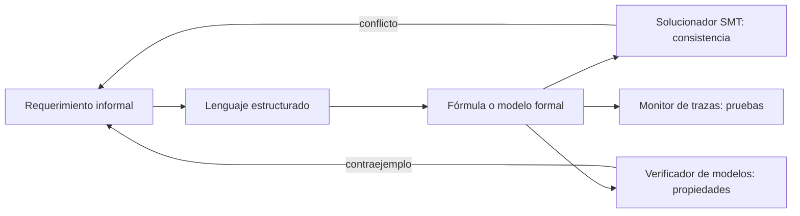

# Ingeniería de Software - Requerimientos y especificaciones

## 4.1 Beneficios de la formalización de requerimientos.

---

Un requerimiento escrito en lenguaje natural, como "el sistema debe responder rápidamente", puede leerse de muchas maneras, y cada lector, sea el cliente, el programador o el probador, elige la suya. **Formalizar** un requerimiento es escribirlo en una notación con un significado preciso, ya sea estructurada, como una plantilla o una tabla, o matemática, como la lógica o la teoría de conjuntos. Este tema describe qué se gana con la formalización, en qué grados se aplica, y muestra tres de sus beneficios concretos: detectar inconsistencias de forma automática, verificar una propiedad sobre todos los comportamientos de un modelo y comprobar trazas de ejecución contra una especificación temporal.

### Grados de formalización

- **Lenguaje natural estructurado:** plantillas con identificador, enunciado, justificación y criterio de aceptación, y vocabulario controlado; por ejemplo, la sintaxis EARS de Mavin, con patrones como "cuando ocurra *evento*, el *sistema* deberá *respuesta*".
- **Notaciones semiformales:** modelos con sintaxis precisa pero semántica parcialmente informal, como los casos de uso, los diagramas de estados de UML y las tablas de decisión (tema 4.5).
- **Métodos formales:** lenguajes con semántica matemática completa, como Z, B, VDM, Alloy, TLA+ o la lógica temporal, sobre los que se puede razonar con herramientas.

Cuanto más formal la notación, más se puede analizar automáticamente y más cuesta escribirla y leerla. La práctica habitual es formalizar matemáticamente solo las partes críticas, como un protocolo de concurrencia o una regla de seguridad, y usar lenguaje estructurado en el resto.

### Beneficios

- **Eliminar la ambigüedad:** "rápido" se convierte en "el percentil 95 del tiempo de respuesta es de a lo más 200 ms con 500 usuarios simultáneos". El simple hecho de formalizar obliga a hacer las preguntas que la versión informal permitía evitar: ¿medido dónde?, ¿con qué carga?, ¿qué pasa con el 5 % restante?
- **Detectar inconsistencias:** dos requerimientos que no pueden cumplirse a la vez. Con lógica, la inconsistencia es la **insatisfacibilidad** del conjunto de fórmulas, y un solucionador SAT o SMT, como Z3, la decide automáticamente en muchos casos.
- **Verificar:** demostrar que un diseño o un modelo cumple una propiedad, ya sea con una demostración asistida, o con **verificación de modelos** (*model checking*), que explora todos los estados de un modelo finito y devuelve un contraejemplo si la propiedad falla.
- **Derivar pruebas:** de una especificación formal se obtienen casos de prueba y **oráculos**, que deciden automáticamente si una ejecución es correcta.
- **Detectar errores pronto:** un defecto de requerimientos cuesta mucho más corregirlo en operación que en la especificación (tema 3.1), y la formalización lo encuentra antes de escribir código.

La evidencia industrial existe: Amazon Web Services usa TLA+ desde 2011 para diseñar sistemas distribuidos y ha encontrado errores sutiles en protocolos que ya habían pasado revisiones y pruebas extensas, como describen Newcombe y otros en 2015; Airbus, la industria ferroviaria con el método B y Microsoft, en los controladores de Windows, son otros casos documentados.

### Lógica temporal

Los requerimientos sobre el **comportamiento en el tiempo** se escriben en **lógica temporal lineal** (LTL), con los operadores $\mathbf{G}\,\varphi,$ que significa que $\varphi$ vale siempre; $\mathbf{F}\,\varphi,$ que vale alguna vez; $\mathbf{X}\,\varphi,$ que vale en el siguiente estado, y $\varphi\ \mathbf{U}\ \psi,$ que $\varphi$ vale hasta que vale $\psi.$ Se distinguen dos clases de propiedades:

- de **seguridad**, "nunca pasa algo malo", como la exclusión mutua, $\mathbf{G}\,\neg(\mathit{crit}_0 \land \mathit{crit}_1);$ se refutan con una traza finita;
- de **vivacidad**, "algo bueno termina por pasar", como $\mathbf{G}(\mathit{quiere}_i \to \mathbf{F}\,\mathit{crit}_i);$ solo se refutan con una traza infinita.

Para plazos concretos, la **lógica temporal métrica** acota los operadores con intervalos: $\mathbf{G}(\mathit{falla} \to \mathbf{F}_{[0,5]}\,\mathit{recuperando})$ dice que cada falla va seguida de un intento de recuperación en a lo más 5 segundos.



### Implementación en Python

El programa resuelve el ejercicio 2 con el solucionador Z3, que decide la satisfacibilidad de los tres requerimientos y de cada par. Para el ejercicio 1 modela dos protocolos de exclusión mutua como sistemas de transición, explora todos sus estados y busca un contraejemplo de la propiedad: lo encuentra en el protocolo ingenuo y no en el de Peterson. Para el ejercicio 3 implementa un monitor que comprueba la fórmula de lógica temporal métrica sobre trazas de eventos con marcas de tiempo.

```python
from z3 import (BoolSort, Const, DeclareSort, Exists, ForAll, Function, Implies, And, Not, Solver, sat, unsat)

# ---------- Ejercicio 2: consistencia con un demostrador SMT ----------
U = DeclareSort("U")
P, Q, R = (Function(n, U, BoolSort()) for n in "PQR")
x, y, z = Const("x", U), Const("y", U), Const("z", U)
r1 = ForAll(x, Implies(P(x), Q(x)))
r2 = Exists(y, And(P(y), Not(R(y))))
r3 = ForAll(z, Implies(Q(z), R(z)))
def consistente(*fs):
    s = Solver(); s.add(*fs); return s.check()
print("ejercicio 2: {1, 2, 3}:", consistente(r1, r2, r3), "| {1, 2}:", consistente(r1, r2), "| {2, 3}:", consistente(r2, r3),
      "| {1, 3}:", consistente(r1, r3))
s = Solver(); s.add(r1, r2); assert s.check() == sat
print("   un modelo de {1, 2}: hay un y con P(y), Q(y) y ¬R(y), que viola 3")

# ---------- Ejercicio 1: exclusión mutua verificada por exploración exhaustiva de estados ----------
def sucesores(est, algoritmo):
    """Estado: (pc0, pc1, bandera0, bandera1, turno). Cada paso es una instrucción atómica de un proceso.
    pc: 0 fuera; 2 en la sección crítica; 1, 3 y 4 son los pasos intermedios de cada protocolo."""
    pc, band, turno = list(est[:2]), list(est[2:4]), est[4]
    for i in (0, 1):
        j = 1 - i; p2, b2, t2 = pc[:], band[:], turno
        if algoritmo == "ingenuo":                          # comprobar la bandera del otro y luego levantar la propia
            if pc[i] == 0: p2[i] = 1
            elif pc[i] == 1:
                if band[j]: continue                        # espera
                p2[i] = 3
            elif pc[i] == 3: b2[i], p2[i] = True, 2
            else: b2[i], p2[i] = False, 0
        else:                                               # Peterson: bandera, cede el turno, espera
            if pc[i] == 0: b2[i], p2[i] = True, 4
            elif pc[i] == 4: t2, p2[i] = j, 1
            elif pc[i] == 1:
                if band[j] and turno == j: continue
                p2[i] = 2
            else: b2[i], p2[i] = False, 0
        yield tuple(p2) + tuple(b2) + (t2,)
def verifica(algoritmo):
    inicial = (0, 0, False, False, 0); vistos, pila, padre = {inicial}, [inicial], {inicial: None}
    while pila:
        e = pila.pop()
        if e[0] == 2 and e[1] == 2:                         # contraejemplo de G ¬(crit0 ∧ crit1)
            camino = []
            while e: camino.append(e[:2]); e = padre[e]
            return len(vistos), list(reversed(camino))
        for s in sucesores(e, algoritmo):
            if s not in vistos: vistos.add(s); padre[s] = e; pila.append(s)
    return len(vistos), None
for alg in ("ingenuo", "peterson"):
    n, cx = verifica(alg)
    print(f"ejercicio 1: {alg:8}: {n:2} estados explorados |", "G ¬(crit₀ ∧ crit₁) se cumple" if cx is None else f"contraejemplo (pc₀, pc₁): {cx}")

# ---------- Ejercicio 3: lógica temporal métrica sobre trazas ----------
def cumple(traza, plazo=5.0):
    """G (falla → F[0,plazo] recuperando): cada falla va seguida de un intento de recuperación en a lo más 'plazo' segundos."""
    for t, ev in traza:
        if ev == "falla" and not any(ev2 == "recuperando" and t <= t2 <= t + plazo for t2, ev2 in traza):
            return False, t
    return True, None
trazas = {"a": [(0, "ok"), (3.0, "falla"), (4.2, "recuperando"), (9.0, "ok")],
          "b": [(0, "ok"), (3.0, "falla"), (8.5, "recuperando")],
          "c": [(1.0, "falla"), (2.0, "recuperando"), (10.0, "falla"), (14.9, "recuperando"), (20.0, "falla")]}
for k, tr in trazas.items():
    ok, t = cumple(tr); print(f"ejercicio 3: traza {k}:", "cumple" if ok else f"viola: la falla en t = {t} no tiene recuperación antes de t = {t + 5}")
```

Salida:

```text
ejercicio 2: {1, 2, 3}: unsat | {1, 2}: sat | {2, 3}: sat | {1, 3}: sat
   un modelo de {1, 2}: hay un y con P(y), Q(y) y ¬R(y), que viola 3
ejercicio 1: ingenuo : 16 estados explorados | contraejemplo (pc₀, pc₁): [(0, 0), (0, 1), (0, 3), (1, 3), (3, 3), (3, 2), (2, 2)]
ejercicio 1: peterson: 20 estados explorados | G ¬(crit₀ ∧ crit₁) se cumple
ejercicio 3: traza a: cumple
ejercicio 3: traza b: viola: la falla en t = 3.0 no tiene recuperación antes de t = 8.0
ejercicio 3: traza c: viola: la falla en t = 20.0 no tiene recuperación antes de t = 25.0
```

### Ejercicios Propuestos

1. **Formalización.** Formaliza el requerimiento "el sistema debe garantizar que nunca dos usuarios tengan acceso simultáneo al mismo recurso crítico".

2. **Inconsistencias.** Determina si este conjunto de requerimientos es inconsistente:

    1. $\forall x\, (P(x) \to Q(x))$
    2. $\exists y\, (P(y) \land \neg R(y))$
    3. $\forall z\, (Q(z) \to R(z))$

3. **Lógica temporal.** Especifica formalmente: "cada vez que ocurra una falla, el sistema debe intentar recuperarse automáticamente dentro de 5 segundos".

### Soluciones

**Ejercicio 1.** Con $U$ el conjunto de usuarios, $C$ el de recursos críticos, y $\mathit{acc}(u, r, t)$ el predicado que indica que el usuario $u$ tiene acceso al recurso $r$ en el instante $t,$ el requerimiento es

$$\forall t\; \forall r \in C\; \forall u_1, u_2 \in U\; \big(\mathit{acc}(u_1, r, t) \land \mathit{acc}(u_2, r, t) \to u_1 = u_2\big).$$

Equivalentemente, en LTL y para dos procesos, $\mathbf{G}\,\neg(\mathit{crit}_0 \land \mathit{crit}_1).$ Formalizar obliga a decidir lo que el enunciado no dice: si "acceso" incluye la lectura, en cuyo caso varios lectores simultáneos estarían prohibidos, o solo la escritura; y si basta con la seguridad o también se exige que todo usuario que pida acceso termine por obtenerlo, una propiedad de vivacidad. El programa verifica la propiedad en dos diseños. El **ingenuo**, en el que cada proceso comprueba que la bandera del otro esté abajo y después levanta la suya, la viola: el verificador encuentra la traza en la que ambos comprueban antes de que el otro levante su bandera, y ambos entran. El **algoritmo de Peterson** la cumple en los 20 estados alcanzables. Este es el tipo de error que las pruebas rara vez encuentran, porque depende de un intercalado preciso, y que la verificación de modelos encuentra siempre.

**Ejercicio 2.** El conjunto es **inconsistente**. Por el requerimiento 2, existe un $y_0$ con $P(y_0)$ y $\neg R(y_0).$ Por el 1, $P(y_0)$ implica $Q(y_0),$ y por el 3, $Q(y_0)$ implica $R(y_0),$ lo que contradice $\neg R(y_0).$ $\blacksquare$ Z3 confirma el resultado, `unsat`, y muestra además que cada par es consistente: el conflicto solo aparece con los tres juntos. Es la situación típica en un documento real, en el que cada requerimiento lo escribe una persona distinta y ninguno es absurdo por sí solo. Para resolverla hay que decidir cuál de los tres ceder, por ejemplo restringir el 1 a los $x$ que cumplen $R(x).$

**Ejercicio 3.** En lógica temporal métrica,

$$\mathbf{G}\,\big(\mathit{falla} \to \mathbf{F}_{[0, 5\,\mathrm{s}]}\ \mathit{recuperando}\big).$$

En LTL sin tiempo no se puede expresar el plazo; la aproximación $\mathbf{G}(\mathit{falla} \to \mathbf{F}\,\mathit{recuperando})$ solo exige que la recuperación ocurra alguna vez. La formalización deja ver otra ambigüedad: el requerimiento pide **intentar** recuperarse, no lograrlo, y la versión fuerte sería $\mathbf{G}(\mathit{falla} \to \mathbf{F}_{[0,5]}\,\mathit{operando}).$ El monitor del programa comprueba la fórmula sobre trazas: la primera la cumple; la segunda la viola, porque la recuperación llega a los 5.5 segundos; la tercera la viola porque la última falla no tiene recuperación dentro de la traza. Este último caso muestra una sutileza de las trazas finitas: si la traza termina a los 21 segundos, no se sabe si la recuperación habría ocurrido a tiempo, y un monitor real debería informar "indeterminado" mientras no hayan pasado los 5 segundos.

### Referencias

1. Sommerville, I., _Software Engineering_. Pearson, 2016. Capítulos 4 y 10.
2. Lamsweerde, A. van, _Requirements Engineering: From System Goals to UML Models to Software Specifications_. Wiley, 2009.
3. Newcombe, C., et al., How Amazon Web Services uses formal methods. _Communications of the ACM_ 58(4), 2015.
4. Pnueli, A., The temporal logic of programs. _FOCS_, 1977.
5. Mavin, A., et al., Easy approach to requirements syntax (EARS). _IEEE International Requirements Engineering Conference_, 2009.
6. de Moura, L., and Bjørner, N., Z3: an efficient SMT solver. _TACAS_, 2008.
