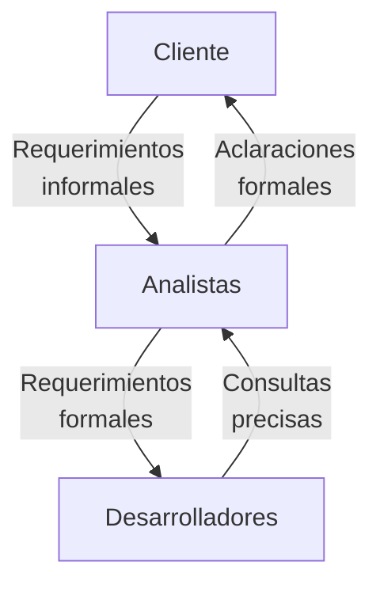
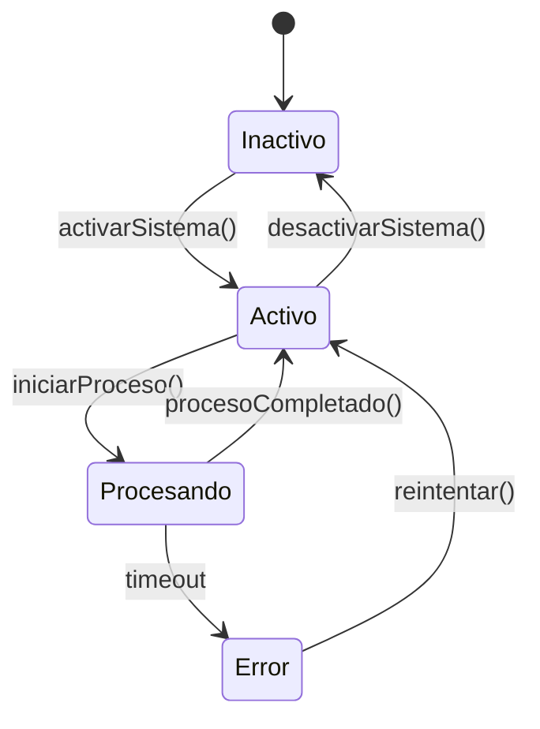

# Ingeniería de Software - Requerimientos y especificaciones

## 4.1 Beneficios de la formalización de requerimientos.

---

La **formalización de requerimientos** es el proceso de expresar las necesidades y restricciones de un sistema de software de manera precisa, no ambigua y completa, utilizando notaciones y lenguajes estructurados. Según Sommerville (2010), "los requerimientos formales son específicos, detallados y proporcionan una base sólida para el diseño del sistema".

### Definición de Requerimientos Formales

Los requerimientos formales se especifican utilizando notaciones matemáticas y lógicas que permiten una interpretación única. A diferencia de los requerimientos en lenguaje natural, que son propensos a ambigüedades, los requerimientos formales se expresan con precisión.

#### Elementos Clave

- **Precisión**: Cada requerimiento tiene un significado único y claro
- **Consistencia**: No existen conflictos entre requerimientos
- **Completitud**: Todos los aspectos relevantes están especificados
- **Verificabilidad**: Se puede comprobar objetivamente si se cumple

### Beneficios de la Formalización

#### 1. Reducción de Ambigüedades

La formalización elimina interpretaciones múltiples mediante el uso de notaciones matemáticas precisas. Por ejemplo, mientras un requerimiento informal podría decir "el sistema debe responder rápidamente", un requerimiento formal especificaría:

$$ \text{Tiempo de respuesta} \leq 200\text{ms} \quad \text{para} \quad 95\% \text{ de las peticiones} $$

#### 2. Capacidad de Verificación y Validación

Los requerimientos formales permiten verificación matemática y pruebas rigurosas. Se pueden aplicar técnicas como:

- **Verificación formal**: Demostración matemática de propiedades del sistema
- **Model checking**: Verificación automática de que un modelo satisface ciertas propiedades

#### 3. Facilitación del Análisis de Consistencia

Mediante lógica formal se pueden detectar inconsistencias:

$$ \forall x (P(x) \rightarrow Q(x)) \land \exists y (P(y) \land \neg Q(y)) \Rightarrow \text{Inconsistencia} $$

#### 4. Soporte para la Generación de Casos de Prueba

Los requerimientos formales permiten derivar casos de prueba completos mediante técnicas como:

- **Partición de equivalencia**
- **Análisis de valores límite**
- **Tablas de decisión**

#### 5. Mejor Comunicación entre Stakeholders

Los diagramas y modelos formales facilitan la comprensión compartida:



#### 6. Detección Temprana de Errores

El costo de corregir errores aumenta exponencialmente con el tiempo de detección:

$$
\text{Costo}_{\text{corrección}} = k \times e^{t} \quad \text{donde } t \text{ es el tiempo de detección}
$$

### Técnicas de Formalización

#### Notaciones Matemáticas

**Ejemplo de especificación formal con Z Notation**:

```latex
\begin{schema}{SistemaReservas}
    asientos: \mathbb{P} ASIENTO \\
    reservados: \mathbb{P} ASIENTO \\
    \where
    reservados \subseteq asientos \\
    \#reservados \leq \#asientos
\end{schema}
```

#### Diagramas Formales



#### Lógica Temporal para Especificaciones de Comportamiento

Para especificar propiedades temporales:

$$
\Box(\text{solicitarRecurso} \rightarrow \Diamond \text{recursoAsignado})
$$

"Siempre que se solicite un recurso, eventualmente será asignado"

### Ejemplo Práctico: Sistema de Control de Acceso

**Requerimiento informal**: "Solo usuarios autorizados pueden acceder al sistema después de autenticarse"

**Requerimiento formal**:

$$
\forall u \in \text{Usuarios}, \forall s \in \text{Sesiones} \\
(\text{autenticado}(u) \land \text{autorizado}(u) \land \text{sesiónActiva}(s,u)) \leftrightarrow \text{accesoPermitido}(u)
$$

### Ejercicios Propuestos

#### Ejercicio 1: Formalización de Requerimientos

Transforme el siguiente requerimiento informal a formal:
"El sistema debe garantizar que nunca dos usuarios tengan acceso simultáneo al mismo recurso crítico."

#### Ejercicio 2: Detección de Inconsistencias

Dados los siguientes requerimientos formales, identifique si existe inconsistencia:

1. $ \forall x (P(x) \rightarrow Q(x)) $
2. $ \exists y (P(y) \land \neg R(y)) $
3. $ \forall z (Q(z) \rightarrow R(z)) $

#### Ejercicio 3: Especificación con Lógica Temporal

Especifique formalmente: "Cada vez que ocurra una falla, el sistema debe intentar recuperarse automáticamente dentro de 5 segundos."

### Caso de Estudio: Sistema de Frenos Antibloqueo

**Requerimiento crítico formalizado**:

$$ \forall t \in \mathbb{T}, \forall rueda \in \text{Ruedas} \\\ (\text{velocidad}(rueda, t) = 0 \land \text{velocidad}(\text{vehículo}, t) > 0) \rightarrow \\\ \Box_{\leq 0.1s} \text{liberarFreno}(rueda) $$

"Si alguna rueda se bloquea (velocidad cero) mientras el vehicle se mueve, el freno debe liberarse en menos de 0.1 segundos"

### Limitaciones y Consideraciones

Aunque la formalización ofrece beneficios significativos, Pfleeger y Atlee (2010) advierten que "el costo de la formalización completa puede ser prohibitivo para algunos sistemas". Se debe encontrar un balance entre precisión y practicidad.

### Referencias

1. Sommerville, Ian. (2010). _Software Engineering_ (9th edition). Capítulo 10: "Formal Specification".
2. Pfleeger, S. L., & Atlee, J. M. (2010). _Software Engineering: Theory and Practice_. Sección 6.4: "Formal Methods".
3. Bowen, J. P., & Hinchey, M. G. (1995). _Ten Commandments of Formal Methods_. IEEE Computer.
4. Jackson, M. (1995). _Software Requirements & Specifications_. Addison-Wesley.

### Recursos Adicionales

- Herramientas para especificación formal: Z/EVES, Alloy, TLA+
- Tutoriales de lógica temporal para especificaciones de sistemas reactivos
- Casos de estudio de aplicaciones de métodos formales en industria crítica
