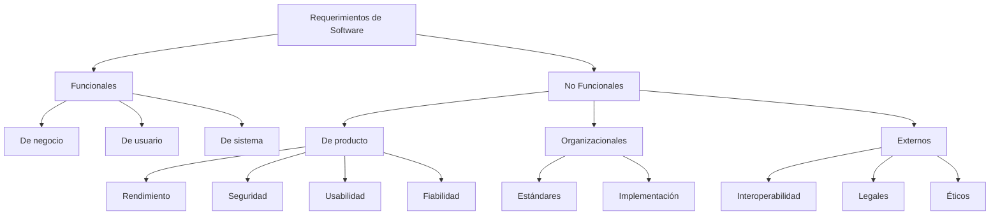

# Ingeniería de Software - Requerimientos y especificaciones

## 4.2 Clasificaciones de requerimientos.

---

Los requerimientos de software representan las necesidades de los stakeholders y las condiciones que el sistema debe cumplir. Según Sommerville (2010), "los requerimientos de software son una descripción de los servicios que el sistema debe proporcionar y las restricciones bajo las cuales debe operar". La clasificación adecuada de requerimientos es fundamental para su gestión efectiva.

### Definición de Requerimientos

Un requerimiento es una condición o capacidad que debe ser cumplida por un sistema para resolver un problema o alcanzar un objetivo (IEEE Std 610.12-1990). Matemáticamente, podemos representar el conjunto de requerimientos como:

$$
R = \{r_1, r_2, r_3, ..., r_n\}
$$

donde cada $r_i$ representa un requerimiento específico.

### Clasificación según el Nivel de Abstracción

#### Requerimientos de Negocio

Representan los objetivos de alto nivel de la organización.

**Ejemplo**: "El sistema debe aumentar la eficiencia del proceso de ventas en un 20%"

#### Requerimientos de Usuario

Describen las necesidades de los usuarios finales.

**Ejemplo**: "Como vendedor, quiero acceder rápidamente al historial de compras del cliente"

#### Requerimientos de Sistema

Especifican detalladamente el comportamiento del sistema.

**Ejemplo**: "El sistema debe validar el formato del email durante el registro"

### Clasificación según su Naturaleza

#### Requerimientos Funcionales (RF)

Describen qué debe hacer el sistema, sus funcionalidades y servicios.

$$
RF = \{f_1, f_2, f_3, ..., f_m\} \subseteq R
$$

**Características**:

- Especifican entradas, comportamientos y salidas
- Son directamente observables por el usuario
- Suelen comenzar con "El sistema debe..."

**Ejemplo**: "El sistema debe permitir a los usuarios recuperar su contraseña mediante verificación por email"

#### Requerimientos No Funcionales (RNF)

Describen cómo debe operar el sistema y sus atributos de calidad.

$$
RNF = \{q_1, q_2, q_3, ..., q_k\} \subseteq R
$$

**Características**:

- Definen propiedades del sistema (rendimiento, seguridad, etc.)
- Aplican restricciones a los requerimientos funcionales
- Son cruciales para la satisfacción del usuario

**Ejemplo**: "El sistema debe responder a las peticiones de búsqueda en menos de 2 segundos"

### Tipos de Requerimientos No Funcionales

#### Requerimientos de Producto

- **Rendimiento**: Tiempos de respuesta, throughput
- **Seguridad**: Niveles de acceso, encriptación
- **Usabilidad**: Facilidad de aprendizaje, eficiencia de uso
- **Fiabilidad**: Tasa de fallos, disponibilidad

#### Requerimientos Organizacionales

- **Estándares**: Normas de desarrollo, documentación
- **Implementación**: Lenguajes, herramientas, frameworks

#### Requerimientos Externos

- **Interoperabilidad**: Compatibilidad con otros sistemas
- **Legales**: Cumplimiento de regulaciones
- **Éticos**: Privacidad, accesibilidad

### Clasificación según su Estabilidad

#### Requerimientos Esenciales

Características fundamentales que no cambian durante el desarrollo.

#### Requerimientos Volátiles

Pueden cambiar durante el ciclo de vida del proyecto:

- **Requerimientos mutables**: Cambian por evolución del negocio
- **Requerimientos emergentes**: Surgen durante el desarrollo
- **Requerimientos consecuentes**: Resultado de la implementación de otros

### Modelo FURPS+

Una clasificación ampliamente utilizada propuesta por Robert Grady:

- **Functionality**: Capacidades del sistema
- **Usability**: Interfaces humanas y documentación
- **Reliability**: Frecuencia y severidad de fallos
- **Performance**: Eficiencia y tiempos de respuesta
- **Supportability**: Adaptabilidad, mantenibilidad
- **+**: Incluye restricciones de diseño, implementación, etc.

### Diagrama de Clasificación de Requerimientos



### Ejemplos de Especificación Formal

#### Requerimiento Funcional Formalizado

Para un sistema de reservas:

$$
\forall u \in Usuarios, \forall v \in Vuelos \\
(reservar(u, v) \rightarrow \exists! r \in Reservas (usuario(r) = u \land vuelo(r) = v))
$$

"Para todo usuario u y todo vuelo v, si u reserva v, entonces existe exactamente una reserva r asociada a u y v"

#### Requerimiento No Funcional Cuantitativo

Para el rendimiento:

$$
P(\text{tiempoRespuesta} \leq 200\text{ms}) \geq 0.95
$$

"La probabilidad de que el tiempo de respuesta sea menor o igual a 200ms debe ser al menos 0.95"

### Ejercicios Propuestos

#### Ejercicio 1: Clasificación de Requerimientos

Clasifique los siguientes requerimientos según las categorías estudiadas:

1. "El sistema debe permitir imprimir reportes en formato PDF"
2. "La aplicación debe estar disponible 99.9% del tiempo"
3. "El código debe seguir el estándar PEP8 para Python"
4. "Como administrador, quiero poder resetear contraseñas de usuarios"
5. "El sistema debe cumplir con el RGPD para protección de datos"

#### Ejercicio 2: Especificación Formal

Formalice el siguiente requerimiento: "Ningún usuario no autorizado puede acceder a datos confidenciales"

#### Ejercicio 3: Identificación de Conflictos

Identifique posibles conflictos entre estos requerimientos:

1. "El sistema debe implementar encriptación AES-256 para todas las comunicaciones"
2. "El tiempo de respuesta para cualquier operación no debe exceder 100ms"

### Caso de Estudio: Sistema de Comercio Electrónico

**Requerimientos funcionales**:

- RF1: El sistema debe permitir búsqueda de productos por categoría, nombre y marca
- RF2: Los usuarios deben poder agregar productos a un carrito de compras
- RF3: El sistema debe procesar pagos mediante tarjeta de crédito y PayPal

**Requerimientos no funcionales**:

- RNF1: El tiempo de carga de páginas debe ser ≤ 3 segundos (Rendimiento)
- RNF2: Todos los datos personales deben encriptarse (Seguridad)
- RNF3: La interfaz debe ser usable por personas con discapacidad visual (Usabilidad)

### Técnicas de Especificación

#### Plantilla para Requerimientos No Funcionales

```
ID: [Identificador único]
Tipo: [Rendimiento/Seguridad/Usabilidad/etc.]
Prioridad: [Alta/Media/Baja]
Descripción: [Descripción detallada]
Criterio de aceptación: [Condición verificable]
Método de verificación: [Prueba/Inspección/Demostración]
```

### Importancia de la Clasificación Adecuada

Una clasificación correcta de requerimientos permite:

- Priorizar el desarrollo efectivamente
- Asignar recursos adecuadamente
- Gestionar expectativas de stakeholders
- Diseñar estrategias de prueba apropiadas
- Gestionar cambios de manera controlada

### Referencias

1. Sommerville, Ian. (2010). _Software Engineering_ (9th edition). Capítulo 4: "Requirements Engineering".
2. Pfleeger, S. L., & Atlee, J. M. (2010). _Software Engineering: Theory and Practice_. Capítulo 3: "Requirements Engineering".
3. IEEE Std 830-1998: "Recommended Practice for Software Requirements Specifications"
4. Grady, R. B. (1992). _Practical Software Metrics for Project Management and Process Improvement_

### Recursos Adicionales

- Plantillas para documentación de requerimientos
- Herramientas de gestión de requerimientos: JIRA, IBM DOORS
- Técnicas de priorización: MoSCoW, método de valoración
- Técnicas de especificación: User stories, casos de uso, escenarios
