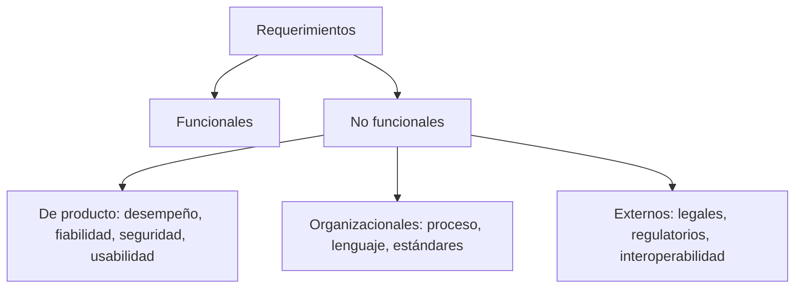

# Ingeniería de Software - Requerimientos y especificaciones

## 4.2 Clasificaciones de requerimientos.

---

Un **requerimiento** es una condición o capacidad que un sistema debe tener para satisfacer un contrato, una norma o una necesidad de sus interesados. No todos los requerimientos son del mismo tipo, y clasificarlos sirve para algo concreto: cada tipo se obtiene de fuentes distintas, se especifica con técnicas distintas y se verifica de forma distinta. Un requerimiento de disponibilidad no se prueba como una función, y uno legal no se negocia como una preferencia del usuario. Este tema presenta las clasificaciones principales, por nivel de abstracción, por naturaleza y por estabilidad, el modelo FURPS+ y la forma de detectar y resolver los conflictos entre requerimientos.

### Por nivel de abstracción

- **Requerimientos de negocio:** los objetivos de la organización que justifican el sistema, como reducir un 30 % el tiempo de atención a reclamaciones. Los establece la dirección.
- **Requerimientos de usuario:** lo que los usuarios necesitan poder hacer, en su lenguaje, con casos de uso o historias de usuario: "como ajustador, quiero registrar un siniestro desde el lugar del accidente".
- **Requerimientos del sistema:** la especificación detallada y precisa de lo que el sistema debe hacer, para quienes lo diseñan y lo prueban.

Cada nivel debe poder **rastrearse** al anterior (tema 4.7): un requerimiento del sistema que no sirve a ningún requerimiento de usuario sobra, y un objetivo de negocio que ningún requerimiento atiende no se cumplirá.

### Por naturaleza

- **Funcionales:** lo que el sistema hace, como sus servicios, cálculos, reacciones a entradas y comportamiento en situaciones particulares.
- **No funcionales:** las cualidades del sistema y las restricciones sobre su construcción. Sommerville los divide en:
  - **de producto**, que restringen el comportamiento del sistema: desempeño, fiabilidad, disponibilidad, seguridad, usabilidad, portabilidad;
  - **organizacionales**, que vienen de las políticas de la organización: lenguajes, estándares de código, procesos, plataformas;
  - **externos**, que vienen del entorno: leyes, regulaciones, normas éticas, interoperabilidad con otros sistemas.

Un requerimiento no funcional debe ser **medible**. "El sistema debe ser rápido" no lo es; "el percentil 95 del tiempo de respuesta de la búsqueda es de a lo más 2 segundos con 100 usuarios simultáneos" sí, y define la prueba que lo verifica. Los requerimientos no funcionales suelen ser más críticos que los funcionales: un sistema al que le falta una función puede usarse; uno que no cumple su requisito de seguridad o de disponibilidad, a menudo no.

### Por estabilidad

- **Estables** o esenciales: derivan de la naturaleza del dominio y cambian poco, como que un préstamo bancario tiene un capital, una tasa y un plazo.
- **Volátiles:** cambian con el entorno, la organización o la experiencia de uso, como las reglas de una promoción o los campos de un formulario. Conviene identificarlos para diseñar el sistema de modo que su cambio sea barato, por ejemplo con reglas configurables.

### FURPS+

El modelo FURPS de Grady, de Hewlett-Packard, clasifica los requerimientos en **funcionalidad**, **usabilidad**, **fiabilidad** (*reliability*), **desempeño** (*performance*) y **soporte**, es decir, mantenibilidad, configurabilidad y portabilidad. El "+" agrega restricciones de diseño, de implementación, de interfaz y físicas. Su uso práctico es como lista de verificación: al obtener requerimientos, recorrer cada categoría y preguntar qué se necesita en ella.



### Conflictos

Dos requerimientos están en **conflicto** si no pueden cumplirse a la vez, o si cumplir uno dificulta el otro. Los más frecuentes son entre cualidades: seguridad frente a usabilidad, desempeño frente a mantenibilidad, disponibilidad frente a costo. Detectarlos requiere cuantificar: un conflicto aparente a menudo desaparece cuando se ponen números, y uno real se resuelve negociando con los interesados qué ceder, con el costo de cada opción a la vista. Con requerimientos formalizados, un solucionador puede detectar algunos conflictos automáticamente, como en el tema 4.1.

### Implementación en Python

El programa resuelve el ejercicio 2 formalizando el requerimiento de confidencialidad con Z3 y comprobando contra él dos políticas de acceso: el solucionador busca un estado que viole el requerimiento y, en la política con un error, encuentra qué usuario accede a qué dato sin autorización. Para el ejercicio 3 calcula un presupuesto de latencia con cifrado para dos distancias y tres formas de establecer la conexión.

```python
from z3 import (Bool, BoolSort, Const, DeclareSort, EnumSort, ForAll, Function, Implies, And, Not, Or, Solver, sat)

# ---------- Ejercicio 2: el requerimiento de confidencialidad frente a una política de acceso ----------
Usuario, (ana, luis, eva) = EnumSort("Usuario", ["ana", "luis", "eva"])
Dato, (nomina, menu, expediente) = EnumSort("Dato", ["nomina", "menu", "expediente"])
Rol, (rrhh, empleado, auditor) = EnumSort("Rol", ["rrhh", "empleado", "auditor"])
confidencial = Function("confidencial", Dato, BoolSort())
autorizado = Function("autorizado", Usuario, Dato, BoolSort())
accede = Function("accede", Usuario, Dato, BoolSort())
tiene_rol = Function("tiene_rol", Usuario, Rol, BoolSort())
u, d, r = Const("u", Usuario), Const("d", Dato), Const("r", Rol)
REQ = ForAll([u, d], Implies(And(confidencial(d), Not(autorizado(u, d))), Not(accede(u, d))))
hechos = [confidencial(nomina), confidencial(expediente), Not(confidencial(menu)),
          tiene_rol(ana, rrhh), tiene_rol(luis, empleado), tiene_rol(eva, auditor),
          Not(tiene_rol(ana, empleado)), Not(tiene_rol(ana, auditor)), Not(tiene_rol(luis, rrhh)), Not(tiene_rol(luis, auditor)),
          Not(tiene_rol(eva, rrhh)), Not(tiene_rol(eva, empleado)),
          ForAll([u, d], autorizado(u, d) == Or(tiene_rol(u, rrhh), Not(confidencial(d))))]   # autorización formal
def politica(con_error):
    """Regla de la implementación: quién puede leer qué. La versión con error deja leer a los auditores todo."""
    reglas = Or(tiene_rol(u, rrhh), Not(confidencial(d)))
    if con_error: reglas = Or(reglas, tiene_rol(u, auditor))
    return ForAll([u, d], accede(u, d) == reglas)
for con_error in (False, True):
    s = Solver(); s.add(hechos + [politica(con_error), Not(REQ)])     # ¿existe un estado que viole el requerimiento?
    if s.check() == sat:
        m = s.model()
        viol = [(str(x), str(y)) for x in (ana, luis, eva) for y in (nomina, menu, expediente)
                if m.eval(And(confidencial(y), Not(autorizado(x, y)), accede(x, y)))]
        print(f"ejercicio 2: política {'con error' if con_error else 'correcta'}: viola el requerimiento en {viol}")
    else: print(f"ejercicio 2: política {'con error' if con_error else 'correcta'}: cumple el requerimiento (no existe contraejemplo)")

# ---------- Ejercicio 3: presupuesto de latencia con cifrado ----------
servidor, aes_gbps = 35, 2.0                             # ms de proceso y GB/s de AES-GCM con AES-NI (supuestos)
def latencia(rtt, carga_kb, rtt_extra):
    cifrado = carga_kb / 1024 / 1024 / aes_gbps * 1000 * 2      # cifrar y descifrar, en ms
    return rtt + servidor + cifrado + rtt_extra * rtt, cifrado
for rtt in (20, 60):                                     # misma región frente a otro continente
    for nombre, extra in (("TLS 1.3 nuevo, 1 RTT extra", 1), ("TLS 1.2 nuevo, 2 RTT extra", 2), ("conexión reutilizada", 0)):
        total, cif = latencia(rtt, 64, extra)
        print(f"ejercicio 3: RTT {rtt} ms, 64 KB, {nombre:27}: {total:6.2f} ms, cifrado {cif:.3f} ms → {'cumple' if total <= 100 else 'no cumple'} 100 ms")
print(f"   AES-GCM de 1 MB: {latencia(0, 1024, 0)[1]:.2f} ms de cifrado")
```

Salida:

```text
ejercicio 2: política correcta: cumple el requerimiento (no existe contraejemplo)
ejercicio 2: política con error: viola el requerimiento en [('eva', 'nomina'), ('eva', 'expediente')]
ejercicio 3: RTT 20 ms, 64 KB, TLS 1.3 nuevo, 1 RTT extra :  75.06 ms, cifrado 0.061 ms → cumple 100 ms
ejercicio 3: RTT 20 ms, 64 KB, TLS 1.2 nuevo, 2 RTT extra :  95.06 ms, cifrado 0.061 ms → cumple 100 ms
ejercicio 3: RTT 20 ms, 64 KB, conexión reutilizada       :  55.06 ms, cifrado 0.061 ms → cumple 100 ms
ejercicio 3: RTT 60 ms, 64 KB, TLS 1.3 nuevo, 1 RTT extra : 155.06 ms, cifrado 0.061 ms → no cumple 100 ms
ejercicio 3: RTT 60 ms, 64 KB, TLS 1.2 nuevo, 2 RTT extra : 215.06 ms, cifrado 0.061 ms → no cumple 100 ms
ejercicio 3: RTT 60 ms, 64 KB, conexión reutilizada       :  95.06 ms, cifrado 0.061 ms → cumple 100 ms
   AES-GCM de 1 MB: 0.98 ms de cifrado
```

### Ejercicios Propuestos

1. **Clasificación.** Clasifica estos requerimientos:

    1. "El sistema debe permitir imprimir reportes en formato PDF".
    2. "La aplicación debe estar disponible el 99.9 % del tiempo".
    3. "El código debe seguir el estándar PEP 8 de Python".
    4. "Como administrador, quiero poder restablecer las contraseñas de los usuarios".
    5. "El sistema debe cumplir con el RGPD para la protección de datos".

2. **Formalización.** Formaliza el requerimiento "ningún usuario no autorizado puede acceder a datos confidenciales".

3. **Conflictos.** Identifica los posibles conflictos entre "el sistema debe usar cifrado AES-256 en todas las comunicaciones" y "el tiempo de respuesta de cualquier operación no debe exceder 100 ms".

### Soluciones

**Ejercicio 1.**

| Requerimiento         | Naturaleza                          | Nivel             | FURPS+                   |
| --------------------- | ----------------------------------- | ----------------- | ------------------------ |
| Reportes en PDF       | Funcional                           | Sistema           | Funcionalidad            |
| Disponibilidad 99.9 % | No funcional de producto            | Sistema           | Fiabilidad               |
| PEP 8                 | No funcional organizacional         | Sistema           | Restricción de implementación |
| Restablecer contraseñas | Funcional                         | Usuario, como historia | Funcionalidad       |
| RGPD                  | No funcional externo, legal         | Negocio o sistema | Restricción              |

Dos observaciones. El requerimiento del RGPD no es verificable tal como está: el reglamento europeo tiene decenas de obligaciones, como el consentimiento, el derecho de acceso y de supresión, la notificación de brechas en 72 horas y la minimización de datos, y debe **descomponerse** en requerimientos concretos, funcionales y no funcionales. El de disponibilidad necesita precisar la ventana de medición y qué cuenta como "disponible": 99.9 % mensual permite unos 43 minutos de caída al mes.

**Ejercicio 2.** Sean los predicados $\mathit{conf}(d),$ que el dato $d$ es confidencial; $\mathit{aut}(u, d),$ que el usuario $u$ está autorizado para $d,$ y $\mathit{acc}(u, d),$ que $u$ accede a $d.$ El requerimiento es

$$\forall u\; \forall d\; \big(\mathit{conf}(d) \land \neg \mathit{aut}(u, d) \to \neg \mathit{acc}(u, d)\big).$$

La fórmula no dice nada hasta que se define $\mathit{aut}:$ en el programa, está autorizado quien tiene el rol de recursos humanos, o cualquiera si el dato no es confidencial. La utilidad de la formalización aparece al compararla con la **política de acceso** que implementa el sistema. Z3 busca un estado en el que la política permita lo que el requerimiento prohíbe. Con la política correcta no lo encuentra. Con una que, por un error de configuración, deja leer todo a los auditores, encuentra que Eva accede a la nómina y al expediente sin estar autorizada. La formalización también hace evidentes preguntas que el enunciado deja abiertas: si "acceder" incluye ver la existencia del dato o solo su contenido, y si el requerimiento debe valer también para los administradores del sistema.

**Ejercicio 3.** El conflicto es en su mayor parte **aparente**. AES con las instrucciones AES-NI de los procesadores actuales cifra a varios GB por segundo; con 2 GB/s supuestos, cifrar y descifrar 64 KB cuesta 0.06 ms, y 1 MB menos de 1 ms. Lo que puede costar es el **establecimiento de la conexión segura**: un saludo de TLS 1.3 agrega una ida y vuelta de red, y uno de TLS 1.2, dos, sin contar el saludo TCP. Con 20 ms de ida y vuelta y 35 ms de proceso, todas las variantes cumplen los 100 ms; a 60 ms, una conexión nueva no cumple, y una reutilizada sí, por poco. Las resoluciones son técnicas, no un relajamiento de la seguridad: reutilizar conexiones, TLS 1.3 con reanudación, servidores cercanos a los usuarios, y precisar el requerimiento de tiempo, porque "cualquier operación" en 100 ms es probablemente excesivo para un reporte e insuficiente como especificación, que debería dar un percentil, una carga y el punto de medición.

### Referencias

1. Sommerville, I., _Software Engineering_. Pearson, 2016. Capítulo 4.
2. Wiegers, K., and Beatty, J., _Software Requirements_. Microsoft Press, 2013.
3. Grady, R. B., _Practical Software Metrics for Project Management and Process Improvement_. Prentice Hall, 1992.
4. ISO/IEC/IEEE 29148:2018, _Systems and software engineering: Life cycle processes, Requirements engineering_.
5. Reglamento (UE) 2016/679 del Parlamento Europeo y del Consejo, Reglamento General de Protección de Datos.
6. Rescorla, E., RFC 8446: The Transport Layer Security (TLS) Protocol Version 1.3. IETF, 2018.
