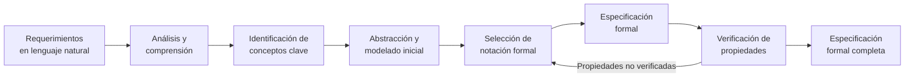
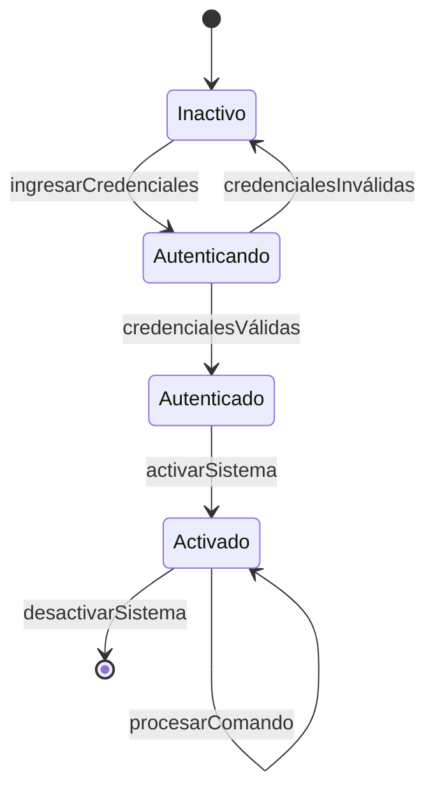

# Ingeniería de Software - Requerimientos y especificaciones

## 4.3 Proceso de formalización de requerimientos.

---

El proceso de formalización de requerimientos transforma necesidades expresadas en lenguaje natural en especificaciones precisas, no ambiguas y matemáticamente rigurosas. Según Sommerville (2010), "la especificación formal es el proceso de representar un sistema de software de manera precisa y no ambigua utilizando notaciones matemáticas".

### Definición y Objetivos

La **formalización de requerimientos** es el proceso sistemático de convertir descripciones informales en especificaciones formales mediante notaciones matemáticas. Sus objetivos principales son:

- Eliminar ambigüedades y inconsistencias
- Permitir verificación y validación rigurosa
- Facilitar la derivación de implementaciones correctas
- Posibilitar el razonamiento formal sobre el sistema

### Etapas del Proceso de Formalización



### Técnicas y Notaciones Formales

#### Lógica de Predicados

Para especificar propiedades estáticas e invariantes:

$$
\forall u \in Usuarios, \forall d \in DatosSensibles \\
(accede(u, d) \rightarrow autenticado(u) \land autorizado(u, d))
$$

#### Lógica Temporal

Para especificar comportamientos dinámicos y temporales:

$$
\Box(\text{solicitarRecurso} \rightarrow \Diamond_{\leq 5s} \text{recursoAsignado})
$$

"Siempre que se solicite un recurso, eventualmente se asignará en menos de 5 segundos"

#### Notación Z (Z Notation)

Esquema para un sistema de reservas:

```latex
\begin{schema}{SistemaReservas}
    reservas: \mathbb{P} RESERVA \\
    capacidad: \mathbb{N} \\
    \where
    \forall r: reservas \bullet r.valida() \\
    \#reservas \leq capacidad
\end{schema}
```

#### Máquinas de Estado Finito



### Proceso Detallado de Formalización

#### 1. Análisis y Comprensión

Identificar los elementos clave del requerimiento informal:

- Entidades y sus atributos
- Operaciones y comportamientos
- Restricciones y condiciones
- Propiedades temporales

**Ejemplo**: Para "El sistema debe permitir solo acceso autorizado":

- Entidades: Usuarios, Recursos, Permisos
- Operaciones: Autenticar, Autorizar, Acceder
- Restricciones: Credenciales válidas, Permisos adecuados

#### 2. Identificación de Conceptos Matemáticos

Mapear conceptos del dominio a constructos matemáticos:

| Concepto Domínio     | Constructo Matemático              |
| -------------------- | ---------------------------------- |
| Conjunto de usuarios | $\mathbb{P} Usuario$               |
| Relación de permisos | $Usuario \leftrightarrow Recurso$  |
| Estado del sistema   | Variables de estado + invariantes  |
| Transiciones         | Funciones/Relaciones entre estados |

#### 3. Especificación de Invariantes

Propiedades que siempre deben cumplirse:

$$
\forall s: Sistema \bullet s.invariante()
$$

Donde $invariante()$ podría ser:

$$
\forall u: UsuariosConectados \bullet u.autenticado = verdadero
$$

#### 4. Especificación de Operaciones

**Precondiciones**: Condiciones necesarias para ejecutar una operación:

$$
pre\_retirar(c: Cuenta, m: Monto) \equiv c.saldo \geq m
$$

**Postcondiciones**: Resultado después de ejecutar la operación:

$$
post\_retirar(c: Cuenta, m: Monto) \equiv c.saldo = c.saldo@pre - m
$$

#### 5. Especificación de Propiedades Temporales

Usando lógica temporal CTL (Computational Tree Logic):

$$
AG(\text{error} \rightarrow AF_{\leq 1min} \text{notificarAdministrador})
$$

"Si ocurre un error, siempre eventualmente se notificará al administrador en menos de 1 minuto"

### Ejemplo Completo: Sistema de Autenticación

#### Requerimiento Informal

"El sistema debe permitir máximo 3 intentos de autenticación fallidos antes de bloquear la cuenta por 30 minutos"

#### Especificación Formal

**Estados y variables**:

$$
\begin{align*}
\text{intentosFallidos} &: \mathbb{N} \\
\text{cuentaBloqueada} &: \mathbb{B} \\
\text{tiempoBloqueo} &: \mathbb{T}
\end{align*}
$$

**Invariante**:

$$
\text{intentosFallidos} \leq 3 \land (\text{cuentaBloqueada} \leftrightarrow \text{intentosFallidos} = 3)
$$

**Operación de autenticación**:

```latex
\begin{schema}{Autenticar}
    \Delta EstadoSistema \\
    usuario?: Usuario \\
    contraseña?: Contraseña \\
    resultado!: ResultadoAuth \\
    \where
    \lnot cuentaBloqueada \\
    (usuarioVálido(usuario?) \land contraseñaCorrecta(usuario?, contraseña?)) \\
    \Rightarrow \\
    resultado! = ÉXITO \land intentosFallidos' = 0 \\
    \lor \\
    resultado! = FALLO \land intentosFallidos' = intentosFallidos + 1 \\
    \land (intentosFallidos' = 3 \Rightarrow cuentaBloqueada' = verdadero \\
    \land tiempoBloqueo' = tiempoActual + 30min)
\end{schema}
```

### Ventajas y Desventajas

#### Ventajas

- Precisión y ausencia de ambigüedades
- Capacidad de verificación formal
- Detección temprana de errores
- Documentación completa y consistente

#### Desventajas

- Curva de aprendizaje pronunciada
- Mayor tiempo y esfuerzo inicial
- Dificultad para stakeholders no técnicos
- Posible sobre-especificación

### Ejercicios Propuestos

#### Ejercicio 1: Formalización de Requerimientos

Formalice el siguiente requerimiento: "El sistema de elevadores debe garantizar que nunca dos elevadores se encuentren en el mismo piso simultáneamente"

#### Ejercicio 2: Especificación con Lógica Temporal

Especifique formalmente: "Cada mensaje enviado debe ser recibido dentro de 500ms, a menos que la conexión falle"

#### Ejercicio 3: Identificación de Invariantes

Para un sistema de transacciones bancarias, identifique y formalice al menos tres invariantes.

#### Ejercicio 4: Completar Especificación

Complete la especificación formal para una operación de transferencia bancaria:

```latex
\begin{schema}{Transferir}
    \Delta SistemaBancario \\
    origen?: Cuenta \\
    destino?: Cuenta \\
    monto?: Monto \\
    resultado!: Resultado \\
    \where
    /* Completar precondiciones */
    \hline
    /* Completar postcondiciones */
\end{schema}
```

### Técnicas de Verificación

#### Model Checking

Verificación automática de propiedades en modelos finitos:

$$
\mathcal{M} \models \varphi
$$

Donde $\mathcal{M}$ es el modelo del sistema y $\varphi$ es la propiedad a verificar.

#### Theorem Proving

Demostración deductiva de propiedades usando lógica formal:

$$
\Gamma \vdash \varphi
$$

Donde $\Gamma$ son los axiomas del sistema y $\varphi$ es el teorema a demostrar.

### Herramientas de Soporte

- **Z/EVES**: Para especificación y verificación en Z Notation
- **TLA+**: Para especificación de sistemas concurrentes
- **Alloy**: Para análisis de modelos software
- **SPIN**: Para verificación de modelos de procesos

### Caso de Estudio: Sistema de Control de Vuelo

**Requerimiento crítico**: "El sistema de piloto automático debe mantener la altitud dentro de ±10 pies de la altitud objetivo"

**Especificación formal**:

$$
\Box(|altitudActual - altitudObjetivo| \leq 10 \text{ pies})
$$

**Con restricción temporal**:

$$
\Box(\text{perturbación} \rightarrow \Diamond_{\leq 2s} |altitudActual - altitudObjetivo| \leq 10 \text{ pies})
$$

### Mejores Prácticas

1. **Iteración incremental**: Formalizar gradualmente, refinando progresivamente
2. **Validación con stakeholders**: Usar ejemplos y scenarios para validar comprensión
3. **Manejo de complejidad**: Dividir el sistema en componentes manejables
4. **Documentación complementaria**: Mantener descripciones informales junto a las formales
5. **Revisión por pares**: Verificar corrección y completitud de las especificaciones

### Referencias

1. Sommerville, Ian. (2010). _Software Engineering_ (9th edition). Capítulo 10: "Formal Specification".
2. Pfleeger, S. L., & Atlee, J. M. (2010). _Software Engineering: Theory and Practice_. Capítulo 11: "Formal Methods".
3. Bowen, J. P. (1996). _Formal Specification and Documentation using Z: A Case Study Approach_.
4. Abrial, J. R. (1996). _The B-Book: Assigning Programs to Meanings_.
5. Lamport, L. (2002). _Specifying Systems: The TLA+ Language and Tools for Hardware and Software Engineers_.

### Recursos Adicionales

- Tutoriales de Z Notation y B Method
- Herramientas de model checking: NuSMV, UPPAAL
- Frameworks para verificación formal: Isabelle/HOL, Coq
- Casos de estudio de aplicaciones industriales de métodos formales
